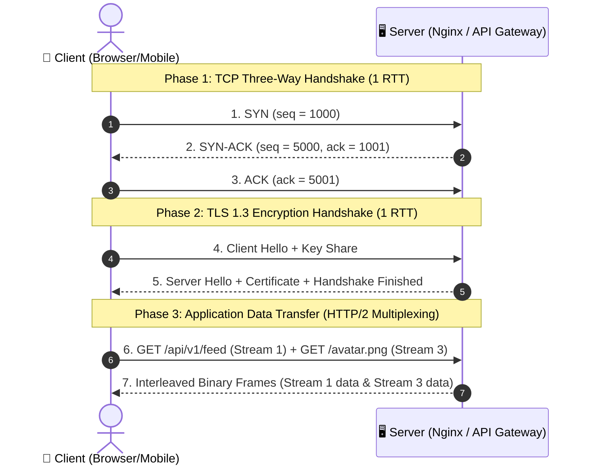
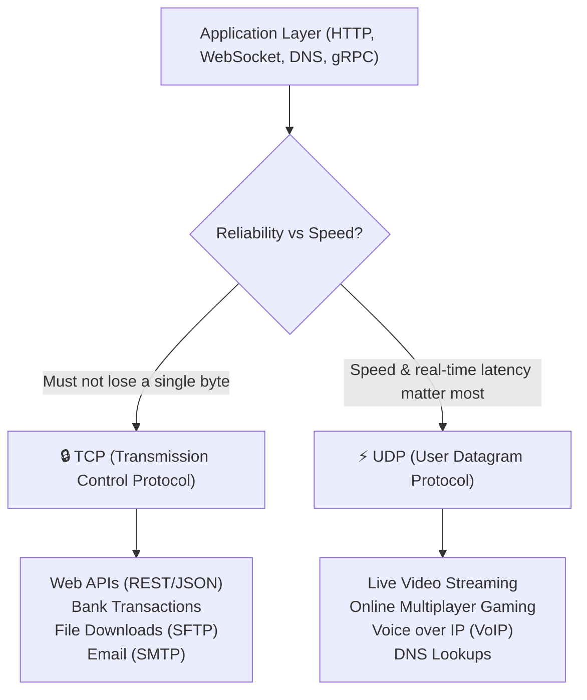

# 01 · Client–Server Networking

> **Part 1 · Networking & traffic** · ⏱️ ~20 min read · Prerequisites: None (Foundational)

---

> 🏢 **Real-world case studies**: how **Google** & **Netflix** approach this, in [REAL_WORLD_EXAMPLES.md](./REAL_WORLD_EXAMPLES.md).

## 🧒 The 30-second version

Every digital product is a conversation between two computers: a **client** (your phone or browser) asking for something, and a **server** (a computer in a datacenter) answering. Before they can speak English or JSON, they must agree on a set of rules called **protocols**. 

- **TCP** is like a certified courier who demands a signature for every package—if a box falls off the truck, they stop everything and redeliver it.
- **UDP** is like a live radio broadcast—it sprays sound into the air as fast as possible; if you miss two syllables of music, it doesn't rewind the station.
- **HTTP/1.1, HTTP/2, and HTTP/3** are the languages clients and servers use on top of those couriers to send web pages, videos, and API data.

## First pass

**Trail Notes** is a fictional website where people read hiking guides. Imagine opening `https://trailnotes.example/guide` and follow one request. For this lesson, assume the browser already knows the server's address.

~~~mermaid
sequenceDiagram
    participant B as Browser
    participant S as Trail Notes server
    B->>S: Establish a secure connection if needed
    B->>S: GET /guide
    S-->>B: 200 OK and the guide HTML
~~~

1. The browser is the **client**. It sends the request over a secure connection.
2. The **server** reads the path `/guide` and sends a response. Status `200 OK` indicates success, and the response body contains the HTML.
3. The browser renders the HTML. It may ask for styles or images in additional requests, using the same connection when possible.

**Predict.** An established connection has a 50 ms round-trip time. The server takes 20 ms to produce a small response. What is the estimated time from sending the request to receiving the response? What might a new connection add?

<details>
<summary>Reveal the answer</summary>

About **70 ms** in this model. The outbound request and inbound response use one network round trip, and server work adds another 20 ms. This estimate omits payload transfer time and browser rendering. A new HTTPS connection can add connection and encryption setup. How much it adds depends on the protocol and whether an earlier session can be resumed.

</details>

Use the existing [Python simulator](#run-the-demo) to compare connection setup and request patterns. In the [flashcards](https://aniketchavan7.github.io/system-design-illustrated/flashcards.html), search for **Client–Server Networking** and explain how you estimated 70 ms.

**Next lesson** · [Find the website's address with DNS](../02-domain-name-system/#first-pass)

---

## Technical reference

Explore TCP and UDP, HTTP versions, loss and multiplexing, streaming protocols, and interview questions.

## 🍕 Everyday analogy: The Postal Letter vs The Live Phone Call

Imagine you want to order dinner from a restaurant:

- **HTTP/1.1 (Postal Mail):** You write a paper letter: *"Please send 1 pizza."* You wait 2 days for the pizza and receipt. Then you write another letter: *"Please send 1 soda."* You wait another 2 days. If letter #1 is delayed in the snow, letter #2 cannot even be read (**Head-of-Line Blocking**).
- **WebSockets (Dedicated Phone Call):** You call the restaurant and leave the line open. You can speak whenever you want; the chef can shout *"Your order is in the oven!"* whenever they want. Neither of you has to dial the phone again.
- **HTTP/3 QUIC (Independent Courier Drones):** Instead of one mail truck carrying all boxes in single file down a narrow road, each dish is delivered by its own independent drone over UDP. If drone #2 gets lost in a storm, drone #1 and drone #3 still land on your table without waiting.

| In everyday life | In network architecture |
| :--- | :--- |
| **Phone number / House address** | **IP Address** (`142.250.190.46`) |
| **Specific apartment door number** | **Port number** (Port `80` for HTTP, Port `443` for HTTPS) |
| **Handshake / "Hello, can you hear me?"** | **TCP 3-Way Handshake** (`SYN` $\to$ `SYN-ACK` $\to$ `ACK`) |
| **Speaking in English or Spanish** | **Application Protocol** (HTTP, WebSocket, gRPC) |
| **A lost letter resent by post office** | **TCP Packet Retransmission** |
| **A live radio speaker ignoring static** | **UDP Datagram Stream** (VoIP, live gaming) |

---

## 🧩 The problem it solves

When you click a link on your phone in New York to fetch data from a server in London:
1. Physical light in glass fiber travels at $\approx 200,000\text{ km/s}$.
2. The physical distance round-trip is $\approx 11,000\text{ km}$.
3. That means **one network Round-Trip Time (RTT)** takes roughly **$70\text{ ms}$** just for the physics of light transit, plus router queue delays.

If every API request had to open a brand-new connection, perform a 3-way handshake (1 RTT), negotiate TLS encryption keys (1 to 2 RTTs), and wait for sequential responses, a single web page needing 80 assets (images, fonts, scripts) would take **over 10 seconds to load**.

Modern networking protocols solve this by **reusing connections**, **multiplexing hundreds of streams over a single pipe**, and **eliminating round-trips**.

---

## 🖼️ Picture it

<p align="center">
  
</p>



1. **Step 1 (SYN):** Client chooses an Initial Sequence Number (`seq=1000`) and asks to connect.
2. **Step 2 (SYN-ACK):** Server reserves buffer memory, acknowledges the client (`ack=1001`), and sends its own sequence number (`seq=5000`).
3. **Step 3 (ACK):** Client confirms receipt (`ack=5001`). Both sides now have open sockets in the `ESTABLISHED` state.
4. **Step 4–5 (TLS 1.3):** Cryptographic keys are exchanged using Elliptic-Curve Diffie-Hellman in just **1 single RTT**.
5. **Step 6–7 (HTTP/2 Data):** Multiple independent requests travel concurrently over the exact same socket without waiting for one another.

---

## 🔢 Worked estimate · Four page assets

Suppose your mobile app needs to fetch **4 items** to display a user profile:
- `profile.json` (2 KB)
- `avatar.jpg` (20 KB)
- `theme.css` (5 KB)
- `analytics.js` (50 KB)

This is a simplified comparison of request patterns. The TCP rows omit TLS setup and payload transfer time. The HTTP/3 row assumes a previously established session can resume with accepted early data. Assume network **$\text{RTT} = 50\text{ ms}$**, and server computation takes **$20\text{ ms}$** per asset.

| Protocol | Connections Opened | How requests travel | Total Elapsed Time | Why? |
| :--- | :---: | :--- | :---: | :--- |
| **HTTP/1.0** (Naive) | 4 separate | 1 after another, new TCP handshake each time | **$560\text{ ms}$** | 4 handshakes ($4 \times 50\text{ms}$) + 4 fetches ($4 \times 70\text{ms}$) |
| **HTTP/1.1** (Keep-Alive) | 1 persistent | Serial queue on one socket (Head-of-Line blocking) | **$330\text{ ms}$** | 1 handshake ($50\text{ms}$) + 4 serial requests in sequence ($4 \times 70\text{ms}$) |
| **HTTP/2** (Multiplexed) | 1 persistent | All 4 sent concurrently as binary streams | **$120\text{ ms}$** | 1 handshake ($50\text{ms}$) + parallel transfer bounded by slowest asset ($70\text{ms}$) |
| **HTTP/3** (QUIC 0-RTT) | 1 UDP session | Instant resumption + independent stream frames | **$70\text{ ms}$** | Zero connection handshake penalty + parallel stream delivery |

> 💡 **Takeaway:** Moving from HTTP/1.1 to HTTP/2 cut latency by **$64\%$** without changing a single line of backend database code!

---

## ⚙️ How it works: The Core Protocols

### 1. TCP vs UDP (The Transport Layer)



- **TCP guarantees:**
  - **Zero data loss:** Lost packets are automatically retransmitted.
  - **In-order delivery:** Packets arriving out of order are reassembled using sequence numbers.
  - **Congestion control:** Slows down transmission speed if routers on the path are dropping packets.
- **UDP guarantees:**
  - **Minimal latency:** No connection setup handshake, no acknowledgments, no retransmission delays.
  - An 8-byte header compared to TCP's 20-to-60-byte header.

---

### 2. The Evolution of HTTP

#### HTTP/1.1: Persistent Connections
- Introduced `Connection: keep-alive` so multiple requests could reuse the same TCP socket.
- **The Fatal Flaw (Head-of-Line Blocking):** Requests on a single socket must be answered in strict FIFO order. If request #1 is an expensive SQL query taking 3 seconds, requests #2, #3, and #4 are stuck waiting in line behind it.
- **The Hack:** Browsers opened 6 parallel TCP connections per domain, which saturated client CPU and router buffers.

#### HTTP/2: Binary Framing & Multiplexing
- Replaced plain-text strings with **binary frames**.
- Introduced **Multiplexing**: Requests and responses are chopped into small numbered frames with a `Stream ID`. Frames from stream 1, 3, and 5 interleave freely over a single TCP connection.
- Introduced **HPACK Header Compression**: Removes repeated redundant headers (like cookies and User-Agent) on every request.

#### HTTP/3: QUIC over UDP
- Why HTTP/2 was not enough: HTTP/2 solves application-layer Head-of-Line blocking, but TCP itself still has transport Head-of-Line blocking. If a single TCP packet drops on Wi-Fi, the OS pauses **all** HTTP/2 streams until that lost packet is resent.
- HTTP/3 replaces TCP with **QUIC (running over UDP)**.
- QUIC orders data per stream. Missing bytes on one stream do not stop delivery of available bytes on another stream, though shared congestion control can slow the connection as a whole.
- **Connection Migration:** If your phone switches from home Wi-Fi to cellular 5G, the IP address changes. TCP connections break and must reconnect from scratch. QUIC uses a 64-bit Connection ID, so streams continue seamlessly without dropping!

---

### 3. Persistent Real-Time: WebSockets vs SSE vs Long Polling

When a server needs to push live data to the client (like a chat message or stock price update):

| Technique | Direction | Connection Type | Protocol | Best Used For |
| :--- | :---: | :---: | :---: | :--- |
| **Short Polling** | Client $\to$ Server | Ephemeral HTTP | HTTP | Obsolete; wastes massive bandwidth |
| **Long Polling** | Client $\to$ Server | Stalls HTTP response | HTTP | Legacy fallbacks when WebSockets are blocked |
| **Server-Sent Events (SSE)** | Server $\to$ Client (One-Way) | Persistent streaming | HTTP | Live stock tickers, AI text streaming (ChatGPT) |
| **WebSockets** | Full Duplex (Both Ways) | Persistent open TCP | `ws://` / `wss://` | Real-time chat, multiplayer games, collaborative docs |

---

### 4. gRPC & Protocol Buffers (Internal Microservices)

While public internet clients use HTTP/JSON REST APIs because every browser supports JSON, internal backend microservices within a datacenter use **gRPC**:
- **Protocol Buffers (Protobuf):** Serializes typed data into compact binary bytes instead of verbose text strings (`{"user_id": 10293}` is 22 bytes in JSON, but only 4 bytes in Protobuf).
- Runs on top of **HTTP/2**: Reuses single TCP connections between services, supports bidirectional streaming, and generates typed client code in Go, Java, Python, and Rust.
- **Result:** $5\times$ to $10\times$ faster throughput and significantly lower CPU utilization across microservice fleets.

---

## ⚖️ Trade-offs & Decision Matrix

| Requirement | Recommended Protocol | Why? | Avoid |
| :--- | :--- | :--- | :--- |
| **Public web or mobile app API** | **HTTPS (HTTP/2 or HTTP/3) + JSON** | Universal browser compatibility, firewall-friendly, standard caching | UDP (blocked by firewalls), Raw TCP |
| **High-throughput internal microservices** | **gRPC over HTTP/2** | Binary compression, strict contract schemas, high RPC speed | REST/JSON (unnecessary text serialization overhead) |
| **Live chat or multiplayer game actions** | **WebSockets (`wss://`)** | Bi-directional, 2-byte frame overhead, sub-millisecond response | HTTP Polling (kills server with empty requests) |
| **Live server-to-client notifications or LLM streaming** | **Server-Sent Events (SSE)** | Simpler than WebSockets, automatic reconnection, standard HTTP | WebSockets (overkill when client never sends data back) |
| **Real-time video/voice call (WebRTC)** | **SRTP over UDP** | Late packets are useless; packet loss is preferred over buffering | TCP (retransmissions cause stutter and voice delay) |

---

## 🚫 Common mistakes & production pitfalls

1. **Opening a new TCP/HTTP connection for every single backend request:**
   - *Why it hurts:* Burns CPU on TLS handshakes and exhausts available ephemeral ports (`TIME_WAIT` socket exhaustion).
   - *Fix:* Always configure **Connection Pooling** with keep-alive timeouts in HTTP clients (e.g., `requests.Session()` in Python, `http.Client` in Go).

2. **Using WebSockets when Server-Sent Events (SSE) is enough:**
   - *Why it hurts:* WebSockets bypass standard HTTP proxy caches, require custom heartbeat/ping-pong servers, and need custom load balancing sticky sessions.
   - *Fix:* If data only flows from server to user (like live scores or LLM generation), use SSE over standard HTTP/2.

3. **Assuming UDP is always faster than TCP:**
   - *Why it hurts:* If your application requires reliability and you attempt to rebuild retransmission, acking, and windowing in user-space code on top of UDP without hardware offloading, it is often slower and buggier than the kernel's optimized TCP stack.

4. **Ignoring TCP SYN Flood vulnerabilities:**
   - *Why it hurts:* Attackers send millions of spoofed SYN packets without sending the final ACK. The server's backlog queue fills with half-open connections and crashes.
   - *Fix:* Enable **SYN Cookies** in the Linux kernel (`sysctl -w net.ipv4.tcp_syncookies=1`).

---

## Run the demo

Run the interactive simulator in this folder:

```bash
cd 01-client-server-networking
python demo.py
```

### What to explore in `demo.py`:
1. The demo counts three one-way legs until the server receives the final ACK. The client can normally send its first data with that ACK after one RTT. Separate TLS setup can add time.
2. Watch how HTTP/1.1 serial queueing creates **Head-of-Line blocking**, forcing the total page load time to equal the sum of all individual latencies.
3. Contrast with the HTTP/2 multiplexing test, which models concurrent requests with elapsed time bounded by the slowest asset under the demo's assumptions.

---

## 🌍 Where you'll see it in production

- **Google** documented an early QUIC deployment for HTTPS traffic in a 2017 research paper. [Google's QUIC deployment paper](https://research.google/pubs/the-quic-transport-protocol-design-and-internet-scale-deployment/)
- **Netflix** documents how Zuul 2 proxies client requests to upstream services. [Netflix's Zuul 2 architecture](https://github.com/Netflix/zuul/wiki/How-It-Works-2.0)

---

## 🎯 Top Interview Questions & Deep Answers

### Q1: "Walk me through step-by-step what happens when you type `https://example.com` into your browser and press Enter."

<details>
<summary>💡 Click to reveal the ideal senior engineering answer</summary>

A comprehensive answer spans **DNS $\to$ TCP $\to$ TLS $\to$ HTTP $\to$ Rendering**:

1. **URL Parsing & HSTS:** The browser parses the protocol (`https`) and domain (`example.com`). It checks its preloaded HSTS list to enforce HTTPS.
2. **DNS Resolution:** Checks browser cache $\to$ OS cache $\to$ `/etc/hosts` $\to$ queries recursive DNS resolver (UDP port 53). The resolver walks Root $\to$ TLD (`.com`) $\to$ Authoritative DNS to return the server's IP (e.g. `93.184.216.34`).
3. **TCP 3-Way Handshake:** Browser initiates TCP connection on port 443 by sending `SYN`. Server replies with `SYN-ACK`. Browser returns `ACK`. (Cost: 1 RTT).
4. **TLS 1.3 Handshake:** Browser sends `ClientHello` with supported cipher suites and key share. Server returns `ServerHello`, certificate, and cryptographic verification. Shared symmetric session keys are established. (Cost: 1 RTT).
5. **HTTP Request & Multiplexing:** Browser transmits an encrypted `GET / HTTP/2` request with headers.
6. **Server Processing & Routing:** The request hits a reverse proxy / load balancer (e.g., Nginx), terminates TLS, forwards to application services, queries databases/caches, and streams back an `HTTP 200 OK` HTML payload.
7. **Browser DOM Construction & Critical Path:** Browser parses HTML, builds the DOM tree, encounters linked CSS/JS assets, and streams them concurrently over the same multiplexed HTTP/2 socket before rendering pixels to screen.

</details>

---

### Q2: "What is TCP Head-of-Line (HoL) blocking, and why did HTTP/2 fail to solve it?"

<details>
<summary>💡 Click to reveal the ideal senior engineering answer</summary>

- **Application-Layer HoL Blocking (HTTP/1.1):** In HTTP/1.1, only one request could be active on a TCP socket at a time. HTTP/2 solved this by multiplexing binary frames with stream IDs.
- **Transport-Layer HoL Blocking (TCP):** TCP is an abstraction of a single continuous stream of ordered bytes. If packet #3 of Stream B is dropped by a router on Wi-Fi, the operating system's TCP receive buffer **refuses to deliver packets #4, #5, and #6 to the application**—even if those subsequent packets belong to a completely unrelated Stream A!
- **Why it matters:** On lossy links, a missing range of TCP bytes can delay every HTTP/2 stream on that connection. The relative performance of one multiplexed connection and several independent connections depends on the workload and network.
- **The Solution:** HTTP/3 abandoned TCP entirely for **QUIC (over UDP)**. In QUIC, each stream has its own independent sequencing and loss-recovery queue. Missing data on Stream B does not impose ordered delivery on Stream A. Shared congestion control still affects the connection.

</details>

---

### Q3: "When would you choose WebSockets over Server-Sent Events (SSE) or HTTP Long Polling?"

<details>
<summary>💡 Click to reveal the ideal senior engineering answer</summary>

- **Pick Server-Sent Events (SSE) when:**
  - Communication is **unidirectional** (server-to-client only), such as live stock tickers, system monitoring alerts, or LLM token streaming.
  - You want automatic reconnection, event IDs, and compatibility with standard HTTP/2 multiplexing, corporate proxies, and firewalls without custom protocol handling.
- **Pick WebSockets when:**
  - Communication is **bidirectional and low latency** (both client and server send frequent messages), such as real-time multiplayer gaming, interactive whiteboards, or chat applications.
  - You need to send high-frequency small binary frames where the 2-byte WebSocket header overhead is dramatically smaller than repeating HTTP headers.

</details>

---

### Q4: "How does gRPC achieve dramatically higher throughput than traditional REST over JSON?"

<details>
<summary>💡 Click to reveal the ideal senior engineering answer</summary>

gRPC wins across three distinct technical dimensions:
1. **Binary Serialization (Protobuf vs JSON):** JSON is human-readable text that requires expensive CPU string parsing, delimiter scanning, and field name repetition. Protobuf compiles to fixed-offset binary tags with varint encoding, reducing payload sizes by $60\text{–}80\%$ and CPU serialization time by up to $10\times$.
2. **Transport Multiplexing (HTTP/2):** gRPC natively runs over HTTP/2, allowing dozens of concurrent RPC calls to interleave over a single long-lived TCP connection, eliminating connection handshake latency.
3. **Strict Code Contracts:** Protobuf `.proto` schemas generate typed client stubs at compile time, eliminating runtime type checking, schema drift, and boilerplate validation logic.

</details>

---

## ✅ Check yourself

1. **A user's phone moves from home Wi-Fi to cellular 5G while playing a live game. Under standard TCP, what happens to the connection? What happens under HTTP/3 QUIC?**

<details>
<summary>View Answer</summary>

Under TCP, the connection is bound to a 4-tuple: `(Source IP, Source Port, Dest IP, Dest Port)`. Switching networks changes the phone's Source IP, which immediately breaks the TCP socket. The app must time out and re-establish a brand-new TCP and TLS handshake.  
Under QUIC (HTTP/3), connections are identified by a persistent 64-bit **Connection ID** independent of IP address. The phone simply transmits the next UDP packet with the same Connection ID from its new cellular IP, and data transfer continues without interruption (**Connection Migration**).

</details>

---

2. **Why does the TCP handshake take 3 steps (SYN, SYN-ACK, ACK) instead of just 2 steps (SYN, ACK)?**

<details>
<summary>View Answer</summary>

Because network links are two-way (full-duplex) and unreliable. Both sides must independently choose, transmit, and have their Initial Sequence Number (ISN) acknowledged:
- Step 1: Client sends its ISN ($x$).
- Step 2: Server acknowledges client's ISN ($x+1$) AND sends its own ISN ($y$).
- Step 3: Client acknowledges server's ISN ($y+1$).  
If it were only 2 steps, the server would have no way of knowing if the client actually received its sequence number before the server started sending real data.

</details>

---

3. **In an HTTP/1.1 system, why did web developers combine 50 small icon images into a single giant "CSS Sprite" image? Is this still recommended in HTTP/2?**

<details>
<summary>View Answer</summary>

In HTTP/1.1, fetching 50 separate images required either 50 sequential round trips (Head-of-Line blocking) or opening multiple expensive TCP connections. Bundling them into one file allowed fetching all icons in a single HTTP request.  
In HTTP/2 and HTTP/3, **CSS sprites are an anti-pattern**. HTTP/2 multiplexes 50 individual requests over a single connection with zero extra overhead. Keeping them separate improves browser cache granularity (changing one icon doesn't invalidate the other 49).

</details>

---

## 📚 Go deeper

- **Understanding Distributed Systems** by Roberto Vitillo: Part 1 (*Reliable links, Transport layer, Network APIs*).
- **High Performance Browser Networking** by Ilya Grigorik: Complete deep dive into TCP mechanics, TLS tuning, and HTTP/2 internals (free online at hpbn.co).
- **RFC 9000:** The official IETF specification for the QUIC transport protocol.

---

## 🔗 Related modules

- [02 · Domain Name System (DNS)](../02-domain-name-system/): How the browser turns the hostname into an IP address before the TCP handshake.
- [03 · Load Balancing](../03-load-balancing/): How Layer 4 and Layer 7 load balancers route incoming TCP connections.
- [04 · API Gateways & Proxies](../04-api-gateways-and-proxies/): Terminating TLS at the network perimeter.
