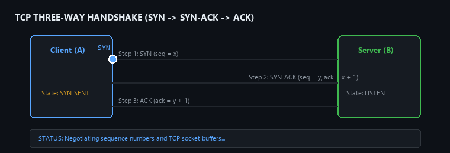
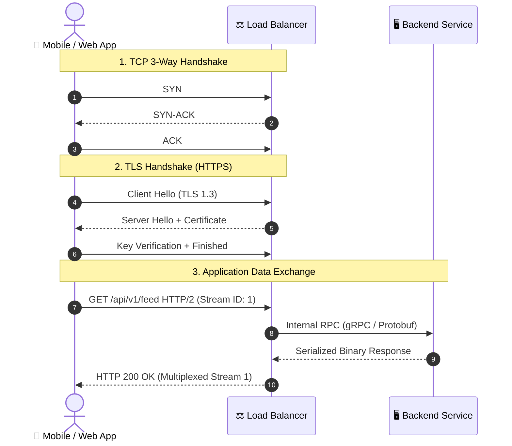

# 01 - Client-Server Architecture & Networking Protocols

> **Real-World Analogy:**  
> Imagine ordering takeout. With HTTP/1.1, you call the restaurant, order one dish, hang up, call again for the next dish, and wait. With WebSockets, you have a direct walkie-talkie connection: both you and the kitchen can talk at any moment without dialing again. With HTTP/3, your food is delivered using an off-road vehicle (QUIC over UDP)—even if one street is blocked, your other dishes keep moving without delay.

---

## 🎯 What & Why
This module explains the foundational protocols powering client-server interactions across the internet: HTTP/1.1, HTTP/2, HTTP/3 (QUIC), WebSockets, and gRPC, as well as the fundamental trade-offs between TCP and UDP.

---

## 📊 Visual Architecture Diagram

<p align="center">
  
</p>


---

## ⚙️ How It Works Under The Hood
### TCP vs UDP: The Transport Layer Foundations

| Characteristic | TCP (Transmission Control Protocol) | UDP (User Datagram Protocol) |
| :--- | :--- | :--- |
| **Connection Setup** | Requires 3-way handshake (SYN, SYN-ACK, ACK) | Connectionless; transmits immediately |
| **Reliability** | Guarantees packet delivery with ACKs & retransmissions | Best-effort delivery; packets can be lost |
| **Packet Ordering** | Strict sequencing; packets reconstructed in order | No ordering guarantees; arrives as routed |
| **Congestion Control** | Built-in windowing (Slow Start, Congestion Avoidance) | None; application handles rate and loss |
| **Header Size** | 20 to 60 bytes | 8 bytes |
| **Primary Use Cases** | Web APIs (HTTP), Email (SMTP), File transfer (FTP/SFTP) | Video streaming, Voice/VoIP, Online gaming, DNS queries |

---

### The Evolution of HTTP Protocols

1. **HTTP/1.1**:
   - Introduced persistent connections (`Connection: keep-alive`).
   - Suffers from **Head-of-Line (HoL) Blocking**: on a single TCP connection, request $B$ cannot be sent or processed until request $A$ finishes.
   - Workarounds included domain sharding (opening 6 parallel TCP connections per host).

2. **HTTP/2**:
   - Switched to a **binary framing layer** instead of plain-text headers.
   - Introduced **Multiplexing**: multiple bidirectional streams interleave over a single TCP connection.
   - Introduced **HPACK** header compression.
   - Limitation: Packet loss in TCP causes all multiplexed streams to stall until the lost packet is retransmitted (TCP-level HoL blocking).

3. **HTTP/3 (QUIC)**:
   - Built on top of **UDP** rather than TCP.
   - Completely independent streams: packet loss in Stream 1 never blocks Stream 2.
   - **0-RTT connection resumption**: clients reconnecting to a known server can send encrypted application data immediately.
   - **Connection Migration**: switches between Wi-Fi and mobile 5G networks without dropping the logical connection because it identifies sessions via 64-bit Connection IDs rather than IP/port tuples.

---

## 💻 Concrete Code Implementation
```python
# Python implementation: A lightweight non-blocking HTTP socket server
import socket
import select

def run_echo_server(host="127.0.0.1", port=8080):
    server = socket.socket(socket.AF_INET, socket.SOCK_STREAM)
    server.setsockopt(socket.SOL_SOCKET, socket.SO_REUSEADDR, 1)
    server.bind((host, port))
    server.listen(10)
    server.setblocking(False)

    print(f"Server started on http://{host}:{port}")
    sockets_list = [server]

    try:
        while True:
            read_sockets, _, exception_sockets = select.select(sockets_list, [], sockets_list, 1.0)
            for notified_socket in read_sockets:
                if notified_socket == server:
                    client_socket, client_address = server.accept()
                    client_socket.setblocking(False)
                    sockets_list.append(client_socket)
                    print(f"Accepted connection from {client_address[0]}:{client_address[1]}")
                else:
                    try:
                        data = notified_socket.recv(1024)
                        if data:
                            response_body = "Hello from lightweight socket server!"
                            response = (
                                "HTTP/1.1 200 OK\r\n"
                                f"Content-Length: {len(response_body)}\r\n"
                                "Content-Type: text/plain\r\n"
                                "Connection: close\r\n\r\n"
                                f"{response_body}"
                            )
                            notified_socket.sendall(response.encode("utf-8"))
                        sockets_list.remove(notified_socket)
                        notified_socket.close()
                    except Exception:
                        sockets_list.remove(notified_socket)
                        notified_socket.close()
    except KeyboardInterrupt:
        print("\nShutting down server.")
    finally:
        server.close()

if __name__ == "__main__":
    run_echo_server()

```

---

## ⚖️ Trade-Offs & Architectural Considerations
- **Scalability**: Decouple client-facing traffic from core compute.
- **Latency**: Optimize protocols (e.g., HTTP/3 QUIC, connection pools) to eliminate unnecessary round-trips.
- **Fault Tolerance**: Always enforce circuit-breakers and graceful degradations under heavy load.
