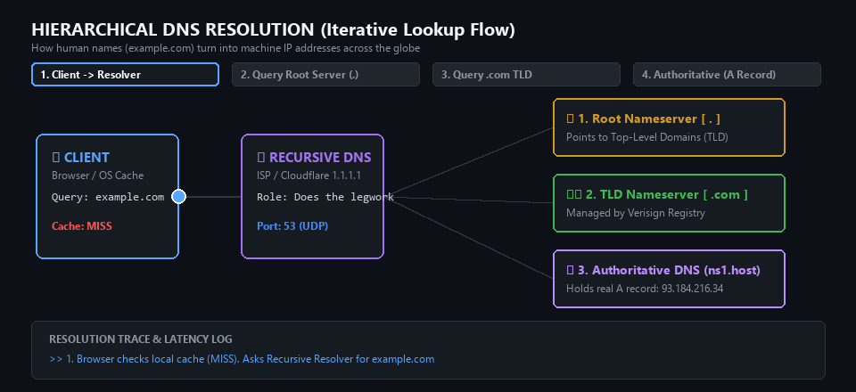
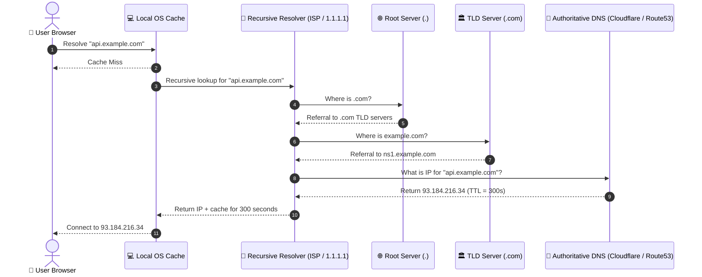

# 02 - Domain Name System (DNS)

> **Real-World Analogy:**  
> Imagine visiting an unfamiliar city and asking for directions. You ask the police officer for the library district (Root Server). She points you to the East District station (TLD Server). That station officer looks up the exact street (Authoritative Server) and hands you a card with the precise house number: 104 Main Street (the IP address). You keep that card in your pocket (DNS Cache) so you never have to ask again today.

---

## 🎯 What & Why
DNS is the decentralized naming system for computers and services connected to the Internet. It translates human-memorable names (such as github.com) into numerical IP addresses (such as 140.82.112.4).

---

## 📊 Visual Architecture Diagram

<p align="center">
  
</p>


---

## ⚙️ How It Works Under The Hood
### The DNS Resolution Tree

1. **Local Resolver & OS Cache**: Checks `hosts` file and browser in-memory cache.
2. **Recursive DNS Resolver**: The intermediate server that does all the iterative lookups on behalf of the client.
3. **Root Nameservers**: 13 logical root server addresses (operated by diverse institutions including NASA, ICANN, and Verisign) distributed worldwide using Anycast routing.
4. **Top-Level Domain (TLD) Nameservers**: Handle `.com`, `.org`, `.net`, `.io`, and country codes like `.uk`.
5. **Authoritative Nameservers**: Maintain the actual database of records (managed via services like AWS Route 53 or Cloudflare).

### Core DNS Record Types

- **A Record**: Maps hostname to IPv4 address (`api.example.com` -> `192.0.2.1`).
- **AAAA Record**: Maps hostname to IPv6 address (`api.example.com` -> `2001:db8::1`).
- **CNAME (Canonical Name)**: An alias from one domain to another (`www.example.com` -> `example.com`).
- **MX (Mail Exchange)**: Mail server destination with priority ranking.
- **TXT**: Arbitrary text attributes (used for SPF, DKIM, and site verification).

### DNS Routing Strategies in System Design

- **GeoDNS**: Directs users to the closest geographical datacenter based on client IP.
- **Weighted Round-Robin DNS**: Sends a percentage of traffic to a new deployment (canary releases).
- **Latency-Based Routing**: Directs users to the AWS/GCP region providing the lowest round-trip latency.
- **Failover / Health-Checked DNS**: If a region fails health checks, DNS stops serving its IP address.

---

## 💻 Concrete Code Implementation
```python
# Python implementation: A custom recursive DNS cache simulator
import time

class DNSCache:
    def __init__(self):
        self._cache = {}

    def put(self, hostname: str, ip: str, ttl_seconds: int):
        expires_at = time.time() + ttl_seconds
        self._cache[hostname.lower()] = {
            "ip": ip,
            "expires_at": expires_at,
            "ttl": ttl_seconds
        }

    def get(self, hostname: str):
        record = self._cache.get(hostname.lower())
        if not record:
            return None
        if time.time() > record["expires_at"]:
            del self._cache[hostname.lower()]
            return None
        remaining_ttl = int(record["expires_at"] - time.time())
        return {"ip": record["ip"], "remaining_ttl": remaining_ttl}

if __name__ == "__main__":
    cache = DNSCache()
    cache.put("api.example.com", "93.184.216.34", ttl_seconds=2)
    
    print("Immediate lookup:", cache.get("api.example.com"))
    time.sleep(1)
    print("After 1 second:", cache.get("api.example.com"))
    time.sleep(1.5)
    print("After TTL expiration:", cache.get("api.example.com"))

```

---

## ⚖️ Trade-Offs & Architectural Considerations
- **Scalability**: Decouple client-facing traffic from core compute.
- **Latency**: Optimize protocols (e.g., HTTP/3 QUIC, connection pools) to eliminate unnecessary round-trips.
- **Fault Tolerance**: Always enforce circuit-breakers and graceful degradations under heavy load.
