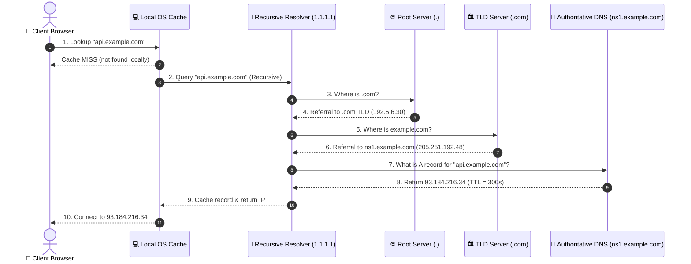
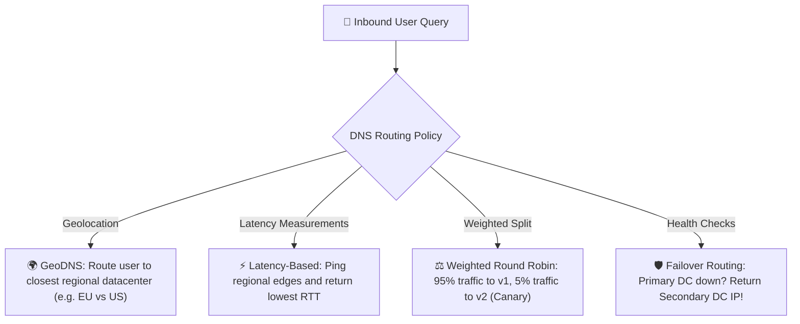

# 02 · Domain Name System (DNS)

> **Part 1 · Networking & traffic** · ⏱️ ~18 min read · Prerequisites: [01 · Client–server networking](../01-client-server-networking/)

---

> 🏢 **Real-World Deep Dives**: Detailed case studies of how **Google** & **Netflix** implement this in production are documented in [REAL_WORLD_EXAMPLES.md](./REAL_WORLD_EXAMPLES.md).

## 🧒 The 30-second version

Computers on the internet don't understand names like `google.com` or `netflix.com`—they only understand numerical coordinates called **IP addresses** (like `142.250.190.46` or `2607:f8b0:4005::200e`).

**DNS (Domain Name System)** is the decentralized global contact book of the internet. Whenever you type a URL, your computer asks a chain of specialized servers to translate that human-friendly name into the server's numerical IP address in a fraction of a second.

---

## 🍕 Everyday analogy: The Global Phone Directory & Concierge

Imagine you visit an unfamiliar megacity looking for the **Stripe Headquarters**:

1. **Your Pocket Notes (Local OS Cache):** You check your notebook first. If you wrote down the address yesterday, you walk straight there (**Cache Hit**). If not, you ask for help.
2. **The Hotel Concierge (Recursive Resolver):** You ask your hotel concierge: *"Where is Stripe?"* The concierge doesn't know every building on earth, but they know who to call and will do all the running around for you.
3. **The City Gatekeeper (Root Nameserver `.`):** The concierge calls City Hall. City Hall says: *"I don't know Stripe, but all commercial businesses ending in `.com` are registered in District 4."*
4. **The District Registry (TLD Nameserver `.com`):** The concierge calls District 4. District 4 checks its registry and says: *"Stripe's building records are managed by their private agency, `ns1.stripe.com`."*
5. **The Building Agency (Authoritative Nameserver):** The concierge calls `ns1.stripe.com`. The agency looks at their live blueprint and answers: *"Stripe is at **54.187.128.85**, and this record is valid for the next 5 minutes (**TTL = 300s**)."*
6. The concierge hands you the address, writes it down in their front-desk ledger so other guests don't have to wait, and you're on your way!

| In the analogy | In DNS architecture |
| :--- | :--- |
| **You (Traveler)** | **Client (Browser / Mobile App)** |
| **Pocket Notes** | **OS / Browser DNS Cache** |
| **Helpful Hotel Concierge** | **Recursive DNS Resolver** (ISP, Cloudflare `1.1.1.1`, Google `8.8.8.8`) |
| **City Hall Gatekeeper** | **Root Nameserver** (`.`) |
| **District Registry** | **Top-Level Domain (TLD) Server** (`.com`, `.org`, `.net`) |
| **Building Agency** | **Authoritative Nameserver** (AWS Route 53, Cloudflare DNS) |
| **Physical Street Address** | **IP Address** (e.g., `54.187.128.85` or IPv6) |
| **"Valid for 5 minutes"** | **Time-To-Live (TTL)** |

---

## 🧩 The problem it solves

1. **Human Memory Limits:** Humans cannot memorize billions of 32-bit IPv4 numbers (`172.217.16.206`) or 128-bit IPv6 hex strings (`2a00:1450:4009:81f::200e`). Names like `github.com` are permanent and intuitive.
2. **Infrastructure Decoupling:** IP addresses change frequently. A company might migrate servers from AWS Virginia to GCP Frankfurt, or scale up new server fleets. DNS acts as a layer of indirection: the domain name stays constant while the underlying IP points to different servers dynamically.
3. **Global Load Balancing & Geo-Routing:** DNS can inspect where the user is calling from and return an IP address in Tokyo for Japanese users, and an IP address in Frankfurt for German users, cutting transit latency by $80\%$.

---

## 🖼️ Picture it

<p align="center">
  
</p>



1. **Step 1–2:** Browser checks in-memory cache, then asks OS resolver. If missing, it fires a UDP query on port 53 to the Recursive Resolver.
2. **Step 3–4:** Recursive Resolver queries the **Root Server (`.`)**. The Root server does not know the full domain, but refers the resolver to the **`.com` TLD server**.
3. **Step 5–6:** Resolver queries the **`.com` TLD server**, which refers it to the domain owner's **Authoritative Nameserver** (`ns1.example.com`).
4. **Step 7–8:** Resolver asks the **Authoritative Nameserver**, which returns the authoritative `A` record (`93.184.216.34`) along with its TTL (300 seconds).
5. **Step 9–10:** Resolver stores the result in its cache and returns the IP to the client OS. Future requests from any nearby user will now get a sub-millisecond cache hit.

---

## 🔢 Walk-through with real numbers

Let's calculate the latency penalty of a cold DNS resolution across the world vs a warm cached resolution:

| Step | Operation | Transit Latency |
| :---: | :--- | :---: |
| 1 | Browser checks local RAM cache | **$0.1\text{ ms}$** |
| 2 | Query sent to ISP / Cloudflare recursive resolver (Anycast) | **$8\text{ ms}$** |
| 3 | Resolver $\to$ Root nameserver RTT | **$15\text{ ms}$** |
| 4 | Resolver $\to$ `.com` TLD nameserver RTT | **$18\text{ ms}$** |
| 5 | Resolver $\to$ Authoritative nameserver (Route 53) RTT | **$22\text{ ms}$** |
| **Total Cold Lookup** | **Full iterative resolution tree traversal** | **$\approx 63\text{ ms}$** |
| **Total Warm Lookup** | **Local OS / Resolver Cache Hit** | **$< 1\text{ ms}$** |

### DNS UDP Packet Size Math
- Traditional DNS packets over UDP are strictly capped at **512 bytes** (RFC 1035).
- If responses exceed 512 bytes (e.g. multiple IPv6 addresses or DNSSEC cryptographic signatures), the server sets the **Truncation Flag (`TC = 1`)**.
- The client detects `TC = 1` and immediately re-establishes the query using **TCP on port 53** or **EDNS0** (Extension Mechanisms for DNS, supporting up to 4,096 bytes).

---

## ⚙️ How it works: The DNS Hierarchy & Architecture

### 1. Essential DNS Record Types

| Record Type | Name | Purpose | Example |
| :--- | :--- | :--- | :--- |
| **A** | Address Record | Maps a hostname to an **IPv4** address (32-bit) | `example.com` $\to$ `93.184.216.34` |
| **AAAA** | IPv6 Address | Maps a hostname to an **IPv6** address (128-bit) | `example.com` $\to$ `2606:2800:220:1::` |
| **CNAME** | Canonical Name | Creates an alias pointing one domain to another domain | `www.example.com` $\to$ `example.com` |
| **ALIAS / ANAME** | Virtual CNAME | Resolves an alias at the root/apex domain without breaking MX | `example.com` $\to$ `lb-123.aws.com` |
| **MX** | Mail Exchange | Directs email to mail servers with priority ranking | `example.com` $\to$ `10 mail.google.com` |
| **TXT** | Text Record | Arbitrary text used for domain verification, SPF, DKIM | `v=spf1 include:_spf.google.com ~all` |
| **NS** | Name Server | Delegates a DNS zone to specific authoritative servers | `example.com` $\to$ `ns1.cloudflare.com` |
| **PTR** | Pointer Record | Reverse DNS: maps an IP address back to a hostname | `34.216.184.93.in-addr.arpa` $\to$ `example.com` |
| **SOA** | Start of Authority | Core zone metadata (zone master, admin email, refresh intervals) | Serial number, refresh, retry, expire timers |

---

### 2. Anycast Routing: How 13 Root IPs Serve the Entire Planet

There are only **13 root server IP addresses** (`a.root-servers.net` through `m.root-servers.net`). How can 13 servers survive all global internet traffic?

They don't! They use **Anycast BGP Routing**:
- In **Unicast**, each IP address maps to one single physical network card in one physical building.
- In **Anycast**, the exact same IP address (e.g. `198.41.0.4` for `a.root-servers.net` or `1.1.1.1` for Cloudflare) is advertised simultaneously by **over 1,500 physical datacenters** across the world using BGP (Border Gateway Protocol).
- When you send a packet to `1.1.1.1`, internet routers automatically route your packet to the **physically closest datacenter** (usually $< 10\text{ ms}$ away).
- **DDoS Immunity:** If a botnet attacks an Anycast IP with 100 Gbps of traffic, the load is distributed across hundreds of edge datacenters worldwide, absorbing the attack locally without bringing down other regions.

---

### 3. Smart DNS Routing Strategies

Modern Cloud DNS services (like AWS Route 53, Cloudflare, NS1) provide advanced routing policies:



---

## ⚖️ Trade-offs: Short TTL vs Long TTL

The **Time-To-Live (TTL)** tells resolvers how long they are legally permitted to cache your record before asking your authoritative server again.

| Dimension | Short TTL (e.g. 30s to 60s) | Long TTL (e.g. 24 hours / 86400s) |
| :--- | :--- | :--- |
| **Disaster Recovery / Failover** | ✅ **Fast**: Traffic shifts to new IP within 60 seconds | ❌ **Slow**: Stale IP cached for up to 24 hours |
| **Authoritative DNS Query Load** | ❌ **High**: Millions of queries hit your nameserver constantly | ✅ **Low**: 99.9% of queries answered by resolver caches |
| **Cost** | Higher DNS provider billing (per million queries) | Lower DNS query costs |
| **Client Latency** | Slightly higher (more frequent cache misses) | Lowest (almost always an instant local cache hit) |
| **Best Used For** | Fast-changing APIs, canary rollouts, active-passive failover | Static assets, landing pages, corporate websites |

---

## 🚫 Common mistakes & production pitfalls

1. **Setting high TTL right before a datacenter migration:**
   - *The Disaster:* You migrate your database and servers to a new cloud provider on Sunday, update DNS, but your TTL was set to 48 hours. Half of your global users continue hitting your decommissioned servers for 2 days!
   - *The Fix:* **Step down your TTL** to 60 seconds 3 days *before* the planned migration. Once the migration is verified stable, raise the TTL back up.

2. **Placing a CNAME record at the Zone Apex (Root Domain):**
   - *The Disaster:* Attempting to set `CNAME example.com -> lb.aws.com`. According to RFC 1034, if a CNAME exists for a host, no other records (like MX for email, or SOA, or NS) can exist for that same host. This destroys your company's email delivery!
   - *The Fix:* Use an **ALIAS**, **ANAME**, or **CNAME Flattening** record provided by modern DNS providers. It synthesizes an `A` record dynamically at query time while allowing MX records to coexist.

3. **Relying purely on DNS for sub-second failover:**
   - *Why it fails:* Many ISPs and mobile carriers blatantly **ignore TTLs** and cache records for hours to save their own bandwidth. Furthermore, web browsers cache IPs internally for 60 seconds regardless of DNS TTL.
   - *The Fix:* Use Anycast IPs or an external Layer 7 proxy for sub-second failover; never rely on DNS records alone for instantaneous zero-downtime failover.

---

## 💻 Try it yourself

Run the interactive simulator in this folder:

```bash
cd 02-domain-name-system
python demo.py
```

### What to explore in `demo.py`:
1. Observe the **iterative step-by-step query log** traversing from Root $\to$ TLD $\to$ Authoritative server on the first lookup.
2. Watch how the second lookup returns instantly in **0.1 ms** via the local cache.
3. Watch the TTL expire after 3.5 seconds and trigger a fresh lookup.
4. See Anycast BGP routing route users across NYC, London, Tokyo, and Sydney.

---

## 🌍 Where you'll see it in production

- **AWS Route 53:** Provides health checks that automatically reroute DNS queries away from degraded AWS regions.
- **Cloudflare (1.1.1.1):** The world's fastest public recursive resolver, operating from over 330 Anycast edge cities with DNS-over-HTTPS (DoH).
- **Netflix Open Connect:** Uses GeoDNS to direct your TV or phone to an Open Connect Appliance (OCA) cache server installed directly inside your local internet service provider's physical facility!

---

## 🎯 Top Interview Questions & Deep Answers

### Q1: "Why does DNS use UDP port 53 by default instead of TCP, and when does it fall back to TCP?"

<details>
<summary>💡 Click to reveal the ideal senior engineering answer</summary>

- **Why UDP by default?**
  - **Latency and Throughput:** DNS lookups are small, transient queries. A UDP query takes **1 single round trip** (Request $\to$ Response). If DNS used TCP, every single lookup would require a 3-way handshake (1.5 RTT) plus connection teardown, tripling lookup latency and consuming massive server socket memory across global resolvers.
- **When does it fall back to TCP?**
  1. **Truncation (`TC = 1`):** Traditional UDP DNS responses are capped at **512 bytes**. If the response payload exceeds 512 bytes (common with DNSSEC cryptographic keys or large TXT records), the server sets the `TC` bit, and the client automatically retries over TCP.
  2. **Zone Transfers (`AXFR` / `IXFR`):** Replicating complete DNS zone files between Primary and Secondary authoritative nameservers requires reliable, sequenced transmission of megabytes of data, which mandates TCP.

</details>

---

### Q2: "What is Anycast routing, and how does it protect DNS infrastructure from massive DDoS attacks?"

<details>
<summary>💡 Click to reveal the ideal senior engineering answer</summary>

- In traditional **Unicast**, one IP belongs to one machine. In **Anycast**, multiple physical servers located across hundreds of cities worldwide advertise the exact same IP prefix via BGP (Border Gateway Protocol).
- When a user sends a DNS packet, internet transit providers naturally route the packet along the shortest BGP path to the nearest geographical datacenter.
- **DDoS Defense Mechanics:** During a 500 Gbps volumetric DDoS attack against an Anycast DNS service:
  - The attack traffic is not concentrated in one datacenter.
  - Instead, the botnet's traffic is geographically fragmented: bots in Germany hit Frankfurt, bots in California hit San Jose, bots in Brazil hit São Paulo.
  - Each individual edge datacenter absorbs its local fraction of the attack with local scrubbing hardware without the global service failing.

</details>

---

### Q3: "What is the difference between a CNAME and an ALIAS record, and why does RFC 1034 forbid CNAME at the zone apex?"

<details>
<summary>💡 Click to reveal the ideal senior engineering answer</summary>

- **RFC 1034 Restriction:** Section 3.6.2 dictates: *"If a CNAME RR is present at a node, no other data should be present."* The apex / root domain (`example.com`) **must** contain `SOA` (Start of Authority) and `NS` (Name Server) records to function as a valid DNS zone. Therefore, creating a CNAME at `example.com` violates the protocol and breaks zone delegation and `MX` email delivery.
- **The Modern Solution (ALIAS / ANAME / CNAME Flattening):**
  - An `ALIAS` record is a pseudo-record implemented by DNS providers (like Route 53 or Cloudflare).
  - To the outside internet, the nameserver **acts as an internal resolver**: it resolves the target hostname (e.g. `dualstack.my-alb-123.amazonaws.com`) to its underlying IP addresses and returns those IP addresses as a standard **`A` record** directly to the client.
  - This allows the apex domain to point dynamically to a cloud load balancer while keeping `NS` and `MX` records completely intact.

</details>

---

### Q4: "How would you design a multi-region disaster-recovery failover system using DNS, and what are its major limitations?"

<details>
<summary>💡 Click to reveal the ideal senior engineering answer</summary>

- **Design:**
  1. Configure an active-passive or active-active DNS routing policy (e.g., in AWS Route 53).
  2. Deploy automated **health-check probes** from multiple global vantage points querying an endpoint (e.g., `https://region-a.example.com/healthz`).
  3. If Region A fails 3 consecutive health checks within 15 seconds, Route 53 automatically flips the DNS record for `api.example.com` to point to Region B's load balancer IP.
  4. Keep the TTL short (e.g., 30 to 60 seconds).
- **Major Limitations in Real Production:**
  1. **Resolver Disobedience (Ignoring TTL):** Many public ISPs, corporate proxy caches, and mobile networks enforce arbitrary minimum TTLs (e.g., 15 minutes to 2 hours) to conserve their bandwidth, meaning a significant percentage of users will continue sending traffic to the dead region.
  2. **Client-Side Caching:** Browsers (Chrome, Safari) cache IP addresses in memory for 60 seconds or longer, ignoring DNS record changes until the tab or browser process restarts.
  3. **Traffic Thundering Herd:** When Region A dies and traffic abruptly swings to Region B, Region B can suffer a catastrophic cold-start crash if its database connection pools and caches are not pre-warmed.

</details>

---

## ✅ Check yourself

1. **A web developer changes an `A` record from `1.2.3.4` to `5.6.7.8` with a TTL of 300 seconds. Why do some users still reach `1.2.3.4` ten minutes later?**

<details>
<summary>View Answer</summary>

Two primary reasons:
1. **Rogue Resolvers:** Some ISPs and upstream recursive resolvers enforce a minimum caching floor (e.g. 15 to 60 minutes) regardless of what authoritative TTL you configured.
2. **Persistent Sockets:** If users have an open, persistent HTTP/1.1 or HTTP/2 TCP connection to the old server, their browser continues sending requests over the already-open socket without performing a new DNS lookup until the socket closes.

</details>

---

2. **What does an `NXDOMAIN` status code mean compared to an `A` record returning an empty answer with `NOERROR`?**

<details>
<summary>View Answer</summary>

- **`NXDOMAIN` (Non-Existent Domain):** The domain name itself does not exist anywhere in the DNS tree (e.g. `this-fake-site-does-not-exist-xyz.com`).
- **`NOERROR` with empty answers:** The domain name **does exist**, but it has no records matching the requested query type. For example, querying for an IPv6 `AAAA` record on a server that only configured an IPv4 `A` record returns `NOERROR` with 0 answers.

</details>

---

3. **Why do recursive resolvers perform queries *iteratively* rather than asking the Root server to find the answer recursively?**

<details>
<summary>View Answer</summary>

To protect the Root and TLD servers from catastrophic resource exhaustion. If the 13 Root servers had to maintain stateful open sockets and wait for answers on behalf of billions of queries simultaneously, they would run out of memory and crash instantly. By keeping Root servers purely **iterative** (returning immediate static referrals in $< 1\text{ ms}$), the memory burden is offloaded to the millions of distributed recursive resolvers at the edge of the internet.

</details>

---

## 📚 Go deeper

- **Understanding Distributed Systems** by Roberto Vitillo: Chapter on *Naming and Discovery*.
- **DNS and BIND (5th Edition)** by Paul Albitz & Cricket Liu: The definitive reference on domain name system internals.
- **Cloudflare Learning Center:** Free, comprehensive guides on Anycast DNS, DNSSEC, and DoH (cloudflare.com/learning/dns).

---

## 🔗 Related modules

- [01 · Client–server networking](../01-client-server-networking/): What happens immediately after DNS returns the IP address.
- [03 · Load balancing](../03-load-balancing/): How DNS distributes traffic across multiple load balancers.
- [12 · Content delivery networks (CDNs)](../12-content-delivery-networks/): How GeoDNS routes traffic to the nearest edge Point of Presence.
