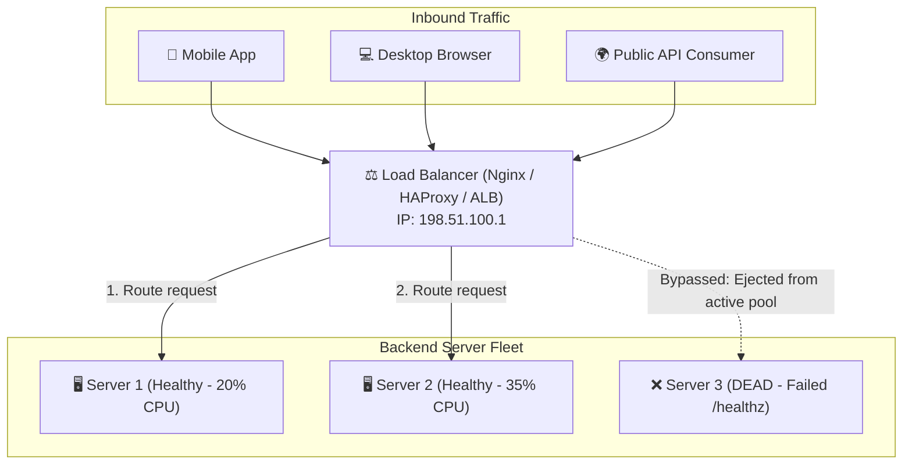
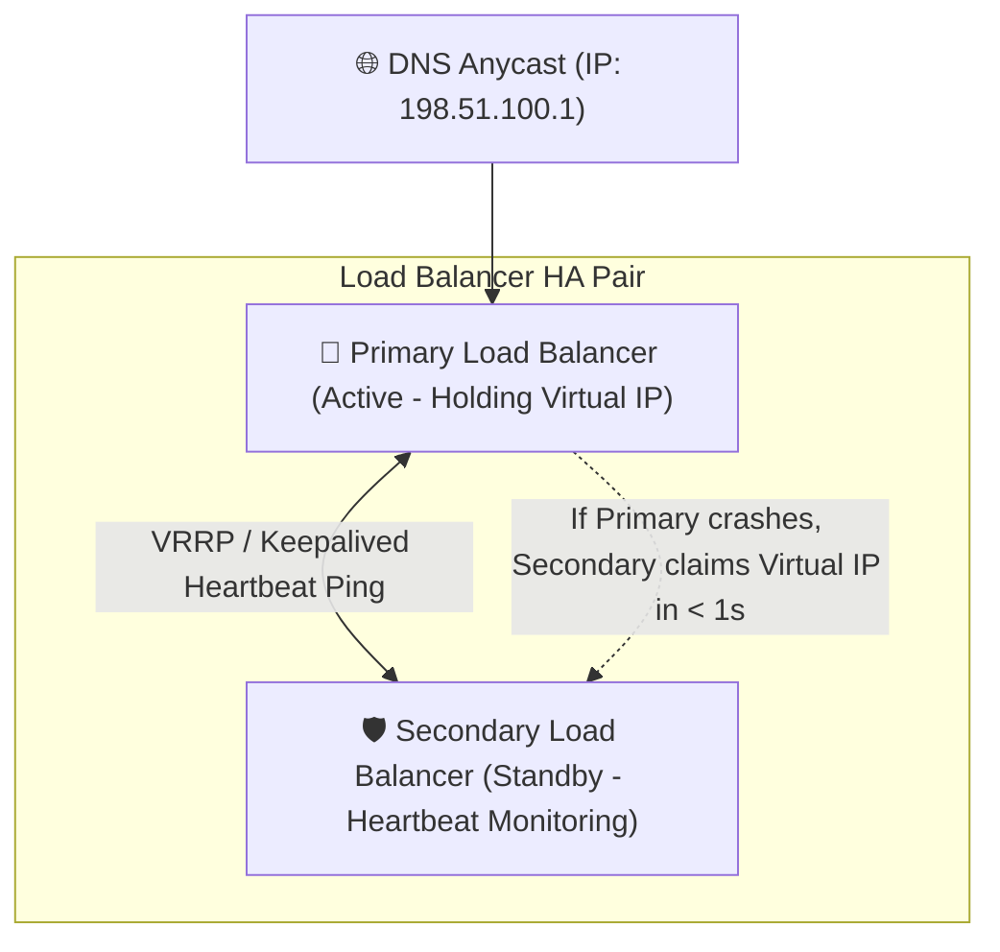

# 03 · Load Balancing

> **Part 1 · Networking & traffic** · ⏱️ ~18 min read · Prerequisites: [01 · Client–server networking](../01-client-server-networking/), [02 · DNS](../02-domain-name-system/)

---

## 🧒 The 30-second version

A single computer can only handle so much traffic before its CPU catches fire or runs out of RAM. Rather than buying an impossibly expensive supercomputer (**vertical scaling**), engineers run dozens of cheap computers in parallel (**horizontal scaling**).

A **load balancer** sits in front of that fleet of servers. When a user sends a request, the load balancer picks one available server, forwards the work, and returns the response. If one server crashes, the load balancer automatically stops sending it traffic without the user ever noticing.

---

## 🍕 Everyday analogy: The Restaurant Hostess & Bank Teller Queues

Imagine a busy downtown bank on a Friday afternoon:

- **Without a Load Balancer (Chaos):** 50 customers walk in the door and rush randomly towards 5 teller windows. 25 people pile into Line 1 because it's closest to the door, while Teller 4 sits reading a newspaper with zero customers. If Teller 1 faints from exhaustion, everyone in Line 1 is stuck waiting indefinitely.
- **With a Load Balancer (Order & Efficiency):** A head coordinator (the Load Balancer) stands at the entrance rope. Customers wait in a single orderly queue. As soon as any teller finishes with a customer, the coordinator directs the next person to that open window. If Teller 3 goes on break, the coordinator simply bypasses Window 3.

| In the bank analogy | In load balancing architecture |
| :--- | :--- |
| **Incoming Customers** | **Client HTTP / HTTPS Requests** |
| **Head Coordinator at the rope** | **Load Balancer** (HAProxy, Nginx, AWS ALB/NLB) |
| **Bank Tellers at desks** | **Backend Application Servers** (Node.js, Go, Python instances) |
| **Checking if teller is awake** | **Health Check Probe** (`GET /healthz`) |
| **Assigning customers 1 by 1 in circle** | **Round-Robin Algorithm** |
| **Sending customer to teller with fewest papers** | **Least-Connections Algorithm** |
| **VIP teller handling large business accounts** | **Weighted Load Balancing** (allocating traffic by CPU weight) |

---

## 🧩 The problem it solves

Suppose your e-commerce application runs on **one server**:
- A single high-end server can process roughly **$1,000\text{ requests per second (RPS)}$**.
- On Black Friday, a flash sale begins and **$15,000\text{ RPS}$** hit your server.
- The operating system's connection queue overflows, memory runs out, the kernel starts killing processes (`OOM Killer`), and your entire website goes completely black for all users.
- Furthermore, if a maintenance engineer reboots that single server, you have **$100\%$ downtime**.

A load balancer solves this by:
1. **Distributing load:** Spreading $15,000\text{ RPS}$ across 20 servers so each handles a comfortable $750\text{ RPS}$.
2. **Zero-downtime rolling deploys:** You can take down 2 servers at a time for upgrades while the remaining 18 keep serving customers.
3. **High availability & self-healing:** When a server crashes, the load balancer's health probe detects the failure within seconds and stops routing traffic to it.

---

## 🖼️ Picture it

<p align="center">
  
</p>



1. Clients send requests to the public IP of the Load Balancer.
2. The Load Balancer executes a balancing algorithm (e.g. Round-Robin or Least Connections).
3. The Load Balancer maintains a background heartbeat polling `GET /healthz` every 5 seconds.
4. If Server 3 throws HTTP 500 errors or times out, the balancer marks it **UNHEALTHY** and immediately isolates it from traffic until it recovers.

---

## 🔢 Walk-through with real numbers

Let's calculate how many backend servers you need to survive peak load:

### 1. Capacity Sizing Math
- **Peak Traffic:** $20,000\text{ requests/sec (RPS)}$.
- **Server Benchmark:** 1 standard compute instance (4 vCPU, 16 GB RAM) comfortably handles **$800\text{ RPS}$** at $60\%$ CPU utilization (leaving safety margin for CPU spikes).
$$\text{Base Servers Needed} = \frac{20,000\text{ RPS}}{800\text{ RPS/server}} = 25\text{ servers}$$

### 2. $N+2$ Redundancy (Fault Tolerance)
- If 2 servers experience sudden hardware failure or restart during peak traffic, you still need full capacity:
$$\text{Total Production Pool} = 25 + 2 = 27\text{ servers}$$

---

## ⚙️ How it works: Deep Dive into Load Balancing

### 1. Layer 4 vs Layer 7 Load Balancing

The OSI model dictates how deeply the load balancer inspects each network packet:

| Dimension | Layer 4 (Transport / TCP & UDP) | Layer 7 (Application / HTTP & HTTPS) |
| :--- | :--- | :--- |
| **Inspection Depth** | Only looks at IP address and TCP/UDP port | Inspects full HTTP URL paths, headers, cookies, JSON body |
| **Latency & Overhead** | Ultra-low latency ($< 0.1\text{ ms}$), millions of RPS | Slightly higher CPU overhead (decrypts TLS, parses HTTP) |
| **TLS / SSL Handling** | Passes encrypted bytes straight through | Terminates TLS at the balancer (**SSL Offloading**) |
| **Routing Intelligence** | Packet forwarding only (cannot route by URL path) | Smart routing: `/api/users` $\to$ User Svc, `/video` $\to$ Media Svc |
| **Session Tracking** | IP-based only | Cookie-based, header-based, or JWT-based |
| **Examples** | AWS Network Load Balancer (NLB), Linux IPVS, HAProxy (TCP) | AWS Application Load Balancer (ALB), Nginx, Envoy, Traefik |

---

### 2. The 5 Core Balancing Algorithms

1. **Round-Robin:** Requests are distributed sequentially: Server 1 $\to$ Server 2 $\to$ Server 3 $\to$ Server 1. Simple and stateless, but assumes all servers have identical hardware and all requests take identical time to process.
2. **Weighted Round-Robin:** Servers are assigned capacity weights (e.g. Server A has 8 vCPUs, Server B has 4 vCPUs). Server A gets twice as many requests as Server B.
3. **Least Connections:** Forwards the new request to whichever server currently has the **fewest active open TCP/HTTP connections**. Ideal for workloads with high processing time variance (e.g., image processing or complex database reports).
4. **Weighted Least Connections:** Calculates normalized score:
   $$\text{Score} = \frac{\text{Active Connections}}{\text{Server Weight}}$$
   Selects the server with the lowest score.
5. **IP Hash:** Computes `hash(client_ip) % num_servers`. Guarantees that requests from the same user IP consistently land on the same server (session affinity).

---

### 3. Active vs Passive Health Checks

- **Active Health Checks (Proactive Heartbeats):** The load balancer periodically sends an HTTP probe (e.g. `GET /healthz` every 5 seconds) to each server. If a server fails 3 consecutive probes, it is ejected.
- **Passive Health Checks (Inline Monitoring):** The load balancer watches real user traffic. If a server returns 5 consecutive `HTTP 502 Bad Gateway` responses to live users, the load balancer temporarily stops sending user requests to that node.

---

### 4. High Availability for the Load Balancer Itself

*"If the load balancer distributes traffic so servers don't fail, what happens when the load balancer itself crashes?"*

In production, you never run a single load balancer machine. You run a **High Availability Pair**:



1. **VRRP (Virtual Router Redundancy Protocol) / Keepalived:** An Active and a Standby load balancer share a single **Virtual IP (VIP)**. The Standby listens to a continuous heartbeat from the Primary. If the Primary misses 3 heartbeats ($< 1\text{ second}$), the Standby instantly assumes ownership of the Virtual IP via ARP broadcast.
2. **DNS Anycast:** Global cloud providers advertise the load balancer IP from dozens of edge locations simultaneously using BGP.

---

## ⚖️ Trade-offs & Algorithm Comparison Matrix

| Algorithm | CPU Overhead | Handles Unequal Servers? | Handles Long Requests? | Recommended Use Case |
| :--- | :---: | :---: | :---: | :--- |
| **Round-Robin** | Ultra Low | ❌ No | ❌ Poorly | Homogeneous microservices with fast ($< 20\text{ms}$) requests |
| **Weighted Round-Robin** | Low | ✅ Yes | ❌ Poorly | Clusters with mixed machine sizes (e.g. cloud migration) |
| **Least Connections** | Low | ❌ No | ✅ Excellent | Web applications with long-lived transactions or downloads |
| **Weighted Least Connections** | Low | ✅ Yes | ✅ Excellent | Production cloud clusters with varying instance families |
| **IP Hash** | Low | ❌ No | ⚠️ Average | Stateful legacy systems that require local session cache |

---

## 🚫 Common mistakes & production pitfalls

1. **Relying on "Sticky Sessions" (Session Affinity) instead of stateless architecture:**
   - *Why it hurts:* The load balancer forces user A to always hit Server 1. If 5 power users land on Server 1, Server 1 gets overloaded while others sit idle. Worse: when Server 1 is rebooted during deployment, all those users are abruptly logged out!
   - *The Fix:* **Make servers completely stateless**. Store session tokens in a distributed in-memory cache like Redis ([module 10](../10-caching-patterns/)) or use signed JWTs. Any server can then handle any request.

2. **The "Health Check Stampede" (Cascading Crash):**
   - *Why it hurts:* 50 backend servers are under heavy load. The load balancer sends an expensive health check query (`SELECT * FROM users`) to all 50 servers every 2 seconds. The servers become slower, health checks time out, the load balancer ejects 10 servers, dumping the remaining traffic onto the surviving 40, which causes them to fail health checks too, collapsing the entire datacenter!
   - *The Fix:* Keep health check endpoints **feather-light** (`/healthz` should just return `200 OK` in memory, or check a cached health boolean without running heavy DB queries).

3. **Not terminating TLS at the Load Balancer (SSL Offloading):**
   - *Why it hurts:* If every individual backend microservice must negotiate TLS handshakes and decrypt RSA/ECDSA keys, you waste up to $25\%$ of your application server CPU capacity on cryptography.
   - *The Fix:* Terminate TLS at the load balancer or API gateway, and communicate with backend servers over high-speed private virtual networks (VPC).

---

## 💻 Try it yourself

Run the interactive simulator in this folder:

```bash
cd 03-load-balancing
python demo.py
```

### What to explore in `demo.py`:
1. Watch **Round-Robin** cycle requests cleanly 1-by-1 across servers.
2. Watch **Least-Connections** normalize active connections by machine weight and route to the least-burdened node.
3. Test **IP Hashing** and observe how a client IP always lands on the same server.
4. Watch an injected **health check failure** eject `srv-3` and observe how subsequent traffic is safely routed only to surviving healthy nodes without dropping requests.

---

## 🌍 Where you'll see it in production

- **HAProxy:** Renowned as the world's fastest open-source Layer 4/7 reverse proxy, used by GitHub, Reddit, and Stack Overflow to handle tens of billions of requests daily.
- **AWS Application Load Balancer (ALB):** Natively integrates with AWS Auto Scaling groups to automatically add and remove container instances based on traffic spikes.
- **Nginx:** Powers over $30\%$ of the world's top 10 million websites as both a reverse proxy and Layer 7 load balancer.

---

## 🎯 Top Interview Questions & Deep Answers

### Q1: "What is the architectural difference between Layer 4 and Layer 7 load balancing, and when would you choose one over the other?"

<details>
<summary>💡 Click to reveal the ideal senior engineering answer</summary>

- **Layer 4 (Transport / TCP/UDP):**
  - Operates purely at the packet level without inspecting application payloads. It routes based on `(Source IP, Source Port, Destination IP, Destination Port)`.
  - **Pros:** Blazing fast throughput, minimal CPU/memory utilization, handles millions of concurrent packets per second.
  - **Cons:** Cannot make smart decisions based on HTTP paths, cannot terminate TLS, cannot inspect HTTP headers or cookies.
  - **Pick L4 when:** You need raw throughput for non-HTTP protocols (gaming, VoIP, database connection pooling), or as a top-level perimeter router sitting in front of a tier of L7 balancers.
- **Layer 7 (Application / HTTP/HTTPS):**
  - Terminates the TCP connection, decrypts TLS, and inspects the complete HTTP request (headers, path, cookies, query parameters).
  - **Pros:** Content-based routing (e.g. routing `/checkout` to Payment Service and `/static` to CDN), header injection, rate limiting, and cookie-based sticky routing.
  - **Cons:** Higher CPU overhead due to TLS termination and stream buffering.
  - **Pick L7 when:** Modern web/microservices architectures where routing depends on HTTP paths, authentication tokens, and API endpoints.

</details>

---

### Q2: "If the load balancer eliminates single points of failure for backend servers, isn't the load balancer itself a single point of failure? How do you eliminate it?"

<details>
<summary>💡 Click to reveal the ideal senior engineering answer</summary>

In a production system, a load balancer is **never** a single server. We eliminate single points of failure across two architectural tiers:

1. **Active-Passive Pair with Virtual IP (Local Redundancy):**
   - Two load balancers run in parallel sharing a floating **Virtual IP (VIP)** via **VRRP (Virtual Router Redundancy Protocol)** or **Keepalived**.
   - The Primary actively processes all traffic while broadcasting heartbeats to the Secondary.
   - If the Primary crashes, the Secondary detects missing heartbeats and claims the Virtual IP via ARP spoofing in $< 500\text{ ms}$, taking over traffic with zero DNS changes.
2. **DNS Anycast & Equal-Cost Multi-Path (Global Redundancy):**
   - For hyperscale systems, multiple active load balancers advertise the same IP address using BGP Anycast.
   - Upstream internet routers use **ECMP (Equal-Cost Multi-Path)** to spray packets across multiple active load balancer machines simultaneously. If one hardware router or balancer dies, BGP withdraws the route in seconds.

</details>

---

### Q3: "Why are sticky sessions considered an architectural anti-pattern in modern cloud architectures?"

<details>
<summary>💡 Click to reveal the ideal senior engineering answer</summary>

Sticky sessions (session affinity via IP hash or cookies) force a client's requests to always route to the exact same backend server because that server stores the user's login state in local RAM.

**Why this breaks cloud scalability:**
1. **Traffic Hot-Spotting:** If a few high-activity enterprise users are pinned to Server 1, Server 1 CPU is maxed out while Servers 2, 3, and 4 sit idle.
2. **Broken Autoscaling & Deployments:** When you scale down or perform a rolling deployment by rebooting a server, all users pinned to that server have their sessions abruptly wiped out and are forcibly logged out.
3. **The Solution:** Keep servers **$100\%$ stateless**. Store session data in a shared distributed cache (Redis / Memcached) or encode identity in cryptographically signed **JSON Web Tokens (JWT)**. Any server can now handle any request from any client at any moment.

</details>

---

### Q4: "How do health checks work, and what is the 'health check stampede' failure mode?"

<details>
<summary>💡 Click to reveal the ideal senior engineering answer</summary>

- **Health Check Mechanism:** The load balancer sends an HTTP request (`GET /healthz`) every $T$ seconds. A server must respond with `200 OK` within a timeout window (e.g. 2 seconds). If it fails $K$ consecutive probes (e.g. 3 fails), it is ejected from the routing table (**unhealthy threshold**). When it recovers and passes $M$ consecutive probes (e.g. 2 passes), it is re-added (**healthy threshold**).
- **The Health Check Stampede (Cascading Failure):**
  - If the health check endpoint runs a live database query (`SELECT 1 FROM orders`), and the database experiences high load, database queries slow down.
  - Health checks begin timing out across the cluster.
  - The load balancer mistakenly assumes the servers are dead and starts ejecting them.
  - The remaining surviving servers receive $100\%$ of the user traffic, which overloads their CPU and causes their health checks to time out too.
  - Within 60 seconds, **every single server in the cluster is ejected**, resulting in a complete global outage!
- **Mitigation:**
  - Health check endpoints must be lightweight and decoupled from heavy database queries.
  - Implement a **minimum healthy threshold** (e.g. "Never eject more than $50\%$ of the server fleet, even if all health checks fail") to prevent full cluster shutdown.

</details>

---

## ✅ Check yourself

1. **A company has 3 backend servers. Server A has 8 cores, Server B has 4 cores, and Server C has 4 cores. Which load balancing algorithm ensures Server A handles twice the traffic of Server B and C?**

<details>
<summary>View Answer</summary>

**Weighted Round-Robin** (or **Weighted Least Connections**). You assign a weight of `2` to Server A, and a weight of `1` to Server B and Server C. The load balancer will route 2 requests to Server A for every 1 request routed to Server B and C.

</details>

---

2. **If an API has requests with extreme variance in processing time (some take 5 ms, others take 4,000 ms), why will Round-Robin cause severe server degradation? What should you use instead?**

<details>
<summary>View Answer</summary>

Under Round-Robin, requests are assigned blindly. By bad luck, 5 consecutive 4,000 ms requests could be assigned to Server 2, while Server 1 gets five 5 ms requests. Server 2's thread pool fills up and it starts dropping connections.  
You should use **Least Connections** instead. Least Connections inspects how many active requests are currently executing on each server and routes new requests to whichever server is currently doing the least work.

</details>

---

3. **Why does an AWS Application Load Balancer (ALB) require at least two Availability Zones (AZs) when setting it up?**

<details>
<summary>View Answer</summary>

For **datacenter-level fault tolerance**. If an entire AWS physical datacenter loses electrical power or suffers a fiber cut, the load balancer running in the second Availability Zone automatically absorbs all incoming traffic with zero disruption to the service.

</details>

---

## 📚 Go deeper

- **Understanding Distributed Systems** by Roberto Vitillo: Chapter on *Network Load Balancing*.
- **Web Scalability for Startup Engineers** by Artur Ejsmont: Chapter 3 (*Application Services & Load Balancers*).
- **HAProxy Architecture Guide:** The official documentation on connection pooling, epoll event loops, and health checking mechanics.

---

## 🔗 Related modules

- [01 · Client–server networking](../01-client-server-networking/): The TCP and HTTP connections terminated by the load balancer.
- [02 · Domain Name System (DNS)](../02-domain-name-system/): How DNS routes traffic across multiple load balancer IPs.
- [04 · API gateways & proxies](../04-api-gateways-and-proxies/): How API gateways extend load balancers with authentication and rate limiting.
