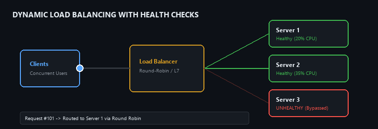
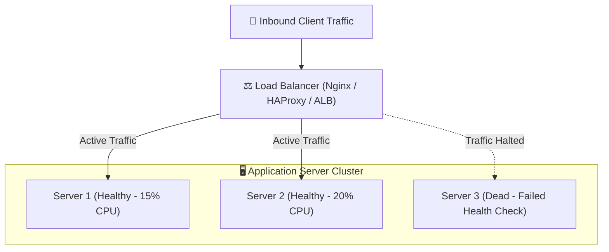

# 03 - Load Balancing

> **Real-World Analogy:**  
> Imagine a bank with 5 teller counters. When customers enter the lobby, a concierge directs each customer to the next open counter. If teller #3 leaves for lunch, the concierge stops directing people to teller #3. The concierge is the load balancer, ensuring no single teller gets overwhelmed while others are sitting empty.

---

## 🎯 What & Why
Load balancers distribute incoming network traffic across multiple servers to ensure high availability, fault tolerance, and responsiveness.

---

## 📊 Visual Architecture Diagram

<p align="center">
  
</p>


---

## ⚙️ How It Works Under The Hood
### Layer 4 vs Layer 7 Load Balancing

| Dimension | Layer 4 (Transport / TCP/UDP) | Layer 7 (Application / HTTP) |
| :--- | :--- | :--- |
| **Inspection Depth** | IP and TCP port only | Full HTTP request (path, cookies, headers, body) |
| **Performance** | Extremely high throughput, ultra-low latency | Slightly higher CPU overhead (TLS termination & parsing) |
| **Routing Capability** | Basic packet forwarding | Path-based routing (`/auth` vs `/feed`), header injection |
| **SSL/TLS Handling** | Usually passes encrypted traffic through untouched (some, like AWS NLB, can optionally terminate TLS) | Terminates TLS, decrypts payload, verifies certificates |
| **Examples** | AWS NLB, HAProxy (TCP mode), Linux IPVS | AWS ALB, Nginx, Envoy, Traefik |

---

### Key Balancing Algorithms

1. **Round Robin**: Passes each new request sequentially to the next node in the pool.
2. **Weighted Round Robin**: Factors in server hardware capacity (e.g., node A gets 3x more requests than node B).
3. **Least Connections**: Allocates traffic to the server currently processing the smallest number of active sessions.
4. **IP Hash**: Computes `hash(client_ip) % N` to send a specific user to the same server for session continuity.
5. **Consistent Hashing**: Minimizes key redistribution when nodes are added or removed from the pool.

---

## 💻 Concrete Code Implementation
```python
# Python implementation of Round Robin and Weighted Least Connections load balancers

class BackendNode:
    def __init__(self, node_id: str, capacity_weight: int = 1):
        self.node_id = node_id
        self.weight = capacity_weight
        self.active_connections = 0
        self.is_healthy = True

    def __repr__(self):
        return f"{self.node_id}(weight={self.weight}, conns={self.active_connections})"

class LoadBalancer:
    def __init__(self, nodes):
        self.nodes = nodes
        self._current_index = 0

    def get_healthy_nodes(self):
        return [node for node in self.nodes if node.is_healthy]

    def select_round_robin(self):
        healthy = self.get_healthy_nodes()
        if not healthy:
            raise RuntimeError("All backend servers are unhealthy!")
        selected = healthy[self._current_index % len(healthy)]
        self._current_index += 1
        return selected

    def select_least_connections(self):
        healthy = self.get_healthy_nodes()
        if not healthy:
            raise RuntimeError("All backend servers are unhealthy!")
        # Normalize active connections by capacity weight
        return min(healthy, key=lambda n: n.active_connections / n.weight)

if __name__ == "__main__":
    cluster = [
        BackendNode("srv-east-1", capacity_weight=1),
        BackendNode("srv-east-2", capacity_weight=2),
        BackendNode("srv-east-3", capacity_weight=1)
    ]
    lb = LoadBalancer(cluster)

    print("--- Round Robin Test ---")
    for _ in range(4):
        print("Selected:", lb.select_round_robin().node_id)

    print("\n--- Least Connections Test ---")
    cluster[0].active_connections = 10
    cluster[1].active_connections = 6  # 6 / 2 weight = score 3
    cluster[2].active_connections = 8
    print("Selected least-connections:", lb.select_least_connections())

```

---

## ⚖️ Trade-offs

| Decision | Trade-off |
| :--- | :--- |
| **Layer 4 vs Layer 7** | L4 is faster and protocol-agnostic but blind to URLs and headers. L7 can route `/api` vs `/images`, retry, and add headers, at the cost of more CPU and TLS termination. |
| **Round robin** | Dead simple, but ignores that some requests are slow and some servers are busy. |
| **Least connections** | Better when request times vary a lot (uploads, WebSockets); the balancer must track live connection counts. |
| **IP hash / sticky sessions** | Keeps a user on one server (handy for in-memory sessions), but load gets uneven (a whole office behind one IP), and adding or removing a server reshuffles users. Better: make servers stateless and keep sessions in Redis. |
| **Health checks** | Too aggressive: a short CPU spike pulls healthy servers out. Too lazy: users hit a dead server for many seconds. |
| **The balancer itself** | It can become a single point of failure: run an active-passive pair or use a managed balancer. |
