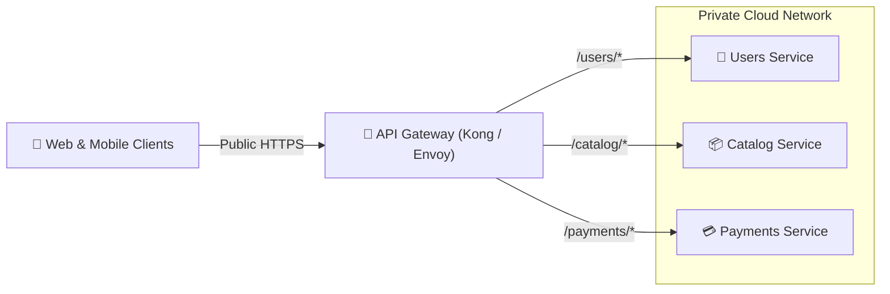

# 04 - API Gateways & Reverse Proxies

> **Real-World Analogy:**  
> Imagine a hospital reception desk. Patients don't wander through surgical wards looking for doctors. Instead, they check in at the front desk. The receptionist verifies their insurance card (authentication), prevents crowds from rushing the doors (rate limiting), and directs them to the exact department they need (request routing). The API Gateway is that front desk for your microservices.

---

## 🎯 What & Why
Covers how API Gateways and reverse proxies manage incoming external traffic, decoupling internal microservices from public client applications.

---

## 📊 Visual Architecture Diagram


---

## ⚙️ How It Works Under The Hood
### Reverse Proxy vs Forward Proxy

- **Forward Proxy**: Represents the **client**. Used inside an office or school network to protect user anonymity, bypass firewalls, or block illicit domains. The destination server sees the proxy's IP, not the client's.
- **Reverse Proxy**: Represents the **server**. Sits in front of backend servers. External clients believe they are communicating with the server directly.

### Central Responsibilities of an API Gateway

1. **Authentication & Authorization**: Decodes and verifies JSON Web Tokens (JWT) or API keys before traffic hits microservices.
2. **TLS / SSL Termination**: Decrypts HTTPS once at the edge, so services behind it don't each need certificates. Traffic behind the gateway is then unencrypted unless you re-encrypt it (e.g. mTLS between services).
3. **Request Aggregation**: Combines data from several services into one response, so a mobile app makes 1 call instead of 5. Giving each client type (web, iOS, TV) its own tailored gateway is called the **Backend for Frontend (BFF)** pattern.
4. **Traffic Shaping & Canary Releases**: Splits 5% of traffic to a new version of a service (`v2`) and 95% to stable (`v1`).
5. **Rate Limiting & DoS Protection**: Prevents abusive scrapers or misbehaving mobile apps from saturating internal services.

---

## 💻 Concrete Code Implementation
```python
# Python implementation: A lightweight routing & auth proxy
class APIGateway:
    def __init__(self):
        self.routes = {}
        self.api_keys = {"secret-key-123": "user_alice"}

    def add_route(self, prefix: str, service_handler):
        self.routes[prefix] = service_handler

    def handle_request(self, path: str, api_key: str, payload: dict):
        # 1. Security Check
        if api_key not in self.api_keys:
            return {"status": 401, "error": "Unauthorized: Invalid API Key"}

        # 2. Path-based Routing
        for prefix, handler in self.routes.items():
            if path.startswith(prefix):
                return {
                    "status": 200,
                    "user": self.api_keys[api_key],
                    "data": handler(path, payload)
                }

        return {"status": 404, "error": f"Route not found for {path}"}

if __name__ == "__main__":
    def user_service(path, payload):
        return {"service": "UserService", "profile": {"name": "Alice", "role": "admin"}}

    def order_service(path, payload):
        return {"service": "OrderService", "orders": [{"id": 101, "total": 49.99}]}

    gw = APIGateway()
    gw.add_route("/api/v1/users", user_service)
    gw.add_route("/api/v1/orders", order_service)

    # Authorized call
    print(gw.handle_request("/api/v1/users/me", "secret-key-123", {}))
    # Unauthorized call
    print(gw.handle_request("/api/v1/users/me", "bad-key", {}))

```

---

## ⚖️ Trade-offs

| Benefit | Cost |
| :--- | :--- |
| One place for auth, rate limits, logging and TLS | Every request takes one extra network hop (usually ~1 ms) |
| Clients see one stable API while services change behind it | The gateway can become a bottleneck or single point of failure, so run several instances |
| Canary releases and traffic splitting without touching services | "Logic creep": business rules sneaking into the gateway make it a hard-to-change monolith |
| Aggregation means fewer round trips for mobile | Aggregation endpoints couple the gateway to many services' response formats |

**Managed (AWS API Gateway, Apigee)** gets you started fast but costs per request and locks you in. **Self-hosted (Kong, Envoy, NGINX)** is flexible but you have to operate it.
