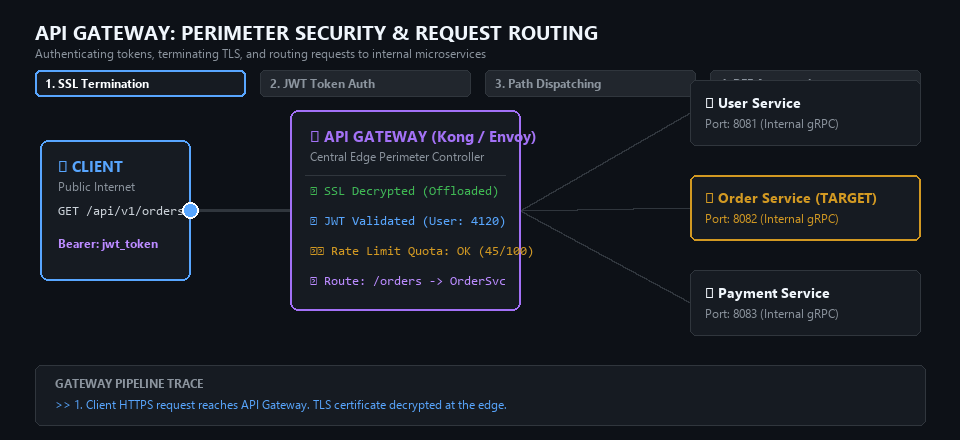
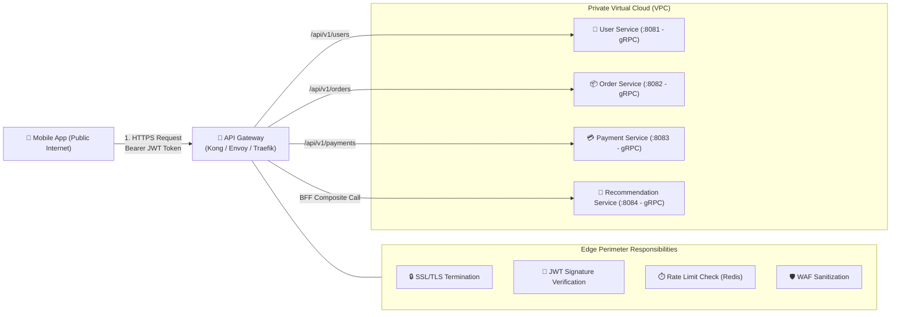
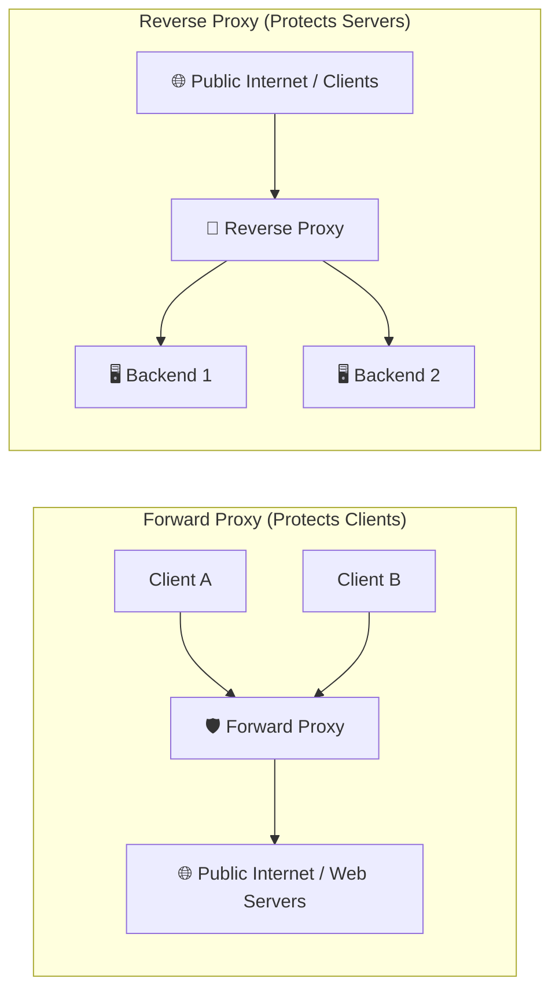

# 04 · API Gateways & Reverse Proxies

> **Part 1 · Networking & traffic** · ⏱️ ~18 min read · Prerequisites: [01 · Client–server networking](../01-client-server-networking/), [03 · Load balancing](../03-load-balancing/)

---

> 🏢 **Real-World Deep Dives**: Detailed case studies of how **Google** & **Netflix** implement this in production are documented in [REAL_WORLD_EXAMPLES.md](./REAL_WORLD_EXAMPLES.md).

## 🧒 The 30-second version

When your backend grows from one server into 50 different microservices (User Service, Payment Service, Recommendation Service), you should **never** let external mobile apps call those 50 services directly. 

An **API Gateway** acts as the single front door to your entire system. External clients talk only to the gateway. The gateway checks their security badge (authentication), protects the building from mobs (rate limiting), decrypts their encryption (SSL termination), and guides their request to the exact microservice inside.

---

## 🍕 Everyday analogy: The Airport Customs & Security Terminal

Imagine arriving on an international flight at a major global airport:

- **Without a Gateway (Total Chaos):** Passengers step off the plane onto the runway and wander freely into baggage rooms, air traffic control towers, and pilot lounges looking for their luggage. Every single room has to hire its own armed guard to check passports, inspect baggage, and verify tickets.
- **With an API Gateway (Order & Security):** All passengers must pass through a single unified International Terminal:
  1. **Border Patrol (Authentication):** Officers verify your passport and visa once at the perimeter.
  2. **Security Screening (Rate Limiting & WAF):** Luggage is X-rayed for contraband and dangerous traffic.
  3. **Terminal Directory (Routing):** Flight display boards tell you: *"Passengers for Flight B go to Gate 14; passengers for Flight C go to Gate 22."*
  4. Once cleared, you enter the secure concourse where internal staff can operate safely.

| In the airport analogy | In microservices architecture |
| :--- | :--- |
| **Arriving International Passenger** | **External Client Request** (Browser / iOS / Android) |
| **Main Airport Security Entrance** | **API Gateway / Reverse Proxy** (Envoy, Kong, Nginx) |
| **Passport & Visa Inspection** | **JWT Authentication & API Key Validation** |
| **Customs Screening for Contraband** | **Web Application Firewall (WAF)** (SQLi / XSS filtering) |
| **Terminal Signs to Flight Gates** | **Path-Based Request Routing** (`/orders` $\to$ Order Service) |
| **Airport Concierge Booking Hotel+Cab** | **Backend-For-Frontend (BFF) Aggregation** |
| **Secure Internal Concourse** | **Private Cloud Network (VPC / Kubernetes Service Mesh)** |

---

## 🧩 The problem it solves

In a modern microservices architecture with 30 backend services:
1. **Security Vulnerability:** If 30 services are exposed directly to the public internet, each one must manage public IP addresses, configure SSL certificates, and protect against brute-force DDoS attacks. One vulnerable service compromises the entire enterprise.
2. **Chatty Mobile Clients:** To render a home screen, an iPhone app would have to make 5 separate HTTP calls over a slow cellular network:
   - `GET /users/me` (Profile)
   - `GET /orders/recent` (Orders)
   - `GET /cart` (Shopping cart)
   - `GET /recommendations` (Feed items)
   - `GET /notifications` (Unread count)
   On a 4G connection ($80\text{ ms RTT}$), 5 sequential calls take over **$500\text{ ms}$**, draining battery and creating a sluggish UI.
3. **Cross-Cutting Concerns Duplication:** Every engineering team has to reimplement rate limiting, auth token parsing, CORS headers, and request logging in Python, Go, Java, and Node.js.

The API Gateway solves this by centralizing all cross-cutting perimeter duties in one battle-tested edge layer.

---

## 🖼️ Picture it

<p align="center">
  
</p>



1. External client sends a single HTTPS request with an Authorization header to `api.example.com`.
2. The Gateway offloads TLS decryption and verifies the cryptographic signature of the JWT token.
3. The Gateway queries Redis to confirm the user has remaining rate limiting quota.
4. The Gateway routes the sanitized request over the high-speed private network (VPC) to the target microservice using fast internal gRPC.
5. In a BFF route, the Gateway queries multiple microservices in parallel and stitches the results into one compact JSON response.

---

## 🔢 Walk-through with real numbers

### Mobile Latency: Direct Calls vs BFF Gateway Aggregation

Suppose a mobile client on a cellular network ($70\text{ ms RTT}$) needs to assemble its home dashboard from 4 backend services. Each backend service takes $15\text{ ms}$ of internal computing time.

| Approach | Network Round-Trips over Cellular | Internal Datacenter Transit | Total Elapsed Latency |
| :--- | :---: | :---: | :---: |
| **Direct Microservice Calls** (No Gateway) | 4 cellular RTTs ($4 \times 70\text{ms} = 280\text{ms}$) | $0\text{ ms}$ | **$340\text{ ms}$** (Sluggish) |
| **API Gateway BFF Aggregation** | **1 cellular RTT** ($1 \times 70\text{ms} = 70\text{ms}$) | Parallel internal RPCs ($1\text{ms} \times 4$) | **$86\text{ ms}$** (Instant!) |

> 💡 **Impact:** By aggregating 4 calls into 1 at the gateway, you eliminate 3 round trips over the cellular airwaves, achieving a **$4\times$ speedup** and saving mobile battery!

---

## ⚙️ How it works: Reverse Proxies & Gateway Architecture

### 1. Forward Proxy vs Reverse Proxy

Understanding the direction of representation is essential:



- **Forward Proxy (Client-Facing):** Sits in front of a group of **clients** (e.g., inside a corporate office or school). It hides the real client IPs, filters outbound illicit websites, and caches shared intranet downloads. The outside world only sees the proxy's IP.
- **Reverse Proxy (Server-Facing):** Sits in front of a group of **servers**. External clients believe they are talking directly to the destination website. It terminates TLS, shields internal IP addresses, caches static assets, and balances traffic.

---

### 2. Core Responsibilities of an API Gateway

An API Gateway is a specialized reverse proxy enriched with application-level microservices intelligence:

1. **Authentication & Identity Offloading:**
   - Instead of every microservice validating passwords or verifying OAuth tokens with Auth0, the gateway validates the incoming JWT at the door.
   - The gateway decodes the claims and injects trusted internal headers: `X-User-Id: 4102`, `X-User-Role: admin`.
   - Internal microservices can trust these headers implicitly because external users cannot bypass the gateway.
2. **Protocol Translation:**
   - Clients communicate via standard HTTP/1.1 or HTTP/2 JSON REST.
   - The gateway translates the JSON payload into compact binary **gRPC / Protocol Buffers** to communicate with internal backend services with maximum speed.
3. **Backend-For-Frontend (BFF) Pattern:**
   - Provides tailored endpoints for different client form factors:
     - `/api/mobile/v1/*`: Strips out heavy description strings to save mobile data.
     - `/api/desktop/v1/*`: Returns full rich analytical datasets for wide screens.
4. **Traffic Canary Splits:**
   - Routes $95\%$ of traffic to `v1` of a service and $5\%$ of traffic to a newly deployed `v2` canary instance to test stability.

---

## ⚖️ Trade-offs: Centralized Gateway vs Service Mesh

| Architecture | Description | Pros | Cons |
| :--- | :--- | :--- | :--- |
| **Centralized API Gateway** (Kong, Apigee, AWS API Gateway) | Single shared cluster at the network edge | One place for all security policies, billing, and rate limits | Can become an organizational bottleneck if teams fight over configs |
| **Backend-For-Frontend (BFF)** | Each client platform (iOS, Web, Smart TV) owns a small dedicated gateway | Teams deploy changes independently without coordinating | Slight duplication of common auth logic across gateways |
| **Service Mesh Sidecars** (Envoy / Istio) | Sidecar proxy deployed alongside every single container | Service-to-service mTLS encryption and deep telemetry | High operational complexity and increased cluster RAM overhead |

---

## 🚫 Common mistakes & production pitfalls

1. **Leaking Business Logic into the Gateway:**
   - *Why it hurts:* Engineers start writing pricing algorithms, order validation logic, or tax calculations inside the gateway router scripts. The gateway becomes a bloated, monolithic mess that requires multi-team approval for every release.
   - *The Fix:* Keep the gateway strictly focused on **cross-cutting perimeter concerns** (Auth, Routing, Rate Limiting, SSL). Business logic belongs exclusively inside domain microservices!

2. **Database Queries in the Gateway:**
   - *Why it hurts:* If the gateway connects directly to PostgreSQL to look up user permissions on every request, the gateway becomes a database connection bottleneck.
   - *The Fix:* Validate identity statelessly using **cryptographically signed JWTs** (verifying the signature with a public key in memory in $< 0.1\text{ ms}$ without querying any database).

3. **No Timeout Configuration for Downstream Services:**
   - *Why it hurts:* If the Recommendation Service hangs for 30 seconds due to a database deadlock, gateway worker threads remain blocked waiting for a response. Incoming traffic backs up, exhausting gateway file descriptors and crashing the entire site.
   - *The Fix:* Configure strict **request timeouts** (e.g. 500 ms) and deploy **Circuit Breakers** ([module 20](../20-fault-tolerance-and-resilience/)) at the gateway.

---

## 💻 Try it yourself

Run the interactive simulator in this folder:

```bash
cd 04-api-gateways-and-proxies
python demo.py
```

### What to explore in `demo.py`:
1. Watch unauthenticated requests get rejected at the perimeter with **401 Unauthorized** without touching any internal service.
2. Observe how the **BFF Aggregation route** (`/api/v1/mobile/home-dashboard`) queries User, Order, and Recommendation services concurrently and packages them into 1 unified response.
3. Test rate limiting in action: watch the gateway throttle the 4th request from the same user with **HTTP 429**.

---

## 🌍 Where you'll see it in production

- **Netflix Zuul / Spring Cloud Gateway:** Manages all edge traffic for Netflix's streaming apps, executing dynamic routing, canary tests, and cryptographic verification.
- **Envoy Proxy:** High-performance C++ edge and service proxy created by Lyft, now the industry standard underlying Istio, Google Cloud Traffic Director, and AWS App Mesh.
- **Kong Gateway:** Popular open-source API gateway built on top of Nginx and Lua, offering a vast ecosystem of plugins for OAuth, rate limiting, and analytics.

---

## 🎯 Top Interview Questions & Deep Answers

### Q1: "What is the architectural distinction between a Load Balancer, a Reverse Proxy, and an API Gateway?"

<details>
<summary>💡 Click to reveal the ideal senior engineering answer</summary>

While their responsibilities often overlap in modern software (e.g. Nginx can act as all three), their architectural focus is distinct:

1. **Reverse Proxy:** The base concept. Any server that sits in front of backend servers and forwards requests to them, hiding their identity, terminating TLS, and providing caching.
2. **Load Balancer:** A specialized reverse proxy focused primarily on **traffic distribution** across a pool of identical server instances using algorithms (Round Robin, Least Connections) to prevent overloading and ensure high availability.
3. **API Gateway:** An application-layer (Layer 7) edge controller built specifically for **microservices**. Beyond load balancing, it acts as the API perimeter controller: validating JWTs, offloading authentication, managing API keys and developer quotas, performing path routing to diverse services, translating protocols (HTTP $\to$ gRPC), and aggregating responses (BFF pattern).

</details>

---

### Q2: "How does an API Gateway validate user authentication at high scale (100,000 RPS) without crashing the user database?"

<details>
<summary>💡 Click to reveal the ideal senior engineering answer</summary>

By using **Stateless Cryptographic Tokens (JSON Web Tokens - JWT)**:
1. **Asymmetric Key Verification:** When a user logs in, the Auth Service signs a JWT containing claims (`user_id`, `role`, `expires_at`) using a private RSA/ECDSA key.
2. **In-Memory Signature Check:** The API Gateway downloads the Auth Service's **Public Key** once on startup (via JWKS endpoint).
3. When requests arrive at 100,000 RPS, the Gateway cryptographically verifies the signature in memory using CPU math in $< 0.1\text{ ms}$. **Zero database queries are performed.**
4. If the signature matches and `now < expires_at`, the token is valid. The Gateway unpacks the claims, injects `X-User-Id: 4120` into the request header, and forwards it to internal services.
5. **Revocation Strategy:** For emergency logouts, the Gateway maintains an in-memory Redis blocklist of revoked token IDs (`jti`), checking it with an ultra-fast $O(1)$ key lookup.

</details>

---

### Q3: "What is the Backend-For-Frontend (BFF) pattern, and why would you create multiple API Gateways?"

<details>
<summary>💡 Click to reveal the ideal senior engineering answer</summary>

- **The Problem with a Single Generic Gateway:** A smart watch, a mobile phone, a desktop web browser, and a 3rd-party public API developer have vastly different network constraints and data needs:
  - Mobile phones want minimal byte payloads over cellular to save battery.
  - Desktop browsers want rich, nested tables.
  - 3rd-party developers need strict semantic versioning.
- **The BFF Solution:** Instead of forcing all clients through one bloated, generic gateway with complex `if/else` formatting switches, you create **dedicated micro-gateways**:
  - `Mobile-BFF Gateway`: Managed by the mobile team. Aggregates data and trims JSON fields.
  - `Web-BFF Gateway`: Managed by the web frontend team.
  - `Public-API Gateway`: Managed by the platform team with OAuth scopes and monetized rate limits.
- **Benefits:** Decouples team release cycles. The mobile team can deploy changes to their BFF gateway daily without risking web or public API stability.

</details>

---

### Q4: "How do you prevent the API Gateway itself from becoming a catastrophic single point of failure and bottleneck?"

<details>
<summary>💡 Click to reveal the ideal senior engineering answer</summary>

We scale and protect the gateway across four defensive layers:
1. **Stateless Clustering:** The gateway nodes store zero session state in local memory. Gateways run in an **Auto-Scaling Group** behind a Layer 4 Network Load Balancer (AWS NLB) or BGP Anycast IP. As traffic doubles, the cluster automatically scales from 10 to 20 nodes.
2. **Asynchronous Non-Blocking I/O:** High-performance gateways (Envoy, Nginx) use event-driven, non-blocking I/O (`epoll` on Linux). A single gateway instance can maintain 50,000+ concurrent open connections using minimal threads without thread-context-switching bottlenecks.
3. **Strict Timeouts & Circuit Breakers:** The gateway wraps every internal microservice call in a strict timeout (e.g. 200 ms). If a downstream service stalls, the circuit breaker opens instantly, returning a cached or graceful fallback response rather than allowing blocked threads to saturate the gateway.
4. **Fast-Path Rate Limiting:** Abusive clients and scrapers are rejected at the very first step in memory before allocating internal memory buffers or opening upstream sockets.

</details>

---

## ✅ Check yourself

1. **A company moves from a monolith to 20 microservices. They deploy an API Gateway. Why should internal microservices still NOT be publicly reachable over the internet?**

<details>
<summary>View Answer</summary>

Because the API Gateway performs all perimeter security (JWT validation, rate limiting, and WAF sanitization). If microservices have public IPs, an attacker can bypass the API Gateway entirely and call the internal microservice directly with forged headers or abusive floods. Microservices must sit in a **Private Virtual Cloud (VPC)** with zero public IP addresses, accepting traffic only from the Gateway's security group.

</details>

---

2. **What is the difference between an API Gateway and a Service Mesh (like Istio)?**

<details>
<summary>View Answer</summary>

- **API Gateway:** Manages **North-South traffic** (traffic flowing from external internet clients into the datacenter). Focuses on public auth, billing, developer API keys, and SSL termination.
- **Service Mesh:** Manages **East-West traffic** (traffic flowing internally between microservice A and microservice B inside the datacenter). Focuses on mutual TLS (mTLS) encryption between pods, service discovery, and distributed tracing.

</details>

---

3. **Why is terminating SSL at the API Gateway called "SSL Offloading"?**

<details>
<summary>View Answer</summary>

Because cryptographic handshakes and public-key decryption require significant CPU mathematical computation. By decrypting the TLS connection once at the gateway perimeter, internal microservices are "offloaded" from having to do crypto math, freeing up their CPU to focus purely on business logic.

</details>

---

## 📚 Go deeper

- **Web Scalability for Startup Engineers** by Artur Ejsmont: Chapter 4 (*Application Services & Reverse Proxies*).
- **Building Microservices (2nd Edition)** by Sam Newman: Chapter on *API Gateways and the Backends-for-Frontends (BFF) Pattern*.
- **Envoy Proxy Architecture Guide:** The official documentation on thread models, listeners, and filter chains (envoyproxy.io).

---

## 🔗 Related modules

- [01 · Client–server networking](../01-client-server-networking/): The HTTP and WebSocket protocols terminated by the gateway.
- [03 · Load balancing](../03-load-balancing/): How Layer 4 balancers distribute traffic across a fleet of API gateways.
- [05 · Rate limiting](../05-rate-limiting/): The algorithms implemented inside the gateway to protect backends from floods.
