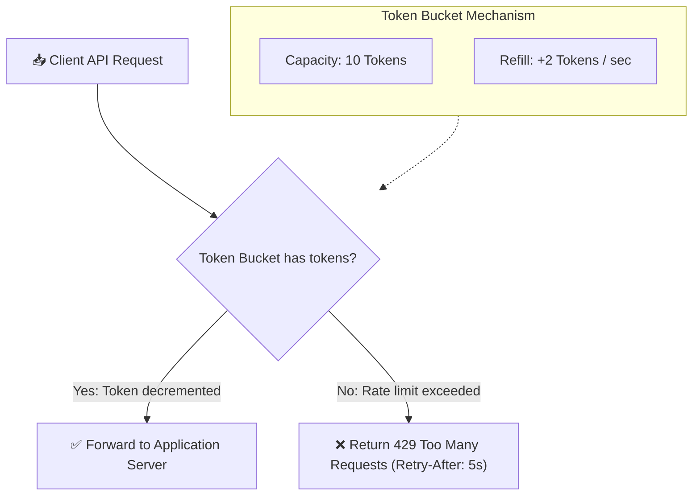

# 05 - Rate Limiting & Throttling

> **Real-World Analogy:**  
> Imagine a highway toll booth that only lets one car through every 5 seconds. Even if 100 cars arrive simultaneously after a sports game, the toll arm meters the flow so the highway ahead never encounters gridlock. Rate limiting meters client requests so backend servers never face resource starvation.

---

## 🎯 What & Why
Examines rate limiting and throttling strategies designed to protect web applications against abuse, accidental loops, denial of service, and resource exhaustion.

---

## 📊 Visual Architecture Diagram


---

## ⚙️ How It Works Under The Hood
### Core Rate Limiting Algorithms

1. **Token Bucket**:
   - A bucket holds up to $C$ tokens and is replenished at $r$ tokens per second.
   - Each request consumes 1 token.
   - **Trade-off**: Supports traffic bursts up to the capacity limit while keeping average rate bounded.

2. **Leaky Bucket**:
   - Incoming requests enter a FIFO queue. Requests leak out and are executed at a constant, fixed rate.
   - If the queue overflows, new requests are rejected.
   - **Trade-off**: Smooths out traffic into a steady stream; bursts are strictly buffered.

3. **Fixed Window Counter**:
   - Tracks requests within fixed time blocks (e.g., 00:00 to 00:01).
   - **Flaw**: 100 requests at 00:00:59 and 100 requests at 00:01:01 allows 200 requests in a 2-second interval (window boundary spike).

4. **Sliding Window Counter**:
   - Calculates request rate by combining the count from the current window with a fraction of the previous window based on elapsed time.
   - Prevents boundary spikes with minimal memory overhead.

---

## 💻 Concrete Code Implementation
```python
# Python implementation: Thread-safe Token Bucket Rate Limiter
import time
import threading

class TokenBucketLimiter:
    def __init__(self, capacity: int, refill_rate_per_sec: float):
        self.capacity = float(capacity)
        self.tokens = float(capacity)
        self.refill_rate = refill_rate_per_sec
        self.last_update = time.time()
        self.lock = threading.Lock()

    def allow(self, cost: int = 1) -> bool:
        with self.lock:
            now = time.time()
            elapsed = now - self.last_update
            # Add tokens accumulated during elapsed time
            self.tokens = min(self.capacity, self.tokens + (elapsed * self.refill_rate))
            self.last_update = now

            if self.tokens >= cost:
                self.tokens -= cost
                return True
            return False

if __name__ == "__main__":
    limiter = TokenBucketLimiter(capacity=3, refill_rate_per_sec=1.0)
    for i in range(1, 6):
        status = "PASSED" if limiter.allow() else "BLOCKED (HTTP 429)"
        print(f"Request {i}: {status}")

    print("Sleeping 1.5 seconds...")
    time.sleep(1.5)
    print("New request after sleep:", "PASSED" if limiter.allow() else "BLOCKED")

```

---

## ⚖️ Trade-Offs & Architectural Considerations
- **Scalability**: Decouple client-facing traffic from core compute.
- **Latency**: Optimize protocols (e.g., HTTP/3 QUIC, connection pools) to eliminate unnecessary round-trips.
- **Fault Tolerance**: Always enforce circuit-breakers and graceful degradations under heavy load.
