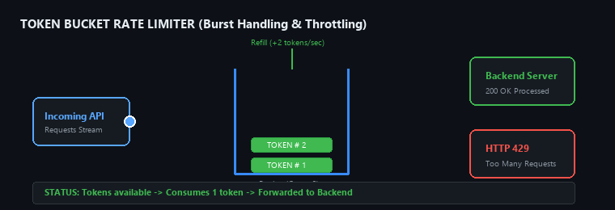
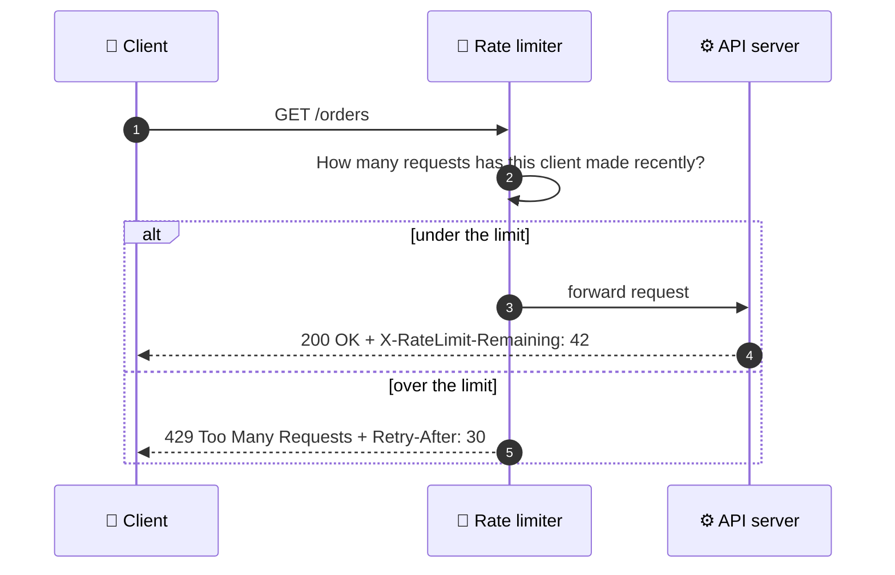

# 05 · Rate limiting

> **Part 1 · Networking & traffic** · ⏱️ ~20 min read · Prerequisites: [01 · Client–server networking](../01-client-server-networking/), [04 · API gateways](../04-api-gateways-and-proxies/)

## 🧒 The 30-second version

A rate limiter is a rule like **"each user may send at most 100 requests per minute."** When someone goes over the limit, the server politely says *"slow down, try again later"* (HTTP status **429 Too Many Requests**) instead of doing the work. This keeps one noisy user, buggy script or attacker from slowing the app down for everyone else.

## 🍕 Everyday analogy: the bubble-tea shop

A small bubble-tea shop has **one person making drinks**, and they can make about **one drink every 12 seconds** (5 per minute).

- Without a rule, a school bus arrives, 40 kids order at once, and everyone waits 8 minutes, including the regulars who just wanted one drink.
- So the shop gives every customer **tokens**: you get 5 tokens, each drink costs 1, and you get one token back every 12 seconds. A kid who already spent all 5 has to wait. Everyone else is still served quickly.

| In the shop | In the system |
| :--- | :--- |
| Customer | A client (user, API key or IP address) |
| Ordering a drink | Sending a request |
| Tokens in your pocket | Requests you're still allowed to make |
| "Sorry, wait a bit" | HTTP `429 Too Many Requests` + a `Retry-After` header |
| The drink-maker | Your servers and database: the limited resource you're protecting |

## 🧩 The problem it solves

Your API runs happily at **200 requests/second**. Then:

- a customer's script has a bug and retries in a tight loop at **5,000 req/s**, or
- someone tries 1 million passwords against your login page, or
- a free-tier user scrapes your whole catalogue.

Your database can handle maybe **1,000 req/s**. Without a limit it falls over, and **every** user gets errors, not just the misbehaving one. Rate limiting turns "the whole site is down" into "one client gets 429s".

It also helps with **cost** (paid APIs or LLM calls you forward to) and **fairness** (free vs paid tiers).

## 🖼️ Picture it

<p align="center">
  
</p>



1. The client sends a request as normal.
2. The rate limiter, which usually lives in the **API gateway** (see module 04), works out *who* is asking (user ID, API key or IP address) and checks that client's counter.
3. If there's room, the request goes through to the real server.
4. The response tells the client how many requests it has left, so well-behaved clients can slow down on their own.
5. If there's no room, the limiter answers immediately with **429**. The expensive server never even sees the request.

## 🔢 Walk-through with real numbers

Rule: **5 requests per 60 seconds.** A client sends **5 requests between 55 s and 59 s**, then **5 more between 60.5 s and 62.5 s**. That's 10 requests in under 8 seconds, double the limit. Here is what each algorithm does. This is real output from [`demo.py`](./demo.py):

```text
  time       fixed window      sliding log  sliding counter     token bucket     leaky bucket
  55.0s           ✅ allow          ✅ allow          ✅ allow          ✅ allow          ✅ allow
  56.0s           ✅ allow          ✅ allow          ✅ allow          ✅ allow          ✅ allow
  57.0s           ✅ allow          ✅ allow          ✅ allow          ✅ allow          ✅ allow
  58.0s           ✅ allow          ✅ allow          ✅ allow          ✅ allow          ✅ allow
  59.0s           ✅ allow          ✅ allow          ✅ allow          ✅ allow          ✅ allow
  60.5s           ✅ allow          ❌ 429            ✅ allow          ❌ 429            ❌ 429
  61.0s           ✅ allow          ❌ 429            ❌ 429            ❌ 429            ❌ 429
  61.5s           ✅ allow          ❌ 429            ❌ 429            ❌ 429            ❌ 429
  62.0s           ✅ allow          ❌ 429            ❌ 429            ❌ 429            ❌ 429
  62.5s           ✅ allow          ❌ 429            ❌ 429            ❌ 429            ❌ 429
  90.0s           ❌ 429            ❌ 429            ✅ allow          ✅ allow          ✅ allow
 110.0s           ❌ 429            ❌ 429            ✅ allow          ✅ allow          ✅ allow
 130.0s           ✅ allow          ✅ allow          ✅ allow          ✅ allow          ✅ allow
```

**Fixed window lets all 10 through.** The next section explains why, and each algorithm in turn.

## ⚙️ How it works: the five classic algorithms

### 1. Fixed window counter: "a counter that resets on the minute"

Keep one counter per client per minute: `requests[client][12:01] = 3`. When the clock moves to 12:02, start again from 0.

```text
window 0 (0–60s)                          window 1 (60–120s)
|-----------------------------[▮▮▮▮▮]|[▮▮▮▮▮]-----------------------------|
                               55–59s   60.5–62.5s
              counter = 5 → full      ↑ counter resets to 0 here
```

- ✅ Very simple: one number per client, easy to store in Redis with `INCR` + `EXPIRE`.
- ❌ **Boundary burst:** 5 requests at the end of one window plus 5 at the start of the next means 10 requests in a few seconds. In the table, that's every ✅ from 55 s to 62.5 s.
- ❌ It also punishes unfairly. The 90 s and 110 s requests get rejected because window 1 is "full", even though the burst ended long ago.

### 2. Sliding window log: "remember every timestamp"

Store the time of every accepted request. For a new request, throw away timestamps older than 60 s and count what's left.

At **60.5 s** the log holds `[55, 56, 57, 58, 59]`. All five are within the last 60 s, so the count is 5 and the request is **rejected**. At **90 s** they're *still* within the last 60 s (90 − 60 = 30, and 55 > 30), so that's rejected too. At **130 s** they've all expired, so it's allowed.

- ✅ **Exact.** Never more than 5 in *any* 60-second stretch.
- ❌ **Memory-hungry.** A limit of 10,000/hour means storing up to 10,000 timestamps per client.

### 3. Sliding window counter: "two counters and a bit of maths"

A clever middle ground. Keep only the counts for the **current** and **previous** fixed windows, and *estimate* the last 60 seconds by assuming the previous window's requests were spread evenly:

```text
estimate = current_count + previous_count × (fraction of the previous window still inside the last 60 s)
```

Worked example at **61.0 s**:

- previous window (0–60 s) accepted **5**
- current window (60–120 s) has accepted **1** so far (the one at 60.5 s)
- we're 1 s into the current window, so 59/60 of the previous window still overlaps the last 60 s

`estimate = 1 + 5 × 59/60 ≈ 5.92` → that's ≥ 5, so **reject**.

Notice it **allowed 60.5 s**: `0 + 5 × 59.5/60 ≈ 4.96` was just under 5. That's the approximation showing. It assumes the previous 5 requests were spread over the whole minute, when really they were bunched at the end. It slips by one, not by five, and it uses just two numbers per client. Big APIs often use this one.

### 4. Token bucket: "pocket full of tokens that slowly refills"

This is the bubble-tea shop. Each client has a bucket that holds at most **5 tokens** and gets **1 new token every 12 s** (5 per minute). Each request costs 1 token. No token means 429.

| time | tokens before | request? | tokens after |
| :-- | :-- | :-- | :-- |
| 55 s | 5.00 | ✅ | 4.00 |
| 59 s | ≈1.33 | ✅ | ≈0.33 |
| 60.5 s | ≈0.46 | ❌ (less than 1) | ≈0.46 |
| 90 s | ≈2.92 | ✅ | ≈1.92 |

- ✅ **Allows short bursts** (up to the bucket size) but keeps the long-run average fixed. Real users really do click a few times quickly.
- ✅ Only two numbers per client: `tokens` and `last_refill_time`.
- Two knobs to tune: **bucket size** (how bursty) and **refill rate** (the average speed).
- Used widely, for example by AWS API Gateway and Stripe.

### 5. Leaky bucket: "a funnel that drips at a fixed speed"

Requests pour into a funnel (a queue) that holds 5. They drip out to the server at a **constant** rate of one every 12 s. If the funnel is full, new requests spill over and are rejected.

- ✅ The server sees perfectly **smooth** traffic, which is great for something fragile like an old payment provider.
- ❌ Bursts are queued, not served quickly. A user who clicks 3 times waits for all 3 drips.

> In the demo, the leaky bucket gives the same allow/reject answers as the token bucket, because both have size 5 and the same speed. The difference is *when* accepted requests run: the token bucket serves them immediately, the leaky bucket queues them and releases them one every 12 s.

## ⚖️ Trade-offs

| Algorithm | Memory per client | Accuracy | Bursts | Pick it when… |
| :--- | :--- | :--- | :--- | :--- |
| Fixed window | 1 counter | ❌ up to 2× at boundaries | uncontrolled | you need something simple *now*, and 2× spikes are OK |
| Sliding log | 1 timestamp **per request** | ✅ exact | none | limits are small (e.g. 5 login attempts / 15 min) |
| Sliding window counter | 2 counters | ≈ very close | small | general API limits at scale |
| Token bucket | 2 numbers | ✅ exact average | ✅ allowed, up to the bucket size | user-facing APIs where short bursts are normal |
| Leaky bucket | queue of size N | ✅ | smoothed out | protecting something that needs a steady flow |

**Where to put the limiter**

| Place | Good for | Watch out |
| :--- | :--- | :--- |
| In the client app | Being nice, avoiding wasted calls | Never *trust* it: attackers don't use your app |
| API gateway / load balancer | One place for all services; rejects early and cheaply | Needs shared state if you run many gateways |
| Inside each service | Per-endpoint rules (e.g. expensive `/export`) | Logic gets duplicated across services |

**What to limit by**

- **API key / user ID:** fairest, but only works after login.
- **IP address:** works before login, but a whole office or mobile carrier can share one IP (NAT), so you may block innocent people.
- Often you need **both**: a loose per-IP limit plus a stricter per-user limit.

## 🚫 Common mistakes

- **Counting in each server's memory when you run 10 servers.** Each server allows 100/min, so the real limit is 1,000/min. → Keep counters in a shared store like Redis. That's [module 25](../25-system-design-rate-limiter/).
- **"Read count, then write count+1" as two steps.** Two servers both read `99`, both allow, and you're at 101. → Use an **atomic** operation (Redis `INCR`, or a Lua script that checks and increments in one step).
- **Returning 500 or just dropping the connection.** → Return **429** with `Retry-After`, so clients know it's on purpose and when to come back.
- **Clients retrying immediately after a 429.** That makes the storm worse. → Retry with **exponential backoff + jitter** ([module 20](../20-fault-tolerance-and-resilience/)).
- **Taking the whole API down when the rate limiter's Redis is down.** → Decide up front: *fail open* (allow traffic and log a warning) or *fail closed* (reject everything). Failing open keeps the product working; failing closed is safer for things like login protection.

## 💻 Try it yourself

```bash
cd 05-rate-limiting
python demo.py
```

All five algorithms take a fake clock (`now`) as input, so the run is repeatable. Things to try:

1. Change `TRAFFIC` to one request every 15 s for 2 minutes (`[i * 15.0 for i in range(9)]`). Every algorithm allows everything. Why? Now try every 10 s: who starts rejecting, and why?
2. Raise the token bucket's `capacity` to 10. What happens to the burst?
3. In `SlidingWindowCounter`, print `estimate` at each step and check the 60.5 s and 61 s maths above.

## 🌍 Where you'll see it

- **GitHub API:** 5,000 requests/hour per token. Check the `x-ratelimit-remaining` header on any response.
- **OpenAI, Anthropic and other LLM APIs:** separate limits for requests/min *and* tokens/min.
- **Login pages:** "Too many attempts, try again in 15 minutes."
- **Nginx** (`limit_req`) and **Cloudflare** rate-limiting rules.

## ✅ Check yourself

1. A rule says "10 requests per minute" and uses a fixed window. What's the most requests a client could get through in 2 seconds?

<details><summary>Answer</summary>

**20.** 10 at 12:00:59 and 10 at 12:01:00. The counter resets on the minute boundary.

</details>

2. Token bucket with capacity 20 and a refill of 1 token/second. A client has been idle for an hour. How many requests can it make instantly, and how many in the next 10 seconds after that?

<details><summary>Answer</summary>

**20 instantly** (the bucket is capped at 20, not 3,600), then **about 10 more** over the next 10 s at 1 per second.

</details>

3. You run 4 API servers, each with its own in-memory limit of 100/min. What's the real limit, and how do you fix it?

<details><summary>Answer</summary>

Up to **400/min**, because each server counts separately. Fix it with a shared counter (e.g. Redis) using atomic increments.

</details>

4. Why might limiting only by IP address block innocent users?

<details><summary>Answer</summary>

Many people can share one public IP: an office network, a university or a mobile carrier (NAT). One heavy user can use up the limit for all of them.

</details>

5. Which algorithm would you pick for "max 5 password attempts per 15 minutes", and why?

<details><summary>Answer</summary>

**Sliding log.** The limit is tiny, so storing 5 timestamps is cheap, and you want it **exact**. A boundary burst of 10 attempts would be a security hole.

</details>

## 📚 Go deeper

- **SDI-1 ch 4**, *Design a rate limiter*: an interview walk-through of these algorithms plus a full distributed design.
- **UDS**, *Upstream resiliency* chapter: rate limiting alongside load shedding and load leveling, as ways to protect a service from its callers.

## 🔗 Related

- [04 · API gateways & proxies](../04-api-gateways-and-proxies/): where rate limiters usually live.
- [20 · Fault tolerance & resilience](../20-fault-tolerance-and-resilience/): what *clients* should do when they get a 429.
- [25 · Distributed rate limiter](../25-system-design-rate-limiter/): running these algorithms across many servers with Redis.
