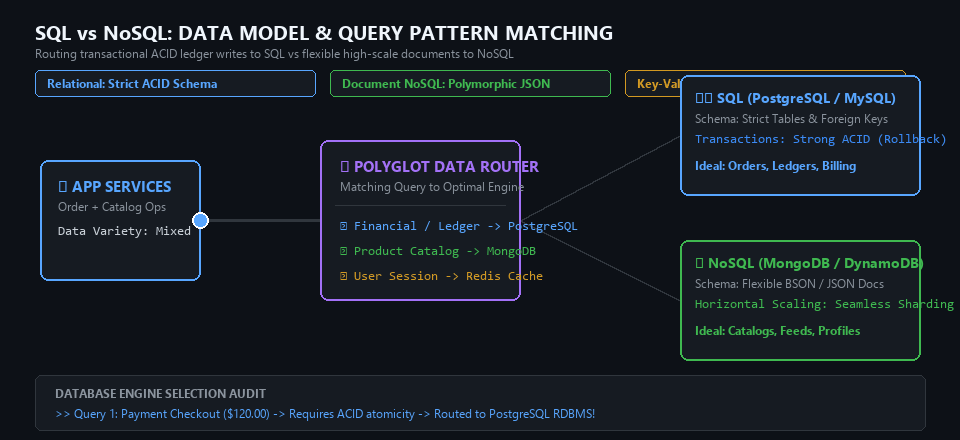
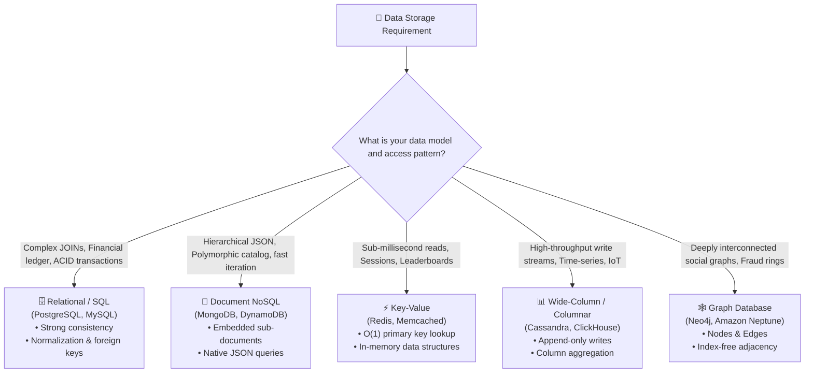

# 06 · Relational (SQL) vs Non-Relational (NoSQL) Databases

> **Part 2 · Storing data** · ⏱️ ~20 min read · Prerequisites: None (Foundational for Storage)

---

> 🏢 **Real-World Deep Dives**: Detailed case studies of how **Google** & **Netflix** implement this in production are documented in [REAL_WORLD_EXAMPLES.md](./REAL_WORLD_EXAMPLES.md).

## 🧒 The 30-second version

A **relational (SQL) database** is like a formal financial spreadsheet with strict rules: every row must follow the exact same column structure, every ID must point to a real record (**foreign keys**), and a transaction either succeeds $100\%$ or rolls back completely (**ACID**).

A **non-relational (NoSQL) database** is like a collection of labeled storage boxes: you can throw in flexible JSON documents of any shape, store simple key-value pairs at lightning speed, or scale horizontally across 50 servers without fighting schema constraints.

---

## 🍕 Everyday analogy: The Strict Financial Ledger vs The Labeled Cardboard Boxes

Imagine organizing a company's physical records:

- **Relational SQL (The Accountant's Ledger Book):** You have a hardbound book with rigid printed columns: `Date`, `Account Number`, `Amount`, `Description`.
  - You cannot add half an entry. If money moves from Account A to Account B, both rows must update simultaneously. If you write down an invalid Account Number that doesn't exist on Page 1, the ledger rejects the entry (**Foreign Key Constraint**).
  - Perfect for accounting, contracts, and banking.
- **Document NoSQL (The Labeled Manila Folders):** Each customer gets a manila folder.
  - Inside Customer A's folder is a simple paper note with an address.
  - Inside Customer B's folder is an address, 3 tax forms, a business card, and a list of 10 phone numbers.
  - You didn't have to reprint the entire company's filing cabinets just because Customer B had extra attributes (**Schema Flexibility**).

| In everyday life | In database architecture |
| :--- | :--- |
| **Accountant's Printed Table** | **SQL Relational Table** (`users`, `orders`) |
| **Row in a ledger** | **Database Record / Tuple** |
| **Strict rules ("Must match Account ID")** | **Foreign Key & Check Constraints** |
| **Manila Folder with mixed papers** | **NoSQL Document (JSON / BSON)** (MongoDB) |
| **Locker with a number and padlock** | **Key-Value Store** (Redis) |
| **Flipping pages backwards to undo a mistake** | **ACID Transaction Rollback** |

---

## 🧩 The problem it solves

In 1995, almost all software ran on a single relational database (Oracle or MySQL). As internet traffic exploded in the 2010s, two major problems emerged:

1. **Schema Rigidity at Scale:** If an e-commerce catalog sells laptops, shoes, and groceries, laptops have `voltage` and `ram`, shoes have `size` and `material`, and groceries have `expiration_date`. In a relational database, you either create 50 nullable columns (`ALTER TABLE` takes 12 hours on a 500M row table and locks writes) or design complex join tables. Document NoSQL lets every product store its own custom attributes natively in JSON.
2. **The Horizontal Scaling Ceiling:** Relational databases are designed for **strong consistency on a single physical machine**. Running complex cross-table `JOIN` operations across 20 machines distributed over network cables is notoriously slow and difficult. NoSQL datastores trade away relational joins to distribute rows cleanly across hundreds of cluster nodes.

---

## 🖼️ Picture it

<p align="center">
  
</p>



---

## 🔢 Walk-through with real numbers

### Data Representation: Normalized SQL vs Denormalized NoSQL

Suppose you are querying a user profile and their 3 shipping addresses:

#### 1. Relational SQL (Normalized across 2 tables)
- `users` table: 1 row ($120\text{ bytes}$)
- `addresses` table: 3 rows ($3 \times 150\text{ bytes} = 450\text{ bytes}$)
- **Query:** `SELECT * FROM users JOIN addresses ON users.id = addresses.user_id WHERE users.id = 42;`
- **Execution Cost:** 2 B-Tree index lookups + in-memory join hash table construction.

#### 2. Document NoSQL (Denormalized into 1 document)
- Single JSON document stored contiguously on disk:
  ```json
  {
    "_id": "usr_42",
    "name": "Alice",
    "addresses": [
      {"city": "New York", "zip": "10001"},
      {"city": "Austin", "zip": "78701"},
      {"city": "Seattle", "zip": "98101"}
    ]
  }
  ```
- **Query:** `db.users.findOne({_id: "usr_42"})`
- **Execution Cost:** 1 single primary key lookup. Zero table joins. Fetches all data in a single sequential disk/memory read!

---

## ⚙️ How it works: SQL vs NoSQL Taxonomy

### 1. ACID vs BASE

| Property | ACID (Relational SQL) | BASE (Distributed NoSQL) |
| :--- | :--- | :--- |
| **A** | **Atomicity:** All operations succeed, or all roll back | **Basically Available:** System remains up despite node crashes |
| **C / S** | **Consistency:** Database satisfies all schema constraints | **Soft State:** Data values may change over time without user input |
| **I / E** | **Isolation:** Concurrent transactions don't corrupt state | **Eventual Consistency:** Replicas converge after propagation delay |
| **D** | **Durability:** Committed data survives crashes/power loss | Durability via multi-node replication |

---

### 2. The 5 Main Categories of Datastores

#### 1. Relational (RDBMS): PostgreSQL, MySQL
- Tables with fixed columns, foreign keys, and SQL query language.
- Enforces strict data integrity and eliminates redundancy via **normalization**.
- Best for: Payment ledgers, user accounts, order checkouts, inventory stock.

#### 2. Document Stores: MongoDB, Amazon DynamoDB
- Stores data as semi-structured documents (JSON, BSON, XML).
- Documents can nest child arrays and objects directly without separate tables.
- Best for: Content management, e-commerce product catalogs, user profiles.

#### 3. Key-Value Stores: Redis, Memcached
- Stores arbitrary values mapped to a unique key string.
- In-memory execution delivers reads and writes in **sub-millisecond ($< 0.5\text{ ms}$)** time.
- Best for: User session tokens, shopping carts, rate-limiting counters.

#### 4. Wide-Column / Columnar: Apache Cassandra, ScyllaDB, ClickHouse
- Groups data on disk by columns rather than rows.
- **Cassandra:** Append-only LSM-tree storage engine optimized for hundreds of thousands of concurrent writes per second.
- **ClickHouse:** Columnar analytical storage (OLAP) capable of scanning billions of rows per second for analytical dashboards.
- Best for: High-throughput write telemetry, IoT sensor logging, analytical aggregations.

#### 5. Graph Databases: Neo4j, Amazon Neptune
- Models entities as **Nodes** and relationships as **Edges** with first-class properties.
- Eliminates recursive foreign-key joins using **Index-Free Adjacency** (navigating pointers directly in memory).
- Best for: Social networks (friend-of-a-friend), fraud detection rings, recommendation engines.

---

## ⚖️ Trade-offs & The Comprehensive Decision Framework

```text
Do you require ACID transactions and complex multi-table JOINs?
├── YES ──> Use PostgreSQL / MySQL
└── NO  ──> What is your primary access pattern?
            ├── High-speed primary key lookup / caching ──> Redis / Memcached
            ├── Flexible nested attributes / JSON docs ────> MongoDB / DynamoDB
            ├── Massive write throughput / time-series ────> Apache Cassandra / ScyllaDB
            ├── Millions of rows analytical queries ───────> ClickHouse / Snowflake
            └── Highly connected social or fraud graphs ──> Neo4j
```

---

## 🚫 Common mistakes & production pitfalls

1. **Premature NoSQL Adoption ("SQL doesn't scale"):**
   - *The Myth:* Many junior engineers assume PostgreSQL cannot scale beyond 1 million users. In reality, modern PostgreSQL on standard cloud hardware easily handles $10,000+\text{ RPS}$ and tens of millions of records.
   - *The Trap:* Moving to MongoDB too early means you lose foreign keys, transactions, and unique constraints. You end up writing buggy, complex validation code in your application layer to mimic what Postgres does automatically.

2. **Re-implementing JOINs in Application Code with NoSQL:**
   - *The Trap:* You store users in one collection and orders in another. To show an order history page, your backend executes 1 query for the orders, then loops and fires 50 individual queries to fetch user data (**the N+1 Query Problem**), destroying latency.
   - *The Fix:* In NoSQL, design your data model around your **access queries**. Denormalize and embed the data directly if it is frequently read together!

3. **Unbounded Document Growth in MongoDB:**
   - *The Trap:* Embedding an array that grows infinitely inside a single document (e.g. embedding all user comments inside a blog post document).
   - *Why it hurts:* MongoDB documents are hard-capped at **16 MB**. When an array outgrows 16 MB, writes crash, and moving fragmented documents causes massive disk I/O thrashing.

---

## 💻 Try it yourself

Run the interactive simulator in this folder:

```bash
cd 06-relational-and-non-relational-databases
python demo.py
```

### What to explore in `demo.py`:
1. Watch an **ACID transaction rollback** in SQL when an account has insufficient funds or when a foreign key violation occurs.
2. Observe how a **NoSQL document store** accepts completely different polymorphic schemas (a Laptop with CPU specs vs a T-Shirt with clothing sizes) without database migrations.
3. Observe **O(1) Key-Value retrieval** timing.

---

## 🌍 Where you'll see it in production

- **Stripe:** Uses **PostgreSQL** as the core database for payments because strong consistency, zero data loss, and ACID guarantees are strictly mandatory for money.
- **Discord:** Originally used MongoDB, then migrated to **Apache Cassandra**, and recently to **ScyllaDB** to store trillions of chat messages partitioned by channel ID.
- **Uber:** Uses a combination of **MySQL** (via their custom Schemaless sharding layer), **Redis** for driver geolocation caching, and **ClickHouse** for ride analytics.

---

## 🎯 Top Interview Questions & Deep Answers

### Q1: "When would you choose a NoSQL document database (MongoDB) over a relational database (PostgreSQL)?"

<details>
<summary>💡 Click to reveal the ideal senior engineering answer</summary>

I evaluate database selection based on **schema stability**, **read/write patterns**, and **scaling model**:

- **Choose MongoDB / Document NoSQL when:**
  1. **Polymorphic / Dynamic Schemas:** The data naturally forms a hierarchical document where items have widely varying attributes (e.g., e-commerce product catalogs with 10,000 distinct product categories, or CMS content blocks).
  2. **High Document Locality:** Data is always written and read together as a single unit (e.g. an order with its line items and shipping address). Reading 1 document from disk is significantly faster than performing a 4-table SQL JOIN.
  3. **Rapid Horizontal Partitioning:** When dataset size exceeds multi-terabyte limits where automated, built-in horizontal sharding is preferred over manual Postgres sharding.
- **Choose PostgreSQL when:**
  1. Strong **ACID guarantees** and strict relational integrity (foreign keys) are required (e.g. banking, financial balances, supply-chain inventory).
  2. Complex relational analytical queries across many disparate business entities are routine.
  3. Note: Modern PostgreSQL natively supports `JSONB` columns with GIN indexes, allowing hybrid models (relational structure with semi-structured JSON fields).

</details>

---

### Q2: "Explain ACID vs BASE. What do you actually sacrifice when moving to an eventual consistency model?"

<details>
<summary>💡 Click to reveal the ideal senior engineering answer</summary>

- **ACID (Pessimistic & Strong):**
  - Prioritizes **immediate global consistency**.
  - When a transaction commits, all locks are honored, constraints are validated, and every subsequent read across any replica immediately reflects the newest update.
  - **The Cost:** Higher latency during writes, reduced horizontal scaling, and vulnerability to node unavailability during network partitions (CAP theorem CP).
- **BASE (Optimistic & Eventual):**
  - Prioritizes **high availability and low latency**.
  - A write is accepted by a local replica and acknowledged immediately. Replicas synchronize asynchronously in the background.
  - **What you sacrifice:** You sacrifice **read freshness**. A user who updates their bio might refresh the page and read from a replica that has not yet received the replication stream, seeing their old bio for 200 ms (**stale read**). If concurrent conflicting writes occur on two nodes, the system must resolve conflicts via Last-Write-Wins (LWW) or CRDTs.

</details>

---

### Q3: "Why does Apache Cassandra achieve millions of writes per second while PostgreSQL struggles with write saturation?"

<details>
<summary>💡 Click to reveal the ideal senior engineering answer</summary>

The difference comes down to the underlying **Storage Engine architecture**:

1. **PostgreSQL uses B-Tree Storage Engines:**
   - Modifying a row in a B-Tree requires **random in-place disk overwrites** to update 8KB or 16KB disk pages.
   - If a table has 5 indexes, an `INSERT` triggers random disk writes across multiple index tree pages. Under high concurrency, disk head seek times (or SSD random I/O write amplification) bottleneck throughput.
2. **Cassandra uses Log-Structured Merge (LSM) Trees:**
   - Cassandra never modifies data in-place on disk.
   - Every write is appended sequentially to an append-only commit log on disk, and inserted into an in-memory sorted structure called a **MemTable**.
   - Because sequential disk appends are $100\times$ faster than random seeks, Cassandra absorbs massive write streams without latency spikes. Periodically, MemTables are flushed to disk as immutable **SSTables**.

</details>

---

### Q4: "What is Polyglot Persistence, and how does a modern enterprise architecture apply it?"

<details>
<summary>💡 Click to reveal the ideal senior engineering answer</summary>

**Polyglot Persistence** is the architectural practice of using different specialized database engines for different microservices within the same enterprise, rather than forcing all data into a single generic database:

- **Example: An Uber or DoorDash Architecture:**
  1. **PostgreSQL:** Handles User Authentication, Payment Accounts, and Billing Invoices (mandates ACID).
  2. **Redis:** Holds real-time driver locations, session tokens, and rate limits (requires $< 1\text{ ms}$ in-memory latency).
  3. **Apache Cassandra / ScyllaDB:** Stores ride history telemetry coordinates emitted every 3 seconds from 5 million cars (massive write stream).
  4. **Elasticsearch:** Powers search boxes with fuzzy matching for restaurant menus and addresses.
  5. **ClickHouse:** Powers the internal business analytics dashboard calculating hourly revenue across cities.

</details>

---

## ✅ Check yourself

1. **A team builds an accounting ledger. They choose MongoDB without transactions. What critical failure mode can occur when transferring money between two accounts?**

<details>
<summary>View Answer</summary>

A **partial failure (violation of Atomicity)**. If the system deducts \$100 from Account A, and the server crashes or the network drops before the \$100 is added to Account B, the \$100 has permanently vanished into thin air. A relational database with ACID transactions guarantees that either both accounts update or neither updates.

</details>

---

2. **In a NoSQL Document Store, when should you EMBED data inside a document vs REFERENCE it with an ID?**

<details>
<summary>View Answer</summary>

- **Embed when:** Data has a strict 1-to-1 or bounded 1-to-few relationship, and is always read and written together (e.g., an Order and its 3 OrderLineItems).
- **Reference when:** Data has a 1-to-many relationship that grows unbounded (e.g. a Celebrity user with 50 million followers), or when data is frequently modified independently from multiple contexts.

</details>

---

3. **Why do Columnar databases (ClickHouse) process analytical queries (`SELECT AVG(age) FROM users`) 100x faster than Row-based databases (PostgreSQL)?**

<details>
<summary>View Answer</summary>

In row-based databases, all columns of a row are stored contiguously on disk. To compute the average age, PostgreSQL must read every single byte of every user row (names, hashed passwords, bios, emails) from disk into RAM just to discard 95% of the data.  
In columnar databases, all `age` values are stored contiguously on disk. ClickHouse reads **only the `age` column** from disk, using SIMD CPU instructions and vector processing to crunch millions of numbers per second.

</details>

---

## 📚 Go deeper

- **Designing Data-Intensive Applications (DDIA)** by Martin Kleppmann: Chapter 2 (*Data Models and Query Languages*) and Chapter 3 (*Storage and Retrieval*).
- **Database Internals** by Alex Petrov: In-depth comparison of B-Tree vs LSM-Tree storage engines.

---

## 🔗 Related modules

- [07 · Database replication](../07-database-replication/): How SQL and NoSQL databases scale reads and survive hardware failures.
- [08 · Database partitioning](../08-database-partitioning/): How to shard databases when data exceeds a single server.
- [09 · Storage engines & indexes](../09-storage-engines-and-indexing/): The B-Tree and LSM-Tree mechanics powering these engines.
