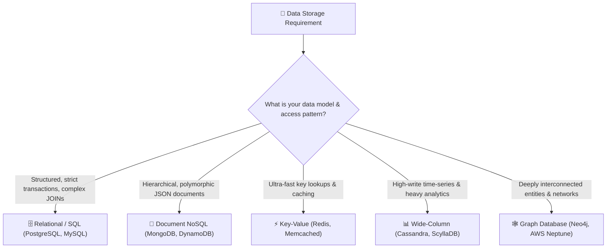

# 06 - Relational (SQL) vs Non-Relational (NoSQL) Databases

> **Real-World Analogy:**  
> A relational database is like a formal financial spreadsheet with strict column types, mandatory rows, and foreign keys—every transaction must fit the ledger rules precisely. A NoSQL database is like a collection of labeled cardboard boxes: you can toss in documents of different shapes, sizes, and formats without needing a rigid schema upfront.

---

## 🎯 What & Why
Explores the fundamental design differences between relational databases (PostgreSQL, MySQL) and non-relational datastores (MongoDB, Redis, Cassandra, Neo4j), comparing ACID vs BASE properties.

---

## 📊 Visual Architecture Diagram


---

## ⚙️ How It Works Under The Hood
### ACID vs BASE

- **ACID (Relational / SQL)**:
  - **Atomicity**: All operations in a transaction succeed, or none do (rollback).
  - **Consistency**: The database transitions from one valid state to another, satisfying all constraints.
  - **Isolation**: Concurrent transactions execute without interfering with one another.
  - **Durability**: Once committed, data persists even across hardware crashes or power loss.

- **BASE (NoSQL / Distributed)**:
  - **Basically Available**: The system remains operational despite node failures.
  - **Soft State**: Values may change over time even without new inputs due to replication propagation.
  - **Eventual Consistency**: Given sufficient time without new updates, all replicas converge to the same value.

---

### Database Categories At A Glance

1. **Relational (RDBMS)**: Highly structured, supports ACID transactions and complex relational algebra (`JOIN`). Ideal for financial ledgers, order management, and core business identities.
2. **Document Stores**: Stores flexible JSON-like documents. Ideal for catalogs, content management, and user profiles.
3. **Key-Value Stores**: O(1) reads and writes by primary key. Ideal for session stores, shopping carts, and leaderboard caches.
4. **Wide-Column / Columnar**: Stores data grouped by columns rather than rows. Ideal for high-throughput write streams (IoT, logs, clickstreams) and OLAP analytical queries.
5. **Graph Databases**: Nodes and edges with first-class relationships. Ideal for social networks, fraud detection, and recommendation engines.

---

## 💻 Concrete Code Implementation
```python
# Python comparison: Simulating an in-memory Key-Value store vs Document store

class SimpleKeyValueStore:
    def __init__(self):
        self._store = {}

    def set(self, key: str, value: str):
        self._store[key] = value

    def get(self, key: str):
        return self._store.get(key)

class SimpleDocumentStore:
    def __init__(self):
        self._collection = {}

    def insert(self, doc_id: str, document: dict):
        self._collection[doc_id] = document

    def find_by_field(self, field: str, value):
        return [doc for doc in self._collection.values() if doc.get(field) == value]

if __name__ == "__main__":
    # Key-Value
    kv = SimpleKeyValueStore()
    kv.set("session_user_42", "token_xyz789")
    print("KV lookup:", kv.get("session_user_42"))

    # Document
    docs = SimpleDocumentStore()
    docs.insert("doc1", {"id": "doc1", "type": "article", "author": "Alice", "tags": ["tech", "ai"]})
    docs.insert("doc2", {"id": "doc2", "type": "article", "author": "Bob", "tags": ["health"]})
    print("Document query by author Alice:", docs.find_by_field("author", "Alice"))

```

---

## ⚖️ Trade-Offs & Architectural Considerations
- **Data Freshness**: Always configure appropriate TTLs to balance staleness vs database load.
- **Resource Limits**: Size in-memory clusters appropriately and set clear eviction policies.
- **Consistency**: Understand the trade-offs between sync writes and async replication.
