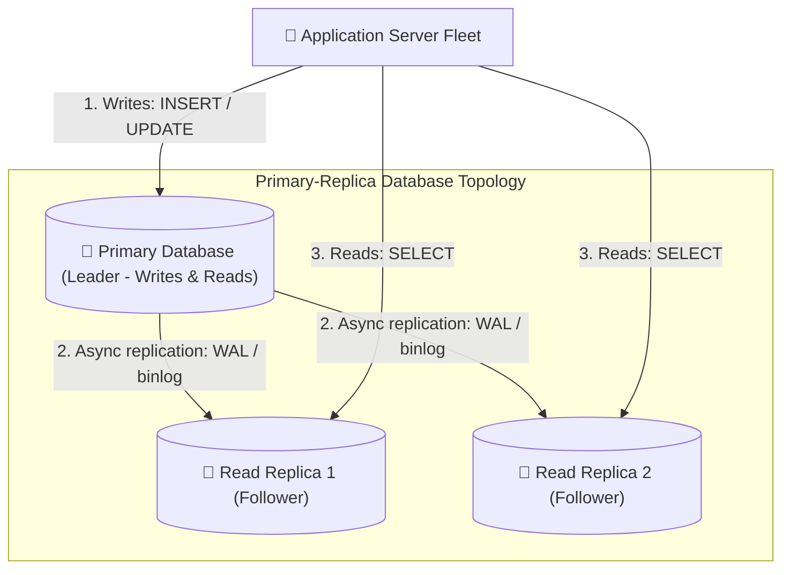

# 07 - Database Replication & High Availability

> **Real-World Analogy:**  
> Imagine an executive chef and three line cooks. The executive chef takes all incoming orders and writes the master menu (Leader). She passes copies of the order tickets to the line cooks (Replicas). When customers ask what the special of the day is, any line cook can answer (Read Scaling), but only the executive chef can change the recipe (Write Master).

---

## 🎯 What & Why
Examines database replication topologies: single-leader, multi-leader, and leaderless architectures, discussing replication lag, failover procedures, and read-after-write consistency.

---

## 📊 Visual Architecture Diagram


---

## ⚙️ How It Works Under The Hood
### Replication Topologies

1. **Single-Leader (Master-Slave)**:
   - All writes are processed by the single leader node.
   - Replicas stream the Write-Ahead Log (WAL) or binlog from the leader to stay synchronized.
   - Scalable for **read-heavy** workloads (e.g., 95% reads, 5% writes).
   - If the leader fails, a follower is promoted to be the new leader: by an operator, by a failover tool (e.g. Patroni for PostgreSQL), or by a consensus-based election. With asynchronous replication, writes the old leader hadn't shipped yet can be lost.

2. **Multi-Leader (Master-Master)**:
   - Multiple nodes across different geographical datacenters accept writes.
   - Useful for low-latency writes across continents and resilience against regional outages.
   - **Challenge**: Write conflicts occur when two users modify the same record concurrently in different datacenters. Requires conflict resolution strategies (Last-Write-Wins, CRDTs, or application-level merges).

3. **Leaderless (Dynamo-style, Cassandra)**:
   - Clients send read and write requests to any node (or a coordinator).
   - Uses **Quorum Reads and Writes** ($W + R > N$) to ensure at least one overlapping replica holds the latest version of data. Example: keep N = 3 copies, write to W = 2 and read from R = 2. Since 2 + 2 > 3, every read touches at least one copy that has the latest write.

---

### Common Replication Pitfalls

- **Replication Lag**: In asynchronous replication, replicas lag behind the primary. A user updates their profile and refreshes the page, reading from a stale replica where the change has not yet propagated.
- **Solution - Read-After-Write Consistency**: Route a user's reads to the primary for a short window after they write (e.g. one minute), or until the replica has caught up to that write.

---

## 💻 Concrete Code Implementation
```python
# Leader + 2 followers with REAL replication lag:
# writes reach the leader immediately but wait in a queue until replicate() runs.
import random

class DatabaseCluster:
    def __init__(self):
        self.leader = {}
        self.followers = [{}, {}]
        self.pending = []  # changes not yet copied to followers

    def write(self, key: str, value: str):
        self.leader[key] = value
        self.pending.append((key, value))  # asynchronous: followers get it later

    def replicate(self):
        for key, value in self.pending:
            for follower in self.followers:
                follower[key] = value
        self.pending.clear()

    def read_leader(self, key: str):
        return self.leader.get(key)

    def read_follower(self, key: str):
        return random.choice(self.followers).get(key)

if __name__ == "__main__":
    db = DatabaseCluster()
    db.write("user:101:name", "Alice")
    db.replicate()

    db.write("user:101:name", "Alice Smith")  # the user edits their profile...
    print("Leader says:  ", db.read_leader("user:101:name"))
    print("Follower says:", db.read_follower("user:101:name"), "<- stale! (replication lag)")

    db.replicate()
    print("After replication, follower says:", db.read_follower("user:101:name"))
```

---

## ⚖️ Trade-offs

| Decision | Trade-off |
| :--- | :--- |
| **Synchronous replication** | No data loss on failover, but every write waits for the follower, and a slow follower slows all writes |
| **Asynchronous replication** | Fast writes, but followers lag (stale reads) and a crash can lose the latest writes |
| **Semi-synchronous** (1 sync follower, the rest async) | A common middle ground: at least two copies of every write |
| **Single-leader** | Simple and no write conflicts; write throughput limited to one machine |
| **Multi-leader** | Low-latency writes in several regions; you must resolve conflicting writes |
| **Leaderless (quorums)** | Keeps working when some nodes are down; reads and writes cost more round trips, and conflicts still happen |
| **More read replicas** | More read capacity, but more lag to monitor and more places to read stale data |
