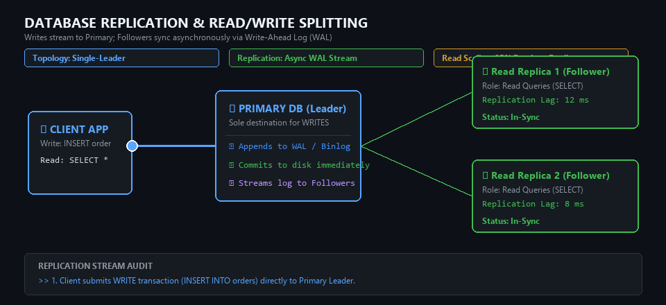
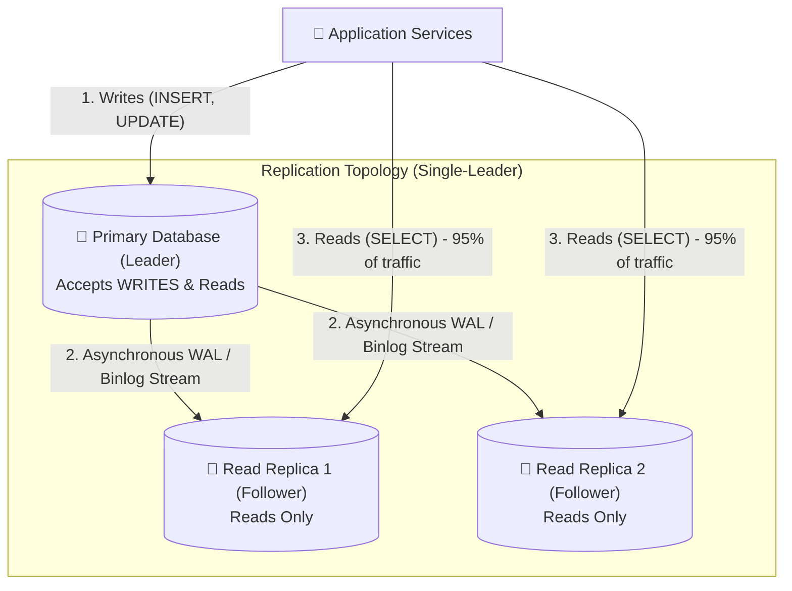
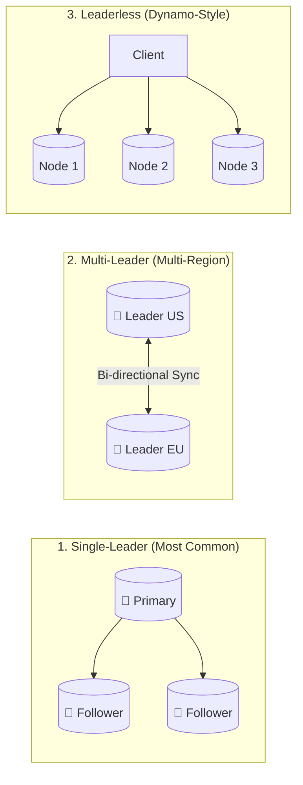

# 07 · Database Replication & High Availability

> **Part 2 · Storing data** · ⏱️ ~20 min read · Prerequisites: [06 · SQL vs NoSQL](../06-relational-and-non-relational-databases/)

---

> 🏢 **Real-World Deep Dives**: Detailed case studies of how **Google** & **Netflix** implement this in production are documented in [REAL_WORLD_EXAMPLES.md](./REAL_WORLD_EXAMPLES.md).

## 🧒 The 30-second version

If you store all your company's data on a single database server and that server's hard drive dies, your business is gone. 

**Database replication** means keeping exact, live copies of your data on multiple separate servers across the network. If the main server (the **Leader**) catches fire, one of the backup copies (the **Followers**) automatically takes over. Furthermore, because $95\%$ of internet traffic is reading data rather than writing it, you can distribute millions of read queries across your followers so the main server never slows down.

---

## 🍕 Everyday analogy: The Head Chef & Line Cooks

Imagine the kitchen of a Michelin-starred restaurant:

- **The Executive Chef (Leader / Primary):** The head chef holds the master recipe book. Only the head chef is allowed to create new dishes or change a recipe (**Write Operations**).
- **The Line Cooks (Followers / Read Replicas):** Every time the head chef updates a recipe, she writes a copy of the change onto an order board (the **Replication Log**). The line cooks read the board and memorize the new steps.
- **Serving Customers (Read Scaling):** When 200 diners ask *"What are the ingredients in the soup?"*, any line cook can answer immediately (**Read Queries**). The head chef doesn't have to stop cooking to answer questions.
- **Replication Lag:** If the head chef changes the soup recipe at 6:00:00 PM, and Line Cook 3 hasn't looked at the board yet at 6:00:01 PM, Line Cook 3 might recite the old recipe for a few seconds (**Eventual Consistency**).

| In the restaurant kitchen | In database replication |
| :--- | :--- |
| **Head Chef** | **Primary Database (Leader)** — accepts all `INSERT / UPDATE / DELETE` |
| **Line Cooks** | **Read Replicas (Followers)** — accept `SELECT` read queries |
| **Recipe Change Board** | **Write-Ahead Log (WAL) / Binlog Stream** |
| **Cook reading board late** | **Replication Lag** (milliseconds to seconds) |
| **Head chef fainting $\to$ Sous chef takes over** | **Automated Leader Failover** |

---

## 🧩 The problem it solves

1. **Hardware Mortality:** Disk drives, power supplies, and RAM sticks fail every single day in cloud datacenters. Replication guarantees that when hardware fails, zero data is lost.
2. **Read Traffic Overload:** Most web applications have a $10:1$ to $100:1$ read-to-write ratio (Twitter, Reddit, YouTube). A single PostgreSQL instance might choke at $2,000\text{ reads/sec}$. By spinning up 5 read replicas, you can effortlessly serve $10,000+\text{ reads/sec}$.
3. **Geographical Data Locality:** Placing read replicas in Frankfurt, Singapore, and Virginia allows European, Asian, and American users to read records from a local datacenter in $< 5\text{ ms}$ instead of sending packets across oceans.

---

## 🖼️ Picture it

<p align="center">
  
</p>



1. All write transactions (`INSERT`, `UPDATE`, `DELETE`) are processed exclusively by the Primary Leader.
2. The Primary writes mutations to its local **Write-Ahead Log (WAL)** on disk and streams those log events across the network to all Followers.
3. Followers read the stream and apply transactions in the exact same sequence to their local storage engines.
4. Read queries are load-balanced across the follower fleet.

---

## 🔢 Walk-through with real numbers

### Synchronous vs Asynchronous Replication Latency Math

Suppose your Primary database is in **Virginia (US-East)** and you configure a Read Replica in **Frankfurt (EU-Central)**:
- Physical fiber Round-Trip Time (RTT): **$75\text{ ms}$**.

| Replication Mode | How it writes | Write Latency | Risk on Primary Crash |
| :--- | :--- | :---: | :--- |
| **Synchronous** | Primary writes locally $\to$ sends to Frankfurt $\to$ waits for confirmation $\to$ returns OK to user | **$75\text{ ms} + \text{disk I/O} \approx 80\text{ ms}$** (Slow!) | **$0\text{ data loss}$** (Replica guaranteed up to date) |
| **Asynchronous** | Primary writes locally $\to$ returns OK to user immediately ($1\text{ms}$) $\to$ streams to Frankfurt in background | **$1.5\text{ ms}$** (Lightning fast!) | **Data loss risk:** If Primary dies before log reaches Frankfurt, last 100ms of writes are lost |
| **Semi-Synchronous** | Primary waits for **at least 1** local replica in same datacenter ($0.5\text{ms}$ RTT) before returning OK | **$2\text{ ms}$** (Fast & Safe) | **Zero data loss** within primary region |

---

## ⚙️ How it works: Replication Topologies & Consistency Guarantees

### 1. Single-Leader vs Multi-Leader vs Leaderless



1. **Single-Leader (Postgres, MySQL, MongoDB):**
   - All writes flow through one primary node. Clean, straightforward, avoids write conflicts.
2. **Multi-Leader (Active-Active across Datacenters):**
   - Writes are accepted in both US and EU datacenters.
   - **The Conflict Problem:** User A in US updates row 10 to `"Red"`; User B in EU updates row 10 to `"Blue"` at the exact same millisecond. Resolving conflicting writes requires complex reconciliation (Last-Write-Wins timestamps, CRDTs, or operational transforms).
3. **Leaderless (Apache Cassandra, Amazon DynamoDB, ScyllaDB):**
   - Any client can write directly to any node.
   - Uses **Quorums** to guarantee consistency.

---

### 2. Quorum Math in Leaderless Systems ($W + R > N$)

In a cluster of $N$ replicas:
- $W$ = Number of replicas that must acknowledge a **write** before it is considered successful.
- $R$ = Number of replicas that must respond to a **read** query.

$$\text{Strict Consistency Condition: } W + R > N$$

**Why this formula guarantees fresh reads:**
- Suppose cluster size $N = 3$.
- You configure $W = 2$ and $R = 2$ ($2 + 2 = 4 > 3$).
- When you write, at least 2 nodes receive the newest version ($V_2$).
- When you read, you query 2 nodes. By the Pigeonhole Principle, **at least one node in your read set is guaranteed to have participated in the write set!**
- The client inspects the version timestamps, sees $V_2 > V_1$, returns $V_2$ to the user, and triggers a background **Read Repair** to update the stale replica!

---

### 3. The 3 Classic Replication Lag Anomalies

When using asynchronous read replicas, clients experience three notorious bugs:

1. **Read-Your-Own-Writes Anomaly:** A user submits a comment, refreshes the page, and the comment disappears because their read query hit a replica that is 500 ms behind!
   - *Fix:* If a user recently wrote data, route that specific user's reads to the Primary for a 5-second window.
2. **Monotonic Reads Anomaly:** A user refreshes repeatedly. First read hits an up-to-date replica (sees comment). Second read hits a lagging replica (comment disappears!). It looks like time is traveling backwards.
   - *Fix:* Ensure a user always reads from the same replica using consistent hashing on `user_id`.
3. **Consistent Prefix Reads Anomaly:** If Question and Answer are written in order, but the Answer arrives at a replica before the Question, readers see the answer before the question, violating causal ordering.
   - *Fix:* Ensure causally related writes are partitioned to the same replication shard.

---

## ⚖️ Trade-offs: Sync vs Async Replication Matrix

| Feature | Asynchronous Replication | Synchronous Replication |
| :--- | :--- | :--- |
| **Write Latency** | Low ($1\text{–}2\text{ ms}$) — does not wait for network transit | High ($10\text{–}100\text{ ms}$) — bounded by slowest replica RTT |
| **Primary Write Availability** | High — primary accepts writes even if all replicas disconnect | Low — if 1 synchronous replica hangs, **all writes freeze** |
| **Data Loss Risk (RPO)** | Non-zero — transactions in flight during primary crash can be lost | Zero — committed transactions guaranteed on replica disk |
| **Read Consistency** | Eventual — reads can be stale during replication lag | Strong — reads on synchronous replica reflect newest state |
| **Recommended Use** | Standard web APIs, social media, read scaling fleets | Financial ledgers, banking transfers, inventory counts |

---

## 🚫 Common mistakes & production pitfalls

1. **The "Split-Brain" Catastrophe:**
   - *What happens:* A temporary network partition occurs between Primary and Replica. The Replica mistakenly assumes the Primary died and promotes itself to Leader. Now you have **two Leaders** accepting writes independently! When the network heals, their datasets have diverged irrecoverably.
   - *The Fix:* Require an **odd-numbered consensus quorum** (e.g. 3 or 5 nodes using Raft / Paxos). A node can only become Leader if it wins votes from a strict majority ($\lfloor N/2 \rfloor + 1$).

2. **Sending heavy analytical queries to the same replica pool serving web users:**
   - *Why it hurts:* A data scientist runs a massive report (`SELECT * FROM orders WHERE year=2023`) that consumes 100% CPU on Replica 1. Replication lag on Replica 1 spikes from 10 ms to 15 minutes, causing regular users to see stale data.
   - *The Fix:* Dedicate a **separate analytical replica** isolated with custom tags, keeping production read pools untouched.

---

## 💻 Try it yourself

Run the interactive simulator in this folder:

```bash
cd 07-database-replication
python demo.py
```

### What to explore in `demo.py`:
1. Watch the **Read-Your-Own-Writes anomaly** in action: Alice writes her bio, refreshes immediately, and reads an empty bio due to asynchronous replication lag.
2. Observe how the **Read-After-Write Consistency router** catches recent user writes and routes them safely to the Primary.
3. Watch the replication stream converge after 1.5 seconds so other users can read from the replica pool.
4. Simulate a Primary node crash and observe **automated failover** promoting Replica 1 to the new Leader!

---

## 🌍 Where you'll see it in production

- **AWS Aurora:** Decouples compute from storage, replicating log records across 6 storage nodes in 3 Availability Zones using a $4/6$ write quorum.
- **GitHub:** Uses MySQL with Orchestrator for automated leader detection and sub-second failover.
- **PostgreSQL Streaming Replication:** Replicates binary WAL records at the block level with sub-millisecond lag.

---

## 🎯 Top Interview Questions & Deep Answers

### Q1: "How do you guarantee 'Read-After-Write' consistency when using asynchronous read replicas?"

<details>
<summary>💡 Click to reveal the ideal senior engineering answer</summary>

In an asynchronous replication cluster, read replicas lag behind the primary by milliseconds to seconds. If a user modifies their profile and immediately refreshes, routing the read to a lagged replica results in a jarring stale read.

**Production Solution Techniques:**
1. **Time-Based Heuristic Routing:** When a user executes a mutation (`POST /profile`), the API gateway or application records a timestamp cookie: `last_write_timestamp = now()`. For the next $T$ seconds (e.g., 5 seconds, exceeding maximum replication lag), all read requests from that user are routed directly to the **Primary Leader**. Reads from other users continue routing to replicas.
2. **Replication Log Sequence Number (LSN) Tracking:** The Primary returns the transaction's commit LSN (e.g. `LSN = 10492`). When the client subsequently reads, it sends `LSN: 10492` in the request header. If the replica has only caught up to `LSN = 10480`, the application either waits until the replica catches up or redirects the read to the Primary.

</details>

---

### Q2: "What is Split-Brain in a database cluster, and how do consensus algorithms prevent it?"

<details>
<summary>💡 Click to reveal the ideal senior engineering answer</summary>

- **Split-Brain Scenario:**
  - Suppose a datacenter network link is severed between Node A (Primary) and Node B (Follower).
  - Node B stops receiving heartbeats. If Node B naively assumes Node A is dead, it promotes itself to Primary.
  - Now, clients on the left side of the network write to Node A, and clients on the right side write to Node B.
  - Both nodes generate conflicting auto-increment IDs, mutate the same user balances, and diverge permanently. When the network reconnects, reconciling the two databases is a nightmare.
- **Prevention via Quorum Consensus:**
  - Clusters must use an **odd number of nodes** (3, 5, or 7) managed by consensus algorithms like Raft, Paxos, or ZooKeeper/etcd.
  - A node is only allowed to become Primary if it wins votes from a **strict majority**:
  $$\text{Quorum} = \left\lfloor \frac{N}{2} \right\rfloor + 1$$
  - In a 3-node cluster, a majority is 2. If the network splits into a 1-node partition and a 2-node partition, only the 2-node partition can reach quorum and elect a leader. The isolated 1-node side cannot reach quorum and automatically transitions to read-only or steps down, mathematically preventing Split-Brain.

</details>

---

### Q3: "In leaderless systems (Cassandra / DynamoDB), how does Quorum Math ($W + R > N$) ensure strong consistency?"

<details>
<summary>💡 Click to reveal the ideal senior engineering answer</summary>

In leaderless systems, there is no master node. Replicas are symmetric.
- If $N$ is the replication factor, $W$ is the number of nodes that must ACK a write, and $R$ is the number of nodes queried on read:
- When $W + R > N$, the read quorum and write quorum **must overlap by at least one node** (Pigeonhole Principle).
- **Step-by-Step Flow:**
  1. Suppose $N = 3, W = 2, R = 2$.
  2. Write transaction writes version 5 to Node 1 and Node 2. (Node 3 misses it).
  3. Subsequent read queries Node 2 and Node 3.
  4. Node 2 returns version 5; Node 3 returns version 4.
  5. The client compares timestamps, identifies version 5 as the newest, and returns version 5 to the application (**Strong Consistency**).
  6. The client asynchronously triggers **Read Repair**, writing version 5 back to Node 3 to heal the replica!

</details>

---

### Q4: "Why is Multi-Leader replication rarely used for primary transactional business databases?"

<details>
<summary>💡 Click to reveal the ideal senior engineering answer</summary>

Because **concurrent conflicting writes** are mathematically inevitable and notoriously difficult to resolve:
- If a user in New York changes their email to `alice@work.com` on the US Leader, and simultaneously changes it to `alice@home.com` on the EU Leader while traveling, both datacenters accept the write locally with zero initial error.
- When the two leaders replicate to each other asynchronously, they encounter a collision.
- **Why conflict resolution hurts:**
  1. **Last-Write-Wins (LWW):** Uses NTP wall clocks. Because physical clocks drift across servers, LWW frequently drops newer writes due to clock skew.
  2. **Conflict Resolution Plugins:** Require application-level logic to merge states, which is prone to data corruption for complex relational schemas.
- Consequently, Multi-Leader is reserved for specialized collaborative tools (Google Docs, Figma) using CRDTs or operational transforms, while transactional systems rely on Single-Leader or globally synchronized systems like Google Spanner.

</details>

---

## ✅ Check yourself

1. **A cluster has 5 replicas. You configure asynchronous replication. The Primary crashes. What is the difference between RPO and RTO in this disaster?**

<details>
<summary>View Answer</summary>

- **RPO (Recovery Point Objective):** The maximum tolerable amount of data loss measured in time. If the replication lag was 150 ms when the Primary crashed, and the last 150 ms of binlog transactions never reached any replica, your realized data loss is 150 ms of writes.
- **RTO (Recovery Time Objective):** The maximum tolerable downtime to recover service. If it takes the failover system 25 seconds to detect the crash, elect a new Primary, and update DNS/load balancers, your RTO was 25 seconds.

</details>

---

2. **In a 5-node Cassandra cluster with replication factor $N=5$, you configure $W=1$ and $R=1$. What happens during network partitions?**

<details>
<summary>View Answer</summary>

$W + R = 1 + 1 = 2 \le 5$. Because $W + R \le N$, you have **Eventual Consistency** (AP system). Writes and reads will be ultra-fast and the system will remain available during partitions, but clients are not guaranteed to read the latest writes and will frequently encounter stale data.

</details>

---

3. **What is a "Read Repair" in leaderless replication?**

<details>
<summary>View Answer</summary>

When a client queries a quorum of replicas (e.g. $R=2$) and notices that Node A returned an older version than Node B, the client returns the newer version to the caller, and immediately fires an asynchronous background write to Node A with the newer version to "repair" the stale replica.

</details>

---

## 📚 Go deeper

- **Designing Data-Intensive Applications (DDIA)** by Martin Kleppmann: Chapter 5 (*Replication* — the industry benchmark chapter on leader-based, multi-leader, and leaderless topologies).
- **MySQL High Availability (2nd Edition)** by Charles Bell: Comprehensive guide on binlog formats, semi-sync replication, and automated failover.

---

## 🔗 Related modules

- [06 · SQL vs NoSQL](../06-relational-and-non-relational-databases/): The underlying database engines being replicated.
- [08 · Database partitioning](../08-database-partitioning/): How replication pairs with sharding to scale both reads and writes.
- [15 · Consensus & leader election](../15-consensus-and-leader-election/): The consensus algorithms (Raft) that make database failovers safe.
