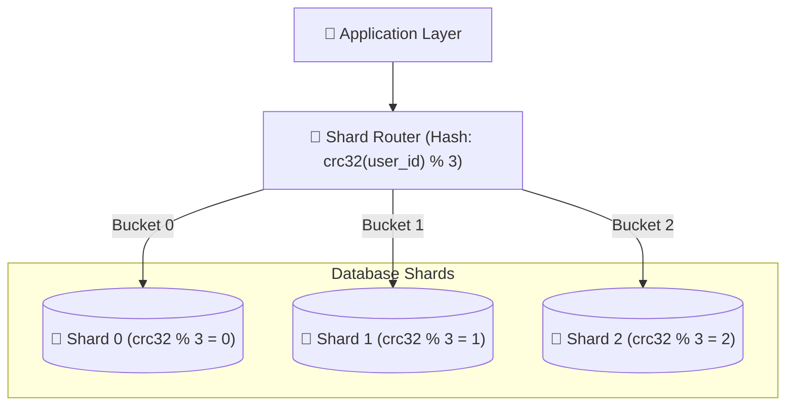

# 08 - Database Partitioning & Sharding

> **Real-World Analogy:**  
> Imagine an encyclopedia set with 26 volumes, labeled A to Z. Instead of trying to squeeze all human knowledge into one massive 50,000-page book that would crush any desk, you split it across 26 distinct books. When you need to look up 'Quantum', you directly grab the 'Q' volume. Sharding splits massive databases across separate servers.

---

## 🎯 What & Why
Explains how to partition databases horizontally across independent machines when a dataset exceeds the RAM, disk, or CPU limits of a single physical server.

---

## 📊 Visual Architecture Diagram


---

## ⚙️ How It Works Under The Hood
### Vertical vs Horizontal Partitioning

- **Vertical Partitioning**: Splitting tables by columns. For example, placing frequently accessed user names and emails in one database, and heavy user profile photos and bio blobs in another.
- **Horizontal Partitioning (Sharding)**: Splitting tables by rows. All rows share the same schema, but rows are distributed across multiple independent database instances.

---

### Sharding Strategies

1. **Range-Based Partitioning**:
   - Assigns contiguous ranges of values (e.g., users starting with A–F on Shard 1, G–M on Shard 2).
   - **Weakness**: Causes uneven data distribution and severe hot spots (e.g., names starting with 'S' are far more common than 'X').

2. **Hash-Based Partitioning**:
   - Computes `hash(shard_key) % num_shards`.
   - Distributes rows evenly across nodes.
   - **Weakness**: Adding a new shard requires rehashing almost all existing records (solved by Consistent Hashing).

3. **Directory-Based Partitioning**:
   - A centralized lookup service maps shard keys to database instances.
   - Highly flexible, but the lookup service can become a single point of failure or latency bottleneck.

---

### The Challenges of Sharding

- **Cross-Shard Joins**: Joining tables located on two different physical servers requires querying both over the network and performing in-memory joins in the application layer.
- **Hotspotting (Celebrity Problem)**: If a shard key is `influencer_id`, a post by a user with 100M followers will flood a single shard while others remain idle.

---

## 💻 Concrete Code Implementation
```python
# Python implementation: Hash-based database shard router
import zlib

class ShardedDatabase:
    def __init__(self, shard_count: int = 3):
        self.shard_count = shard_count
        self.shards = {i: {} for i in range(shard_count)}

    def _get_shard_index(self, key: str) -> int:
        # Compute CRC32 checksum and modulo by shard count
        return zlib.crc32(key.encode('utf-8')) % self.shard_count

    def insert(self, key: str, value: dict):
        shard_idx = self._get_shard_index(key)
        self.shards[shard_idx][key] = value
        return shard_idx

    def get(self, key: str):
        shard_idx = self._get_shard_index(key)
        return self.shards[shard_idx].get(key), shard_idx

if __name__ == "__main__":
    db = ShardedDatabase(shard_count=4)
    users = ["user_alpha", "user_bravo", "user_charlie", "user_delta", "user_echo"]

    print("Distributing users across 4 shards:")
    for u in users:
        shard_num = db.insert(u, {"username": u, "status": "active"})
        print(f"Key '{u}' -> Stored on Shard {shard_num}")

    print("\nRetrieving 'user_charlie':")
    data, shard = db.get("user_charlie")
    print(f"Found on Shard {shard}: {data}")

```

---

## ⚖️ Trade-offs

| Strategy | Good | Bad |
| :--- | :--- | :--- |
| **Range** | Range queries are cheap ("all orders from March"); easy to understand | Hot spots: new data often lands on the same shard (e.g. today's timestamps) |
| **Hash** | Spreads data and load evenly | Range queries must ask every shard; changing the shard count moves most keys (unless you use consistent hashing, module 16) |
| **Directory / lookup table** | Total flexibility: move any tenant anywhere | The lookup service is one more thing that must be fast and never go down |

**Before you shard at all:** add indexes, caching, read replicas and a bigger machine first. Sharding makes JOINs, transactions, unique constraints and schema changes much harder, so it should be the last step, not the first.

**Choosing the shard key** is the most important decision. Pick something that (1) appears in almost every query and (2) spreads load evenly. `user_id` is often good; `country` or `created_date` are usually bad.
