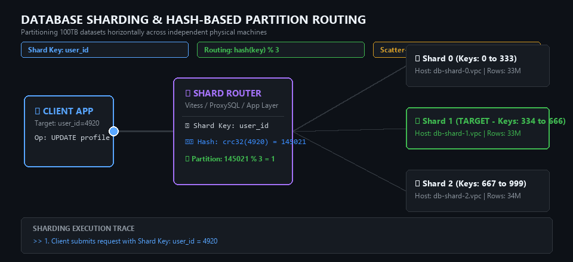
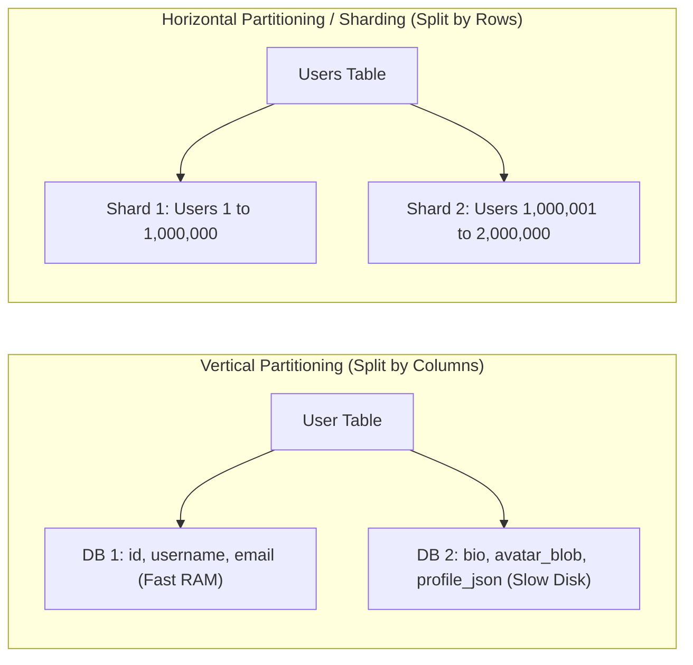

# 08 · Database Partitioning & Sharding

> **Part 2 · Storing data** · ⏱️ ~20 min read · Prerequisites: [06 · SQL vs NoSQL](../06-relational-and-non-relational-databases/), [07 · Database replication](../07-database-replication/)

---

## 🧒 The 30-second version

Replication makes copies of the **same** data across multiple servers to handle read traffic. But what happens when you have so much data (e.g. 50 Terabytes) that it physically cannot fit on one computer's hard drive? Or when you have so many writes (e.g. 100,000 writes/second) that one Primary server catches fire?

**Partitioning (also called Sharding)** splits your massive database table into smaller, independent pieces called **shards**, and stores each shard on a completely different computer.

---

## 🍕 Everyday analogy: The 26-Volume Encyclopedia & Supermarket Aisles

Imagine a massive 50,000-page encyclopedia containing all human knowledge:

- **Without Partitioning (The 50,000-Page Book):** It weighs 800 kilograms. You need a forklift to move it, only one person can read it at a time, and no standard desk can hold it.
- **With Partitioning (The 26-Volume Set):** You chop the encyclopedia into 26 separate, manageable books labeled **A through Z**:
  - If you want to look up *"Quantum Physics"*, you walk straight to Shelf Q, pull down Volume Q, and read it (**Targeted Point Query**). You never touch the other 25 volumes.
  - If 26 students are studying simultaneously, each student holds one volume without blocking anyone else (**Horizontal Write Scaling**).
- **The Cross-Shard Problem:** If a student asks *"List every person in history who died in the year 1812"*, they must open all 26 volumes simultaneously and scan every single page (**Scatter-Gather Query**).

| In the library analogy | In database sharding |
| :--- | :--- |
| **The massive 50,000-page book** | **Single Monolithic Database Table** |
| **Splitting by letter (A–Z)** | **Sharding by Shard Key** (`user_id`, `tenant_id`) |
| **Volume Q on Shelf 17** | **Physical Database Shard Node** (Server `db-shard-2`) |
| **First letter of the word** | **Partition Function / Shard Key** |
| **Scanning all 26 volumes** | **Scatter-Gather Broadcast Query** |
| **Letter 'S' volume being 10x thicker** | **Hotspotting / Data Skew** |

---

## 🧩 The problem it solves

1. **Storage Limits:** Even the largest cloud server instances max out around 16 to 32 Terabytes of attached NVMe storage. When your dataset hits 100 Terabytes (e.g. Instagram photos metadata or Discord chat logs), a single server is physically impossible.
2. **Write Bottlenecks:** Replication scales *reads*, but all writes must still bottleneck on the single Primary Leader. Sharding allows 50 independent Primary databases to process writes simultaneously in parallel, scaling write throughput to millions of operations per second.
3. **Blast Radius Reduction:** If Shard 3 experiences a hardware kernel panic, only $5\%$ of your users are temporarily affected. The remaining $95\%$ of users on the other shards continue operating with zero disruption.

---

## 🖼️ Picture it

<p align="center">
  
</p>

```mermaid
flowchart TD
    Client["📱 Application Request<br/>user_id = 4920"] --> Router["🧭 Shard Router (Proxy / Vitess / App)<br/>hash(user_id) % 3"]

    subgraph Shards["Distributed Shard Fleet"]
        S0[("💾 Shard 0 (db-0.vpc)<br/>Keys: 0 to 333<br/>Rows: 33M")]
        S1[("💾 Shard 1 (db-1.vpc)<br/>Keys: 334 to 666<br/>Rows: 33M (TARGET)")]
        S2[("💾 Shard 2 (db-2.vpc)<br/>Keys: 667 to 999<br/>Rows: 34M")]
    end

    Router -->|Bucket 0| S0
    Router -->|Bucket 1 (4920 matches here)| S1
    Router -->|Bucket 2| S2
```

1. Application sends a database query specifying the **Shard Key** (`user_id = 4920`).
2. The Shard Router applies a uniform hash function: `crc32("4920") % 3 = 1`.
3. The query is routed directly to **Shard 1** in $O(1)$ time. Shards 0 and 2 do zero work.

---

## 🔢 Walk-through with real numbers

### Calculating Cluster Size: Sizing a 500 Million User Database

Suppose you are designing the user profile storage for a global social network:
- **Total Registered Users:** $500\text{ Million users}$.
- **Average Data Size per User:** $2\text{ KB}$ (profile, settings, metadata).
- **Total Dataset Size:**
  $$500\text{M} \times 2\text{ KB} = 1,000\text{ GB} = 1\text{ Terabyte (clean data)}$$
- **Index Overhead + 3x Replication Factor:**
  $$1\text{ TB} \times 2\text{ (indexes)} \times 3\text{ (replicas)} = 6\text{ Terabytes}$$
- **Safety Rule of Thumb:** Never fill database disks beyond $60\%$ capacity (leaving room for compaction, index rebuilds, and growth).
- **Target Shard Size:** Keep individual shards under **$250\text{ GB}$** so backups, restores, and point-in-time recoveries finish in $< 30\text{ minutes}$.

$$\text{Number of Shards Needed} = \frac{1,000\text{ GB}}{250\text{ GB/shard}} = 4\text{ Shards}$$

---

## ⚙️ How it works: Partitioning Strategies & Engineering Trade-offs

### 1. Vertical vs Horizontal Partitioning



- **Vertical Partitioning:** Splits tables by **columns**. Frequently accessed columns (like username, password hash) reside on high-speed NVMe servers; heavy binary blobs (photos, PDF resumes) are moved to cheap cold storage.
- **Horizontal Sharding:** Splits tables by **rows**. Every shard has the exact same column schema, but each shard holds a mutually exclusive subset of rows.

---

### 2. Sharding Strategies

#### A. Range-Based Sharding
- Partitions data based on ranges of values (e.g., User IDs 1–1,000 on Shard 1; 1,001–2,000 on Shard 2; or timestamp ranges by month).
- **Advantage:** Range queries (`SELECT * WHERE date BETWEEN '2023-01-01' AND '2023-01-31'`) hit a single shard.
- **The Fatal Flaw (Hotspotting):** If you shard by date, all today's writes flood the single shard holding the current month, while past months sit completely idle!

#### B. Hash-Based Sharding (Recommended)
- Computes `hash(shard_key) % num_shards`.
- **Advantage:** Spreads rows statistically uniformly across all physical servers, eliminating write hotspots.
- **Flaw:** Range queries must be executed as a scatter-gather across all shards.

#### C. Directory-Based / Lookup Service
- A centralized lookup table maps Shard Keys to physical database endpoints.
- **Advantage:** Extremely flexible; individual shards can be moved or rebalanced without changing shard keys.
- **Flaw:** The lookup service itself becomes a single point of failure and adds an extra network round-trip to every query.

---

### 3. The 3 Great Nightmares of Sharding

#### Nightmare 1: Cross-Shard Joins
In a monolithic database, you write: `SELECT * FROM users JOIN orders ON users.id = orders.user_id`.  
In a sharded database, Alice is on **Shard 1** in Virginia, and her order is on **Shard 4** in Oregon. The database engine cannot perform a local index join. Your application must query Shard 1 over the network, query Shard 4 over the network, and stitch the rows together in memory!
- *The Fix:* **Co-locate related data**. Shard orders by `user_id` so that a user's profile and all their orders always live on the exact same physical shard.

#### Nightmare 2: The Scatter-Gather Query
If a query does not include the shard key (e.g. `SELECT * FROM users WHERE email = 'alice@gmail.com'` when the table is sharded by `user_id`), the router must fan out the query to **all 50 shards simultaneously**, wait for 50 responses, and merge them. The query latency is bounded by the **single slowest shard in the entire fleet**!

#### Nightmare 3: The Celebrity / Hotspot Problem
If you shard by `creator_id`, a normal user generates 2 writes/week. But a celebrity with 80 million followers generates 100,000 writes/second. The single shard hosting that celebrity catches fire, while other shards are 99% idle.

---

## ⚖️ Sharding Strategies Comparison Matrix

| Strategy | Write Distribution | Range Queries | Complexity | Best Used For |
| :--- | :---: | :---: | :---: | :--- |
| **Hash-Based** (`hash(k) % N`) | ✅ **Uniform & Fair** | ❌ Scatter-Gather required | Low | High-scale user accounts, order systems |
| **Range-Based** (IDs / Dates) | ❌ **Prone to hot spots** | ✅ **Very Fast** | Low | Internal audit logs, archive databases |
| **Directory-Based** (Lookup Table) | ✅ **Custom control** | ⚠️ Average | High | Multi-tenant SaaS with giant enterprise accounts |

---

## 🚫 Common mistakes & production pitfalls

1. **Sharding before you actually need it:**
   - *The Trap:* Sharding introduces immense complexity (distributed transactions, cross-shard joins, schema migration pains, monitoring dozens of nodes).
   - *Rule of Thumb:* **Never shard on Day 1**. Maximize vertical scaling first (a 64-core, 512 GB RAM cloud instance), optimize indexes, add read replicas ([module 07](../07-database-replication/)), and implement caching ([module 10](../10-caching-patterns/)). Only shard when dataset size exceeds physical disk limits or write IOPS saturate the primary.

2. **Picking a Shard Key with Low Cardinality:**
   - *The Disaster:* Sharding users by `country_code` or `gender`. If $80\%$ of your users are from the US, Shard `US` melts while Shard `IS` (Iceland) sits empty. Shard keys **must have high cardinality** (millions of unique values, like UUIDs or auto-increment IDs).

3. **Using Modulo Hashing without Consistent Hashing:**
   - *The Disaster:* You shard with `hash(user_id) % 4`. When you add a 5th machine and change the formula to `% 5`, almost **$80\%$ of all records** suddenly map to a different server, forcing a massive, dangerous multi-day database data migration.
   - *The Fix:* Use **Consistent Hashing** ([module 16](../16-consistent-hashing/)) or pre-split into 1,024 logical shards distributed across a few physical servers.

---

## 💻 Try it yourself

Run the interactive simulator in this folder:

```bash
cd 08-database-partitioning
python demo.py
```

### What to explore in `demo.py`:
1. Observe **Hash-Based routing** distribute users uniformly across physical shards.
2. See the speed of a **Targeted Point Lookup** ($O(1)$) that touches only Shard 2 while leaving Shard 0 and 1 untouched.
3. Watch the performance penalty of a **Scatter-Gather query** that is forced to fan out to every single shard in the cluster.
4. Watch a simulated **Celebrity Hotspot** dump 100 writes onto a single shard, starving its resources.

---

## 🌍 Where you'll see it in production

- **Instagram:** Sharded PostgreSQL using a custom 64-bit ID generator (incorporating timestamp + shard ID) to scale to hundreds of millions of photos.
- **YouTube (Vitess):** Built Vitess as an open-source database clustering system on top of MySQL to shard YouTube's massive video and user comments database.
- **Slack:** Sharded their MySQL architecture by **Team / Workspace ID**. All channels, messages, and users for a single company reside on the same shard, guaranteeing that almost all queries are local and never cross shards!

---

## 🎯 Top Interview Questions & Deep Answers

### Q1: "How do you pick a good shard key, and what are the catastrophic consequences of picking a bad one?"

<details>
<summary>💡 Click to reveal the ideal senior engineering answer</summary>

Picking a shard key is the single most critical decision in distributed storage because **changing a shard key in a live production database with terabytes of data is virtually impossible without extensive downtime.**

- **Three Criteria for a Perfect Shard Key:**
  1. **High Cardinality:** The key must have millions of distinct values (e.g. `user_id` or `order_id`). A key like `country` or `gender` has low cardinality and causes massive data skew.
  2. **Uniform Write Distribution:** Writes must hash evenly across shards. Using `created_at` timestamp causes 100% of current writes to hammer the latest shard, creating a severe write hotspot.
  3. **High Query Isolation (Locality):** The key must match your application's most frequent read query filter so that $99\%$ of queries are single-shard lookups rather than broadcast scatter-gather queries.
- **Catastrophic Failure Example:**
  - In a ride-sharing app (Uber), if you shard by `driver_id`, finding all available drivers near a customer's `lat/long` requires a scatter-gather query across all shards worldwide.
  - Instead, sharding by **S2 Cell / Geohash** co-locates all nearby drivers and riders on the exact same regional shard.

</details>

---

### Q2: "What is a Scatter-Gather query, and why does it destroy database performance at scale?"

<details>
<summary>💡 Click to reveal the ideal senior engineering answer</summary>

- **Definition:** A scatter-gather query occurs when a read query cannot specify the shard key (e.g. `SELECT * FROM users WHERE phone_number = '+1234567890'` when the table is sharded by `user_id`).
- **Why it kills performance:**
  1. **Latency Bounded by Slowest Node:** The router must broadcast the query over the network to all $N$ physical shards, wait for every single response, and merge them in memory. In a 50-shard cluster, the query latency is dictated by the **99.9th percentile slowest server** in the fleet.
  2. **Cluster-Wide Resource Consumption:** A single query forces 50 separate servers to wake up, allocate worker threads, and perform disk/index scans. A few dozen concurrent scatter-gather queries can saturate CPU across the entire datacenter.
- **Production Solution:** Build a **Global Secondary Index (GSI)** or lookup table (e.g. in Redis or DynamoDB GSI) mapping `phone_number` $\to$ `user_id`. The application looks up `user_id` first, and then executes a fast $O(1)$ single-shard query.

</details>

---

### Q3: "How do you perform a transaction or join across multiple shards when data resides on different physical servers?"

<details>
<summary>💡 Click to reveal the ideal senior engineering answer</summary>

Cross-shard transactions cannot rely on local database ACID locks. We use one of three architectural patterns:

1. **Two-Phase Commit (2PC):**
   - A coordinator node asks all participating shards to prepare, then commits.
   - **The Problem:** 2PC is a blocking protocol. If the coordinator or network fails mid-transaction, locks are held indefinitely, slashing system throughput.
2. **The Saga Pattern (Recommended for Microservices):**
   - Breaks the distributed transaction into a sequence of local transactions across shards.
   - Each shard commits locally. If a subsequent step fails, **compensating transactions** are executed backwards to undo changes. (Covered deeply in [module 19](../19-distributed-transactions/)).
3. **Avoidance by Schema Co-Location:**
   - Design the schema so cross-shard joins are mathematically unnecessary. For example, in Slack, all channels, messages, and files for a company are sharded by `workspace_id`. Since 99.9% of user activity is within their own workspace, joins are always $100\%$ local to a single physical shard.

</details>

---

### Q4: "How do you mitigate the Celebrity / Influencer Hotspot problem in a sharded database?"

<details>
<summary>💡 Click to reveal the ideal senior engineering answer</summary>

When a user like Taylor Swift has 100 million followers, every post generates millions of likes and comments. If sharded by `influencer_id`, that single shard suffers catastrophic CPU saturation.

**The Salting Technique:**
1. When storing records for ultra-popular keys, append a random **salt integer** (e.g. from 0 to 9) to the shard key:
   `shard_key = influencer_id + "_" + random_int(0, 9)`
2. Instead of all likes hashing to Shard 1, writes are distributed uniformly across 10 different shards (`influencer_99_0` through `influencer_99_9`).
3. **The Read Trade-off:** To calculate the total like count, the application queries those 10 salted keys in parallel and sums them up in memory. You trade a fast 10-shard scatter query to prevent a fatal write bottleneck.

</details>

---

## ✅ Check yourself

1. **A database has 100 shards. A query is submitted WITHOUT the shard key. If each individual shard has a 99% probability of answering within 10 ms, what is the probability that the overall query will suffer a latency delay?**

<details>
<summary>View Answer</summary>

The overall query must wait for **all 100 shards** to answer. The probability that all 100 shards answer without delay is:
$$0.99^{100} \approx 36.6\%$$
That means **$63.4\%$ of all scatter-gather queries will suffer latency delays**! This proves mathematically why scatter-gather queries degrade rapidly as cluster size grows.

</details>

---

2. **Why is sharding by auto-incrementing `id` with Modulo (`id % num_shards`) superior to sharding by `created_at` timestamp?**

<details>
<summary>View Answer</summary>

Sharding by `created_at` timestamp sends $100\%$ of current writes to the single shard holding the current hour/day, leaving older shards completely idle (write hotspotting).  
Auto-incrementing IDs with modulo (`id % 4`) cycle sequentially: ID 1 $\to$ Shard 1, ID 2 $\to$ Shard 2, ID 3 $\to$ Shard 3, ID 4 $\to$ Shard 4, ID 5 $\to$ Shard 1, spreading write load perfectly uniformly across all machines.

</details>

---

3. **What is the difference between Partitioning and Sharding?**

<details>
<summary>View Answer</summary>

- **Partitioning** is the general term for dividing a database table into smaller subsets. This can happen on a single physical machine (e.g. PostgreSQL table partitioning by date range to speed up index lookups).
- **Sharding** specifically refers to **horizontal partitioning across multiple physically independent database servers** connected over a network.

</details>

---

## 📚 Go deeper

- **Designing Data-Intensive Applications (DDIA)** by Martin Kleppmann: Chapter 6 (*Partitioning* — the definitive industry guide on sharding by key range, key hash, rebalancing, and request routing).
- **Vitess Documentation:** How YouTube scales MySQL to billions of users via transparent horizontal sharding (vitess.io).

---

## 🔗 Related modules

- [06 · SQL vs NoSQL](../06-relational-and-non-relational-databases/): The database engines being partitioned.
- [07 · Database replication](../07-database-replication/): How each individual shard uses primary-follower replication for local high availability.
- [16 · Consistent hashing](../16-consistent-hashing/): The algorithm that minimizes key movement when adding or removing shards.
