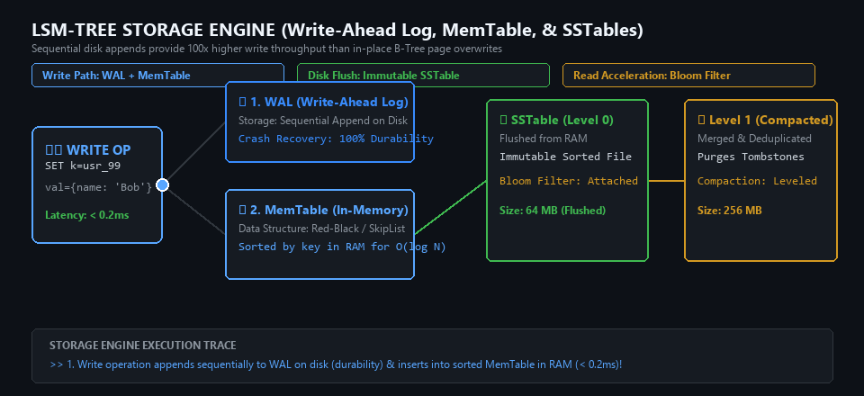
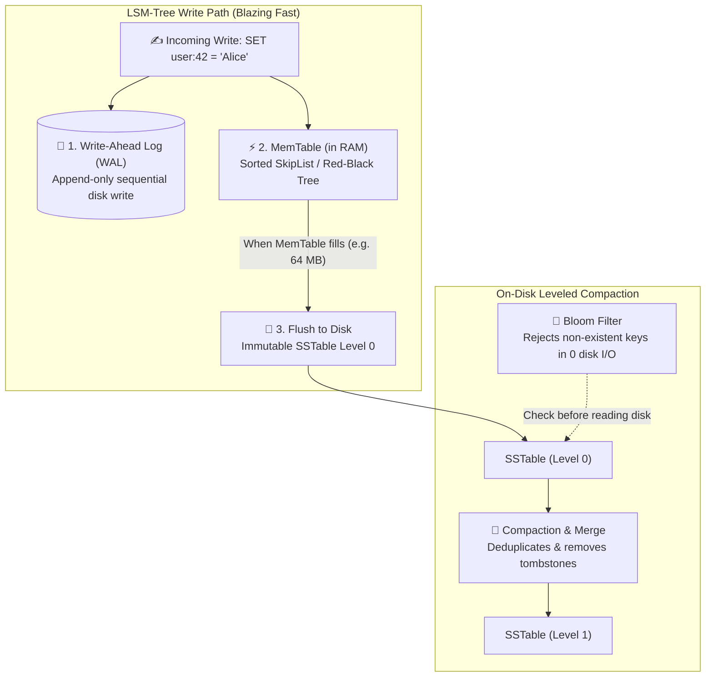
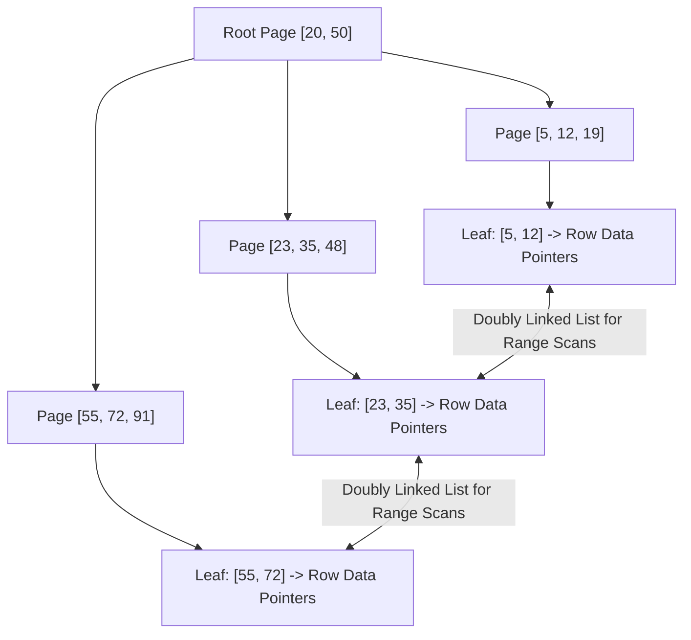

# 09 · Storage Engines & Database Indexing

> **Part 2 · Storing data** · ⏱️ ~20 min read · Prerequisites: [06 · SQL vs NoSQL](../06-relational-and-non-relational-databases/)

---

> 🏢 **Real-world case studies**: how **Bigtable**, **LevelDB** and **RocksDB** build on the LSM-tree, in [REAL_WORLD_EXAMPLES.md](./REAL_WORLD_EXAMPLES.md).

## 🧒 The 30-second version

A database index is exactly like the alphabetical index at the back of a 1,000-page textbook. 

Without an index, finding where *"Distributed Consensus"* is mentioned requires reading every single page from 1 to 1,000 (**Full Table Scan**). With an index, you flip straight to the letter **'D'**, read the exact page number (Page 412), and open it in under 2 seconds (**Indexed Lookup**). 

Under the hood, databases use two radically different storage engines to organize these indexes: **B+ Trees** (optimized for fast reads) and **LSM-Trees** (optimized for blazing fast writes).

---

## 🍕 Everyday analogy: The Book Index vs The Append-Only Journal

Imagine two different ways of taking notes:

- **The B+ Tree (The Carefully Maintained Encyclopedic Binder):**
  - Every topic has a designated page slot in alphabetical order.
  - When you want to find a topic, you navigate a table of contents: *Section M $\to$ Subsection MO $\to$ Page 84*.
  - **The Catch:** When you want to add a new note into a page that is already completely full, you have to physically erase, rewrite, and split the page in half (**Page Split**). Reads are instant, but writes involve heavy erasing and rewriting.
- **The LSM-Tree (The Chronological Sticky-Note Journal):**
  - Whenever you have a new fact, you don't reorganize the book. You simply scribble it on a sticky note and paste it on top of your desk in memory (**MemTable**), and jot it down in an append-only log (**Write-Ahead Log**).
  - Writing takes **zero effort**.
  - Later, when your desk is covered in sticky notes, your assistant sorts them alphabetically and files them into permanent folders in the cabinet (**SSTable Flush & Compaction**).

| In everyday life | In database storage engine |
| :--- | :--- |
| **Alphabetical index at back of textbook** | **Database Index** |
| **Reading all 1,000 pages cover-to-cover** | **Full Table Scan (Sequential Scan)** |
| **Flipping to Section $\to$ Chapter $\to$ Page** | **B+ Tree Node Traversal** |
| **Scribbling sticky note on desk** | **LSM-Tree MemTable (in RAM)** |
| **Emergency audio recorder running while you write** | **Write-Ahead Log (WAL on disk)** |
| **Filing sorted sticky notes into cabinet** | **Flushing to immutable SSTable on disk** |
| **Throwing out old superseded drafts** | **Background Compaction (purging tombstones)** |

---

## 🧩 The problem it solves

1. **The I/O Latency Chasm:**
   - Reading 1 MB from RAM takes $\approx 3\text{ }\mu\text{s}$.
   - Reading 1 MB from an NVMe SSD takes $\approx 50\text{ }\mu\text{s}$.
   - Reading 1 MB randomly from a magnetic hard drive takes $\approx 10,000\text{ }\mu\text{s}$ ($10\text{ ms}$).
   If a table has 100 million rows ($50\text{ GB}$), scanning the whole table on disk takes **30 seconds**. An index cuts that lookup to **2 milliseconds** ($15,000\times$ faster).
2. **The Write Amplification Bottleneck:**
   - Traditional B-Trees perform random in-place updates on disk blocks. Overwriting an 8KB page on SSD to update a 10-byte integer causes massive write amplification and destroys write throughput.
   - LSM-Trees convert all random writes into **sequential disk appends**, allowing modern datastores (Cassandra, RocksDB) to absorb hundreds of thousands of writes per second.

---

## 🖼️ Picture it

<p align="center">
  
</p>



---

## 🔢 Walk-through with real numbers

### Why B+ Trees are Shallow: The Power of Fan-Out (Branching Factor)

A standard binary search tree has a branching factor of 2. A **B+ Tree** has a branching factor of **$B = 100$ to $500$** (matching physical 4KB or 8KB disk page boundaries).

Suppose branching factor $B = 100$:
- **Level 1 (Root Page):** Points to $100$ child pages.
- **Level 2:** $100 \times 100 = 10,000$ leaf pages.
- **Level 3:** $10,000 \times 100 = 1,000,000$ leaf pages.
- **Level 4:** $1,000,000 \times 100 = \mathbf{100,000,000\text{ records}}$!

> 💡 **The Magic of B+ Trees:** You can index **100 Million rows** in a tree of height **only 4 levels**! The root and internal nodes sit permanently cached in RAM, meaning any point query on a 100M-row table requires **at most 1 or 2 physical disk reads** ($< 2\text{ ms}$).

---

## ⚙️ How it works: Storage Engines & Indexing Under the Hood

### 1. B+ Trees: The Classic Engine (PostgreSQL, MySQL InnoDB)



- **All data pointers live in the Leaf Nodes:** Internal nodes only store routing keys, allowing maximum branching factor.
- **Leaves are connected by a Doubly-Linked List:** Once you find the starting key, range scans (`WHERE age BETWEEN 20 AND 30`) simply walk the linked list sequentially along disk blocks without backtracking up the tree!

---

### 2. LSM-Trees: The Write Engine (RocksDB, Cassandra, LevelDB)

Instead of overwriting disk pages in-place, an LSM-Tree follows an append-only pipeline:

1. **Write-Ahead Log (WAL):** When a write arrives, it is appended to an append-only log file on disk. This guarantees durability in $< 0.1\text{ ms}$. If the computer loses power, the WAL replays lost writes on reboot.
2. **MemTable:** Simultaneously, the write is inserted into an in-memory balanced tree (Red-Black tree or SkipList) sorted by key.
3. **SSTable (Sorted String Table):** When the MemTable reaches its size threshold (typically 32MB to 64MB), it is frozen and written to disk as an immutable SSTable file. Because keys are already sorted in RAM, writing the SSTable is a purely **sequential disk write**.
4. **Compaction:** Over time, multiple SSTables accumulate. Background worker threads run **Compaction**: merging sorted files together (like merge sort), removing superseded old values, and permanently deleting rows marked with a **Tombstone** (`__DELETED__`).

---

### 3. Bloom Filters: The Zero-Disk-I/O Shield

In an LSM-tree, searching for a key that *does not exist* could require checking every single SSTable on disk from newest to oldest.

A **Bloom Filter** is a space-efficient probabilistic data structure placed in RAM in front of each SSTable:
- It uses multiple hash functions mapped onto a bit array.
- It answers with mathematical certainty:
  - *"Key is **definitely NOT** in this SSTable."* $\to$ **Skips disk read entirely!**
  - *"Key **might be** in this SSTable."* $\to$ Performs disk read.
- **Guarantee:** A Bloom Filter has **$0\%$ False Negatives**. It will never tell you a key doesn't exist when it actually does!

---

### 4. Clustered vs Secondary Indexes

- **Clustered Index (Primary Key):** The table itself is physically stored on disk in the exact sorted order of the clustered index. A table can have **only one** clustered index.
- **Secondary Index:** A separate B-Tree whose leaf nodes do not contain the actual row data, but instead contain the **Primary Key pointer**.
  - A query on a secondary index (`WHERE email = 'alice@gmail.com'`) looks up the email B-Tree to find `id = 42`, and then performs a second lookup in the clustered index to fetch the full row (**Index Hop / Bookmark Lookup**).

---

### 5. Composite Indexes & The Leftmost Prefix Rule

If you create an index on `(last_name, first_name)`:
- `WHERE last_name = 'Smith'` $\to$ **Uses index ✅**
- `WHERE last_name = 'Smith' AND first_name = 'Alice'` $\to$ **Uses index ✅**
- `WHERE first_name = 'Alice'` $\to$ **CANNOT use index! ❌ (Full table scan)**

**Why?** Think of a telephone phonebook sorted by `(Lastname, Firstname)`. You can easily find all *"Smiths"*. But you cannot look up all people named *"Alice"* without scanning every page from A to Z!

---

## ⚖️ B+ Trees vs LSM-Trees Trade-Off Matrix

| Dimension | B+ Tree (Postgres, MySQL InnoDB) | LSM-Tree (RocksDB, Cassandra, ScyllaDB) |
| :--- | :--- | :--- |
| **Write Performance** | Slower (Random in-place page overwrites) | **Ultra-Fast** (Sequential disk appends) |
| **Read Performance** | **Predictable & Fast** ($O(\log N)$ in 1–2 disk reads) | Slower (May need to check MemTable + multiple SSTables) |
| **Storage Fragmentation** | Suffers page fragmentation from random deletes | Highly compressed, no empty page gaps |
| **Write Amplification** | High (Rewriting 16KB pages for 20-byte row changes) | Lower write amplification, but compaction consumes background I/O |
| **Best Used For** | General transactional systems (OLTP), read-heavy apps | High-throughput logging, IoT, time-series, write-heavy messaging |

---

## 🚫 Common mistakes & production pitfalls

1. **"Index Everything" Syndrome:**
   - *Why it hurts:* Junior engineers add an index to all 15 columns in a table. While reads speed up, every single `INSERT`, `UPDATE`, and `DELETE` must now update 15 separate B-Tree structures on disk, cutting write throughput by $80\%$ and tripling disk storage.
   - *The Fix:* Index only columns used in `WHERE`, `JOIN`, and `ORDER BY` clauses on high-frequency query paths.

2. **Indexing Low-Cardinality Columns (e.g. `gender` or `is_active`):**
   - *Why it hurts:* If a column has only 2 values (True/False), each value matches $50\%$ of the table. Traversing a B-Tree to fetch $50\%$ of the row pointers is actually **slower than a sequential table scan**! The query planner will simply ignore the index.
   - *The Fix:* Use a **Partial Index** (`CREATE INDEX ... WHERE is_active = false`) if you only query the rare $1\%$ minority value.

3. **Using Functions on Indexed Columns in Queries:**
   - *The Trap:* Writing `WHERE DATE(created_at) = '2023-01-01'` or `WHERE LOWER(email) = 'alice@gmail.com'`.
   - *Why it fails:* Wrapping the column in a function prevents the database from using the standard B-Tree index, forcing a full table scan!
   - *The Fix:* Query using ranges (`WHERE created_at >= '2023-01-01' AND created_at < '2023-01-02'`) or create a specialized **Functional Expression Index**.

---

## 💻 Try it yourself

Run the interactive simulator in this folder:

```bash
cd 09-storage-engines-and-indexing
python demo.py
```

### What to explore in `demo.py`:
1. Watch the **LSM-Tree write pipeline**: keys append to the WAL and insert into the in-memory MemTable in microseconds.
2. Watch the MemTable reach its 3-key limit and trigger a **sequential flush** to disk as an immutable SSTable.
3. Test the **Bloom Filter**: see how it intercepts non-existent keys (`user:999_nonexistent`) and rejects them in memory with **0 disk I/O reads**!

---

## 🌍 Where you'll see it in production

- **MySQL InnoDB & PostgreSQL:** Default to **B+ Trees** for primary keys and secondary indexes.
- **RocksDB (Meta):** Ultra-high-performance embedded **LSM-Tree** engine powering internal storage at Meta, Kafka Streams, and CockroachDB.
- **Cassandra & ScyllaDB:** Built on **LSM-Trees** to absorb billions of write operations per day for Discord and Netflix telemetry.

---

## 🎯 Top Interview Questions & Deep Answers

### Q1: "Why do databases use B+ Trees instead of standard Binary Search Trees (BST) or Red-Black Trees for disk storage?"

<details>
<summary>💡 Click to reveal the ideal senior engineering answer</summary>

The difference comes down to **Hardware Disk Block Architecture**:
1. **Branching Factor & Tree Height:**
   - A Binary Search Tree has a branching factor of 2. In a table of 100 million rows, a balanced BST has a height of $\approx 27$. Following pointers on disk would require **27 random disk seeks** ($27 \times 10\text{ms} = 270\text{ ms}$).
   - A B+ Tree has a branching factor of $100$ to $500$, keeping tree height at **only 3 or 4 levels**, requiring at most 1–2 disk reads ($< 2\text{ ms}$).
2. **Page Sizing Alignment:**
   - Operating systems and SSD controllers read and write in fixed-size blocks (typically 4KB, 8KB, or 16KB). A B+ Tree node is sized to match a physical disk page exactly. Reading a node fetches hundreds of keys in a single I/O operation.
3. **Sequential Range Scans:**
   - In a BST, range queries require in-order tree traversal hopping randomly across memory. In a B+ Tree, all leaf nodes are connected via a contiguous **doubly linked list**. Range scans simply walk the leaf pointers sequentially along disk blocks with hardware prefetching!

</details>

---

### Q2: "How does an LSM-Tree achieve 10x higher write throughput than a B+ Tree, and what is the trade-off on reads?"

<details>
<summary>💡 Click to reveal the ideal senior engineering answer</summary>

- **Why LSM-Tree Writes are 10x Faster:**
  - In a B+ Tree, updating a row requires an in-place overwrite of an 8KB disk page. If you update 5 rows scattered across different tables, you trigger 5 random I/O writes.
  - In an LSM-Tree, data is **never modified in-place**. Every write is appended sequentially to the Write-Ahead Log (WAL) on disk and inserted into an in-memory sorted structure (MemTable). Sequential disk writes are up to $100\times$ faster than random writes because they eliminate disk head seek overhead and minimize SSD write amplification.
- **The Trade-Off on Reads:**
  - In a B+ Tree, a read is guaranteed in $O(\log N)$ in 1 or 2 page accesses.
  - In an LSM-Tree, the newest value might be in the MemTable, or in SSTable 0, or in SSTable 3 on disk. A read may have to check multiple files across disk levels (**Read Amplification**). LSM-trees mitigate this using **Bloom Filters** and sparse block indexes.

</details>

---

### Q3: "How does a Bloom Filter work, and why does it guarantee ZERO False Negatives?"

<details>
<summary>💡 Click to reveal the ideal senior engineering answer</summary>

- **Mechanism:**
  - A Bloom Filter consists of a bit array of $m$ bits (all initialized to 0) and $k$ independent hash functions.
  - **Adding a key:** Hash the key with all $k$ hash functions and set the corresponding bit indexes to `1`.
  - **Querying a key:** Hash the key with the $k$ hash functions. If **any** of those bit positions is `0`, the key was **mathematically NEVER added** to the set.
- **Why Zero False Negatives?**
  - Bits are only ever set from 0 to 1; they are never cleared or deleted. Therefore, if an item was added, its hashed bits are guaranteed to remain 1. It is physically impossible for the filter to return `false` for an existing item.
- **Why Can False Positives Occur?**
  - Multiple distinct keys can happen to set overlapping bit combinations through hash collisions. If the filter returns `true`, the key *might* be in the SSTable, so the database proceeds to read the disk file.

</details>

---

### Q4: "What is the Leftmost Prefix Rule in multi-column database indexes?"

<details>
<summary>💡 Click to reveal the ideal senior engineering answer</summary>

When you create a composite index on columns `(A, B, C)`, the B-Tree sorts the entries lexicographically: first by `A`, then within identical `A` values by `B`, and then within identical `B` values by `C`.

- **Queries that utilize the index:**
  - `WHERE A = 1` $\to$ **Yes** (uses level A)
  - `WHERE A = 1 AND B = 2` $\to$ **Yes** (uses levels A and B)
  - `WHERE A = 1 AND B = 2 AND C = 3` $\to$ **Yes** (uses full index)
- **Queries that CANNOT use the index efficiently:**
  - `WHERE B = 2` $\to$ **No!** B is sorted only within specific values of A. Across the whole index, B values are scattered randomly.
  - `WHERE C = 3` $\to$ **No!**
  - `WHERE A = 1 AND C = 3` $\to$ Uses index for `A`, but must scan all matching rows to filter `C`.
- **Takeaway:** Always place the column most frequently queried with equality filters as the **leftmost column** in the composite index definition.

</details>

---

## ✅ Check yourself

1. **A table has 10 million rows. You run `SELECT * FROM users WHERE email = 'alice@example.com'`. There is an index on `email`. How many B+ Tree page accesses are performed?**

<details>
<summary>View Answer</summary>

**Approximately 3 or 4 page accesses.** With a branching factor $B=100$, a B+ Tree of height 4 can hold 100 million entries. The database traverses Root $\to$ Internal 1 $\to$ Internal 2 $\to$ Leaf page. Because root and upper levels are cached in RAM, this usually requires **at most 1 physical disk read**!

</details>

---

2. **Why does an LSM-Tree write a "Tombstone" marker when you execute a `DELETE` query, rather than simply erasing the bytes from the SSTable file?**

<details>
<summary>View Answer</summary>

Because SSTables on disk are strictly **immutable** (read-only). Modifying an existing file in-place would require expensive random disk seeks and rewriting gigabyte-sized files. By writing a tombstone record sequentially (`key: __DELETED__`), the delete executes in $< 0.1\text{ ms}$. During later background **Compaction**, the compaction worker merges SSTables and permanently discards the tombstone and the deleted data together.

</details>

---

3. **What is a "Covering Index", and why does it deliver massive query speedups?**

<details>
<summary>View Answer</summary>

A **Covering Index** is a secondary index that contains **all** columns requested by a query (e.g. index on `(user_id, status)` for query `SELECT status FROM orders WHERE user_id = 42`).  
Because the index itself contains the requested `status` data, the database answers the query directly from the index leaf node **without performing a second lookup (bookmark lookup) to the main table data on disk**, cutting disk I/O in half!

</details>

---

## 📚 Go deeper

- **Designing Data-Intensive Applications (DDIA)** by Martin Kleppmann: Chapter 3 (*Storage and Retrieval — Hash Indexes, SSTables, LSM-Trees, and B-Trees*).
- **Use The Index, Luke!** by Markus Winand: The premier guide to SQL indexing mechanics and query optimization (use-the-index-luke.com).

---

## 🔗 Related modules

- [06 · SQL vs NoSQL](../06-relational-and-non-relational-databases/): How these storage engines underpin relational and non-relational stores.
- [07 · Database replication](../07-database-replication/): How Write-Ahead Logs (WAL) are streamed to replicas.
- [10 · Caching patterns](../10-caching-patterns/): How in-memory caches protect storage engines from read saturation.
