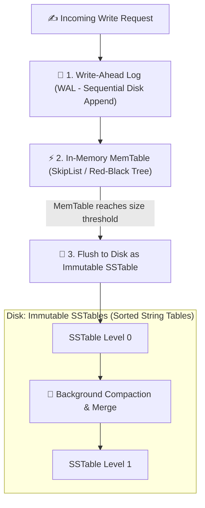

# 09 - Storage Engines & Database Indexing

> **Real-World Analogy:**  
> Imagine a 1,000-page textbook. If you want to find where 'Distributed Consensus' is discussed without an index, you must read every single page from 1 to 1,000 (Full Table Scan). But with the alphabetical index at the back, you flip directly to the letter 'D', find the entry, and jump directly to page 412 (Indexed Lookup).

---

## 🎯 What & Why
Deep dive into the inner workings of database storage engines, comparing B+ Trees (optimized for read-heavy workloads) and LSM-Trees / SSTables (optimized for write-heavy workloads), along with Bloom filters.

---

## 📊 Visual Architecture Diagram


---

## ⚙️ How It Works Under The Hood
### B+ Trees vs LSM-Trees

| Dimension | B+ Tree (Postgres, MySQL InnoDB) | LSM-Tree (RocksDB, Cassandra, LevelDB) |
| :--- | :--- | :--- |
| **Primary Optimization** | Optimized for fast **Reads** | Optimized for ultra-fast **Writes** |
| **Write Pattern** | Random in-place page overwrites on disk | Sequential append-only writes |
| **Read Pattern** | Single tree traversal ($O(\log N)$) | Searches MemTable, then checks SSTables via Bloom filters |
| **Storage Structure** | Fixed-size pages (typically 4KB to 16KB) | In-memory MemTable flushed to immutable sorted files |
| **Write Amplification** | A small row change rewrites a whole page (8–16 KB), plus the WAL | Often lower, but compaction rewrites the same data several times, so it depends on the workload |

---

### Essential Indexing Components

1. **Write-Ahead Log (WAL)**: An append-only log on disk where every mutation is recorded before being applied to memory structures. Ensures durability across crashes.
2. **SSTable (Sorted String Table)**: An immutable disk file containing key-value pairs sorted by key. Because keys are sorted, finding a key is fast via binary search or sparse indexing.
3. **Bloom Filter**: A space-efficient probabilistic data structure used to test whether an element is a member of a set. It answers:
   - *"Definitely not in this SSTable"* (skips expensive disk read entirely).
   - *"Possibly in this SSTable"* (performs disk read).

---

## 💻 Concrete Code Implementation
```python
# Python implementation: A minimal Bloom Filter using bit arrays
import math
import zlib

class BloomFilter:
    def __init__(self, expected_elements: int, false_positive_rate: float = 0.05):
        # Calculate optimal size (m) and hash functions count (k)
        self.size = int(- (expected_elements * math.log(false_positive_rate)) / (math.log(2) ** 2))
        self.hash_count = int((self.size / expected_elements) * math.log(2))
        self.bit_array = [0] * self.size

    def _hashes(self, item: str):
        # Generate multiple hash offsets using dual-hashing simulation
        h1 = zlib.crc32(item.encode('utf-8'))
        h2 = zlib.adler32(item.encode('utf-8'))
        for i in range(self.hash_count):
            yield (h1 + i * h2) % self.size

    def add(self, item: str):
        for bit_index in self._hashes(item):
            self.bit_array[bit_index] = 1

    def contains(self, item: str) -> bool:
        for bit_index in self._hashes(item):
            if self.bit_array[bit_index] == 0:
                return False  # Guaranteed not in set
        return True  # Probably in set

if __name__ == "__main__":
    bf = BloomFilter(expected_elements=1000, false_positive_rate=0.01)
    bf.add("alice@example.com")
    bf.add("bob@example.com")

    print("Contains alice@example.com:", bf.contains("alice@example.com"))
    print("Contains eve@example.com:", bf.contains("eve@example.com"))

```

---

## ⚖️ Trade-offs

| Decision | Trade-off |
| :--- | :--- |
| **B-tree engine** | Predictable, fast reads and range scans; in-place updates mean more random I/O on writes |
| **LSM-tree engine** | Very high write throughput and good compression; reads may check several files, and background compaction can cause latency spikes |
| **Adding an index** | Turns a full scan into a quick lookup, but every INSERT/UPDATE must also update the index, and it uses disk and memory |
| **Composite index `(a, b)`** | Serves queries on `a` or on `a AND b`, but not queries on `b` alone |
| **Bloom filter size** | More bits per key = fewer false positives (fewer wasted disk reads) but more memory |

**Rule of thumb:** index the columns you filter and join on in your most frequent queries, and check with `EXPLAIN` that they're actually used.
