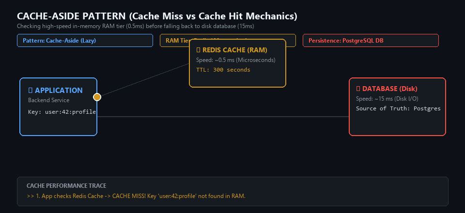

# 10 - Caching Strategies & Architecture Patterns

> **Real-World Analogy:**  
> Imagine keeping a notepad on your desk with the 5 phone numbers you call every single day. Instead of getting up, walking over to the filing cabinet, unlocking it, and searching the paper folder every time (querying the database), you glance at your notepad (cache) and dial instantly.

---

## 🎯 What & Why
Explains caching design patterns (Cache-Aside, Write-Through, Write-Behind, Write-Around) to drastically reduce database load and cut request latency from milliseconds to microseconds.

---

## 📊 Visual Architecture Diagram

<p align="center">
  
</p>
```mermaid
flowchart TD
    subgraph CacheAsidePattern["Cache-Aside Pattern (Lazy Loading)"]
        App["📱 Application"]
        Cache["⚡ In-Memory Cache (Redis)"]
        DB[("💾 Database")]

        App -->|1. Check Cache| Cache
        Cache -.->|2. Cache Miss| App
        App -->|3. Query DB| DB
        DB -->>|4. Return Data| App
        App -->|5. Write to Cache with TTL| Cache
    end
```

---

## ⚙️ How It Works Under The Hood
### Core Caching Access Patterns

1. **Cache-Aside (Lazy Loading)**:
   - The application first queries the cache.
   - If found (**Cache Hit**), return data immediately.
   - If not found (**Cache Miss**), fetch from the database, write the result into cache with a Time-To-Live (TTL), and return it to the client.
   - **Trade-off**: Cache only contains requested data; first read is slow (miss penalty).

2. **Write-Through**:
   - The application writes data to the cache, and the cache synchronously writes to the database before acknowledging success.
   - **Trade-off**: Data in cache is never stale; writes suffer higher latency because two systems are updated synchronously.

3. **Write-Behind (Write-Back)**:
   - The application writes directly to the cache, which acknowledges immediately.
   - The cache asynchronously batches and flushes writes to the database in the background.
   - **Trade-off**: Ultra-fast write latency; risk of data loss if the cache node crashes before flushing dirty pages.

4. **Write-Around**:
   - Writes go directly to the persistent database, bypassing the cache.
   - Only subsequent read requests populate the cache.
   - **Trade-off**: Prevents the cache from being flooded with data that may never be read again.

---

## 💻 Concrete Code Implementation
```python
# Python implementation: Cache-Aside pattern with simulated TTL expiration
import time

class CacheAsideService:
    def __init__(self):
        self.cache = {}
        self.database = {
            "user:1": {"name": "Alice", "role": "Engineer"},
            "user:2": {"name": "Bob", "role": "Designer"}
        }

    def get_user(self, user_id: str, ttl_seconds: int = 2):
        now = time.time()
        # 1. Check cache
        if user_id in self.cache:
            data, expires_at = self.cache[user_id]
            if now < expires_at:
                return data, "CACHE_HIT"
            del self.cache[user_id]  # Expired

        # 2. Cache miss -> query DB
        if user_id in self.database:
            user_data = self.database[user_id]
            # 3. Populate cache
            self.cache[user_id] = (user_data, now + ttl_seconds)
            return user_data, "CACHE_MISS"

        return None, "NOT_FOUND"

if __name__ == "__main__":
    service = CacheAsideService()
    
    val, status = service.get_user("user:1")
    print(f"First request: {status} -> {val}")

    val, status = service.get_user("user:1")
    print(f"Immediate second request: {status} -> {val}")

    print("Sleeping 2.2 seconds for TTL expiration...")
    time.sleep(2.2)

    val, status = service.get_user("user:1")
    print(f"Third request after expiration: {status} -> {val}")

```

---

## ⚖️ Trade-Offs & Architectural Considerations
- **Data Freshness**: Always configure appropriate TTLs to balance staleness vs database load.
- **Resource Limits**: Size in-memory clusters appropriately and set clear eviction policies.
- **Consistency**: Understand the trade-offs between sync writes and async replication.
