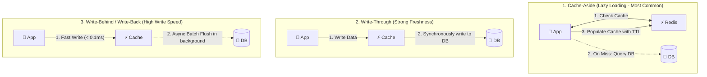

# 10 · Caching Strategies & Architecture Patterns

> **Part 3 · Caching & edge** · ⏱️ ~18 min read · Prerequisites: [01 · Client–server networking](../01-client-server-networking/), [06 · SQL vs NoSQL](../06-relational-and-non-relational-databases/)

---

> 🏢 **Real-world case studies**: how **Google** & **Netflix** approach this, in [REAL_WORLD_EXAMPLES.md](./REAL_WORLD_EXAMPLES.md).

## 🧒 The 30-second version

Fetching data from a database on a hard drive takes about **15 milliseconds**. Reading data from a computer's RAM memory takes about **100 nanoseconds**—over **$100,000\times$ faster**.

A **cache** is a high-speed in-memory storage layer (like Redis or Memcached) sitting between your application and your database. Instead of making the database re-calculate the same expensive SQL query 10,000 times a second, the application checks the cache first. If the answer is already in memory (**Cache Hit**), it returns it in under 1 millisecond.

## Trail Notes exercise

In the [load balancing lesson](../03-load-balancing/#first-pass), two surviving servers can handle **1,800 requests per second**, while users send **2,000**. Trail Notes adds a cache in front of those servers for public guide pages. Assume all incoming requests are eligible for caching, a cache hit never reaches a backend, and the origin can sustain the same rate for cache misses.

**Predict.** With a **70% hit rate**, how many requests per second go to the backends? What happens if the cache stops answering and the site sends every request through?

<details>
<summary>Reveal the answer</summary>

The cache handles **1,400 requests per second**, and the backends see **600**. If all traffic bypasses the cache, the backends see **2,000** again and the 200-request-per-second shortfall returns. Plan for cold caches and cache failures. For example, limit concurrent work sent to the origin and decide whether an older cached guide is acceptable during an outage.

</details>

**Next exercise** · [Move photo processing off the request path](../17-message-queues/#trail-notes-exercise).

---

## 🍕 Everyday analogy: The Kitchen Counter vs The Basement Pantry

Imagine you are cooking dinner in your kitchen:

- **The Basement Pantry (The Database):** It holds 500 cans of food, 50 bags of flour, and all ingredients. But every time you need salt, you have to walk down two flights of stairs, unlock the door, search the shelf, and walk back up (**15 ms disk I/O**).
- **The Kitchen Counter (The In-Memory Cache):** You place a small shaker of salt and black pepper directly next to your stove (**0.1 ms RAM access**).
  - When you need salt, you reach out your hand and grab it instantly (**Cache Hit**).
  - If you need truffle oil that isn't on the counter (**Cache Miss**), you walk down to the basement pantry once, bring the bottle upstairs, and set it on the counter for the rest of the evening (**Lazy Loading / Cache-Aside**).

| In the kitchen analogy | In caching architecture |
| :--- | :--- |
| **Basement Pantry** | **Persistent Database on Disk** (PostgreSQL, MySQL) |
| **Kitchen Counter** | **In-Memory Cache in RAM** (Redis, Memcached) |
| **Grabbing salt from counter in 1 second** | **Cache Hit** ($< 0.5\text{ ms}$) |
| **Walking to basement when counter is empty** | **Cache Miss** ($\approx 15\text{ ms}$ disk latency) |
| **Throwing away expired milk from counter** | **Time-To-Live (TTL) Eviction** |
| **Clearing counter when counter is full** | **Least Recently Used (LRU) Eviction** |

---

## 🧩 The problem it solves

1. **Database CPU Exhaustion:** A standard PostgreSQL instance can handle roughly $1,000$ to $3,000$ complex queries/second. If a celebrity tweets a link to a product page and $50,000$ users click it simultaneously, the database runs out of connection pools and crashes. An in-memory Redis cluster handles **$100,000+$ reads/second per node** with ease.
2. **Slow Sub-Query Latencies:** A dashboard showing user profile + order history + account tier requires 3 table joins and takes $40\text{ ms}$. Caching the assembled JSON response reduces response time to **$0.4\text{ ms}$**, eliminating $99\%$ of database load.

---

## 🖼️ Picture it

<p align="center">
  
</p>



---

## 🔢 Walk-through with real numbers

### The Impact of Cache Hit Ratio on User Latency

Suppose your database query takes **$20\text{ ms}$** and your Redis cache lookup takes **$0.5\text{ ms}$**:

$$\text{Effective Latency} = (\text{Hit Ratio} \times \text{Cache Latency}) + ((1 - \text{Hit Ratio}) \times \text{DB Latency})$$

| Cache Hit Ratio | Calculation | Average Request Latency | Database Load Reduction |
| :---: | :--- | :---: | :---: |
| **$0\%$ (No Cache)** | $1.0 \times 20\text{ ms}$ | **$20.0\text{ ms}$** | $0\%$ |
| **$80\%$** | $(0.80 \times 0.5) + (0.20 \times 20)$ | **$4.4\text{ ms}$** | $80\%$ |
| **$95\%$ (Target)** | $(0.95 \times 0.5) + (0.05 \times 20)$ | **$1.47\text{ ms}$** | **$95\%$** |
| **$99\%$ (Elite)** | $(0.99 \times 0.5) + (0.01 \times 20)$ | **$0.69\text{ ms}$** | **$99\%$** |

> 💡 **Takeaway:** Pushing your hit ratio from $80\%$ to $95\%$ cuts average user latency by **$66\%$** and reduces database query traffic by a factor of 4!

---

## ⚙️ How it works: The 4 Core Caching Access Patterns

### 1. Cache-Aside (Lazy Loading)
- **Read Path:** Application checks cache first. If found (**Hit**), returns data. If missing (**Miss**), reads from database, writes data into cache with a **Time-To-Live (TTL)**, and returns to user.
- **Write Path:** Application writes directly to the database, and **deletes (invalidates)** the key from the cache.
- **Pros:** Only requested data is cached (memory efficient); resilience against cache node restarts.
- **Cons:** Cache miss penalty on the first read; risk of transient stale reads.

---

### 2. Write-Through Pattern
- When data is updated, the application writes to the cache. The cache synchronously writes to the database in the same transaction before returning success.
- **Pros:** Data in cache is never stale; reads are always $100\%$ fresh.
- **Cons:** High write latency (writes must wait for two storage systems); caches items that may never be read again.

---

### 3. Write-Behind (Write-Back) Pattern
- When data is updated, the application writes to the cache, which acknowledges immediately in $< 0.1\text{ ms}$.
- The cache queues the update and asynchronously flushes batches of writes to the database in the background (e.g. every 10 seconds or 1,000 writes).
- **Pros:** Ultra-fast write performance; absorbs massive write spikes (e.g. video view count counters).
- **Cons:** **Data loss risk!** If the Redis node loses power before flushing to the database, recent in-flight writes are lost forever.

---

### 4. Write-Around Pattern
- Writes go directly to the persistent database, completely bypassing the cache.
- The cache is only populated when a subsequent read request experiences a cache miss.
- **Pros:** Prevents cache pollution when writing large volumes of data that are rarely read immediately (e.g. archived log files, legal receipts).

---

### 5. Redis vs Memcached

| Dimension | Redis | Memcached |
| :--- | :--- | :--- |
| **Data Structures** | Rich: Strings, Hashes, Lists, Sets, Sorted Sets (`ZSET`), Bitmaps, HyperLogLogs | Simple key-value strings and raw blobs only |
| **Thread Architecture** | Single-threaded event loop (epoll / kqueue) with I/O threads | Multi-threaded (scales across multiple CPU cores on 1 machine) |
| **Persistence to Disk** | ✅ Yes: RDB snapshots and AOF (Append-Only File) logs | ❌ No: Pure in-memory only (cache wiped on reboot) |
| **Clustering & Replication** | Built-in Redis Sentinel (failover) and Redis Cluster (sharding) | Client-side consistent hashing across nodes |
| **Lua Scripting / PubSub** | ✅ Yes: Atomic Lua scripts and Pub/Sub message channels | ❌ No |

---

## ⚖️ Caching Patterns Comparison Matrix

| Pattern | Write Latency | Read Latency | Data Freshness | Risk of Data Loss |
| :--- | :---: | :---: | :---: | :---: |
| **Cache-Aside** | Fast (Writes DB) | Ultra-Fast on Hit | Eventual (Bounded by TTL) | None |
| **Write-Through** | Slower (Writes both) | Ultra-Fast | **Strong / Immediate** | None |
| **Write-Behind** | **Blazing Fast (< 0.1ms)** | Ultra-Fast | Eventual | **High (Power crash)** |
| **Write-Around** | Fast | Slower on 1st read | Strong | None |

---

## 🚫 Common mistakes & production pitfalls

1. **Updating the Cache instead of Deleting it on Write:**
   - *The Trap:* When updating a user profile in the DB, you also execute `cache.set(user_id, new_data)`.
   - *Why it causes bugs (Race Condition):* Two concurrent updates arrive: Thread A writes DB, Thread B writes DB. Due to network jitter, Thread B's cache update executes *before* Thread A's cache update. The cache now holds stale Thread A data indefinitely!
   - *The Fix:* **Always invalidate (delete) the cache key on mutation** (`cache.delete(user_id)`). The next read will cleanly re-populate the cache from the database.

2. **Caching without a Time-To-Live (TTL):**
   - *Why it hurts:* If a cache invalidation bug occurs in code, data without a TTL remains stale in memory forever until a human engineer manually flushes the cluster.
   - *The Fix:* **Always set a TTL** (e.g. 5 minutes or 1 hour) as a safety net.

3. **Caching Giant Monolithic JSON Blobs:**
   - *Why it hurts:* Storing a 5 MB JSON document in Redis. Redis is single-threaded; transferring and serializing a 5 MB string blocks the Redis event loop for 10 ms, stalling thousands of other concurrent requests.
   - *The Fix:* Cache granular records ($< 10\text{ KB}$) or split objects into Redis Hashes (`HSET / HGET`).

---

## 💻 Try it yourself

Run the interactive simulator in this folder:

```bash
cd 10-caching-patterns
python demo.py
```

### What to explore in `demo.py`:
1. Watch the **Cache-Aside pattern**: first read triggers a 15 ms disk query, and immediate second read returns in **0.2 ms** from RAM!
2. Observe **Write-Through**: synchronously updating both tiers for 100% data freshness.
3. Observe **Write-Behind**: updates acknowledged instantly in memory, then flushed to disk in an asynchronous batch by a background worker.

---

## 🌍 Where you'll see it in production

- **Twitter / X Timeline Cache:** Caches user home timelines in Redis clusters so opening the app renders tweets in $< 50\text{ ms}$ without querying databases.
- **Reddit:** Uses massive Memcached clusters to cache comment trees and upvote scores.
- **Netflix:** Uses EVCache (distributed Memcached on AWS) to serve personalization recommendations to 250M+ viewers.

---

## 🎯 Top Interview Questions & Deep Answers

### Q1: "When modifying data in the database, should you UPDATE the cached value or DELETE (invalidate) it? Why?"

<details>
<summary>💡 Click to reveal the ideal senior engineering answer</summary>

In almost all production scenarios, you should **DELETE (invalidate) the cache key** rather than updating it:

1. **Prevents Concurrent Race Conditions:**
   - Suppose Thread 1 updates row $X=10$ in the DB.
   - Thread 2 updates row $X=20$ in the DB.
   - If both threads try to update the cache directly, Thread 2's cache update might execute first, followed by Thread 1's cache update arriving late due to network latency.
   - Result: Database has $20$, but Cache has $10$! The cache is permanently corrupted with stale data.
   - By **deleting** the key on mutation, neither thread leaves stale data in the cache. The next read query will fetch the authoritative state directly from the DB.
2. **Resource Efficiency (Lazy Evaluation):**
   - If a record is updated 10 times in 1 minute, but nobody reads it, updating the cache 10 times wastes CPU cycles and serialization overhead. Deleting it costs almost nothing, and the cache is only recomputed when someone actually asks for it.

</details>

---

### Q2: "What is the difference between Write-Through and Write-Behind, and when is Write-Behind worth the risk of data loss?"

<details>
<summary>💡 Click to reveal the ideal senior engineering answer</summary>

- **Write-Through:**
  - The application writes to the cache, and the cache synchronously writes to the database before returning `OK`.
  - **Trade-off:** High write latency, zero data loss, $100\%$ fresh reads.
- **Write-Behind (Write-Back):**
  - The application writes only to the cache, which returns `OK` in $< 0.1\text{ ms}$. A background worker batches queued writes and updates the database asynchronously.
  - **When is Write-Behind worth the data loss risk?**
    1. **Extremely High-Frequency Increment Counters:** (e.g. YouTube video view counts, live stream like buttons, TikTok analytics). If 100,000 users click "like" in 5 seconds, sending 100,000 individual `UPDATE` queries to PostgreSQL will lock the row and crash the DB. Write-Behind batches them in Redis memory and flushes 1 single `UPDATE likes = likes + 100000` query to Postgres every 10 seconds.
    2. **Telemetry & Sensor Logging:** Where losing the last 3 seconds of GPS coordinates during an unexpected crash is completely acceptable to the business.

</details>

---

### Q3: "How do you choose between Redis and Memcached in a modern distributed system design?"

<details>
<summary>💡 Click to reveal the ideal senior engineering answer</summary>

- **Choose Memcached when:**
  - The data model is strictly simple key-value blobs (e.g. HTML fragments, rendered web templates).
  - You are running on multi-core servers with massive RAM and want multi-threaded memory scaling with zero background disk persistence overhead.
- **Choose Redis (The Industry Standard for 95% of Use Cases) when:**
  - You need **rich data structures**: Sorted Sets (`ZSET`) for real-time leaderboards, Sets for unique visitor tracking, Hashes for user objects, Lists for queues.
  - You need **disk persistence (RDB/AOF)** to avoid cold-cache stampedes when a cache node reboots.
  - You need **atomic operations via Lua scripting** (e.g., distributed rate limiters, distributed locks via Redlock).
  - You need automated failover (Redis Sentinel) and clustering (Redis Cluster).

</details>

---

### Q4: "What is the 80/20 Rule (Pareto Principle) in caching, and how does it determine cluster memory sizing?"

<details>
<summary>💡 Click to reveal the ideal senior engineering answer</summary>

- **The Principle:** In almost all internet applications, **$20\%$ of the keys generate $80\%$ of the read traffic** (e.g., top trending tweets, viral products, active users).
- **Memory Sizing Math:**
  - You **never** need enough RAM to store your entire database in cache!
  - If your total database size is $10\text{ Terabytes}$, sizing your Redis cluster to hold the hottest **$20\%$ of data** ($2\text{ TB}$ of RAM across 32 nodes of 64 GB each) allows you to achieve an **$80\%$ to $90\%$ Cache Hit Ratio**, reducing database load by up to $90\%$ at a fraction of the hardware cost!

</details>

---

## ✅ Check yourself

1. **An application uses the Cache-Aside pattern. Key `user:10` has a TTL of 60 seconds. A client updates `user:10` in the database, but forgets to delete it from Redis. For how long will users see stale data?**

<details>
<summary>View Answer</summary>

For **at most 60 seconds**. After 60 seconds, Redis's TTL expires, the key is evicted, and the next read query experiences a Cache Miss, fetching the updated record from the database and healing the cache. (This is why setting a TTL is mandatory as a safety net!).

</details>

---

2. **Why does Write-Through caching have higher write latency than Cache-Aside?**

<details>
<summary>View Answer</summary>

Because Write-Through requires a **synchronous write to two distinct systems** (first to the cache, then across the network to the database disk) before returning an HTTP response to the user. Cache-Aside writes to the database and issues an instantaneous in-memory delete command.

</details>

---

3. **In Redis, what is the time complexity of an `HGET` on a Hash compared to querying a relational database?**

<details>
<summary>View Answer</summary>

An `HGET` in Redis is **$O(1)$** in memory ($< 0.1\text{ ms}$). In a relational database, even with a B-Tree index, a query is **$O(\log N)$** and requires traversing tree pages on disk ($1\text{–}15\text{ ms}$).

</details>

---

## 📚 Go deeper

- **Designing Data-Intensive Applications (DDIA)** by Martin Kleppmann: Section on *Caching and Derived Data*.
- **Redis Documentation:** Official guides on Memory Optimization, Redis Persistence (AOF vs RDB), and Cluster Topologies (redis.io/docs).

---

## 🔗 Related modules

- [06 · SQL vs NoSQL](../06-relational-and-non-relational-databases/): The underlying databases protected by the cache tier.
- [11 · Cache eviction & invalidation](../11-cache-eviction-and-invalidation/): What happens when the cache runs out of memory (LRU, LFU, Cache Stampedes).
- [16 · Consistent hashing](../16-consistent-hashing/): How Redis clusters distribute keys across multiple nodes.
