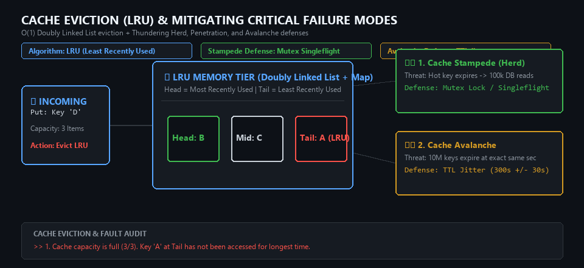

# 11 - Cache Eviction Policies & Invalidation Pitfalls

> **Executive Summary:** RAM is finite and expensive, while database storage is virtually infinite and cheap. Cache eviction algorithms (LRU, LFU, FIFO) govern which data to discard when memory runs out. Meanwhile, cache invalidation failure modes—Cache Stampede (Thundering Herd), Cache Penetration, and Cache Avalanche—represent three of the most notorious causes of catastrophic site-wide outages in distributed systems.

---

> 🏢 **Real-World Deep Dives**: Detailed case studies of how **Google** & **Netflix** implement this in production are documented in [REAL_WORLD_EXAMPLES.md](./REAL_WORLD_EXAMPLES.md).

## ⏱️ Prerequisites: What You Need to Know First

To get the most out of this module, make sure you understand:
- [01 - Client-Server Networking](../01-client-server-networking/README.md): Latency differences between RAM lookups (~100 ns) and network/disk calls (~10–100 ms).
- [06 - Relational & Non-Relational Databases](../06-relational-and-non-relational-databases/README.md): Connection pooling limits, IOPS constraints, and DB query execution costs.
- [10 - Caching Patterns](../10-caching-patterns/README.md): Cache-Aside, Write-Through, Write-Behind, and basic read-through caching.
- **Data Structures**: Doubly linked lists, hash tables, and probabilistic bit arrays (Bloom filters).

---

## 🧒 The 30-Second Version (ELI5)

Imagine you have a small desk where you keep books you are actively reading. Your desk can only hold 3 books, but you own thousands of books on shelves downstairs.
- When you bring a 4th book to your desk, you must send one back downstairs to make room. If you send back the book you haven't touched for the longest time, that is **LRU (Least Recently Used)**.
- If someone constantly knocks on your door asking for books that don't even exist on your shelves, and you walk downstairs every single time to check, that is **Cache Penetration**.
- If all 3 books on your desk vanish at the exact same minute because a timer rang, and 50 people run into your room demanding to read them at once, causing a human pileup at the staircase, that is **Cache Avalanche** and **Cache Stampede**.

---

## 🍕 Everyday Analogy

Imagine a busy coffee table in a doctor's waiting room that can hold exactly 4 magazines:

| Concept | Waiting Room Analogy | Technical Reality in Distributed Systems |
| :--- | :--- | :--- |
| **Cache Capacity** | Coffee table space (holds 4 magazines) | Allocated RAM budget (e.g., 64 GB in Redis cluster) |
| **Eviction (LRU)** | Throwing out the magazine no one picked up for 3 days | Discarding the least recently accessed key in $O(1)$ time |
| **Cache Stampede** | The magazine with celebrity gossip is removed; 20 patients all shout at the nurse at once demanding she sprint to the store | Hot key expires; 50,000 concurrent threads simultaneously hammer the database |
| **Singleflight Mutex** | Nurse tells the crowd: *"Only Bob will go get a copy; everyone else sit down and wait for Bob to return"* | Exactly one worker thread queries the DB and repopulates cache; others await the promise |
| **Cache Penetration** | Pranksters repeatedly ask for a magazine that doesn't exist; the nurse walks downstairs every time | Malicious/buggy requests query `user_id=-99999`; bypasses cache and exhausts DB IOPS |
| **Bloom Filter** | A receptionist desk checklist that knows every magazine title ever printed; immediately denies fake titles | Space-efficient probabilistic bit-set checking key existence before querying cache or DB |
| **Cache Avalanche** | All 4 magazines have an expiration sticker for Friday 5:00 PM; at 5:01 PM the table is empty and everyone panics | Millions of keys set with identical 2-hour TTL expire at the exact same second |
| **TTL Jitter** | Staggering sticker dates: one expires at 4:45, one at 5:10, one at 5:30 | Adding random noise ($\pm 10\%$) to key TTLs so expirations are smoothed over time |

---

## 🧩 The Problem It Solves

### Without Proper Eviction & Invalidation Protections
- **Memory Exhaustion (OOM Panic)**: When cache runs out of RAM, unmanaged Redis/Memcached instances crash, drop connections, or freeze due to Linux kernel Out-Of-Memory killer.
- **Thundering Herd Collapse**: An ultra-popular homepage banner or World Cup live score expires. Within 100 milliseconds, 50,000 backend application threads miss the cache and issue the exact same expensive SQL query. The database connection pool is immediately exhausted, connection timeouts spike, and the entire platform cascadingly crashes.
- **DDoS via Non-Existent Keys**: Attackers scan an e-commerce catalog using non-existent random UUIDs (`/product/uuid-999999999`). Because these keys do not exist in the cache, 100% of attacker traffic punches straight through to disk-bound database queries.

### With Modern Eviction & Fault-Tolerant Cache Architecture
- **Deterministic Memory Bound**: $O(1)$ LRU/LFU eviction guarantees memory never exceeds provisioned hardware thresholds.
- **Singleflight De-duplication**: Only 1 request queries the DB upon a hot key expiration; 49,999 requests wait for the in-flight result and return immediately.
- **Zero-Cost Negative Filtering**: Bloom filters reject non-existent requests at the cache layer with 0 database round-trips.
- **Jittered Expirations**: Smooth database load curves with no sudden cliff-edge expiration waves.

---

## 🖼️ Picture It: Architecture & Flow

### High-Resolution Architecture Animation
Below is an animated trace of an $O(1)$ Doubly Linked List LRU Cache evicting the oldest key upon capacity overflow, alongside the defensive architectures for Cache Stampede and Cache Avalanche:



---

### Invalidation Failure Modes & Mitigations Flowchart

```mermaid
flowchart TD
    subgraph Stampede["1. Cache Stampede (Thundering Herd)"]
        A[🔥 Hot Key Expires] --> B[100k Simultaneous Requests]
        B -->|Without Singleflight| C[💥 100k Concurrent DB Queries -> Outage]
        B -->|With Distributed Mutex| D[🔒 Only 1 Thread Queries DB]
        D --> E[Populate Cache & Unblock Waiting 99,999 Requests]
    end

    subgraph Penetration["2. Cache Penetration (Attacker Scanning Fake IDs)"]
        F[Request for Non-Existent ID] --> G{Bloom Filter Check}
        G -->|Key Definitely Not in DB| H[🛑 Return 404 Immediately in 100ns]
        G -->|Key Might Exist| I[Query Cache -> Query DB -> Cache NULL Object]
    end

    subgraph Avalanche["3. Cache Avalanche (Synchronized Expirations)"]
        J[10 Million Keys Written at Midnight] --> K{TTL Configuration}
        K -->|Fixed TTL: 3600s| L[💥 All 10M Keys Expire at 1:00:00 AM -> DB Crashes]
        K -->|Jittered TTL: 3600s +/- 300s| M[✅ Keys Expire Smoothly Over 10 Minutes]
    end

    style Stampede fill:#161b22,stroke:#58a6ff,stroke-width:2px;
    style Penetration fill:#161b22,stroke:#3fb950,stroke-width:2px;
    style Avalanche fill:#161b22,stroke:#d29922,stroke-width:2px;
```



---

## 🔢 Walk-Through with Real Numbers

Let's model an e-commerce platform during Black Friday to calculate the blast radius of cache failure modes:

### Scenario: Black Friday Hot Deal Flash Sale
- **Peak Throughput**: 100,000 HTTP requests per second for the featured deal (`deal:blackfriday_special`).
- **Database Capacity**: PostgreSQL read replica can handle at most 2,500 queries per second before connection pool exhaustion.
- **Query Cost**: Complex product bundle calculation takes 40 ms of database CPU time.

```
┌────────────────────────────────────────────────────────────────────────┐
│ Scenario A: Cache Stampede (No Mutex / Singleflight)                    │
├────────────────────────────────────────────────────────────────────────┤
│ 1. Deal key expires at t = 0.000s                                      │
│ 2. In the next 40 ms (DB query time), 4,000 incoming requests miss.    │
│    (100,000 req/sec * 0.040 sec = 4,000 queries)                       │
│ 3. Database connection pool limit = 200 connections.                   │
│ 4. Result: 3,800 connection requests queued, 504 Gateway Timeouts,     │
│    DB CPU spikes to 100%, health checks fail, replica gets killed.     │
└────────────────────────────────────────────────────────────────────────┘

┌────────────────────────────────────────────────────────────────────────┐
│ Scenario B: Protected with Singleflight (Mutex Locking)                │
├────────────────────────────────────────────────────────────────────────┤
│ 1. Deal key expires at t = 0.000s                                      │
│ 2. Request #1 acquires distributed mutex lock (`lock:deal:blackfriday`) │
│ 3. Requests #2 through #4,000 fail to acquire lock -> sleep / subscribe│
│ 4. Request #1 finishes DB query in 40 ms, writes key to Redis, releases│
│ 5. Requests #2 through #4,000 read fresh key directly from Redis (1 ms)│
│ 6. Total DB Queries issued: Exactly 1. Peak DB CPU delta: 0.04%.       │
└────────────────────────────────────────────────────────────────────────┘
```

---

## ⚙️ How It Works Under the Hood

### 1. The Classic Eviction Algorithms

#### LRU (Least Recently Used)
- **Data Structure**: Combination of a **Hash Map** (`Key -> Node Pointer`) and a **Doubly Linked List** (`Head <-> Node1 <-> Node2 <-> Tail`).
- **Lookup ($O(1)$)**: Find node pointer in Hash Map; detach node from its current position in list and move it directly to `Head` (Most Recently Used).
- **Eviction ($O(1)$)**: When size exceeds capacity, remove node directly preceding `Tail` (Least Recently Used), and delete its key from the Hash Map.
- **Weakness**: Vulnerable to "Cache Pollution" (e.g., a batch script or full-table scan touches every record once, evicting all hot, valuable data).

#### LFU (Least Frequently Used)
- **Data Structure**: Hash Map for keys + Doubly Linked Lists grouped by access frequency bucket, with a `min_frequency` tracking pointer.
- **Lookup ($O(1)$)**: Increment key's access counter; move node from frequency bucket $k$ to bucket $k+1$.
- **Eviction ($O(1)$)**: Evict node from the bucket corresponding to `min_frequency`.
- **Weakness**: Historical bias—a key that received 10,000 views last week will never be evicted, even if nobody reads it today. Requires frequency aging/decay algorithms (e.g., divide all counters by 2 every hour).

#### Advanced: W-TinyLFU (Window TinyLFU)
- Used in state-of-the-art caches like **Caffeine** (Java) and **Ristretto** (Go).
- Maintains a small "admission window" (LRU) for new entries and a frequency filter (Count-Min Sketch) to determine whether incoming data is more likely to be accessed again than the current eviction candidate. Prevents single-scan cache pollution completely.

---

### 2. The Three Critical Invalidation Failures

#### Threat 1: Cache Stampede (Thundering Herd)
- **Mechanism**: A heavily accessed key expires or is deleted. A surge of parallel application workers detect a cache miss and all try to compute/fetch the replacement concurrently.
- **Solutions**:
  1. **Singleflight / Distributed Lock**: Ensure only one worker computes the value.
  2. **Probabilistic Early Expiration (XFetch Algorithm)**:
     $$\Delta \cdot \beta \cdot \ln(\text{random}()) > \text{time\_to\_expire}$$
     Background worker recalculates and refreshes the key *before* it actually expires when access probability is high.

#### Threat 2: Cache Penetration
- **Mechanism**: Client requests keys that exist in neither cache nor storage (e.g., `SELECT * FROM users WHERE id = -404`). Every lookup hits disk.
- **Solutions**:
  1. **Cache Null Values**: Set `redis.setex("user:-404", 60, "NULL")` so subsequent queries return nil immediately from cache.
  2. **Bloom Filter**: A bit-array that guarantees: if it says *No*, the key 100% does not exist in the database. Filter sits in front of the cache.

#### Threat 3: Cache Avalanche
- **Mechanism**: A large batch of keys are loaded into cache with the same fixed TTL (e.g., 2 hours). When 2 hours elapse, millions of keys evaporate at the exact same millisecond.
- **Solution**:
  - **TTL Jitter**: Inject random variance into the expiration:
    $$\text{TTL} = \text{BaseTTL} + \text{random}(-\text{Delta}, +\text{Delta})$$

---

## ⚖️ Trade-Offs & Decision Matrix

| Eviction Policy | Lookup Time | Space Overhead | Best Suited For | Major Vulnerability |
| :--- | :--- | :--- | :--- | :--- |
| **LRU** | $O(1)$ | Medium (2 pointers per node) | Temporal locality (recently read will be read again) | Batch scans completely wipe hot working set |
| **LFU** | $O(1)$ | High (frequency nodes + lists) | Long-term stable access patterns | Stale keys with old high counts resist eviction |
| **FIFO** | $O(1)$ | Lowest (simple queue) | Streaming data where age strictly predicts irrelevance | Evicts heavily used keys simply because they are old |
| **Random** | $O(1)$ | Zero extra metadata | Memory-constrained systems (e.g., low-RAM edge routers) | Suboptimal hit rates compared to LRU |
| **W-TinyLFU** | $O(1)$ | Low (~8 bits per key) | High-throughput, mixed read/write microservices | Higher implementation complexity |

---

## 🚫 Common Mistakes & Production Pitfalls

1. **Setting TTL Without Jitter in Batch Scripts**:
   - *Pitfall*: A nightly sync job writes 5,000,000 customer records to Redis at 03:00 AM with `TTL = 86400` (24 hours). At 03:00 AM the next night, all 5M keys expire simultaneously, killing the DB during early morning traffic.
   - *Fix*: Apply jitter: `TTL = 86400 + random.randint(-3600, 3600)`.

2. **Unbounded Cache Memory**:
   - *Pitfall*: Running Redis with `maxmemory` disabled on a 16 GB instance. Keys grow until Linux invokes `OOM-Killer`, violently terminating the `redis-server` process with SIGKILL.
   - *Fix*: Always define `maxmemory 12gb` and set an explicit policy like `maxmemory-policy allkeys-lru` or `volatile-lru`.

3. **Re-fetching on Stampede Instead of Singleflight**:
   - *Pitfall*: Relying solely on caching without request coalescing. When a key expires, 5,000 identical SQL queries are fired in 50 ms.
   - *Fix*: Implement Go's `singleflight` or Python's mutex coalescer to share 1 execution among all concurrent callers.

---

## 💻 Try It Yourself: Python Simulation

The companion simulation script [`demo.py`](./demo.py) implements:
1. An $O(1)$ Doubly Linked List LRU Cache with automatic eviction.
2. A multi-threaded simulation of a **Cache Stampede** vs. a **Mutex Singleflight Defense**.
3. A benchmark showing DB query count dropping from 50 concurrent calls down to **1 single query**.

Run it locally in your terminal:
```bash
python demo.py
```

---

## 🌍 Where You'll See It in Production

- **Redis**: Provides 8 distinct eviction policies via `maxmemory-policy`: `noeviction`, `allkeys-lru`, `volatile-lru`, `allkeys-lfu`, `volatile-lfu`, `allkeys-random`, `volatile-random`, and `volatile-ttl`. Note that Redis uses an *approximated LRU/LFU* algorithm (sampling 5–10 random keys) to avoid the memory overhead of actual linked list pointers.
- **Go `golang.org/x/sync/singleflight`**: Standard library extension used by Google, CockroachDB, and Docker to suppress duplicate function calls and prevent cache stampedes.
- **Cloudflare Edge CDN**: Implements stale-while-revalidate and origin request coalescing so millions of global users requesting an uncached asset only produce a single origin pull.
- **Meta (Facebook) TAO**: Uses Cache-Aside with distributed invalidation buses and leases (tokens returned on cache misses) to avoid stampedes across thousands of memcached nodes.

---

## 🎯 Top Interview Questions & Deep Answers

### Q1: "How do you implement an LRU Cache with $O(1)$ operations for both `get` and `put`?"
**Interviewer Goal**: Testing data structure mastery, pointer manipulation, and memory complexity.

**Model Answer**:
"To achieve $O(1)$ time complexity for both `get` and `put`, we combine two data structures:
1. A **Hash Map** that maps each key to its corresponding node pointer in memory.
2. A **Doubly Linked List** where the head represents the Most Recently Used (MRU) item and the tail represents the Least Recently Used (LRU) item.

- **`get(key)`**: We look up the key in the hash map in $O(1)$. If found, we detach the node from its current position in the doubly linked list and re-attach it immediately after the dummy head node (marking it MRU), returning the value.
- **`put(key, value)`**: If the key already exists, we update its value and move it to the head. If it is new, we check current size against capacity. If full, we delete the node directly preceding the dummy tail node (the LRU node), remove its key from the hash map, and insert the new node at the head. All pointer adjustments (updating `.prev` and `.next`) take constant $O(1)$ operations."

---

### Q2: "What is the difference between Cache Stampede, Cache Penetration, and Cache Avalanche, and how do you protect against each?"
**Interviewer Goal**: Checking whether the candidate has lived through or prepared for real-world production cache outages.

**Model Answer**:
"These are three distinct failure modes with different root causes:
1. **Cache Stampede (Thundering Herd)**:
   - *Cause*: A high-concurrency *valid* key expires. Thousands of simultaneous requests miss the cache and all run the same heavy database query.
   - *Defense*: Request coalescing / **Singleflight Mutex** (only 1 thread queries the DB; others wait for its completion) or **probabilistic early refresh** (XFetch algorithm refreshes the key before actual TTL expiry).
2. **Cache Penetration**:
   - *Cause*: High volume of requests for keys that *do not exist* in either cache or database (e.g., malicious enumeration of `id = -1` or random UUIDs).
   - *Defense*: Deploy a **Bloom Filter** in front of the cache to drop non-existent keys in $O(k)$ bit-lookups, and **cache NULL results** with a short TTL (e.g., 30–60s) for missing items.
3. **Cache Avalanche**:
   - *Cause*: Millions of cached keys are set with the *identical TTL* (e.g., 2 hours). When that duration elapses, a massive volume of keys drop out at the exact same second, overwhelming the database.
   - *Defense*: Add **random jitter** to expiration times (e.g., $\text{TTL} = 7200 \pm \text{random}(0, 600)$) to disperse expirations across time."

---

### Q3: "Redis claims to support LRU, but why does its documentation say it uses an 'approximated LRU' instead of true LRU?"
**Interviewer Goal**: Testing deep knowledge of systems programming trade-offs and memory efficiency.

**Model Answer**:
"In a standard LRU implementation, every entry requires a doubly linked list node containing two 64-bit pointers (`prev` and `next`), consuming at least 16 additional bytes of RAM per key. Across 100,000,000 keys, that overhead alone wastes 1.6 GB of expensive RAM purely for pointer bookkeeping. Furthermore, updating pointers on every single read operation degrades memory locality and creates lock contention.

To solve this, Redis uses **Approximated LRU**:
- Each Redis object stores a 24-bit timestamp field recording its last access time.
- When memory limit is reached and eviction triggers, Redis does not inspect a global linked list. Instead, it randomly samples a small pool of keys (configurable by `maxmemory-samples`, default 5), and evicts the key with the oldest timestamp among that sampled pool.
- With a sample size of 10, Redis's approximated LRU behavior becomes virtually indistinguishable from true LRU, while saving hundreds of megabytes of RAM and eliminating linked list overhead."

---

### Q4: "In a write-heavy microservices architecture, how do you handle cache invalidation consistency without race conditions?"
**Interviewer Goal**: Checking distributed systems rigor regarding Cache-Aside vs. Write-Through race conditions.

**Model Answer**:
"A classic race condition occurs in Cache-Aside when:
1. Thread A reads from DB (returns version 1).
2. Before Thread A can write version 1 to Cache, Thread B writes version 2 to DB and deletes the key from Cache.
3. Thread A now writes stale version 1 into Cache. Stale data remains indefinitely until TTL expires.

To resolve this in production:
1. **Always Delete, Never Update**: In Cache-Aside, mutating operations must **delete/invalidate** the cache key rather than updating it, avoiding serialization race order issues.
2. **Short TTL as a Safety Net**: Always assign a reasonable TTL (e.g., 5–15 minutes) to ensure that any temporary inconsistency is self-healing.
3. **Change Data Capture (CDC)**: Use Debezium or DynamoDB Streams with a dedicated invalidator service that tails the database Write-Ahead Log (WAL) and publishes invalidation events to Redis, decoupling application workers from the cache invalidation contract."

---

### Q5: "How does a Bloom Filter work, and what are its trade-offs when protecting against Cache Penetration?"
**Interviewer Goal**: Assessing understanding of probabilistic algorithms and space-efficiency tradeoffs.

**Model Answer**:
"A Bloom Filter is a space-efficient probabilistic data structure used to test set membership:
- It consists of an array of $m$ bits (initially all 0) and $k$ independent hash functions.
- **Adding an item**: Compute $k$ hashes of the key and set the corresponding bit positions in the array to 1.
- **Querying an item**: Hash the key with all $k$ functions. If **any** bit is 0, the item is **definitely not in the set**. If all bits are 1, the item **might be in the set**.

**Trade-offs**:
- **Pros**: Extremely fast $O(k)$ operations and tiny memory footprint (less than 10 bits per item for a 1% false positive rate).
- **Cons**: It has **false positives** (may report an item exists when it doesn't, causing an occasional DB lookup), but **zero false negatives** (never says an item doesn't exist if it actually does).
- **Deletion is impossible**: Standard Bloom filters cannot delete items because clearing a bit might affect other keys sharing that bit. If item deletions are required, a **Counting Bloom Filter** or **Cuckoo Filter** must be used."

---

## ✅ Check Yourself: Flash Quiz

<details>
<summary><b>1. Why is LRU vulnerable to batch scanning scripts (e.g. daily backup or analytics queries)?</b></summary>
<br>
Because LRU only tracks recency. A batch script reading 1,000,000 old records touches each once, moving them to the front of the LRU list and evicting all high-frequency, highly active keys from RAM. Solutions like <b>W-TinyLFU</b> or <b>2Q (Two-Queue)</b> defend against this by requiring an item to be accessed more than once before admission into the main cache.
</details>

<details>
<summary><b>2. If you set 1,000,000 keys with a 60-second TTL at 12:00:00 without jitter, what happens at 12:01:00?</b></summary>
<br>
You cause a <b>Cache Avalanche</b>. All 1,000,000 keys expire at the exact same millisecond. If traffic is active, millions of incoming queries miss the cache simultaneously and hit the database tier at once, likely exhausting connection pools and causing cascading service failures.
</details>

<details>
<summary><b>3. Can a Bloom Filter ever return a False Negative (telling you an item does not exist when it actually is in the database)?</b></summary>
<br>
<b>No.</b> Bloom filters have a mathematical guarantee of zero false negatives. If an item was added, all $k$ of its hash bits were set to 1. If any hash bit is 0, the item was definitely never added.
</details>

---

## 📚 Go Deeper: Recommended Reading

- **Designing Data-Intensive Applications** by Martin Kleppmann — *Chapter 3: Storage and Retrieval (Caches and In-Memory Stores)*.
- **Systems Performance** by Brendan Gregg — *Chapter 4: Memory Architecture and Caching Mechanics*.
- **The XFetch Algorithm Paper**: *Optimal Probabilistic Cache Stampede Prevention* (Vattani, Chierichetti, Lowenstein).
- **Redis Documentation**: *Redis as an LRU Cache* (`https://redis.io/docs/reference/eviction/`).
- **Caffeine Cache Design Document**: *Window TinyLFU Eviction Policy (Ben Manes)*.

---

## 🔗 Related Modules

- [10 - Caching Patterns](../10-caching-patterns/README.md): Cache-Aside, Write-Through, Write-Behind fundamentals.
- [12 - Content Delivery Networks](../12-content-delivery-networks/README.md): Caching and invalidating assets at edge PoPs globally.
- [22 - System Design: Distributed In-Memory Cache](../22-system-design-in-memory-cache/README.md): Full architectural end-to-end design of a Redis-like distributed cache cluster.
