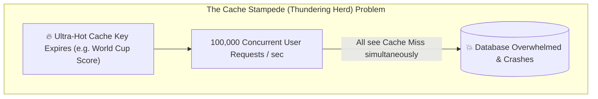

# 11 - Cache Eviction Policies & Invalidation Pitfalls

> **Real-World Analogy:**  
> Imagine a coffee table in a doctor's waiting room that can only hold 5 magazines. When a patient brings a new magazine, an old one must be discarded. If you throw away the magazine that nobody has touched for the longest time, that is Least Recently Used (LRU). If you throw away the magazine read the fewest total times, that is Least Frequently Used (LFU).

---

## 🎯 What & Why
Covers cache replacement policies (LRU, LFU, FIFO) and distributed caching failure modes: Cache Stampede (Thundering Herd), Cache Penetration, and Cache Avalanche, with battle-tested mitigation strategies.

---

## 📊 Visual Architecture Diagram


---

## ⚙️ How It Works Under The Hood
### Common Eviction Algorithms

1. **LRU (Least Recently Used)**:
   - Evicts the item that has not been accessed for the longest period of time.
   - Typically implemented using a Doubly Linked List combined with a Hash Map for $O(1)$ lookups and updates.
2. **LFU (Least Frequently Used)**:
   - Tracks an access counter for each item; evicts the item with the lowest access count.
   - Requires handling frequency decay so old, obsolete items that were once popular do not occupy the cache forever.
3. **FIFO (First In, First Out)**:
   - Evicts items strictly in the order they were inserted, regardless of access frequency.

---

### Critical Cache Invalidation Failures

- **Cache Penetration**:
  - Attackers or clients repeatedly query keys that **do not exist** in either the cache or the database (e.g., `user_id = -9999`). Every query punches straight through to the database.
  - **Mitigation**: Cache null objects (`cache.set("user:-9999", NULL, ttl=60s)`) or deploy a **Bloom Filter** in front of the cache to instantly reject non-existent IDs.

- **Cache Avalanche**:
  - Millions of cached keys are set with the exact same TTL (e.g., 2 hours). When the timer expires, they all invalidate at the exact same second, dumping a massive tsunami of queries directly onto the database.
  - **Mitigation**: Add **random jitter** to expiration times (`TTL = base_ttl + random_uniform(-300, 300)`).

- **Cache Stampede (Thundering Herd)**:
  - An extremely popular hot key expires while receiving thousands of requests per second. All concurrent threads simultaneously experience a cache miss and run the expensive query on the database.
  - **Mitigation**: Use a distributed mutex lock (`Redis SETNX`) so only one thread recomputes the key, or use probabilistic early recomputation (XFetch algorithm).

---

## 💻 Concrete Code Implementation
```python
# LRU cache: hash map + doubly linked list, O(1) get and put.
# (Not thread-safe: wrap get/put in a lock if several threads share it.)
class Node:
    def __init__(self, key: str, val: any):
        self.key = key
        self.val = val
        self.prev = None
        self.next = None

class LRUCache:
    def __init__(self, capacity: int):
        self.capacity = capacity
        self.map = {}
        # Dummy head and tail
        self.head = Node("HEAD", 0)
        self.tail = Node("TAIL", 0)
        self.head.next = self.tail
        self.tail.prev = self.head

    def _remove(self, node: Node):
        node.prev.next = node.next
        node.next.prev = node.prev

    def _add_to_front(self, node: Node):
        node.next = self.head.next
        node.prev = self.head
        self.head.next.prev = node
        self.head.next = node

    def get(self, key: str):
        if key in self.map:
            node = self.map[key]
            self._remove(node)
            self._add_to_front(node)  # Move to most recently used
            return node.val
        return None

    def put(self, key: str, val: any):
        if key in self.map:
            self._remove(self.map[key])
        elif len(self.map) >= self.capacity:
            # Evict least recently used (tail.prev)
            lru = self.tail.prev
            self._remove(lru)
            del self.map[lru.key]

        new_node = Node(key, val)
        self._add_to_front(new_node)
        self.map[key] = new_node

if __name__ == "__main__":
    cache = LRUCache(capacity=2)
    cache.put("item1", "Data 1")
    cache.put("item2", "Data 2")
    print("Get item1:", cache.get("item1"))  # item1 accessed, item2 is now LRU
    cache.put("item3", "Data 3")             # evicts item2
    print("Get item2 (should be None):", cache.get("item2"))
    print("Get item3:", cache.get("item3"))

```

---

## ⚖️ Trade-offs

| Policy | Works well for | Weakness |
| :--- | :--- | :--- |
| **LRU** | Most web workloads (recently used ≈ soon used) | One big scan (e.g. a nightly report) can flush all your hot keys |
| **LFU** | Stable popularity (top products, country lists) | Slow to adapt when popularity changes; needs counter decay |
| **FIFO** | Very simple, low overhead | Evicts hot items just because they're old |
| **TTL only** | Data that goes stale on a known schedule | Memory can still fill up before keys expire |

| Mitigation | Cost |
| :--- | :--- |
| Cache null results (penetration) | Memory for "not found" entries; must expire them in case the item is created later |
| TTL jitter (avalanche) | Expiry times become less predictable |
| Lock / single-flight (stampede) | Other requests wait or get slightly stale data while one request rebuilds the value |
