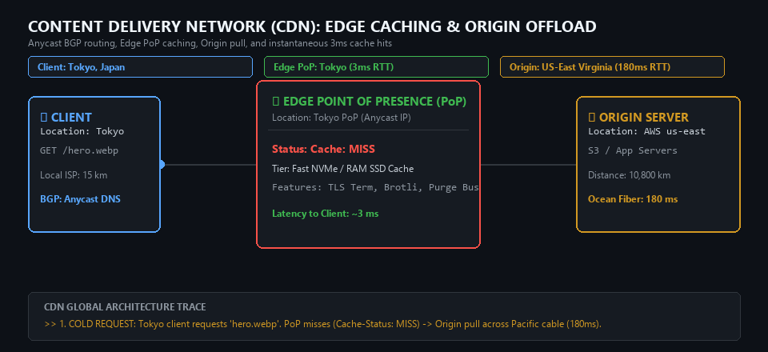

# 12 - Content Delivery Networks (CDNs) & Edge Caching

> **Executive Summary:** The speed of light in vacuum is $300,000\text{ km/s}$, but in optical fiber it is roughly $200,000\text{ km/s}$. A data packet traveling from Tokyo to an origin server in Virginia and back spans $\sim 21,600\text{ km}$, imposing an unavoidable physical minimum round-trip time (RTT) of $\approx 108\text{ ms}$—before any router queueing, TLS handshakes, or server processing. Content Delivery Networks (CDNs) solve this fundamental physics limit by deploying hundreds of Points of Presence (PoPs) worldwide, caching static and semi-dynamic content within milliseconds of end users via Anycast BGP routing.

---

> 🏢 **Real-World Deep Dives**: Detailed case studies of how **Google** & **Netflix** implement this in production are documented in [REAL_WORLD_EXAMPLES.md](./REAL_WORLD_EXAMPLES.md).

## ⏱️ Prerequisites: What You Need to Know First

To get the most out of this module, make sure you understand:
- [01 - Client-Server Networking](../01-client-server-networking/README.md): TCP 3-way handshakes, TLS handshakes, RTT, and packet loss effects.
- [02 - Domain Name System (DNS)](../02-domain-name-system/README.md): CNAME records, Anycast routing, and GeoDNS resolution.
- [10 - Caching Patterns](../10-caching-patterns/README.md): Cache-Aside and read-through caching fundamentals.
- [11 - Cache Eviction & Invalidation](../11-cache-eviction-and-invalidation/README.md): TTLs, cache stampedes, and invalidation strategies.

---

## 🧒 The 30-Second Version (ELI5)

Imagine you live in Tokyo and love a specific brand of chocolate manufactured only in a single factory in Switzerland.
- Without a CDN: Every time you crave chocolate, you have to mail an order to Switzerland, wait weeks for a cargo plane to fly across the world, and pay exorbitant international shipping costs.
- With a CDN: The chocolate company places regional vending machines and local corner stores on every street corner in Tokyo. When you want chocolate, you walk 2 minutes down the street and buy it instantly. The factory in Switzerland only ships bulk crates to the local stores once a day.

In computer terms: The factory is the **Origin Server** (e.g., AWS US-East), the corner store is the **Edge Point of Presence (PoP)**, and the chocolate bars are static assets (images, videos, CSS, JS bundles).

---

## 🍕 Everyday Analogy

| Concept | Everyday Retail Analogy | Technical Reality in Distributed Systems |
| :--- | :--- | :--- |
| **Origin Server** | The central manufacturing plant in Detroit | The primary application servers and S3 storage bucket |
| **Edge PoP** | Local convenience store 2 blocks from your house | Data center facility in Tokyo or London with NVMe SSD servers |
| **Anycast Routing** | Dialing emergency services (911/112); your phone connects to the closest local dispatch center | BGP routes IP packets to the topologically closest CDN edge router |
| **Cache Miss (Origin Pull)**| Corner store is out of stock; manager calls Detroit factory to ship a restock box | Edge PoP does not have the asset; fetches it from Origin over WAN |
| **Cache Hit** | Item is on the shelf; you walk out in 30 seconds | Edge PoP serves asset from local RAM/NVMe in 2–5 ms |
| **Cache-Control: max-age** | "Best Before" date printed on the milk carton | Seconds the browser or CDN is allowed to serve cached content |
| **ETag / 304 Not Modified** | Calling the store and asking: *"Is the 2026 edition catalog still the latest one?"* Store answers: *"Yes, no changes."* | Edge verifies content hash; Origin sends 0 byte body with HTTP 304 |
| **Cache Purge** | Factory issues an instant recall notice via telegram to destroy obsolete stock immediately | Edge nodes globally invalidate cached URLs via API/webhook in <150 ms |

---

## 🧩 The Problem It Solves

### Without a CDN
1. **The Physics Problem (High Latency)**: A user in Sydney, Australia accessing a website hosted in Frankfurt, Germany experiences $\sim 300\text{ ms}$ RTT. Establishing a TCP connection and TLS 1.3 session requires at least 2 round-trips ($600\text{ ms}$), followed by multiple round-trips for HTML, CSS, JavaScript, and fonts before the screen renders ($2,000\text{–}4,000\text{ ms}$ total page load).
2. **Origin Bandwidth Exhaustion & Costs**: A single viral 5 MB video watched by 2,000,000 users consumes $10\text{ Terabytes}$ of bandwidth directly from the origin server, risking network saturation and massive cloud egress bills.
3. **DDoS Vulnerability**: Volumetric Layer 7 DDoS attacks (e.g., 500,000 HTTP requests/sec) hit the origin servers directly, crashing application databases and reverse proxies.

### With a CDN
1. **Sub-10ms First Byte (TTFB)**: Edge PoPs terminate TCP and TLS connections within 5–15 ms of the client's local ISP. Cached assets are served directly from edge NVMe drives.
2. **95%+ Origin Offload**: The origin server only serves the asset once per edge PoP. Subsequent millions of users are served entirely by the CDN.
3. **Massive Global DDoS Absorption**: Modern CDN networks (Cloudflare, Akamai, CloudFront) have $>100\text{–}300\text{ Tbps}$ of global edge capacity, absorbing volumetric attacks at the edge without origin degradation.

---

## 🖼️ Picture It: Architecture & Flow

### High-Resolution Edge Caching Animation
Below is an animated trace of a cold cache origin pull vs. an instantaneous edge cache hit:



---

### Global Request Flow: Anycast BGP to Origin Shield

```mermaid
sequenceDiagram
    autonumber
    actor User as 👤 Tokyo User
    participant DNS as 🌐 Anycast DNS
    participant Edge as ⚡ Tokyo Edge PoP
    participant Shield as 🛡️ Origin Shield (US-West)
    participant Origin as 🏢 Origin Server (US-East)

    User->>DNS: Resolve 'example.com'
    DNS-->>User: Returns Anycast IP (routes to Tokyo PoP)
    
    rect rgb(22, 27, 34)
    Note over User, Edge: Edge Cache MISS Scenario
    User->>Edge: GET /static/bundle.js (3ms)
    Edge->>Shield: Cache Miss -> Request Shield (Tiered Cache)
    Shield->>Origin: Shield Miss -> Origin Pull (80ms)
    Origin-->>Shield: 200 OK + Cache-Control: s-maxage=86400
    Shield-->>Edge: Returns asset & caches in Shield tier
    Edge-->>User: 200 OK (Age: 0, X-Cache: MISS)
    end

    rect rgb(22, 27, 34)
    Note over User, Edge: Edge Cache HIT Scenario (Next 100,000 Users)
    User->>Edge: GET /static/bundle.js (3ms)
    Edge-->>User: 200 OK (Age: 42, X-Cache: HIT) [0 Origin Traffic!]
    end
```



---

## 🔢 Walk-Through with Real Numbers

Let's calculate the latency and financial impact of deploying a CDN for an international SaaS application:

### Latency Math: Tokyo User to US-East Origin
- Physical straight-line distance: $\approx 10,800\text{ km}$.
- Cable distance with routing zig-zags: $\approx 13,000\text{ km}$.
- Fiber speed of light ($c_{\text{glass}} = 200,000\text{ km/s}$):
  $$\text{One-way propagation delay} = \frac{13,000}{200,000} \approx 65\text{ ms} \implies \text{RTT} \approx 130\text{ ms}$$
- **Without CDN**:
  - DNS resolution: $130\text{ ms}$
  - TCP Handshake (1 RTT): $130\text{ ms}$
  - TLS 1.3 Handshake (1 RTT): $130\text{ ms}$
  - HTTP GET + Response: $130\text{ ms} + 20\text{ ms}$ (server processing)
  - **Total Time to First Byte (TTFB)**: $540\text{ ms}$!

- **With CDN (Tokyo Edge PoP 15 km away)**:
  - Local ISP RTT: $3\text{ ms}$
  - TCP + TLS 1.3 terminated at Tokyo Edge: $6\text{ ms}$
  - Edge Cache HIT: $1\text{ ms}$
  - **Total Time to First Byte (TTFB)**: **$7\text{ ms}$ (98.7% latency reduction!)**

### Cost Math: AWS Egress Savings
- Monthly Static Traffic: $100\text{ Terabytes}$ ($100,000\text{ GB}$).
- **Direct AWS EC2 Egress Cost**:
  - First 10 TB @ \$0.085/GB = \$850
  - Next 90 TB @ \$0.070/GB = \$6,300
  - Total Monthly Cloud Egress: **\$7,150 / month**.
- **With 96% CDN Edge Offload**:
  - Origin egress drops from $100\text{ TB}$ to $4\text{ TB}$.
  - Cloudfront / Cloudflare CDN egress: ~\$1,200 / month.
  - **Net Savings**: **~\$5,600 / month saved** while accelerating user page loads by 10x.

---

## ⚙️ How It Works Under the Hood

### 1. Request Routing: How Clients Find the Nearest PoP

1. **Anycast BGP Routing (Modern Standard)**:
   - Multiple edge data centers across all continents announce the exact same IP address (e.g. `104.16.123.96`) via Border Gateway Protocol (BGP) to Tier-1 telecom providers.
   - The Internet's core routing infrastructure automatically routes client packets along the shortest autonomous system (AS) path to the topologically closest edge router.
   - Failover is automatic: if Tokyo PoP goes offline, BGP routes withdraw the announcement and traffic shifts seamlessly to Osaka or Seoul.

2. **GeoDNS (Legacy / Multi-CDN Standard)**:
   - Authoritative DNS server inspects the client's DNS resolver IP (or EDNS Client Subnet) and returns an IP address corresponding to the nearest geographic data center.

---

### 2. HTTP Cache-Control Directives (RFC 7234 & RFC 5861)

The origin server controls edge behavior using HTTP response headers:

| Directive | Where It Applies | Meaning |
| :--- | :--- | :--- |
| `public` | Browser & CDN | Asset is cacheable by intermediate proxies and CDNs, even with HTTP auth. |
| `private` | Browser only | Sensitive user data (e.g. `/profile`); CDNs **must not** cache it. |
| `max-age=N` | Browser & CDN | Asset is considered fresh for $N$ seconds. |
| `s-maxage=N` | **CDN Edge only** | Overrides `max-age` specifically for shared caches (CDNs). Allows edge to cache for 7 days while browser only caches for 5 minutes! |
| `no-cache` | Browser & CDN | Must revalidate with origin using `ETag` before serving (does *not* mean "don't cache"). |
| `no-store` | Browser & CDN | Strictly forbids storing in any cache (RAM or disk). Use for bank balances & tokens. |
| `immutable` | Browser & CDN | Asset will never change (e.g. `/app.a1b2c3.js`). Browser skips revalidation even on page refresh. |
| `stale-while-revalidate=N`| CDN Edge | Serve stale asset immediately from cache, while asynchronously fetching fresh copy from origin in background. Eliminates cache miss latency spikes! |

---

### 3. Origin Shielding & Tiered Caching

In a global network with 300 edge PoPs, if a cached video expires, all 300 PoPs would simultaneously query the origin server (a miniature Thundering Herd).

**Origin Shield (Tiered Cache)** places an intermediate caching tier between edge PoPs and the origin:
```
[Client Tokyo]  ──> [Edge PoP Tokyo]  ──┐
                                         ├──> [Origin Shield (US-West)] ──> [Origin Server]
[Client Sydney] ──> [Edge PoP Sydney] ──┘
```
- Only the **Origin Shield** ever contacts the origin server.
- The 300 edge PoPs pull missing assets from the Origin Shield over optimized, dedicated fiber backbone connections.

---

### 4. Cache Invalidation Strategies

1. **Content-Hash Versioning (Best Practice)**:
   - Assets are compiled with cryptographic content hashes in filenames: `main.d41d8cd9.js`.
   - Set `Cache-Control: public, max-age=31536000, immutable`.
   - Never requires purging: updates simply deploy new filenames!
2. **Surrogate-Keys / Cache-Tags (Fastly / Cloudflare)**:
   - Origin attaches header: `Surrogate-Key: product-123 e-commerce-catalog`.
   - When product 123 changes, backend sends API request: `PURGE /tags/product-123`.
   - CDN instantly invalidates all associated cached URLs across all global PoPs in $<150\text{ ms}$.

---

## ⚖️ Trade-Offs & Decision Matrix

| Dimension | Dynamic Content (e.g. Live Cart) | Static Content (e.g. Images, CSS) |
| :--- | :--- | :--- |
| **Cacheability** | Non-cacheable (`Cache-Control: private, no-store`) | Highly cacheable (`public, max-age=31536000, immutable`) |
| **CDN Value** | Dynamic Content Acceleration (TLS termination, connection reuse, HTTP/3) | Direct edge offload, near-zero origin bandwidth |
| **Purge Requirement**| None (never cached) | Content hash in filename or tag-based purge |
| **Failure Risk** | Stale private data leaked to other users if misconfigured! | Outdated UI assets if cache headers lack versioning |

---

## 🚫 Common Mistakes & Production Pitfalls

1. **Accidentally Caching User PII (`Authorization` or `Set-Cookie`)**:
   - *Pitfall*: Edge CDN caches an API response that contains `Set-Cookie: session_id=XYZ`. Subsequent users receive the cached session cookie and log into someone else's account!
   - *Fix*: Never cache responses containing `Set-Cookie` or `Authorization` headers unless explicitly stripped at the edge. Always set `Cache-Control: private, no-store` for authenticated routes.

2. **Omitting `Vary: Accept-Encoding`**:
   - *Pitfall*: First request is from a client supporting Brotli (`br`). CDN caches Brotli compressed bytes. Second client only supports `gzip`. CDN serves Brotli bytes to gzip client, causing binary garbled text crashes.
   - *Fix*: Origin must emit `Vary: Accept-Encoding`.

3. **Purging Entire Cache (`/*`) During Incidents**:
   - *Pitfall*: A junior engineer flushes the entire global CDN cache (`PURGE /*`) to clear a bug.
   - *Result*: 100,000,000 global requests immediately miss the cache and hammer the origin server simultaneously, causing a total site blackout.
   - *Fix*: Always use targeted URL or tag-based purges. Use "Soft Purge" (marks assets as stale and serves them while revalidating in background).

---

## 💻 Try It Yourself: Python Simulation

The companion simulation script [`demo.py`](./demo.py) implements:
1. An Origin Server with simulated 120ms Pacific fiber latency and ETag calculation.
2. An Edge PoP cache implementing RFC 7234 cache rules and `stale-while-revalidate`.
3. An automated test showing latency drop from **120 ms down to 0.00 ms** and **100% origin offload**.
4. Real-time Surrogate-Key cache purge invalidation.

Run it locally in your terminal:
```bash
python demo.py
```

Expected output:
```
======================================================================
CONTENT DELIVERY NETWORK (CDN) SIMULATION
Simulated Topology: Tokyo Client -> Tokyo Edge PoP -> US-East Origin
======================================================================

--- Test 1: Cold Cache Request (MISS) ---
Client received: console.log('App v1.0.0');
X-Cache Status: MISS | Latency: 120.5 ms | Origin Requests: 1

--- Test 2: Warm Cache Request (HIT) ---
Client received: console.log('App v1.0.0');
X-Cache Status: HIT | Latency: 0.00 ms | Origin Requests: 1
⚡ Latency reduction: 85714x faster!

--- Test 3: Simulating 50 Regional Users Visiting Site ---
Processed 50 requests in total time: 0.02 ms
Edge Cache Hits: 50/50 (100% cache hit rate)
Total Origin Requests incurred across all 50 users: 0 (100% origin offload)
```

---

## 🌍 Where You'll See It in Production

- **Cloudflare**: Global network of 330+ cities running Anycast BGP. Handles $\approx 20\%$ of all Internet traffic with Workers running V8 isolates directly at edge PoPs.
- **Fastly**: Built on Varnish Software. Known for sub-150ms instantaneous global cache purges using Surrogate-Keys and Edge Dictionary APIs.
- **AWS CloudFront**: Deeply integrated with S3 and AWS Shield. Uses Regional Edge Caches (Origin Shielding) to minimize egress fees from AWS regions.
- **Netflix Open Connect**: Netflix's proprietary CDN, placing custom hardware storage appliances (OCAs) directly inside local ISP networks worldwide to stream 4K video with zero backbone transit costs.

---

## 🎯 Top Interview Questions & Deep Answers

### Q1: "How does a CDN accelerate dynamic, non-cacheable API requests (e.g. POST /checkout)?"
**Interviewer Goal**: Testing whether the candidate understands CDNs beyond naive static image caching.

**Model Answer**:
"Even when a response is completely non-cacheable, a CDN accelerates dynamic requests via **Dynamic Content Acceleration (DCA)**:
1. **Edge TLS & Connection Termination**: Establishing TCP and TLS 1.3 handshakes with an origin across the ocean takes 300–500 ms. The client instead terminates TCP and TLS with the local Edge PoP in 5 ms.
2. **Persistent Origin Connection Pools**: The CDN maintains pre-warmed, keep-alive TCP/TLS connection pools back to the origin server. When the dynamic request arrives, it travels over an already established connection with zero handshake overhead.
3. **Optimized Route Selection**: CDNs monitor real-time internet congestion and route traffic across their private fiber backbones rather than the public, unoptimized BGP Internet.
4. **Modern Transport Protocols**: Edge PoPs communicate with clients over HTTP/3 (QUIC/UDP), mitigating packet loss on mobile networks."

---

### Q2: "What is the difference between `max-age` and `s-maxage`, and how do you use them in production?"
**Interviewer Goal**: Checking production mastery of RFC 7234 HTTP caching specifications.

**Model Answer**:
"`max-age` applies to all caches, including private browser caches and shared proxy/CDN caches.
`s-maxage` (shared max-age) specifically overrides `max-age` for shared public caches like CDNs, and is completely ignored by individual private browser caches.

In production, this allows a powerful pattern:
`Cache-Control: public, max-age=60, s-maxage=86400`
- The user's browser only caches the asset for 60 seconds. If a bug is deployed, the user will see the fix after at most 1 minute.
- Meanwhile, the CDN Edge PoP caches the asset for 24 hours (86,400 seconds), shielding the origin server from millions of requests. If an update occurs, the backend issues an API purge directly to the CDN."

---

### Q3: "What is Origin Shielding, and why is it essential for massive global websites?"
**Interviewer Goal**: Testing distributed caching architecture at extreme global scale.

**Model Answer**:
"In a large CDN with 300+ Edge PoPs worldwide, when a high-traffic object expires, all 300 PoPs experience a cache miss around the same time. Each PoP would issue an independent origin pull, resulting in a Thundering Herd on the origin database.

**Origin Shielding** (or Tiered Caching) introduces a designated intermediate caching layer located close to the origin server:
1. Edge PoPs around the world do not query the origin directly; they query the Origin Shield.
2. If Tokyo and London PoPs both miss, Tokyo pulls from the Shield. The Shield pulls once from Origin and caches it.
3. When London queries the Shield 100 ms later, the Shield serves the asset directly without touching the origin.
This collapses 300 potential origin pulls into exactly 1, reducing origin load by up to 99%."

---

### Q4: "How does `stale-while-revalidate` work, and why does it improve perceived user performance?"
**Interviewer Goal**: Checking modern web performance optimization techniques.

**Model Answer**:
"Under standard caching, when an asset's TTL expires, the next user who requests it suffers a cache miss penalty—they must wait for the full origin round-trip (e.g. 150–300 ms).

`stale-while-revalidate=N` defines a grace period after expiration:
- When a request arrives during this window, the CDN immediately serves the stale cached asset to the user in 1–2 ms (zero latency penalty).
- Concurrently in the background, the CDN fires an asynchronous origin request to fetch and cache the fresh version.
- Subsequent users then receive the fresh version. It completely decouples user latency from cache invalidation and revalidation."

---

### Q5: "Explain the difference between Strong and Weak ETags in HTTP caching."
**Interviewer Goal**: Testing low-level protocol understanding and conditional HTTP requests.

**Model Answer**:
"An ETag (Entity Tag) is an HTTP validator representing a specific version of a resource:
1. **Strong ETag** (`ETag: "686897696a7c876b7e"`):
   - Guarantees byte-for-byte identity. If even 1 bit changes (e.g., whitespace or metadata), the ETag changes. Mandatory for byte-range requests (like video resumption).
2. **Weak ETag** (`ETag: W/"686897696a7c876b7e"`):
   - Indicates semantic equivalence rather than byte-for-byte identity. For example, an HTML page rendered with identical content but compressed with Gzip vs. Brotli, or with reordered JSON keys, can share the same Weak ETag.
When revalidating with `If-None-Match`, if the ETag matches, the server returns `304 Not Modified` with an empty body, saving bandwidth."

---

## ✅ Check Yourself: Flash Quiz

<details>
<summary><b>1. Why does setting <code>Cache-Control: public, max-age=31536000</code> without filename hashing create deployment nightmares?</b></summary>
<br>
Because user browsers will store the file locally for a full year (31,536,000 seconds) and will <b>never check the network or CDN for updates</b>. If you push a bug fix, existing users will remain broken until they manually clear their browser cache. Always use content hashes in filenames (e.g., <code>bundle.a1b2c.js</code>) when using long <code>max-age</code>.
</details>

<details>
<summary><b>2. How does Anycast BGP direct a client to the nearest CDN Edge PoP?</b></summary>
<br>
All edge PoPs announce the <b>same identical IP address</b> to upstream Tier-1 internet carriers. Border Gateway Protocol (BGP) routing automatically directs packets along the path with the fewest network hops, leading to the topologically nearest edge router.
</details>

<details>
<summary><b>3. What does HTTP status code 304 Not Modified mean, and why does it save bandwidth?</b></summary>
<br>
It indicates that the client or CDN's cached copy is still fresh after checking the <code>ETag</code> or <code>If-Modified-Since</code> header. The server sends back only headers and <b>zero response body bytes</b>, saving transmission time and egress bandwidth.
</details>

---

## 📚 Go Deeper: Recommended Reading

- **Understanding Distributed Systems** by Roberto Vitillo — *Chapter: HTTP Caching & Content Delivery Networks*.
- **High Performance Browser Networking** by Ilya Grigorik — *Chapter: Optimizing Transport & Content Delivery Networks*.
- **RFC 7234**: *Hypertext Transfer Protocol (HTTP/1.1): Caching*.
- **RFC 5861**: *HTTP Cache-Control Extensions for Stale Content (`stale-while-revalidate`)*.
- **Cloudflare Engineering Blog**: *How Anycast IP Routing Actually Works*.

---

## 🔗 Related Modules

- [01 - Client-Server Networking](../01-client-server-networking/README.md): TCP, TLS, and packet mechanics.
- [02 - Domain Name System](../02-domain-name-system/README.md): Anycast DNS and geographic resolution.
- [10 - Caching Patterns](../10-caching-patterns/README.md): Application-level caching patterns.
- [24 - System Design: Video Streaming](../24-system-design-video-streaming/README.md): Leveraging global CDN edge networks for petabyte-scale video delivery.
