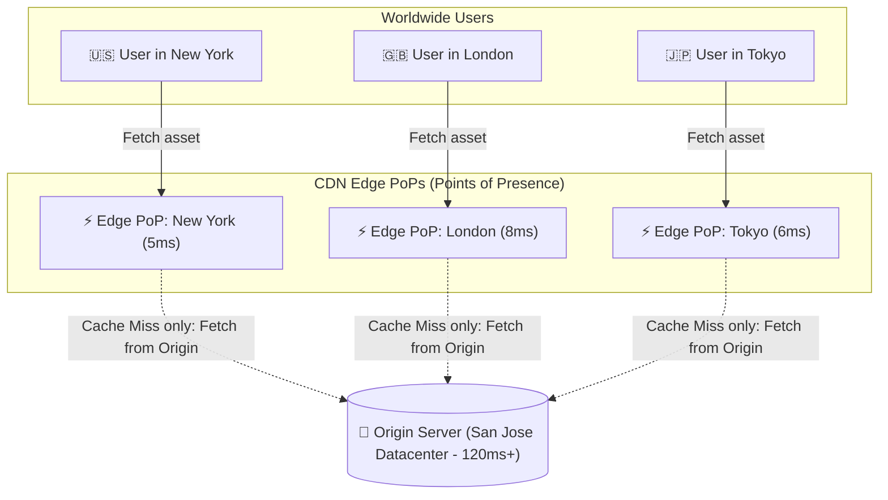

# 12 - Content Delivery Networks (CDNs)

> **Real-World Analogy:**  
> Imagine ordering a physical book from an author living in Australia when you live in New York. If every single customer order had to ship individually from Australia across the ocean, delivery would take 2 weeks. Instead, the author places thousands of copies in local distribution warehouses in New York, London, and Tokyo. When you order, a local courier delivers it from Queens in 2 hours.

---

## 🎯 What & Why
Explores how globally distributed edge networks cache static assets (images, videos, JS/CSS) and dynamic content geographically close to users to reduce latency and origin server load.

---

## 📊 Visual Architecture Diagram


---

## ⚙️ How It Works Under The Hood
### Push vs Pull CDNs

- **Pull CDN (Origin Pull)**:
  - The CDN edge server does not store content initially.
  - When the first user requests `logo.png`, the edge server experiences a cache miss, pulls the asset from the origin server, caches it locally, and serves the user.
  - Subsequent users in that region receive the asset from the local edge cache instantly.
  - Best for websites with unpredictable or large catalogs of assets.

- **Push CDN**:
  - The origin server proactively pushes content to the CDN edges whenever new assets are published (e.g., via upload scripts or CI/CD pipelines).
  - Best for sites with fixed releases, software patches, or relatively static media libraries.

---

### Critical HTTP Caching Headers

- `Cache-Control: public, max-age=31536000, immutable`: Instructs CDNs and browsers to cache the asset for 1 full year without revalidating (common for content-hashed assets like `bundle.8f3a1.js`).
- `ETag` (Entity Tag): A hash fingerprint of the resource. If the client sends `If-None-Match: "xyz"`, the server returns `304 Not Modified` with zero body bytes if unchanged.
- `Vary: Accept-Encoding`: Instructs the edge to maintain separate cached copies for clients requesting `gzip`, `brotli`, or uncompressed payloads.

---

## 💻 Concrete Code Implementation
```python
# Python simulation: Edge CDN PoP with Origin Pull fallback
class EdgePoP:
    def __init__(self, location: str, origin_server):
        self.location = location
        self.origin = origin_server
        self.edge_cache = {}

    def get_asset(self, path: str):
        if path in self.edge_cache:
            return {"source": f"CDN_EDGE_{self.location}", "data": self.edge_cache[path]}
        
        # Cache Miss -> Pull from Origin
        data = self.origin.fetch(path)
        if data:
            self.edge_cache[path] = data
            return {"source": "ORIGIN_PULL", "data": data}
        return {"source": "NOT_FOUND", "data": None}

class OriginServer:
    def __init__(self):
        self.storage = {
            "/assets/logo.png": "IMAGE_BYTES_V1",
            "/assets/styles.css": "CSS_STYLES_V1"
        }

    def fetch(self, path: str):
        return self.storage.get(path)

if __name__ == "__main__":
    origin = OriginServer()
    ny_pop = EdgePoP("NYC", origin)

    # First request: pulled from origin
    print(ny_pop.get_asset("/assets/logo.png"))
    # Second request: served immediately from NYC edge cache
    print(ny_pop.get_asset("/assets/logo.png"))

```

---

## ⚖️ Trade-Offs & Architectural Considerations
- **Quorums**: Choose odd-numbered cluster sizes (3, 5, 7) to avoid split votes.
- **Failover Speeds**: Balance election timeouts to avoid false failovers during transient CPU spikes.
- **Consistency**: Strict consistency trades off availability during partitions.
