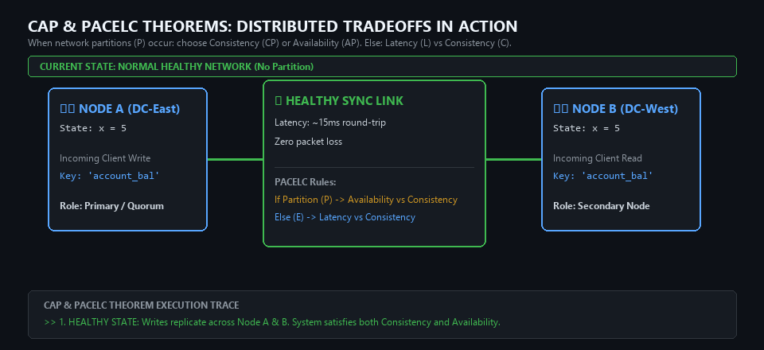

# 13 - CAP & PACELC Theorems: Distributed Trade-offs

> **Executive Summary:** Distributed systems span multiple physical machines connected by networks that can delay, drop, or reorder packets. Eric Brewer's **CAP Theorem** (proven by Gilbert & Lynch) proves that when a network partition ($P$) occurs, a system must fundamentally choose between **Consistency ($C$)** and **Availability ($A$)**—the popular idea of "picking 2 of 3" is mathematically false because partitions are an unavoidable property of physics. Daniel Abadi extended this with the **PACELC Theorem**, highlighting that even when the network is completely healthy (**E**lse), you must choose between **Latency ($L$)** and **Consistency ($C$)**.

---

> 🏢 **Real-world case studies**: whether **Google Spanner** is CA (Eric Brewer's answer) and why **Dynamo** and **Cassandra** are PA/EL, in [REAL_WORLD_EXAMPLES.md](./REAL_WORLD_EXAMPLES.md).

## ⏱️ Prerequisites: What You Need to Know First

To get the most out of this module, make sure you understand:
- [01 - Client-Server Networking](../01-client-server-networking/README.md): Packet loss, latency, timeouts, and network round-trips.
- [06 - Relational & Non-Relational Databases](../06-relational-and-non-relational-databases/README.md): Read/write replication topologies.
- [07 - Database Replication](../07-database-replication/README.md): Synchronous vs. asynchronous replication lag.
- **Set Theory & Logic**: Majority quorums ($R + W > N$).

---

## 🧒 The 30-Second Version (ELI5)

Imagine two bank tellers, Alice and Bob, working in separate branches of the same bank.
- Normally, when a customer deposits \$100 with Alice, Alice calls Bob over the phone to update his notebook.
- One day, an excavator accidentally cuts the telephone wire between Alice and Bob (**Network Partition**).
- A customer walks into Alice's branch to deposit \$50, while the customer's partner walks into Bob's branch to withdraw \$100.
  - **Choice 1 (CP - Consistency)**: Alice and Bob say: *"Our phone line is cut. We refuse to process any transactions until the line is repaired."* (Transactions fail, but the bank's account balance is never wrong).
  - **Choice 2 (AP - Availability)**: Alice accepts the deposit, and Bob allows the withdrawal. Both branches remain open and fast, but their notebooks are now out of sync, and the account might be overdrawn.

You cannot choose "CA" because you cannot stop backhoes from severing fiber optic cables!

---

## 🍕 Everyday Analogy

| Concept | Bank Branch Analogy | Technical Reality in Distributed Systems |
| :--- | :--- | :--- |
| **Nodes** | Alice's branch (East) and Bob's branch (West) | Independent database instances in different Availability Zones |
| **Network Partition ($P$)** | Backhoe cuts telephone cable connecting Alice and Bob | Switch failure, fiber cut, or GC pause dropping inter-node packets |
| **Consistency ($C$)** | Every customer sees the exact same balance regardless of branch | **Linearizability**: Reads return the most recent write or an error |
| **Availability ($A$)** | Every branch serves every customer immediately without errors | Every non-failing node returns a non-error response |
| **CP System** | Alice turns customers away with "System Down" sign | Database rejects writes or times out to preserve strict state correctness |
| **AP System** | Both branches take transactions and reconcile notebooks tonight | Database accepts writes locally; reads may return stale data |
| **PACELC (Else: L vs C)**| When phone works: Do they call on *every single* penny, or sync in batches? | In normal times: Do you wait for synchronous multi-node replication? |

---

## 🧩 The Problem It Solves

### The Myth of "Pick 2 of 3"
In casual blog posts, CAP is frequently explained as a triangle where you can freely choose any two: "CA", "CP", or "AP".
**This is factually false.**
- In any distributed system involving physical networks, network partitions ($P$) are not an architectural preference; they are an inevitable physical reality. Switches crash, BGP routes flap, firewalls misconfigure, and hardware fails.
- Therefore, you **cannot pick "CA"**. A system that operates in CA mode is a single-node system running on a single motherboard.
- The real theorem states: **When a network partition ($P$) occurs, you must choose between Consistency ($C$) and Availability ($A$)**.

### The Blindspot of CAP: What Happens in Normal Times?
Network partitions typically occur $<0.1\%$ of the year. For the other $99.9\%$ of the time, the network is completely healthy!
CAP tells you **nothing** about how a system behaves when there is no partition.
This is where Abadi's **PACELC** theorem completes the picture:
$$\text{If } \mathbf{P} \text{ (Partition)} \implies \mathbf{A} \text{ vs } \mathbf{C} \quad \Big| \quad \mathbf{E} \text{ (Else / Normal)} \implies \mathbf{L} \text{ vs } \mathbf{C}$$

---

## 🖼️ Picture It: Architecture & Flow

### High-Resolution CAP & PACELC Animation
Below is an animated trace of a 2-node cluster encountering a network split, demonstrating the CP vs. AP branching paths:



---

### PACELC Decision Flowchart

```mermaid
flowchart TD
    Start["Distributed System Request"] --> IsPartition{"Is there a Network Partition (P)?"}

    %% Partition Branch
    IsPartition -->|"YES (Failure Mode)"| PartitionTradeoff{"Prioritize What?"}
    PartitionTradeoff -->|Consistency| CP["🔒 CP System (e.g. Spanner, CockroachDB)<br/>• Reject writes in minority partition<br/>• Guarantee Linearizability<br/>• Sacrifices Availability"]
    PartitionTradeoff -->|Availability| AP["⚡ AP System (e.g. Cassandra, DynamoDB)<br/>• Accept writes locally on all nodes<br/>• Return stale data if needed<br/>• Sacrifices Consistency (Eventual)"]

    %% Normal Operation Branch
    IsPartition -->|"NO (Normal 99.9% State)"| ElseTradeoff{"In Normal Times, Prioritize What?"}
    ElseTradeoff -->|Low Latency| EL["🚀 Else: Latency (PA/EL or PC/EL)<br/>• Asynchronous replication ACK<br/>• Sub-millisecond response time<br/>• Small risk of stale reads"]
    ElseTradeoff -->|Strong Consistency| EC["🛡️ Else: Consistency (PC/EC or PA/EC)<br/>• Synchronous quorum round-trips<br/>• Higher latency (20-100ms)<br/>• Guaranteed fresh reads"]

    style CP fill:#161b22,stroke:#f85149,stroke-width:2px;
    style AP fill:#161b22,stroke:#3fb950,stroke-width:2px;
    style EL fill:#161b22,stroke:#58a6ff,stroke-width:2px;
    style EC fill:#161b22,stroke:#d29922,stroke-width:2px;
```



---

## 🔢 Walk-Through with Real Numbers

Let's model the mathematical mechanics behind quorum consensus ($R + W > N$) and availability calculations:

### 1. Quorum Intersection Math: The Core of CP Systems
Consider an $N$-node cluster:
- $N = 5$ replicas.
- Write Quorum ($W$): Number of nodes that must acknowledge a write before returning success.
- Read Quorum ($R$): Number of nodes that must be queried before returning the value.

$$\mathbf{R + W > N}$$

By the **Pigeonhole Principle**, any read quorum of size $R$ and any write quorum of size $W$ must overlap in at least one node:
$$\text{Overlap} = (R + W) - N = (3 + 3) - 5 = 1 \text{ node}$$
That single overlapping node is guaranteed to hold the latest version of the data!

```
Total Nodes: [ Node 1 | Node 2 | Node 3 | Node 4 | Node 5 ]
Write (W=3): [   ✓    |   ✓    |   ✓    |        |        ] (Updated to v2)
Read  (R=3): [        |        |   ✓    |   ✓    |   ✓    ] (Node 3 has v2!)
                                    ▲
                         Guaranteed Overlap Node
```

### 2. The Cost of Partition Failures (Availability Math)
- Suppose a cluster has 3 nodes distributed across 3 data centers.
- Individual node availability: $99.9\%$ (down $\sim 8.7$ hours/year).
- Inter-DC network link partition probability: $0.05\%$ per month.
- **In an AP system**: If DC-3 is partitioned, DC-1 and DC-2 handle 100% of their local traffic, and DC-3 handles its local traffic. Overall platform availability: **$99.99\%$**.
- **In a CP system**: DC-3 (the minority) must reject all incoming writes (returns HTTP 503). If 33% of users are connected to DC-3, overall platform write availability immediately drops to **$66.7\%$** during the partition!

---

## ⚙️ How It Works Under the Hood

### 1. What the CAP Terms Actually Mean (Formal Definitions)

Many engineering arguments stem from vague definitions. In the formal proof (Gilbert & Lynch, 2002):
- **Consistency ($C$)**: Specifically means **Linearizability** (Atomic / External Consistency).
  - If client A writes value $v$ at time $t_1$, any client B that begins a read operation at time $t_2 > t_1$ **must** read value $v$ or a newer value. It appears as if there is only a single copy of the item in the entire universe.
  - *Note*: It does **not** mean ACID consistency (which refers to relational database foreign key invariants).
- **Availability ($A$)**: Every **non-failing node** must return a **non-error response** to every request it receives.
  - Returning an HTTP 500, a timeout, or a "Partition Error" is considered an availability failure under CAP.
- **Partition Tolerance ($P$)**: The network is allowed to arbitrarily drop or delay an unlimited number of messages between nodes without causing system crash.

---

### 2. The PACELC Taxonomy Matrix

Daniel Abadi published the PACELC theorem to classify production databases based on both failure mode and normal operation:

| Database | PACELC Classification | Partition Behavior ($P$) | Normal Behavior ($E$) | Common Production Use Cases |
| :--- | :--- | :--- | :--- | :--- |
| **Google Cloud Spanner** | **PC/EC** | Rejects minority writes (Consistency) | Waits for Paxos quorum + TrueTime (Consistency) | Financial ledgers, banking cores, global billing |
| **CockroachDB** | **PC/EC** | Preserves Raft consensus (Consistency) | Synchronous Raft log commit (Consistency) | Distributed multi-region SQL databases |
| **Apache Cassandra** | **PA/EL** | Accepts writes with local node (Availability) | Returns immediately; async hinted handoff (Latency) | High-volume IoT telemetry, activity feeds |
| **AWS DynamoDB** (default) | **PA/EL** | Returns available locally (Availability) | Replicates asynchronously (Latency) | Shopping carts, session stores, gaming leaderboards |
| **MongoDB** (`w:1`) | **PA/EL** | Returns write after 1 node (Availability) | Async replica sync (Latency) | Rapid prototyping, web analytics |
| **MongoDB** (`w:majority`) | **PC/EC** | Rejects if majority unreachable (Consistency) | Blocks until majority ACK (Consistency) | Order processing, inventory tracking |

---

## ⚖️ Trade-Offs & Decision Matrix

| Dimension | CP (Consistency over Availability) | AP (Availability over Consistency) |
| :--- | :--- | :--- |
| **Failure Response** | Returns error/timeout to minority partition | Accepts writes; serves potentially stale reads |
| **Data Integrity** | Absolute guarantee against dirty reads or write loss | Eventual consistency; requires conflict resolution (LWW, CRDTs) |
| **End-User Impact** | Users see "Payment Failed" or spinning loader | Users see stale comments or temporary out-of-order posts |
| **Latency in Normal Times**| Higher (must coordinate synchronous ACKs) | Lower (can ACK immediately after local memory write) |
| **Best For** | Money, ticketing, stock trading, inventory reservation | Social feeds, messaging, metrics, recommendation engines |

---

## 🚫 Common Mistakes & Production Pitfalls

1. **Claiming a System is "CA"**:
   - *Pitfall*: Stating in an interview: *"Our architecture is CA because we run inside a high-speed AWS VPC with redundant networks."*
   - *Reality*: AWS availability zones experience fiber cuts, network card lockups, and router firmware bugs. A network partition *will* happen. If your system claims CA, the first network hiccup will cause either a complete outage (sacrificing A) or data corruption / split-brain (sacrificing C).

2. **Last-Write-Wins (LWW) Clock Skew Disasters**:
   - *Pitfall*: Building an AP system using server wall-clock timestamps to resolve write conflicts (`max(timestamp)`).
   - *Reality*: Physical NTP clocks on Linux servers drift by tens or hundreds of milliseconds. An older write from a server with a clock running 50ms fast will permanently overwrite and destroy a newer write from an accurate server!
   - *Fix*: Use **Vector Clocks**, **Hybrid Logical Clocks (HLC)**, or **CRDTs** (Conflict-free Replicated Data Types).

3. **Confusing ACID Consistency with CAP Consistency**:
   - *Pitfall*: Thinking that because Postgres is an ACID database, the "C" in ACID is the "C" in CAP.
   - *Reality*: "C" in ACID means *Invariants* (e.g., account balance cannot be negative). "C" in CAP means *Linearizability* (single-copy atomic read-after-write semantics across distributed network nodes).

---

## 💻 Try It Yourself: Python Simulation

The companion simulation script [`demo.py`](./demo.py) implements:
1. A 3-node distributed cluster capable of simulating physical network splits.
2. A side-by-side comparison of **CP Quorum verification** vs. **AP Local-accept logic**.
3. Partition injection isolating `Node-C` and observing write rejections (CP) vs. state divergence (AP).
4. Last-Write-Wins reconciliation upon partition healing.
5. PACELC normal-time latency benchmark (Sync Quorum ACK vs. Async Local ACK).

Run it locally in your terminal:
```bash
python demo.py
```

---

## 🌍 Where You'll See It in Production

- **Stripe & PayPal (CP/PC/EC)**: Ledger balance updates and authorizations strictly choose Consistency. If an account balance partition occurs, Stripe will reject the charge rather than allow a double-spend.
- **Amazon Retail Shopping Cart (AP/PA/EL)**: Described in the seminal 2007 Dynamo paper: *"Customers should never be prevented from adding an item to their shopping cart."* If network links break, carts diverge and are merged later (even if deleted items occasionally reappear).
- **Google Spanner (PC/EC)**: Spanner relies on GPS receivers and atomic clocks in every Google data center (TrueTime API) to achieve bounded uncertainty ($\le 7\text{ ms}$), providing strict linearizability globally while maximizing availability.

---

## 🎯 Top Interview Questions & Deep Answers

### Q1: "Why is 'picking CA' considered impossible in modern distributed system design?"
**Interviewer Goal**: Testing whether the candidate understands the foundational physical constraints of distributed systems.

**Model Answer**:
"In a distributed system, network partitions are an unavoidable fact of physics. Network cables can be severed, top-of-rack switches can fail, and garbage collection pauses can make a node appear dead. 
When a partition occurs between Node 1 and Node 2, and a write arrives at Node 1:
- If you accept the write on Node 1, Node 2 is out of date. If a client reads from Node 2, you have sacrificed **Consistency**.
- If you reject the write to prevent inconsistency, you have sacrificed **Availability**.
Therefore, you cannot choose to avoid the partition ($P$). You can only choose your system's response *during* a partition: either refuse the request to maintain Consistency (CP), or accept the request to maintain Availability (AP). The only true 'CA' system is a single-node database running on a single machine, where no network partitions can occur."

---

### Q2: "What is the PACELC theorem, and what gap does it address in the original CAP theorem?"
**Interviewer Goal**: Assessing modern distributed systems architecture knowledge beyond outdated 2000-era simplifications.

**Model Answer**:
"The CAP theorem only describes system behavior during a network partition ($P$), which is a rare failure mode occurring $<0.1\%$ of the time. It is silent about how systems behave during normal healthy operations ($99.9\%$ of the time).

Daniel Abadi formulated **PACELC** to describe the complete trade-off spectrum:
- **If Partition ($P$)**: Choose between **Availability ($A$)** and **Consistency ($C$)**.
- **Else ($E$)**: Choose between **Latency ($L$)** and **Consistency ($C$)**.

Even without network failures, replicating data across multiple servers takes time. If you require strong consistency (**C**), you must wait for synchronous round-trip acknowledgments from replicas, increasing latency (**L**). If you want sub-millisecond write latency, you must return immediately and replicate asynchronously, accepting eventual consistency."

---

### Q3: "In an AP system like Cassandra or DynamoDB, how do you handle conflicting writes when the partition heals?"
**Interviewer Goal**: Checking knowledge of conflict resolution mechanisms and anti-entropy protocols.

**Model Answer**:
"When an AP partition heals, replicas will have diverged. Production systems resolve this using several strategies:
1. **Last-Write-Wins (LWW)**: The write with the highest timestamp wins. While simple, it suffers from clock drift—an NTP synchronization discrepancy can silently drop newer updates.
2. **Vector Clocks / Version Vectors**: Each node increments its own counter in a version tuple `[NodeA:2, NodeB:1]`. The system detects concurrent conflicting writes and surfaces both versions to the client application to resolve (e.g., merging two shopping carts).
3. **CRDTs (Conflict-free Replicated Data Types)**: Mathematically structured data types (e.g., Grow-only Sets, PN-Counters) where state merges are commutative and associative ($A \cup B = B \cup A$). They guarantee convergence to identical state without requiring coordination or central locks.
4. **Read Repair & Anti-Entropy**: When a client performs a read, the system compares versions across replicas in the background and writes the latest value back to stale nodes. In addition, background Merkle tree sync processes identify and heal divergent key ranges."

---

### Q4: "How does Google Spanner claim to be both consistent and highly available despite the CAP theorem?"
**Interviewer Goal**: Testing understanding of TrueTime and high-availability engineering in CP systems.

**Model Answer**:
"Technically, Google Spanner is a **CP system** (PC/EC under PACELC)—if a network partition occurs, Spanner will choose consistency and fail requests in a partitioned minority.

However, in practice, Spanner achieves $99.999\%$ (five nines) availability through two extraordinary innovations:
1. **TrueTime API**: Every Google data center contains dedicated GPS receivers and atomic clocks. TrueTime provides an API that returns a time interval $[t_{\text{earliest}}, t_{\text{latest}}]$ with a guaranteed maximum uncertainty bound ($\epsilon \le 7\text{ ms}$). By waiting out the uncertainty window ($\ge 2\epsilon$), Spanner guarantees global linearizable transactions without expensive cross-region consensus on read operations.
2. **Private Global Fiber Infrastructure**: Google owns and manages its own global physical fiber optic network with redundant paths and multi-homed BGP routing. Network partitions are made so exceedingly rare that Spanner practically operates with five-nines availability while remaining mathematically CP."

---

### Q5: "What is the Quorum condition $R + W > N$, and what happens if $R + W \le N$?"
**Interviewer Goal**: Checking distributed math and consistency tuning skills.

**Model Answer**:
"In a cluster with $N$ replicas:
- $W$ is the number of replicas that must acknowledge a write before it succeeds.
- $R$ is the number of replicas that must be queried during a read.

If **$R + W > N$**, the set of nodes written to and the set of nodes read from are guaranteed to overlap in at least one node by the Pigeonhole Principle. That overlap node will hold the latest version of the record, guaranteeing strong consistency (linearizability), provided version timestamps or vector clocks are compared.

If **$R + W \le N$** (for example, $N=3, W=1, R=1$):
- A write may succeed on Node 1.
- A read may query Node 2.
- Since Node 1 and Node 2 do not overlap, the read will return stale data. This yields **weak / eventual consistency**, but offers lower latency and higher availability because operations can succeed even when multiple nodes fail."

---

## ✅ Check Yourself: Flash Quiz

<details>
<summary><b>1. True or False: You can build a CA system as long as you deploy it across multiple AWS Availability Zones with 10Gbps fiber.</b></summary>
<br>
<b>False.</b> No physical network is immune to failure. Fiber cables get severed, switches lock up, and operating system kernels freeze. As soon as two AZs lose communication, the system must either reject writes (sacrificing Availability) or accept inconsistent writes (sacrificing Consistency). A system can only be CA if it runs on a single physical machine.
</details>

<details>
<summary><b>2. Under PACELC, what does "PA/EL" mean, and name one real-world database that matches it?</b></summary>
<br>
<b>PA/EL</b> means: If there is a <b>P</b>artition, choose <b>A</b>vailability. <b>E</b>lse (normal times), choose <b>L</b>atency (over consistency). Examples: <b>Apache Cassandra</b>, <b>AWS DynamoDB</b> (with default eventual consistency), and <b>Couchbase</b>.
</details>

<details>
<summary><b>3. Why is Last-Write-Wins (LWW) conflict resolution dangerous in distributed systems that use standard server clocks?</b></summary>
<br>
Because physical server clocks synchronized with NTP drift by tens of milliseconds. A server whose clock is running 50 ms fast will generate timestamps in the "future", causing its updates to permanently overwrite and destroy legitimately newer updates from an accurate server.
</details>

---

## 📚 Go Deeper: Recommended Reading

- **Designing Data-Intensive Applications** by Martin Kleppmann — *Chapter 8: The Trouble with Distributed Systems & Chapter 9: Consistency and Consensus*.
- **Understanding Distributed Systems** by Roberto Vitillo — *Part 2: Distributed Systems Architecture & Theorems*.
- **Brewer's Retrospective (2012)**: *CAP Twelve Years Later: How the "Rules" Have Changed (Computer, IEEE)*.
- **Daniel Abadi's Blog Post (2012)**: *Consistency Tradeoffs in Modern Distributed Database System Design (PACELC)*.
- **Google Research Paper (2012)**: *Spanner: Google’s Globally-Distributed Database (Corbett et al.)*.

---

## 🔗 Related Modules

- [07 - Database Replication](../07-database-replication/README.md): Leader-follower and multi-leader replication trade-offs.
- [14 - Consistency Models](../14-consistency-models/README.md): Linearizable, sequential, causal, and eventual consistency explained.
- [15 - Consensus & Leader Election](../15-consensus-and-leader-election/README.md): How Paxos and Raft implement CP consensus.
- [16 - Consistent Hashing](../16-consistent-hashing/README.md): Partitioning data across distributed nodes dynamically.
