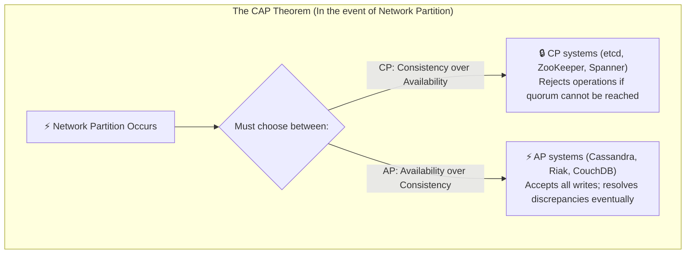

# 13 - The CAP & PACELC Theorems

> **Real-World Analogy:**  
> Imagine planning an event with two coordinators who communicate via walkie-talkie. Suddenly, the radio batteries die (Network Partition). You now have only two choices: Coordinator A can keep selling tickets anyway, but risk double-booking seats that Coordinator B also sold (High Availability, Low Consistency); or they can stop selling until the radios work again (Consistency, but no availability while the radios are down).

---

## 🎯 What & Why
Explains the foundational trade-offs in distributed systems when network partitions occur, examining the classic CAP theorem and the more comprehensive PACELC theorem.

---

## 📊 Visual Architecture Diagram


---

## ⚙️ How It Works Under The Hood
### Understanding the CAP Properties

- **Consistency (Linearizability)**: Every read receives the most recent write or an error.
- **Availability**: Every non-failing node returns a non-error response for every request (no guarantee it is the newest write).
- **Partition Tolerance**: The system continues to operate despite an arbitrary number of messages being dropped or delayed by the network between nodes.

> ⚠️ **Key Truth**: In distributed systems, networks are inherently unreliable (fiber cuts, router reboots, cloud latency spikes). Therefore, **Partition Tolerance (P) is non-negotiable**. When a partition occurs, you must choose between **Consistency (CP)** or **Availability (AP)**.

---

### PACELC: The Modern Extension

The CAP theorem only describes behavior *during a network partition*. But what about normal times when the network is healthy?

**PACELC Theorem**:
- **If there is a Partition (P)**, trade off **Availability (A)** vs **Consistency (C)**.
- **Else (E)**, trade off **Latency (L)** vs **Consistency (C)**.

| Database | PACELC Classification | Explanation |
| :--- | :--- | :--- |
| **Apache Cassandra** | **PA/EL** | On partition, chooses Availability. Else, chooses low Latency (async replication). |
| **Google Spanner** | **PC/EC** | On partition, chooses Consistency (quorums). Else, chooses Consistency via TrueTime. |
| **MongoDB** | **Depends on settings** | Only the primary accepts writes, and a primary cut off from the majority steps down, so writes are CP-like. Reading from secondaries or using weak write concerns trades consistency for latency. Abadi's original PACELC paper classified it PA/EC. |
| **Amazon DynamoDB** | **PA/EL** | Configurable, but defaults to high availability and ultra-low latency. |

---

## 💻 Concrete Code Implementation
```python
# Python simulation: Demonstrating CP vs AP behavior during network partition

class DistributedClusterNode:
    def __init__(self, name: str):
        self.name = name
        self.data = {}
        self.is_partitioned = False

    def write_cp(self, key: str, value: str):
        if self.is_partitioned:
            # CP: Reject write to preserve global consistency
            raise RuntimeError(f"[{self.name}] Quorum unavailable. Write rejected (CP).")
        self.data[key] = value
        return True

    def write_ap(self, key: str, value: str):
        # AP: Accept write locally regardless of network partition
        self.data[key] = value
        return f"[{self.name}] Write accepted locally (AP). May be stale."

if __name__ == "__main__":
    node = DistributedClusterNode("node-virginia")
    node.is_partitioned = True

    print("--- AP System Behavior ---")
    print(node.write_ap("status", "active"))

    print("\n--- CP System Behavior ---")
    try:
        node.write_cp("status", "active")
    except RuntimeError as e:
        print(e)

```

---

## ⚖️ Trade-offs

| Choose **CP** (refuse when unsure) for… | Choose **AP** (answer anyway) for… |
| :--- | :--- |
| Bank balances, payments, inventory you can't oversell | Likes, view counts, social feeds |
| Leader election, locks, configuration (etcd, ZooKeeper) | Shopping carts, user presence, product catalogs |
| Anything where a wrong answer is worse than no answer | Anything where a slightly old answer beats an error page |

**Common misunderstandings**
- CAP is only about what happens **during** a network partition. Most of the time there is no partition, and the real everyday trade-off is PACELC's **latency vs consistency**.
- "CA systems" don't exist across a network: partitions will happen, so you only get to choose C or A when they do.
- Many databases let you choose **per request** (e.g. Cassandra consistency levels, DynamoDB strongly-consistent reads), so a whole system is rarely "just CP" or "just AP".
