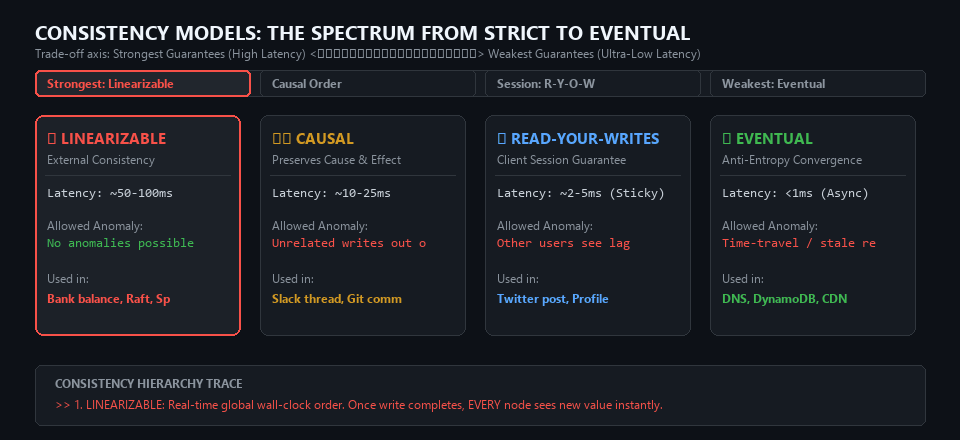

# 14 - Consistency Models: From Linearizable to Eventual

> **Executive Summary:** In a distributed database, "consistency" does not mean a binary toggle between "right" and "wrong." Instead, it is a formal contract between the storage engine and client applications governing the order, recency, and visibility of concurrent writes across replicas. While **Linearizability** guarantees the illusion of a single global register at the cost of high cross-region latency, weaker models like **Causal Consistency**, **Read-Your-Own-Writes**, and **Eventual Consistency** unlock massive throughput and fault tolerance by permitting controlled, predictable read anomalies.

---

> 🏢 **Real-world case studies**: how **Spanner**, **Azure Cosmos DB** and **DynamoDB** expose different consistency levels, in [REAL_WORLD_EXAMPLES.md](./REAL_WORLD_EXAMPLES.md).

## ⏱️ Prerequisites: What You Need to Know First

To get the most out of this module, make sure you understand:
- [01 - Client-Server Networking](../01-client-server-networking/README.md): Network latency, propagation delays, and packet reordering.
- [07 - Database Replication](../07-database-replication/README.md): Asynchronous replication lag, leader-follower topology, and replication streams.
- [13 - CAP & PACELC Theorems](../13-cap-and-pacelc-theorems/README.md): Why network partitions force a choice between availability and linearizability.
- **Data Structures**: Directed Acyclic Graphs (DAGs), logical clocks, and vector clocks.

---

## 🧒 The 30-Second Version (ELI5)

Imagine you post a funny joke in a group chat with friends across the world:
- **Linearizable (Strict)**: A magical referee freezes time globally. The instant you hit Send, everyone's phone updates simultaneously. Nobody on Earth can ever see the world in an older state.
- **Causal Consistency**: Your friend replies: *"That is hilarious!"* Causal consistency guarantees that no one will ever see *"That is hilarious!"* **before** they see your joke. Cause always precedes effect.
- **Read-Your-Own-Writes**: You hit Send, and you immediately see your joke appear on your own screen. Your friend in Australia might not see it for another 2 seconds, but you never think your post was lost.
- **Eventual Consistency (Weak)**: There is no referee and no ordering guarantee. You post the joke, refresh your screen, and your joke disappears! You refresh again, and it comes back. Eventually (after a few seconds), everyone sees the same final state.

---

## 🍕 Everyday Analogy

| Consistency Model | Real-World Communication Analogy | Guarantees & Anomalies |
| :--- | :--- | :--- |
| **Linearizable** | A single physical whiteboard in a small meeting room | Every person looking at the board sees every eraser mark in real-time. Zero anomalies. |
| **Sequential** | A shared group text thread where messages have serial numbers | Everyone agrees on the exact order of messages, even if delivery was delayed by 10 minutes. |
| **Causal** | Reading an email chain with nested quotes | You can never read a reply before the original question that provoked it. Unrelated emails may interleave. |
| **Read-Your-Own-Writes** | Writing a reminder in your personal diary | You can always read what you just wrote, even if other people have not received your newsletter yet. |
| **Monotonic Reads** | Reading pages in a printed book | You never flip backwards to read page 10 after you have already read page 20 (**no time travel**). |
| **Eventual Consistency** | Neighborhood gossip spread by word of mouth | Eventually everyone hears the news, but rumors spread in random order and temporary confusion is common. |

---

## 🧩 The Problem It Solves

### The Cost of Strict Linearizability
To make a distributed system linearizable across multiple data centers (e.g., Virginia, Ireland, Tokyo):
- Every single read and write must coordinate across the globe (via Paxos, Raft, or two-phase locking).
- Speed-of-light fiber latency imposes a mandatory penalty of $150\text{–}250\text{ ms}$ on every operation.
- If an undersea fiber cable snaps (network partition), the system must reject requests to prevent split-brain.

### The Chaos of Pure Eventual Consistency
To avoid this latency, systems like early Cassandra adopted pure eventual consistency. However, without safeguards, applications suffer severe user-facing anomalies:
1. **The Disappearing Comment**: User submits a comment, the page refreshes, hitting a lagging replica, and the comment vanishes! The user submits it again, creating annoying duplicates.
2. **Backwards Time Travel**: User refreshes their social feed: they see 10 new posts. They refresh again: 8 posts disappear because the load balancer routed them to an older replica!
3. **Causality Inversion**: In an e-commerce review section, the seller's apology *"We apologize for the broken widget"* appears **above** the customer's complaint *"My widget arrived broken!"*.

Understanding the **consistency spectrum** allows engineers to pick the exact right model for each use case—enforcing strict consistency only for money, while using causal or session consistency for social, chat, and feeds.

---

## 🖼️ Picture It: Architecture & Flow

### High-Resolution Consistency Spectrum Animation
Below is an animated trace comparing the four major consistency models, their latencies, and their allowed anomalies:



---

### Consistency Hierarchy & Anomaly Containment

```mermaid
graph TD
    subgraph Strong["Strong Models (High Latency, Zero Stale Reads)"]
        L["🔒 Linearizable<br/>(Real-Time Global Clock Order)"]
        S["📜 Sequential<br/>(Global Order, Not Tied to Real Time)"]
        L --> S
    end

    subgraph Intermediate["Intermediate Models (Client-Centric & Causal)"]
        C["⛓️ Causal Consistency<br/>(Preserves Cause & Effect Relationships)"]
        S --> C
        
        RYOW["👤 Read-Your-Own-Writes<br/>(Client always sees own updates)"]
        MR["📖 Monotonic Reads<br/>(No reading backwards in time)"]
        MW["✍️ Monotonic Writes<br/>(Client writes applied in order)"]
        
        C -.-> RYOW
        C -.-> MR
        C -.-> MW
    end

    subgraph Weak["Weak Models (Ultra-Low Latency, High Availability)"]
        E["⚡ Eventual Consistency<br/>(Replicas converge if writes cease)"]
        RYOW --> E
        MR --> E
        MW --> E
    end

    style L fill:#161b22,stroke:#f85149,stroke-width:2px;
    style S fill:#161b22,stroke:#d29922,stroke-width:2px;
    style C fill:#161b22,stroke:#d29922,stroke-width:2px;
    style RYOW fill:#161b22,stroke:#58a6ff,stroke-width:2px;
    style MR fill:#161b22,stroke:#58a6ff,stroke-width:2px;
    style MW fill:#161b22,stroke:#58a6ff,stroke-width:2px;
    style E fill:#161b22,stroke:#3fb950,stroke-width:2px;
```



---

## 🔢 Walk-Through with Real Numbers

Let's quantify the trade-offs in throughput, latency, and operational cost between Linearizable and Eventual architectures:

### Benchmark: 3-Region Deployment (US-East, EU-West, AP-South)
- Minimum physical WAN round-trip time (RTT):
  - US-East $\leftrightarrow$ EU-West: $75\text{ ms}$
  - US-East $\leftrightarrow$ AP-South: $190\text{ ms}$

```
┌────────────────────────────────────────────────────────────────────────┐
│ Model 1: Linearizable (Raft / 2-Phase Commit across Regions)          │
├────────────────────────────────────────────────────────────────────────┤
│ Write: Must replicate to majority quorum (US + EU = 75ms WAN delay)   │
│ Read:  Must contact leader or execute read lease (75ms WAN delay)      │
│ Latency: ~85 ms p50, ~220 ms p99                                       │
│ Throughput Ceiling: ~1,500 writes/sec per partition                    │
│ Availability during trans-Atlantic cable cut: Partitioned region HALTS │
└────────────────────────────────────────────────────────────────────────┘

┌────────────────────────────────────────────────────────────────────────┐
│ Model 2: Eventual Consistency with Session Tokens (RYOW + MR)          │
├────────────────────────────────────────────────────────────────────────┤
│ Write: Commits to local datacenter in 2 ms; async replicates to WAN    │
│ Read:  Queries local replica with session token. Latency: 0.8 ms!      │
│ Latency: ~1.2 ms p50, ~4 ms p99 (60x faster than Linearizable!)       │
│ Throughput Ceiling: >150,000 writes/sec per region                     │
│ Availability during trans-Atlantic cable cut: 100% (Zero downtime)    │
└────────────────────────────────────────────────────────────────────────┘
```

---

## ⚙️ How It Works Under the Hood

### 1. The Core Consistency Hierarchy

#### 1. Linearizability (External Consistency)
- **Definition**: If operation B begins after operation A successfully completes in real-world wall-clock time, operation B **must** observe the state left by operation A (or a newer state).
- **Implementation**: Requires distributed consensus (Paxos or Raft) or coordinated hardware clocks (Google Spanner's TrueTime). Reads must either query the consensus leader or pass through a read-index barrier to avoid serving stale data from a partitioned former leader.

#### 2. Sequential Consistency (Leslie Lamport, 1979)
- **Definition**: All operations appear to take effect in some single, global sequential order that is visible and agreed upon by all nodes, and operations from each individual process appear in that process's program order.
- **Difference from Linearizability**: Sequential consistency does not tie ordering to physical wall-clock time. If write $W_1$ happens at 12:00:00 and write $W_2$ happens at 12:00:05, sequential consistency allows the cluster to agree that $W_2$ occurred before $W_1$, provided **all** nodes see $W_2$ before $W_1$.

#### 3. Causal Consistency
- **Definition**: Operations that are causally related must be seen by every node in the same order. Operations that are concurrent (unrelated) can be seen in different orders by different nodes.
- **Tracking Causality**: Implemented using **Vector Clocks** or **Lamport Timestamps**. Each write includes metadata: `[parent_event_id: hash]`. A replica will buffer a write until all causal parent dependencies have been received and applied.

---

### 2. Client-Centric Session Guarantees

In user-facing web applications, full linearizability is rarely required. Users only care about their own interactions:

1. **Read-Your-Own-Writes (RYOW)**:
   - A user who updates their username will always see the updated username on subsequent page loads.
   - *Implementation*: After a write, the client receives a version token (`X-Version: 1042`). Subsequent reads pass this token. If the assigned read replica has only synced up to version 1040, the load balancer either waits or reroutes the read to the primary database.
2. **Monotonic Reads**:
   - If a client reads version $V$, they will never subsequently read any version $V' < V$ (**no backwards time travel**).
   - *Implementation*: Sticky sessions pin a client to a specific replica, or the client tracks `last_seen_timestamp` in a cookie.
3. **Monotonic Writes**:
   - A user's writes are applied strictly in the order they were submitted.
   - *Implementation*: Hash client requests by `user_id` to route all writes from that user to the same serialization queue or database partition.

---

## ⚖️ Trade-Offs & Decision Matrix

| Model | Read Latency | Write Latency | Tolerates Network Split? | Common Database Systems |
| :--- | :--- | :--- | :--- | :--- |
| **Linearizable** | High (50–200 ms) | High (50–200 ms) | ❌ No (sacrifices availability) | Google Spanner, CockroachDB, etcd, ZooKeeper |
| **Sequential** | Medium (20–50 ms) | Medium (20–50 ms) | ❌ No | Classic multi-core CPU cache coherency |
| **Causal** | Low (5–15 ms) | Low (5–15 ms) | ✅ Yes | MongoDB (causal sessions), CouchDB |
| **Session (RYOW)**| Ultra-Low (<2 ms) | Low (2–5 ms) | ✅ Yes (falls back to local) | DynamoDB, Facebook TAO, Redis + Postgres Read Replicas |
| **Eventual** | Lowest (<1 ms) | Lowest (<1 ms) | ✅ Yes | DNS, Cassandra, AWS S3 (pre-2020) |

---

## 🚫 Common Mistakes & Production Pitfalls

1. **Assuming Read Replicas are Linearizable**:
   - *Pitfall*: Architecting an e-commerce checkout flow where an order is written to Postgres Primary, and the next line of backend code queries `Postgres-Replica-1` to calculate order taxes.
   - *Reality*: Replication is asynchronous. With a 20 ms replication lag, `Postgres-Replica-1` throws `OrderNotFoundException`!
   - *Fix*: Route immediate read-after-write queries to the Primary database, or use session tokens (RYOW).

2. **Using Wall-Clock NTP Timestamps for Causal Order**:
   - *Pitfall*: Storing messages in a group chat sorted by `created_at = System.currentTimeMillis()`.
   - *Reality*: Server clock skew will cause a reply generated at 12:00:00.010 on a slow clock to be timestamped *before* the message it replies to at 12:00:00.050 on a fast clock.
   - *Fix*: Use Lamport Timestamps or message sequence numbers assigned by a single partition leader.

3. **Over-Engineering with Distributed Locks**:
   - *Pitfall*: Using heavy distributed locks (etcd/Consul) on every single user profile update to force strict linearizability.
   - *Reality*: Destroys system throughput and introduces catastrophic single points of lock contention. 99% of profile updates only require Read-Your-Own-Writes.

---

## 💻 Try It Yourself: Python Simulation

The companion simulation script [`demo.py`](./demo.py) implements:
1. A multi-replica distributed cluster demonstrating replication lag.
2. An **Eventual Consistency Time-Travel Anomaly** where a user observes an updated status and then reads stale data.
3. A **Monotonic Read Session Guarantee** using version tokens to eliminate backward time travel.
4. A **Causal Consistency Chat Engine** where causally linked answers are buffered until their parent questions arrive.

Run it locally in your terminal:
```bash
python demo.py
```

---

## 🌍 Where You'll See It in Production

- **Facebook TAO (The Associations and Objects graph)**: Serves billions of social graph queries using Master-Slave MySQL with local edge memcached caching. Implements **Read-Your-Own-Writes** session consistency so users immediately see their own likes, comments, and posts, while allowing global viewers to converge eventually.
- **Git Version Control**: Git's commit tree is a pure implementation of **Causal Consistency**. Every commit explicitly hashes its parent commit ID. You can never merge a child commit without having its parent history.
- **Amazon S3**: Originally designed with eventual consistency (overwriting an existing object could return stale bytes for a few seconds). In December 2020, AWS upgraded S3 to **Strong Read-After-Write Consistency** (Linearizability) with zero performance penalty.
- **MongoDB Causal Sessions**: Allows clients to initiate `startSession(causalConsistency: true)`, tracking operation cluster times to guarantee monotonic reads and causal ordering across sharded replica sets.

---

## 🎯 Top Interview Questions & Deep Answers

### Q1: "What is the precise difference between Linearizability and Serializability?"
**Interviewer Goal**: Disqualifying candidates who confuse database transaction isolation with distributed systems consistency.

**Model Answer**:
"These two terms address completely different dimensions of systems engineering:
- **Serializability** is a **transaction isolation property** (multi-operation, multi-key). It guarantees that executing concurrent transactions produces the same outcome as if they ran in some serial, one-by-one order. However, it places **no constraints on real-time wall-clock ordering**. A serializable system can legally process a transaction according to a valid order from 2 hours ago.
- **Linearizability** is a **recency guarantee on a single register/key** (single operation). It guarantees that operations take effect instantaneously at a discrete point in real-world time between their invocation and response. If write $W$ completes at 12:00:00, any read starting after 12:00:00 must observe $W$.
- When both properties are combined, the system achieves **Strict Serializability** (or External Consistency), which is the holy grail of distributed databases (e.g., Google Spanner)."

---

### Q2: "How would you design a social network feed so that users never experience the 'disappearing post' anomaly?"
**Interviewer Goal**: Testing practical application of client-centric session guarantees.

**Model Answer**:
"The 'disappearing post' anomaly happens in master-slave architectures when a write goes to the Primary database, but subsequent feed read requests are load-balanced to a read replica that has not yet caught up with replication lag.

To solve this without crippling throughput:
1. **Read-Your-Own-Writes Session Tracking**: When the user posts, the backend returns the transaction commit timestamp or Log Sequence Number (LSN) in the response header (e.g., `Set-Cookie: user_last_write_lsn=948201`).
2. **Replication Guard on Read**: When the user fetches their feed, the API gateway inspects the cookie:
   - If the assigned read replica's current LSN is $\ge 948201$, serve from the replica.
   - If the replica is lagging, wait up to a small timeout (e.g., 50 ms) for replication to catch up, or route that specific user's read directly to the Primary database.
3. **Optimistic Local UI Rendering**: Render the post immediately in the client's mobile/web app state cache before the network round-trip completes, masking any short replication delay."

---

### Q3: "What is Causal Consistency, and why is it considered the strongest consistency model achievable under network partitions?"
**Interviewer Goal**: Testing deep understanding of the CAP boundaries (Mahajan et al., 2011).

**Model Answer**:
"Causal Consistency ensures that any operations causally related by 'happens-before' relationships are observed in the same order by all nodes in the cluster. Concurrent operations with no causal relationship can be observed in different orders.

In 2011, distributed systems researchers (Mahajan, Alvisi, Dahlin) formally proved that **Causal Consistency with Convergent Conflict Handling (Causal+) is the mathematically strongest consistency model achievable in a fully available, partition-tolerant (AP) system**.
Unlike Linearizability, which requires consensus across partitioned nodes (causing deadlocks during network splits), causal dependencies can be tracked entirely via local vector clocks and propagated asynchronously. Nodes can remain 100% available for writes during partitions while guaranteeing that causes always precede effects."

---

### Q4: "What is Monotonic Reads, and how can an architecture violate it even with a single master database?"
**Interviewer Goal**: Assessing edge cases in read-replica pooling.

**Model Answer**:
"**Monotonic Reads** guarantees that if a client reads a state $V_1$, they will never subsequently observe an earlier state $V_0$.

Even with a single master database, an architecture easily violates monotonic reads if it uses **multiple read replicas**:
1. User reads their notifications: request hits Replica A, which has replication lag of 2 ms (shows 5 notifications).
2. User refreshes the page: request hits Replica B, which is suffering from network congestion and has replication lag of 800 ms (shows only 2 notifications).
From the user's perspective, time moved backwards—3 notifications vanished!
To enforce monotonic reads, we use **sticky replica routing** (hashing `user_id` to always hit the same replica) or client-side vector timestamps where replicas must reject or buffer reads until they catch up to the client's last observed version."

---

### Q5: "How do Vector Clocks work to detect concurrent conflicting writes?"
**Interviewer Goal**: Checking algorithmic mechanics behind distributed versioning.

**Model Answer**:
"A Vector Clock is an array of logical clock counters, one for each node in the cluster: $V = [N_1: c_1, N_2: c_2, \dots, N_k: c_k]$.
- When node $i$ processes a write, it increments its own counter: $V[i] = V[i] + 1$.
- When nodes synchronize, they compare vector clocks:
  - Event $A$ causally **preceded** Event $B$ ($A < B$) if every element in $V_A \le V_B$ and at least one element is strictly smaller.
  - If neither $V_A \le V_B$ nor $V_B \le V_A$ holds, the events are **concurrent**.
When concurrency is detected, the database knows that two independent writes occurred without knowledge of each other (e.g. during a network split). It preserves both versions as 'siblings' and delegates conflict resolution to the application (or uses CRDTs) rather than silently overwriting data."

---

## ✅ Check Yourself: Flash Quiz

<details>
<summary><b>1. If a database is Linearizable, is it also Causally Consistent?</b></summary>
<br>
<b>Yes.</b> Linearizability is strictly stronger than Causal Consistency. In fact, Linearizability is the strongest recency guarantee possible: because it preserves real-world wall-clock order, it inherently preserves all causal relationships.
</details>

<details>
<summary><b>2. What user-facing anomaly occurs when Monotonic Reads is violated?</b></summary>
<br>
<b>Time travel back to the past.</b> A user observes new data (e.g., a refreshed balance of $150), and on the very next refresh observes stale old data (a balance of $100) because the load balancer routed the second request to a replica lagging behind the first one.
</details>

<details>
<summary><b>3. Why can Causal Consistency remain available during a network partition, while Linearizability cannot?</b></summary>
<br>
Because Causal Consistency does not require nodes to agree on a single global wall-clock timeline. Each partition can continue accepting writes, tracking causality locally using vector clocks. In contrast, Linearizability requires cross-partition quorum consensus to guarantee external recency, which is impossible across severed network links.
</details>

---

## 📚 Go Deeper: Recommended Reading

- **Designing Data-Intensive Applications** by Martin Kleppmann — *Chapter 9: Consistency and Consensus (Linearizability vs Eventual Consistency)*.
- **Leslie Lamport's 1978 Seminal Paper**: *Time, Clocks, and the Ordering of Events in a Distributed System*.
- **Werner Vogels (Amazon CTO, 2008)**: *Eventually Consistent - Revisited (CACM)*.
- **Facebook Engineering Blog**: *TAO: How Facebook Serves the Social Graph with Session Consistency*.

---

## 🔗 Related Modules

- [07 - Database Replication](../07-database-replication/README.md): Replication lag and multi-leader topologies.
- [13 - CAP & PACELC Theorems](../13-cap-and-pacelc-theorems/README.md): Partition trade-offs in distributed clusters.
- [15 - Consensus & Leader Election](../15-consensus-and-leader-election/README.md): How Raft and Paxos enforce linearizability.
