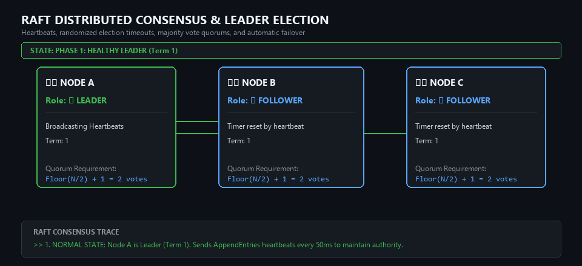
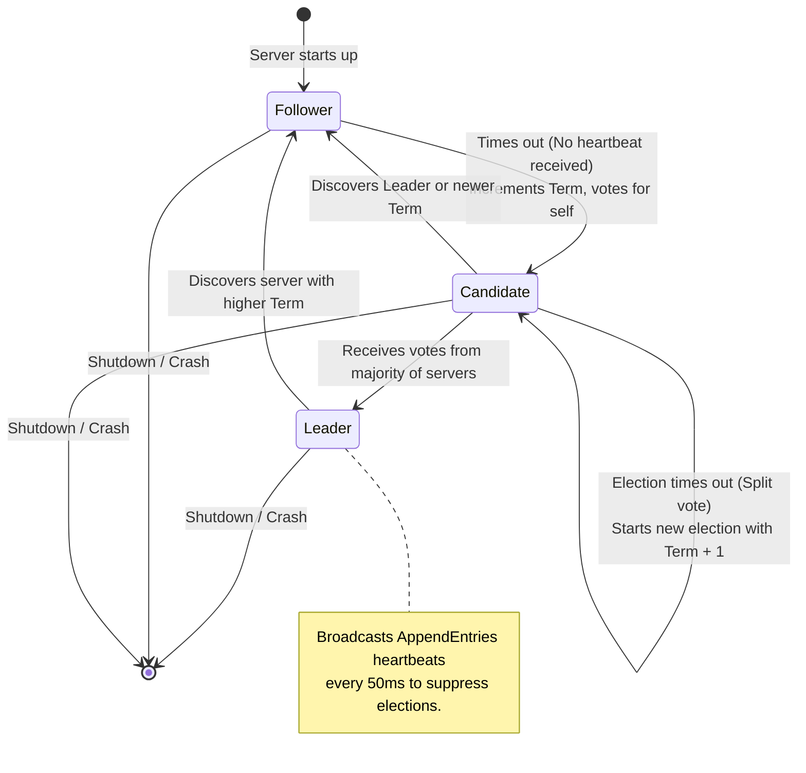

# 15 - Distributed Consensus & Leader Election: Raft and Paxos

> **Executive Summary:** Distributed consensus is the fundamental problem of getting a set of independent, unreliable computers to agree on a single state or sequence of events—even when networks drop packets and servers crash at any time. While Leslie Lamport's **Paxos** (1998) was notoriously difficult to understand and implement in industry, Diego Ongaro and John Ousterhout introduced **Raft** (2014), decomposing consensus into three understandable, independent sub-problems: **Leader Election**, **Log Replication**, and **Safety**. Raft now underpins Kubernetes (`etcd`), Kafka (`KRaft`), CockroachDB, and Consul.

---

> 🏢 **Real-World Deep Dives**: Detailed case studies of how **Google** & **Netflix** implement this in production are documented in [REAL_WORLD_EXAMPLES.md](./REAL_WORLD_EXAMPLES.md).

## ⏱️ Prerequisites: What You Need to Know First

To get the most out of this module, make sure you understand:
- [01 - Client-Server Networking](../01-client-server-networking/README.md): Network latency, timeouts, and dropped packets.
- [07 - Database Replication](../07-database-replication/README.md): Leader-follower replication and replication logs.
- [13 - CAP & PACELC Theorems](../13-cap-and-pacelc-theorems/README.md): Why consensus systems are strictly CP (sacrificing availability in minority partitions).
- [14 - Consistency Models](../14-consistency-models/README.md): Linearizability and external consistency.

---

## 🧒 The 30-Second Version (ELI5)

Imagine a committee of 5 judges making decisions:
- To keep things orderly, they elect one judge to be the **Chairperson (Leader)**. All official documents go to the Chairperson, who reads them out loud.
- If the Chairperson suddenly falls asleep (**crashes**), the remaining 4 judges notice the silence.
- A judge who waits 3 minutes stands up and announces: *"I want to be the new Chairperson!"* (**Candidate**).
- If at least 3 of the 5 judges (a **Majority Quorum**) raise their hand and vote "Yes", that judge becomes the new Chairperson.
- Even if the old Chairperson wakes up later and tries to shout orders, the judges ignore them because the committee is already operating in a newer session term (**Term 2**). There is **never more than one active leader** at a time.

---

## 🍕 Everyday Analogy

| Concept | Parliamentary Committee Analogy | Technical Reality in Raft / Paxos |
| :--- | :--- | :--- |
| **Node** | A committee member sitting at the table | An independent server / process in the cluster |
| **Leader** | The elected Chairperson who writes the meeting minutes | The single node that accepts client writes and manages the log |
| **Follower** | Passive committee members listening to the Chairperson | Passive nodes that append log entries sent by the leader |
| **Candidate** | A member standing up to run for Chairperson | A follower whose election timer expired, seeking votes |
| **Term** | Election term (e.g. 2024–2028 term) | Monotonically increasing logical epoch number ($1, 2, 3 \dots$) |
| **Heartbeat** | Chairperson tapping the microphone every 10 seconds: *"I'm here"* | Empty `AppendEntries` RPC sent every 50 ms to prevent elections |
| **Election Timeout** | Member's internal timer: *"If no speech in 3 mins, I'll run"* | Randomized timer (150–300 ms) preventing split-vote deadlocks |
| **Quorum** | $\text{Floor}(N/2) + 1$ votes needed to pass a law | Strict majority required to elect a leader or commit a log entry |
| **Split-Brain** | Two people both declaring they are Chairperson and giving conflicting orders | Catastrophic failure where two nodes accept conflicting writes |

---

## 🧩 The Problem It Solves

### The Nightmare of Split-Brain
In a distributed database, if multiple servers believe they are the active Leader simultaneously:
- Clients connected to Server A write `balance = $500`.
- Clients connected to Server B write `balance = $200`.
- Database logs diverge irrevocably. Financial ledgers are corrupted, inventory is double-sold, and reconciliation requires manual database surgery.

### What Consensus Guarantees
Consensus algorithms like Raft and Paxos provide mathematical proof of **Safety** and **Liveness**:
1. **Election Safety**: At most one leader can be elected in any given term.
2. **Leader Append-Only**: A leader never overwrites or truncates its own log entries; it only appends new entries.
3. **Log Matching Property**: If two logs contain an entry with the same index and term, then the logs are identical in all entries up through the given index.
4. **Leader Completeness**: If a log entry is committed in a given term, that entry will be present in the logs of the leaders for all higher-numbered terms.
5. **State Machine Safety**: If a server has applied a log entry at a given index to its state machine, no other server will ever apply a different log entry for the same index.

---

## 🖼️ Picture It: Architecture & Flow

### High-Resolution Raft Consensus Animation
Below is an animated trace of a Raft 3-node cluster handling a leader crash, randomized timer timeout, quorum vote, and clean recovery without split-brain:



---

### Raft State Machine Lifecycle



---

## 🔢 Walk-Through with Real Numbers

Let's calculate the cluster sizing, fault tolerance, and failover latency for an `etcd` Kubernetes control plane:

### 1. Quorum Sizing Formula: Surviving $F$ Node Failures
To survive $F$ node crashes, a consensus cluster requires a total of:
$$\mathbf{N = 2F + 1} \text{ nodes}$$
And the majority quorum size required to proceed is:
$$\mathbf{Q = \lfloor N/2 \rfloor + 1} \text{ nodes}$$

| Total Nodes ($N$) | Crashes Tolerated ($F$) | Quorum Needed ($Q$) | Why Even Numbers ($N=4, N=6$) are Bad |
| :---: | :---: | :---: | :--- |
| **1** | 0 | 1 | Single point of failure. |
| **3** | **1** | **2** | Standard minimal production cluster. |
| **4** | **1** | **3** | *Antipattern*: Requires 3 votes, tolerates only 1 failure (same as 3 nodes!), but adds 33% more network overhead! |
| **5** | **2** | **3** | **Industry Gold Standard**: Survives 2 simultaneous node crashes across 3 Availability Zones. |
| **7** | **3** | **4** | Used in high-resilience global control planes. |

### 2. Failover Latency Calculation
- **Heartbeat Interval ($T_{\text{heartbeat}}$)**: $50\text{ ms}$
- **Election Timeout ($T_{\text{election}}$)**: Uniformly randomized between $150\text{ ms}$ and $300\text{ ms}$
- **Maximum Detection & Failover Time**:
  - Leader crashes at $t = 0\text{ ms}$.
  - Follower with shortest timeout ($160\text{ ms}$) detects absence of heartbeat at $t = 160\text{ ms}$.
  - Follower broadcasts `RequestVote` RPC across local datacenter ($1\text{ ms}$ RTT).
  - Peers respond ($1\text{ ms}$). Majority secured at $t = 162\text{ ms}$.
  - New leader broadcasts first heartbeat at $t = 163\text{ ms}$.
  - **Total Cluster Failover Latency**: **$\approx 163\text{ ms}$!** Zero human intervention.

---

## ⚙️ How It Works Under the Hood

### 1. The Three Roles of a Raft Node

1. **Follower**:
   - Completely passive. Responds to incoming RPCs from leaders and candidates.
   - Maintains an internal countdown timer (`election_timeout`). Every time it receives an `AppendEntries` heartbeat from a valid leader, it resets this timer to a fresh random value.
2. **Candidate**:
   - Triggered when `election_timeout` reaches zero.
   - Increments its `current_term`, votes for itself, and broadcasts `RequestVote` RPCs to all peers.
3. **Leader**:
   - Handles all client read and write requests.
   - Converts client writes into log entries, appends them locally, and broadcasts `AppendEntries` RPCs to replicate them to all followers.
   - Once an entry is confirmed written on a majority of nodes, the leader **commits** the entry and applies it to its local state machine.

---

### 2. Why Randomized Election Timeouts Prevent Split-Votes

If all followers shared the exact same election timeout (e.g. exactly $150\text{ ms}$):
- When the leader crashes, all followers would timeout at the exact same millisecond.
- Every follower would vote for itself and request votes from peers.
- In a 3-node cluster, each node would receive 1 vote (its own). No node would achieve a 2-vote majority!
- All nodes would timeout again, triggering an endless split-vote livelock.

**The Raft Solution**:
Randomize timeouts over a spread (e.g., $150\text{ ms}\dots 300\text{ ms}$). Almost certainly, one single follower (say Node B at $162\text{ ms}$) will time out before anyone else, transition to Candidate, and collect votes from the other followers before their timers expire.

---

### 3. Log Replication & The "Leader Completeness" Invariant

How does Raft guarantee that a newly elected leader has all committed data?
- When a candidate asks for votes, its `RequestVote` RPC includes:
  - `candidate_id`
  - `term`
  - `last_log_index`
  - `last_log_term`
- **Follower Voting Rule**: A follower will **refuse** to vote for a candidate if the candidate's log is less up-to-date than the follower's own log!
- Because any committed entry must reside on a majority of nodes, and any winning candidate must receive votes from a majority of nodes, the two majorities **must overlap in at least one node**.
- That overlapping node will refuse to vote for any candidate missing the latest committed entry. Therefore, **a candidate missing committed entries can never win an election!**

---

## ⚖️ Trade-Offs & Decision Matrix

| Dimension | Raft / Multi-Paxos (Leader-Based) | Leaderless Dynamo / Gossip | Two-Phase Commit (2PC) |
| :--- | :--- | :--- | :--- |
| **Consistency** | Strict Linearizability ($CP$) | Eventual Consistency ($AP$) | Strict Atomic Commit ($CP$) |
| **Fault Tolerance** | Survives $F$ crashes out of $2F+1$ | Survives any node loss | **Zero crash tolerance** (coordinator crash blocks all) |
| **Write Bottleneck**| Single Leader node | Distributed across all nodes | Coordinator is single point of failure |
| **Throughput** | Moderate (~10k–50k writes/sec) | Massive (>500k writes/sec) | Low (heavy synchronous locking) |
| **Best Used For** | Cluster metadata, locks, master elections | Large-scale metrics, social feeds | Cross-shard atomic transactions |

---

## 🚫 Common Mistakes & Production Pitfalls

1. **Deploying Clusters with Even Numbers of Nodes ($N=4$ or $N=6$)**:
   - *Pitfall*: A team deploys 4 `etcd` nodes across 2 data centers (2 in DC-1, 2 in DC-2), thinking 4 nodes is safer than 3.
   - *Result*: A network partition splits the DCs. DC-1 has 2 nodes; DC-2 has 2 nodes. Neither DC has a majority ($> 4/2 = 3$ votes). The entire cluster locks up and refuses all writes! Always deploy odd numbers: 3, 5, or 7.

2. **Storing Bulk Application Data in etcd/ZooKeeper**:
   - *Pitfall*: Using `etcd` to store user avatars or large JSON blobs.
   - *Result*: Every byte written to `etcd` must be replicated sequentially via Raft consensus across the cluster and stored in memory. Raft log sizes explode, disk fsync times spike, heartbeats miss their deadlines, and the cluster falls into continuous leader-election thrashing. Consensus stores should only hold tiny metadata (flags, configs, leases).

3. **Disk I/O Starvation Causing Leader Drops**:
   - *Pitfall*: Running `etcd` on shared magnetic disks or low-IOPS cloud volumes alongside heavy background database writes.
   - *Result*: When disk `fsync()` takes $>50\text{ ms}$, the leader cannot flush its log in time to send heartbeats, triggering false election timeouts. Always use dedicated NVMe SSDs for consensus stores.

---

## 💻 Try It Yourself: Python Simulation

The companion simulation script [`demo.py`](./demo.py) implements:
1. A multi-node Raft state machine with Follower, Candidate, and Leader roles.
2. Heartbeat tick cycles resetting follower randomized timers.
3. Live Leader crash simulation triggering election timeouts.
4. Candidate vote gathering with majority quorum checks ($2/3$ votes).
5. Old leader reboot and safe demotion to Follower upon discovering newer terms.

Run it locally in your terminal:
```bash
python demo.py
```

---

## 🌍 Where You'll See It in Production

- **Kubernetes (`etcd`)**: The entire state of a Kubernetes cluster—every pod, service, secret, and configmap—is stored in `etcd`, which uses Raft to guarantee linearizability and zero split-brain during master node failures.
- **Apache Kafka (KRaft Mode)**: Kafka replaced its legacy ZooKeeper dependency with an internal Raft implementation called KRaft (Kafka Raft Metadata mode), allowing Kafka clusters to scale to millions of partitions.
- **CockroachDB**: Shards its relational data into 64 MB ranges. Each individual range is a separate Raft consensus group across 3 or 5 nodes, ensuring ACID transaction linearizability globally.
- **HashiCorp Consul & Vault**: Uses Raft for service discovery, dynamic configuration, and cryptographic secret management.

---

## 🎯 Top Interview Questions & Deep Answers

### Q1: "Why do consensus systems like Raft and Paxos require an odd number of nodes (3, 5, 7)?"
**Interviewer Goal**: Testing mathematical understanding of majority quorums and hardware economics.

**Model Answer**:
"Consensus algorithms require a strict majority quorum:
$$Q = \lfloor N/2 \rfloor + 1$$
Adding an even node never increases fault tolerance, but it increases the number of votes required:
- In a **3-node cluster**, quorum is 2. The cluster can tolerate **1 failure** ($3 - 2 = 1$).
- In a **4-node cluster**, quorum is 3. The cluster can still only tolerate **1 failure** ($4 - 3 = 1$)! If 2 nodes fail, the remaining 2 nodes cannot form a majority of 3.
- Furthermore, an even number of nodes makes a 50/50 split vote possible during network partitions (e.g., 2 nodes vs 2 nodes), rendering neither side capable of making progress. Therefore, systems always use odd numbers (typically 3 or 5) to maximize fault tolerance per hardware dollar."

---

### Q2: "What is the role of 'Terms' in Raft, and how do they resolve conflicting leadership claims?"
**Interviewer Goal**: Checking deep knowledge of Raft's logical clock mechanics.

**Model Answer**:
"In Raft, time is divided into arbitrary numbered epochs called **Terms** (Term 1, Term 2, etc.), which act as a logical clock:
1. Each term begins with an election where one or more candidates attempt to become leader.
2. Nodes exchange their `current_term` on every single RPC. If a node discovers that another node's term is strictly greater than its own, it immediately updates its term and steps down to Follower.
3. If an old leader experiences a network partition and continues trying to send heartbeats with Term 1, when it reconnects to the cluster, followers will see Term 1, reject the RPC, and reply with Term 2. The old leader sees Term 2 > Term 1 and immediately relinquishes leadership.
Terms guarantee that stale leaders from previous epochs are cleanly and instantaneously neutralized."

---

### Q3: "What is the difference between Paxos and Raft?"
**Interviewer Goal**: Assessing historical perspective and theoretical grasp of distributed algorithms.

**Model Answer**:
"Both Paxos and Raft are mathematically equivalent in their safety guarantees and fault tolerance ($2F+1$ nodes to survive $F$ crashes under an asynchronous network model with crash-recovery).

The primary differences are architectural and pedagogical:
1. **Understandability & Decomposition**: Basic Paxos only achieves consensus on a single value. Multi-Paxos extends this to a log, but leaves leadership mechanisms, log compaction, and membership changes unspecified. Raft was explicitly designed by Ongaro & Ousterhout to be understandable, cleanly decomposing consensus into three rigid sub-problems: Leader Election, Log Replication, and Safety.
2. **Strong Leadership**: In Multi-Paxos, multiple nodes can propose values concurrently, leading to dueling proposer conflicts unless complex leases are added. In Raft, log entries only ever flow in one direction: strictly from the Leader to Followers.
3. **Log Gaps**: Multi-Paxos allows out-of-order log commits, leaving temporary 'holes' in the log that must be filled. Raft enforces the Log Matching Property: logs never have holes, simplifying snapshotting and recovery."

---

### Q4: "How does a Raft leader handle read requests without serving stale data (linearizable reads)?"
**Interviewer Goal**: Testing advanced edge-case handling in consensus protocols.

**Model Answer**:
"A naive Raft implementation would simply read from the leader's local state machine. However, this violates linearizability if the leader was partitioned off from the cluster and a new leader was elected in a higher term (a 'zombie leader'). The zombie leader might serve stale data before discovering it was deposed.

To guarantee linearizable reads without serving stale data:
1. **Read-Index Protocol**: Before returning a read, the leader records its current commit index (`ReadIndex`) and sends a round of heartbeat RPCs to a majority of nodes. If the majority confirms it is still the leader, it knows no new term has started, and it can safely serve the read once its state machine applies up to `ReadIndex`.
2. **Lease Reads**: The leader relies on a bounded time lease. As long as the leader received heartbeats from a majority within the last $T_{\text{lease}}$ milliseconds, it assumes no new election could have occurred (assuming bounded clock drift). This avoids the network round-trip for reads, drastically lowering read latency."

---

### Q5: "What is Log Compaction / Snapshotting in Raft, and why is it necessary?"
**Interviewer Goal**: Testing operational longevity and memory management of consensus systems.

**Model Answer**:
"In a long-running system, the write-ahead log grows indefinitely. Without compaction, servers would run out of disk space, and a rebooting node would take hours or days to replay millions of log entries from the beginning of time.

**Log Compaction (Snapshotting)**:
- Periodically, a node takes a snapshot of its current state machine data and discards all log entries up to that index.
- The snapshot only stores the latest consolidated state (e.g., `balance = $500`) rather than the historical stream of deltas (`+10, -5, +20...`).
- Metadata preserved in the snapshot includes the `last_included_index` and `last_included_term` to maintain log continuity.
- If a follower lags so far behind that the leader has already discarded the log entries needed to bring it up to date, the leader sends an `InstallSnapshot` RPC instead of regular `AppendEntries`."

---

## ✅ Check Yourself: Flash Quiz

<details>
<summary><b>1. In a 5-node Raft cluster, how many nodes can crash simultaneously while allowing the cluster to continue processing writes?</b></summary>
<br>
<b>2 nodes.</b> The formula is $N = 2F + 1$. For $N = 5$, $F = 2$. The quorum size is $\lfloor 5/2 \rfloor + 1 = 3$ nodes. If 2 nodes crash, 3 remain, which satisfies the quorum. If a 3rd node crashes, only 2 remain, and the cluster halts writes to preserve safety.
</details>

<details>
<summary><b>2. Why does Raft use randomized election timeouts instead of a fixed duration?</b></summary>
<br>
To prevent <b>split-vote deadlocks</b>. If all followers had the same timeout, they would all become candidates at the exact same millisecond upon a leader crash, vote for themselves, split the vote equally, and repeat indefinitely. Randomization ensures one candidate times out first and wins.
</details>

<details>
<summary><b>3. Can a candidate missing committed entries ever be elected Leader in Raft?</b></summary>
<br>
<b>No.</b> Followers strictly reject vote requests if the candidate's log is less up-to-date than their own. Because committed entries reside on a majority of nodes, any winning candidate must receive a vote from at least one node holding the latest committed entry.
</details>

---

## 📚 Go Deeper: Recommended Reading

- **In Search of an Understandable Consensus Algorithm (The Raft Paper, 2014)** by Diego Ongaro and John Ousterhout (Stanford University).
- **Designing Data-Intensive Applications** by Martin Kleppmann — *Chapter 9: Consistency and Consensus (Distributed Transactions and Consensus)*.
- **The Secret Lives of Data**: *Raft Visualization Guide (`http://thesecretlivesofdata.com/raft/`)*.
- **Paxos Made Simple (2001)** by Leslie Lamport.

---

## 🔗 Related Modules

- [07 - Database Replication](../07-database-replication/README.md): Leader-follower replication mechanisms.
- [13 - CAP & PACELC Theorems](../13-cap-and-pacelc-theorems/README.md): CP systems trade availability for linearizability.
- [14 - Consistency Models](../14-consistency-models/README.md): How consensus enforces linearizable external consistency.
- [16 - Consistent Hashing](../16-consistent-hashing/README.md): Distributing partition ranges across consensus groups.
