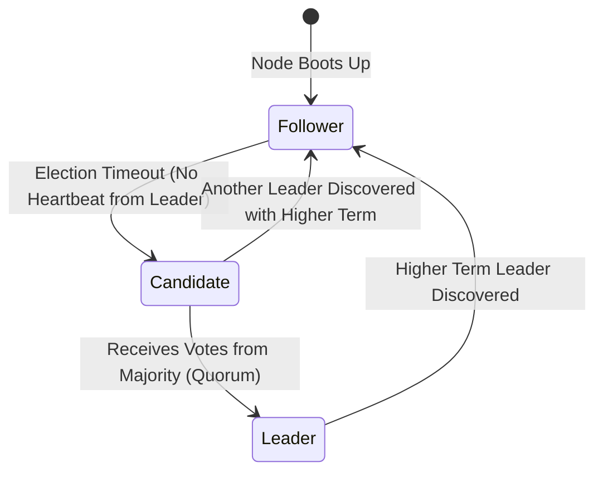

# 15 - Distributed Consensus & Leader Election

> **Real-World Analogy:**  
> Imagine a jury in a courtroom. To deliver a legal verdict, a quorum of jurors must agree. If one juror falls ill, the jury can still function as long as a strict majority is present. But if the jury splits evenly in half and cannot agree, no verdict can be issued. Consensus algorithms allow distributed computers to agree on a single source of truth even when some machines crash.

---

## 🎯 What & Why
Covers how distributed systems reach agreement on state changes, exploring Raft, Paxos, Quorums, and leader election mechanisms.

---

## 📊 Visual Architecture Diagram


---

## ⚙️ How It Works Under The Hood
### Why Is Consensus Hard?

In an asynchronous network:
- Machines can crash or reboot at any time.
- Network links can drop packets, reorder them, or duplicate them.
- A machine might simply be slow (not dead), leading others to believe it failed.
- The **FLP Impossibility Result** proves that no deterministic consensus protocol can guarantee termination in an asynchronous network in the presence of even a single unannounced fail-stop fault.

---

### The Raft Consensus Algorithm

Raft breaks consensus into three manageable sub-problems:

1. **Leader Election**:
   - Nodes exist in one of three states: **Follower**, **Candidate**, or **Leader**.
   - If a Follower receives no heartbeats within a randomized election timeout (e.g., 150ms–300ms), it becomes a Candidate and requests votes.
   - If it wins votes from a majority of nodes ($\lfloor N/2 
floor + 1$), it becomes the Leader.

2. **Log Replication**:
   - Clients send commands only to the Leader.
   - The Leader appends the command to its log and sends `AppendEntries` RPCs to all Followers.
   - Once a majority of Followers acknowledge the entry, the Leader commits it and applies it to its state machine.

3. **Safety Guarantee**:
   - If a leader commits a log entry, no other node can ever overwrite or diverge that committed entry in any future term.

---

## 💻 Concrete Code Implementation
```python
# Python simulation: Quorum-based voting simulator for leader election
import math

class ConsensusNode:
    def __init__(self, node_id: int, total_nodes: int):
        self.node_id = node_id
        self.total_nodes = total_nodes
        self.quorum_size = math.floor(total_nodes / 2) + 1
        self.term = 0
        self.state = "FOLLOWER"

    def start_election(self, available_peers: list):
        self.term += 1
        self.state = "CANDIDATE"
        votes = 1  # Votes for itself
        
        for peer_id in available_peers:
            if peer_id != self.node_id:
                votes += 1  # Peer grants vote

        if votes >= self.quorum_size:
            self.state = "LEADER"
            return True, f"Node {self.node_id} elected LEADER with {votes}/{self.total_nodes} votes (Quorum: {self.quorum_size})"
        else:
            self.state = "FOLLOWER"
            return False, f"Node {self.node_id} failed election ({votes}/{self.total_nodes} votes)"

if __name__ == "__main__":
    cluster_size = 5
    candidate = ConsensusNode(node_id=1, total_nodes=cluster_size)

    # 4 out of 5 nodes healthy
    healthy_peers = [1, 2, 3, 4]
    won, msg = candidate.start_election(healthy_peers)
    print("Healthy cluster election:", msg)

    # Only 2 out of 5 nodes alive (below quorum of 3)
    partitioned_peers = [1, 2]
    won, msg = candidate.start_election(partitioned_peers)
    print("Partitioned election:", msg)

```

---

## ⚖️ Trade-Offs & Architectural Considerations
- **Quorums**: Choose odd-numbered cluster sizes (3, 5, 7) to avoid split votes.
- **Failover Speeds**: Balance election timeouts to avoid false failovers during transient CPU spikes.
- **Consistency**: Strict consistency trades off availability during partitions.
