# 16 - Consistent Hashing & Virtual Nodes

> **Executive Summary:** When scaling a distributed cache or partitioned database across $N$ servers, traditional modulo hashing (`hash(key) % N`) causes catastrophic failure: adding or removing a single node remaps $\approx N / (N + 1)$ of all keys (up to $80\%\text{–}95\%$), triggering total cache stampedes and database collapse. **Consistent Hashing** maps both servers and keys onto a circular hash ring $[0, 2^{32} - 1]$. When a node joins or leaves, only $\approx 1 / N$ of keys are relocated. By introducing **Virtual Nodes (V-nodes)**, load skew and hot spots are eliminated, distributing data with near-perfect uniformity.

---

> 🏢 **Real-world case studies**: how **Google** & **Netflix** approach this, in [REAL_WORLD_EXAMPLES.md](./REAL_WORLD_EXAMPLES.md).

## ⏱️ Prerequisites: What You Need to Know First

To get the most out of this module, make sure you understand:
- [01 - Client-Server Networking](../01-client-server-networking/README.md): Client-to-server routing and TCP connections.
- [08 - Database Partitioning](../08-database-partitioning/README.md): Range-based vs. hash-based horizontal sharding.
- [10 - Caching Patterns](../10-caching-patterns/README.md): Cache-Aside and cache miss penalties.
- [11 - Cache Eviction & Invalidation](../11-cache-eviction-and-invalidation/README.md): Cache stampedes (thundering herds).
- **Data Structures**: Hash functions (MurmurHash3, MD5) and Binary Search (`bisect` in $O(\log M)$ time).

---

## 🧒 The 30-Second Version (ELI5)

Imagine 4 children sitting in a circle: Alice, Bob, Charlie, and David.
- You have a basket of 100 toys. You toss each toy into the center with a spin; wherever it lands, the child sitting clockwise from that spot gets to play with it.
- If a 5th child, Emma, sits down between Alice and Bob:
  - Emma **only takes toys from Alice's section of the circle**.
  - Bob, Charlie, and David don't have to give up a single toy!
- In contrast, if you used old-fashioned math (`toy_number % number_of_kids`), adding Emma would force **80 of the 100 toys** to be ripped away and redistributed to different kids, causing total chaos.

---

## 🍕 Everyday Analogy

| Concept | Roulette Wheel Analogy | Technical Reality in Distributed Systems |
| :--- | :--- | :--- |
| **Hash Ring** | A 360-degree roulette wheel ($0^\circ \dots 359^\circ$) | An integer space from $0$ to $2^{32} - 1$ |
| **Key Hash** | A ball landing at a specific angle (e.g. $142^\circ$) | `hash(key) = 32-bit unsigned integer` |
| **Physical Node** | A player with hands placed at $0^\circ, 120^\circ, 240^\circ$ | A physical caching server (e.g. Redis node) |
| **Clockwise Walk** | Ball rolls clockwise until hitting the first player's hand | Finding first node hash $\ge \text{key hash}$ using binary search |
| **Scaling Out** | A 4th player puts their hands at $60^\circ$ | Adding a new server; takes over only the arc $(0^\circ \dots 60^\circ]$ |
| **Hot Spot** | One player has long arms covering $60\%$ of the wheel | Non-uniform hash clustering overloading one physical machine |
| **Virtual Nodes** | Each player is allowed to place 150 colored stickers across the wheel | Multiplying physical servers into hundreds of virtual tokens |

---

## 🧩 The Problem It Solves

### The Catastrophic Modulo Problem (`hash(key) % N`)
In a naive distributed caching cluster with $N = 4$ servers:
$$\text{server\_id} = \text{hash}(\text{key}) \pmod 4$$
Suppose you scale out to $N = 5$ servers to handle peak Black Friday traffic:
$$\text{server\_id} = \text{hash}(\text{key}) \pmod 5$$

Because $4$ and $5$ are coprime, the mathematical remainder changes for **$80\%$ of all keys in the cluster!**
```
Key Hash = 100:  100 % 4 = Node 0  -->  100 % 5 = Node 0  (Retained)
Key Hash = 101:  101 % 4 = Node 1  -->  101 % 5 = Node 1  (Retained)
Key Hash = 102:  102 % 4 = Node 2  -->  102 % 5 = Node 2  (Retained)
Key Hash = 103:  103 % 4 = Node 3  -->  103 % 5 = Node 3  (Retained)
Key Hash = 104:  104 % 4 = Node 0  -->  104 % 5 = Node 4  (💥 REMAPPED!)
Key Hash = 105:  105 % 4 = Node 1  -->  105 % 5 = Node 0  (💥 REMAPPED!)
Key Hash = 106:  106 % 4 = Node 2  -->  106 % 5 = Node 1  (💥 REMAPPED!)
...
Total Keys Remapped: N / (N + 1) = 4 / 5 = 80.0%!
```
- **Consequence**: $80\%$ of your cache entries are instantly orphaned on the wrong servers.
- Millions of user requests miss the cache simultaneously, dumping tens of thousands of heavy queries onto the backend database. The database crashes, taking down the entire website.

### The Consistent Hashing Solution
By mapping both servers and keys to a fixed ring:
- Adding the 5th server remaps **only $1 / 5 = 20\%$ of keys**.
- The remaining **$80\%$ of cached data remains completely intact and readable!**

---

## 🖼️ Picture It: Architecture & Flow

### High-Resolution Consistent Hashing Animation
Below is an animated trace of a hash ring scaling from 3 to 4 nodes, followed by Virtual Node balancing:


---

### The Hash Ring Architecture

```mermaid
flowchart TD
    subgraph Ring["Consistent Hashing Ring: 0 to 2^32 - 1"]
        direction TB
        NodeA["🖥️ Node A<br/>Tokens: A#1, A#2, A#3"]
        NodeB["🖥️ Node B<br/>Tokens: B#1, B#2, B#3"]
        NodeC["🖥️ Node C<br/>Tokens: C#1, C#2, C#3"]
        NodeD["✨ Node D (New Node)<br/>Takes ~1/N of keys"]

        Key1["🔑 Key 'user_12'"] -->|hash = 12049| NodeB
        Key2["🔑 Key 'order_98'"] -->|hash = 48201| NodeC
        Key3["🔑 Key 'cart_404'"] -->|hash = 89123| NodeD
    end

    style NodeA fill:#161b22,stroke:#58a6ff,stroke-width:2px;
    style NodeB fill:#161b22,stroke:#3fb950,stroke-width:2px;
    style NodeC fill:#161b22,stroke:#d29922,stroke-width:2px;
    style NodeD fill:#161b22,stroke:#a371f7,stroke-width:2px;
```



---

## 🔢 Walk-Through with Real Numbers

Let's compare Modulo Hashing vs Consistent Hashing with real production numbers:

### Scenario: Scaling an In-Memory Cache from 9 to 10 Nodes
- **Total Keys Stored**: $100,000,000\text{ keys}$ (100 million sessions).
- **RAM Footprint**: $500\text{ GB}$ of data across the cluster.
- **Scaling Action**: Provision 1 additional caching node ($N = 9 \rightarrow 10$).

| Metric | Modulo Hashing (`hash % N`) | Consistent Hashing |
| :--- | :--- | :--- |
| **Remapping Formula** | $\frac{N}{N+1} = \frac{9}{10}$ | $\frac{1}{N_{\text{new}}} = \frac{1}{10}$ |
| **Keys Remapped** | **$90,000,000\text{ keys}$ (90%)** | **$10,000,000\text{ keys}$ (10%)** |
| **Cache Miss Storm** | **$90\%$ of traffic misses cache!** | **Only $10\%$ misses cache.** |
| **Origin DB Query Surge**| $90,000\text{ queries/sec}$ $\rightarrow$ **DB Crash** | $10,000\text{ queries/sec}$ $\rightarrow$ **Normal Load** |
| **Lookup Algorithm** | $O(1)$ modulo operation | $O(\log(N \cdot V))$ binary search ($<1\ \mu\text{s}$) |

---

## ⚙️ How It Works Under the Hood

### 1. The Ring Lookup Algorithm

1. **Ring Initialization**:
   - For every physical node $P_i$ and each virtual index $j \in [0, V-1]$, compute:
     $$h = \text{hash}(\text{node\_id} + "\#vnode-" + j)$$
   - Insert $h$ into an array `ring` kept in sorted ascending order.
   - Store mapping `hash_to_node[h] = P_i`.
2. **Key Assignment**:
   - To find the destination node for key $K$, compute $h_k = \text{hash}(K)$.
   - Perform a **Binary Search** (`bisect_right`) in `ring` for the smallest token hash $\ge h_k$.
   - If $h_k > \text{ring}[-1]$, wrap around to $\text{ring}[0]$.
   - Return `hash_to_node[token]`.
   - **Time Complexity**: $O(\log(N \cdot V))$ where $N$ is physical nodes and $V$ is virtual tokens. For 100 nodes with 150 V-nodes ($15,000$ tokens), $\log_2(15,000) \approx 14$ comparisons ($\approx 50\text{ nanoseconds}$).

---

### 2. Why Virtual Nodes (V-Nodes) are Essential

Without virtual nodes (each physical machine gets only 1 point on the ring):
- Random hashing of 4 nodes will leave huge, uneven arc distances between them.
- In our simulation benchmark:
  - Node 4 received $3.6\%$ of keys.
  - Node C received **$89.5\%$ of keys** (a **$159\text{x}$ imbalance!**). Node C burns out while Node 4 sits idle.

**With $V = 100\text{–}250$ Virtual Nodes**:
- By the Law of Large Numbers, distributing hundreds of points per node across the ring forces key distribution to converge to a tight Gaussian bell curve.
- Load variance drops to $\le 1.2\text{x}$ across all physical nodes.
- **Heterogeneous Hardware**: If Server A has 64 GB RAM and Server B has 128 GB RAM, assign 100 V-nodes to Server A and 200 V-nodes to Server B! Server B automatically and precisely absorbs twice the data and traffic.

---

### 3. Replication on the Hash Ring

In systems like **Amazon DynamoDB** and **Apache Cassandra**:
- Data is replicated across $R$ nodes (e.g., $R = 3$).
- A key hashes to the ring and lands on its primary coordinator node.
- The coordinator walks clockwise along the ring and skips duplicate virtual nodes of the same machine until it finds **$R-1$ physically distinct machines**.
- The key is written to all $R$ distinct physical replicas!

---

## ⚖️ Trade-Offs & Decision Matrix

| Hashing Strategy | Key Remapping on Scale | Load Uniformity | Memory Overhead | Lookup Speed |
| :--- | :--- | :--- | :--- | :--- |
| **Modulo Hashing** | $N / (N+1)$ (~80–95% lost) | Poor unless key space is dense | Zero (pure math) | $O(1)$ (~5 ns) |
| **Consistent Hashing (No V-nodes)** | $1 / N$ (~10–20% lost) | Extremely Poor (hot spots) | Negligible ($N$ tokens) | $O(\log N)$ (~20 ns) |
| **Consistent Hashing (150 V-nodes)** | $1 / N$ (~10–20% lost) | **Near-Perfect (Gaussian)** | Low (~1 MB for 100 nodes) | $O(\log(N \cdot V))$ (~50 ns) |
| **Rendezvous Hashing (HRW)**| $1 / N$ | Excellent | Zero (no ring stored) | $O(N)$ (hashes all nodes) |

---

## 🚫 Common Mistakes & Production Pitfalls

1. **Using Too Few Virtual Nodes ($V < 50$)**:
   - *Pitfall*: Setting `vnodes = 5` to save memory.
   - *Result*: Noticeable hot spots where one server receives 3x the traffic of its neighbors, leading to CPU throttling and cascading node failures. Standard production practice is $V = 150\text{–}256$.

2. **Replicating to Adjacent Virtual Nodes of the Same Machine**:
   - *Pitfall*: Walking clockwise to pick 3 replicas, but tokens 1, 2, and 3 all map to `Node-A`.
   - *Result*: All 3 copies reside on the exact same physical machine! If Node A loses power, all 3 copies vanish simultaneously. Always deduplicate by physical node identity during replication.

3. **Using Non-Uniform Hash Functions**:
   - *Pitfall*: Using Python's default `hash()` function (which randomized seed per process) or Java's standard `String.hashCode()`.
   - *Result*: Severe bit collisions and clustering on the ring. Always use cryptographic or high-distribution non-cryptographic hashes like **MurmurHash3**, **xxHash**, or **MD5**.

---

## 💻 Try It Yourself: Python Simulation

The companion simulation script [`demo.py`](./demo.py) implements:
1. Traditional Modulo Hashing vs Consistent Hashing scaling benchmark ($N=4 \rightarrow N=5$).
2. Proof of catastrophic cache invalidation: Modulo invalidates **$80.2\%$ of keys**, while Consistent Hashing remaps only **$20.0\%$**.
3. Load balance comparison: Showing 1 token per node has a $159\text{x}$ hot-spot variance, while 150 virtual nodes achieves a balanced $1.24\text{x}$ spread.

Run it locally in your terminal:
```bash
python demo.py
```

---

## 🌍 Where You'll See It in Production

- **Amazon DynamoDB & Apache Cassandra**: Partitioning and replication are organized around a consistent hash ring (token ring). Nodes publish tokens via gossip protocols.
- **Discord**: Uses consistent hashing in their routing proxies to direct millions of concurrent voice and text gateway connections to specific guild server instances.
- **Envoy Proxy**: Supports consistent hashing load balancing for sticky HTTP sessions with Maglev or Ring Hash load balancers.
- **Akamai CDN**: The inventors of consistent hashing (David Karger et al., 1997 at MIT) founded Akamai, using consistent hashing to distribute web content across thousands of edge proxy caches without origin disruption.

---

## 🎯 Top Interview Questions & Deep Answers

### Q1: "Why does traditional modulo hashing fail in distributed caching systems?"
**Interviewer Goal**: Testing whether the candidate understands the fundamental motivation for consistent hashing.

**Model Answer**:
"Traditional modulo hashing maps keys to servers using `server = hash(key) % N`. 
When the number of servers $N$ changes (due to a node crash, deployment, or auto-scaling), the divisor changes. Because consecutive integers modulo $N$ and modulo $N+1$ yield completely different remainders for almost all values, approximately $\frac{N}{N+1}$ (e.g., 80% when moving from 4 to 5 servers, or 90% when moving from 9 to 10 servers) of all keys map to an entirely different server.
In a caching tier, this causes almost the entire cache to become invalid at once. Millions of requests suffer cache misses simultaneously, causing a catastrophic **Cache Stampede (Thundering Herd)** on the database origin, often causing a complete system outage."

---

### Q2: "What are Virtual Nodes, and why is consistent hashing broken without them?"
**Interviewer Goal**: Assessing understanding of statistical distribution and real-world implementation pitfalls.

**Model Answer**:
"In basic consistent hashing, each physical server is mapped to exactly one point on the ring. However, with a small number of servers (e.g. 5–20), random hash placement results in non-uniform arc segments between nodes. One server might inadvertently end up responsible for 60% of the ring space, while an adjacent server only covers 5%, creating massive **hot spots** that can crash the overloaded node.

**Virtual Nodes (V-nodes)** solve this by mapping each physical machine to $V$ distinct points (typically 150 to 256 tokens) across the ring:
1. By the Central Limit Theorem, distributing hundreds of virtual tokens per server ensures the partition sizes average out, yielding near-perfect uniform distribution across all machines (variance $<5\%$).
2. V-nodes allow **heterogeneous capacity handling**: a high-memory server can be assigned 300 V-nodes while a smaller server receives 100 V-nodes.
3. When a server fails, its load is evenly redistributed across **all remaining servers**, rather than dumping 100% of its load onto its immediate clockwise neighbor."

---

### Q3: "How does data replication work on a consistent hash ring in a system like Cassandra or DynamoDB?"
**Interviewer Goal**: Testing multi-node replication and topology awareness on top of consistent hashing.

**Model Answer**:
"In systems with a replication factor of $R$ (e.g., $R = 3$):
1. A key's hash position on the ring is determined.
2. The key walks clockwise until it reaches the first node, which becomes the **Coordinator / Primary replica** for that key.
3. To place the remaining $R - 1$ replicas, the coordinator continues traversing clockwise along the ring.
4. Crucially, the coordinator skips any virtual nodes that belong to physical machines already selected. It selects the next $R - 1$ **physically distinct machines**.
5. Advanced implementations (such as Cassandra's `NetworkTopologyStrategy`) also ensure replicas are distributed across different **racks and Availability Zones** on the ring to survive data center power outages."

---

### Q4: "What is the time complexity of locating a key on a consistent hash ring with $N$ servers and $V$ virtual nodes?"
**Interviewer Goal**: Testing data structure algorithmic rigor.

**Model Answer**:
"The total number of virtual tokens on the ring is $M = N \times V$.
1. **Hashing the key**: $O(1)$ constant time (e.g. 32-bit MurmurHash3 takes ~10 ns).
2. **Finding the node on the ring**: The virtual node token hashes are stored in a sorted array or red-black binary search tree. A binary search (`bisect_right`) takes **$O(\log(N \cdot V))$** comparisons.
For example, with 100 servers each having 200 virtual nodes, $M = 20,000$ tokens. $\log_2(20,000) \approx 15$ comparisons, which takes roughly $30\text{–}60\text{ nanoseconds}$ of CPU time in memory.
Therefore, the lookup overhead is completely negligible compared to network transit times."

---

### Q5: "What is Rendezvous Hashing (Highest Random Weight), and how does it compare to Consistent Hashing?"
**Interviewer Goal**: Testing knowledge of alternative consistent partitioning algorithms.

**Model Answer**:
"**Rendezvous Hashing (HRW)** is an alternative to ring-based consistent hashing:
- For a key $K$ and a set of servers $\{S_1, S_2, \dots, S_N\}$, compute a score for every server: $\text{score}_i = \text{hash}(K, S_i)$.
- The key is routed to the server with the **highest score**.
- If a server is added or removed, only keys whose highest score belonged to that server are affected—achieving the same optimal $\approx 1/N$ remapping property as consistent hashing.

**Comparison**:
- **Pros of Rendezvous Hashing**: Zero state stored—no need to maintain and binary search a sorted ring array. Zero hot spots without needing virtual nodes.
- **Cons of Rendezvous Hashing**: Finding the server requires computing $N$ hashes ($O(N)$ time), whereas consistent hashing takes $O(\log(N \cdot V))$ time. Consistent hashing scales much better when cluster size $N$ is very large (hundreds or thousands of nodes)."

---

## ✅ Check Yourself: Flash Quiz

<details>
<summary><b>1. If you add 1 node to a 9-node consistent hash cluster, what percentage of keys are remapped on average?</b></summary>
<br>
<b>10%.</b> In consistent hashing, adding the $(N+1)$-th node only relocates $\frac{1}{N+1} = \frac{1}{10} = 10\%$ of keys. The other 90% of keys remain mapped to their existing servers. In contrast, modulo hashing would have moved 90% of keys!
</details>

<details>
<summary><b>2. Why is raw consistent hashing without Virtual Nodes dangerous in production?</b></summary>
<br>
Because random hashing of a small number of physical nodes creates <b>massive hot spots</b>. One node can easily be assigned 60–80% of the entire ring space simply due to hash clustering, overloading that machine and causing it to crash.
</details>

<details>
<summary><b>3. How do Virtual Nodes allow servers with different hardware specs (e.g., 64 GB RAM vs 128 GB RAM) to share load fairly?</b></summary>
<br>
By allocating <b>proportional numbers of virtual tokens</b>. You can assign 100 virtual nodes to the 64 GB server and 200 virtual nodes to the 128 GB server. The 128 GB server will automatically absorb twice the ring arcs and twice the traffic without any changes to the core algorithm.
</details>

---

## 📚 Go Deeper: Recommended Reading

- **Consistent Hashing and Random Trees: Distributed Caching Protocols for Relieving Hot Spots on the World Wide Web (1997)** by David Karger, Eric Lehman, Tom Leighton, Matthew Levine, Daniel Lewin, and Rina Panigrahy (MIT).
- **Amazon Dynamo Paper (2007)**: *Dynamo: Amazon’s Highly Available Key-value Store (Section 4.2: Partitioning Algorithm)*.
- **System Design Interview – An Insider’s Guide (Volume 1)** by Alex Xu — *Chapter 5: Design Consistent Hashing*.
- **Google Research**: *Maglev: A Fast and Reliable Software Network Load Balancer (Consistent Hashing Section)*.

---

## 🔗 Related Modules

- [08 - Database Partitioning](../08-database-partitioning/README.md): Range vs Hash sharding mechanics.
- [10 - Caching Patterns](../10-caching-patterns/README.md): Cache-Aside and eviction impacts.
- [11 - Cache Eviction & Invalidation](../11-cache-eviction-and-invalidation/README.md): Preventing cache stampedes.
- [22 - System Design: Distributed In-Memory Cache](../22-system-design-in-memory-cache/README.md): Implementing a production-grade consistent hashing cache cluster.
