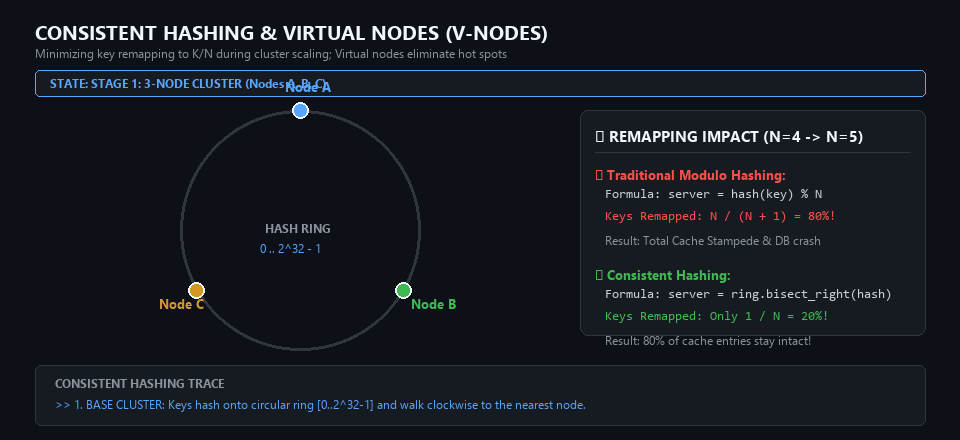
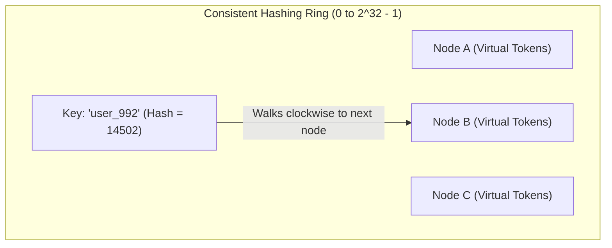

# 16 - Consistent Hashing & Virtual Nodes

> **Real-World Analogy:**  
> Imagine a round roulette wheel numbered 0 to 360 degrees. Three servers are placed at points on the wheel: 0°, 120°, and 240°. When you want to store a key, you hash it to a degree and walk clockwise until you hit the first server. If a 4th server joins the wheel at 60°, it only takes a small slice of keys from its neighbor. In contrast, traditional modulo hashing (`hash % N`) would force almost every single item in the entire casino to be moved to a different room!

---

## 🎯 What & Why
Covers how consistent hashing maps keys and servers onto an abstract ring topology to minimize the number of keys remapped when nodes join or leave the cluster.

---

## 📊 Visual Architecture Diagram

<p align="center">
  
</p>


---

## ⚙️ How It Works Under The Hood
### The Modulo Problem in Distributed Caching

In traditional hash-based routing:
`server_index = hash(key) % N`

When the number of servers $N$ changes from 4 to 5:
- About **80% of keys** (in general, N/(N+1) of them) map to a different server.
- Results in a massive **Cache Stampede**: entire caches are missed simultaneously, overwhelming the database origin.

---

### How Consistent Hashing Solves This

1. **The Circular Ring**:
   - Both nodes and keys are mapped onto a circular numerical space $[0, 2^{32} - 1]$ using a uniform hash function (e.g., MD5, MurmurHash3, SHA-256).
   - To find the destination server for a key, find its hash position on the ring and traverse clockwise until encountering the first node.

2. **Node Addition and Removal**:
   - Adding a node only moves the keys that fall between the new node and the node just before it (counter-clockwise). Those keys used to belong to the next node clockwise; now they belong to the new node. Nothing else moves.
   - On average, only $K / N$ keys need to be remapped, where $K$ is the total number of keys and $N$ is the number of servers!

3. **Virtual Nodes (Vnodes)**:
   - A single physical node is assigned multiple (e.g., 100 to 256) virtual locations across the ring (e.g., `NodeA#1`, `NodeA#2`, `NodeA#3`).
   - Ensures statistically uniform data distribution and prevents **hot-spotting**.

---

## 💻 Concrete Code Implementation
```python
# Python implementation: Consistent Hash Ring with Virtual Nodes
import hashlib
import bisect

class ConsistentHashRing:
    def __init__(self, replicas: int = 100):
        self.replicas = replicas
        self.ring = []  # Sorted list of virtual node hash keys
        self.vnode_to_node = {}  # Map: virtual hash -> physical node name

    def _hash(self, key: str) -> int:
        # MD5 gives a 128-bit position, so this ring runs from 0 to 2^128 - 1
        return int(hashlib.md5(key.encode('utf-8')).hexdigest(), 16)

    def add_node(self, node: str):
        for i in range(self.replicas):
            vnode_key = f"{node}#vnode_{i}"
            vnode_hash = self._hash(vnode_key)
            bisect.insort(self.ring, vnode_hash)
            self.vnode_to_node[vnode_hash] = node

    def remove_node(self, node: str):
        for i in range(self.replicas):
            vnode_key = f"{node}#vnode_{i}"
            vnode_hash = self._hash(vnode_key)
            idx = bisect.bisect_left(self.ring, vnode_hash)
            if idx < len(self.ring) and self.ring[idx] == vnode_hash:
                del self.ring[idx]
                del self.vnode_to_node[vnode_hash]

    def get_node(self, key: str) -> str:
        if not self.ring:
            return None
        key_hash = self._hash(key)
        idx = bisect.bisect_right(self.ring, key_hash)
        if idx == len(self.ring):
            idx = 0  # Wrap around the ring
        return self.vnode_to_node[self.ring[idx]]

if __name__ == "__main__":
    ring = ConsistentHashRing(replicas=50)
    ring.add_node("redis-node-1")
    ring.add_node("redis-node-2")
    ring.add_node("redis-node-3")

    test_keys = ["photo:101", "session:abc", "cart:xyz", "user:99"]
    for k in test_keys:
        print(f"Key '{k}' maps to -> {ring.get_node(k)}")

```

---

## ⚖️ Trade-offs

| Decision | Trade-off |
| :--- | :--- |
| **Plain `hash % N`** | Simplest and perfectly even, but changing N moves most keys |
| **Consistent hashing without virtual nodes** | Few keys move, but load is very uneven with only a handful of servers |
| **More virtual nodes per server** (100–256) | Smoother balance, but a bigger ring to store and search |
| **Weighted virtual nodes** | Give a bigger server more vnodes so it takes a bigger share |
| **Alternatives** | *Rendezvous hashing* (no ring, simple, even) and *jump consistent hash* (tiny and fast, but only for numbered buckets) solve the same problem |

**Remember:** consistent hashing decides *where* data lives; it doesn't move the data for you. Something still has to copy the affected keys when the ring changes.
