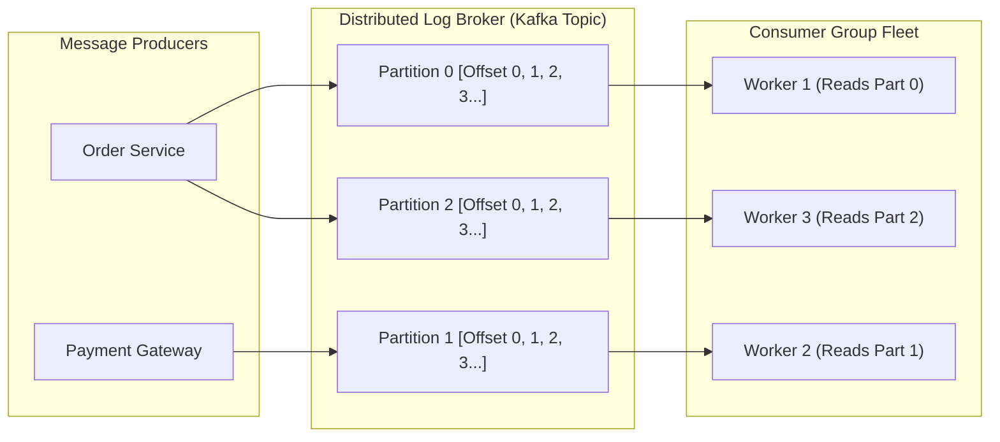

# 17 - Message Queues & Event Streaming

> **Real-World Analogy:**  
> Imagine a busy bakery. The counter staff take customer orders and write them onto hanging tickets on an order wheel (Message Queue). The kitchen bakers pick tickets off the wheel at their own pace and bake the cakes (Consumers). Even if 50 customers arrive simultaneously, the counter never refuses an order, and the kitchen bakers never choke.

---

## 🎯 What & Why
Deep dive into asynchronous messaging systems, comparing message queues (RabbitMQ, SQS) with distributed commit log streams (Apache Kafka, Redpanda), along with consumer groups and delivery semantics.

---

## 📊 Visual Architecture Diagram


---

## ⚙️ How It Works Under The Hood
### Message Queues vs Distributed Log Streaming

| Dimension | Traditional Message Queue (RabbitMQ, SQS) | Event Log Stream (Apache Kafka, Redpanda) |
| :--- | :--- | :--- |
| **Data Retention** | Messages deleted immediately after consumer ACK | Messages persisted to disk for days/months; durable log |
| **Model** | Smart broker, dumb consumer (broker tracks delivery) | Dumb broker, smart consumer (consumer tracks own offset) |
| **Replayability** | Cannot replay processed messages | Consumers can rewind offset and replay historical events |
| **Ordering** | Ordered within queue; complex with competing workers | Strictly ordered per partition |
| **Throughput** | Tens of thousands of messages per second | Millions of events per second (sequential disk I/O) |

---

### Delivery Semantics

1. **At-Most-Once**:
   - Messages may be lost, but are never redelivered.
   - Example: Telemetry metrics, sensor updates where occasional loss is acceptable.
2. **At-Least-Once** (Most common):
   - Messages are guaranteed never to be lost, but duplicates may arrive during network retries.
   - **Requirement**: Consumers must be designed to be **Idempotent** (processing the same message ID twice produces identical results).
3. **Exactly-Once**:
   - Achieved through two-phase commit or transactional outboxes combined with idempotent deduplication keys.

---

## 💻 Concrete Code Implementation
```python
# Python simulation: In-memory Pub/Sub event bus with consumer groups
from collections import defaultdict, deque

class EventBus:
    def __init__(self):
        self.topics = defaultdict(deque)
        self.subscribers = defaultdict(list)

    def subscribe(self, topic: str, callback):
        self.subscribers[topic].append(callback)

    def publish(self, topic: str, event_payload: dict):
        self.topics[topic].append(event_payload)
        for consumer in self.subscribers[topic]:
            consumer(event_payload)

if __name__ == "__main__":
    bus = EventBus()

    # Define subscriber callbacks
    def email_notification_worker(event):
        print(f"[Email Worker] Sending welcome email to {event['email']}")

    def analytics_worker(event):
        print(f"[Analytics Worker] Logged signup event for user {event['user_id']}")

    bus.subscribe("user.created", email_notification_worker)
    bus.subscribe("user.created", analytics_worker)

    print("Publishing 'user.created' event...")
    bus.publish("user.created", {"user_id": 402, "email": "alice@example.com"})

```

---

## ⚖️ Trade-Offs & Architectural Considerations
- **Resilience**: Design for failure at every tier; assume machines and networks will fail.
- **Backpressure**: Shed load gracefully before resources are completely exhausted.
- **Idempotency**: Guarantee safe retries for all network operations.
