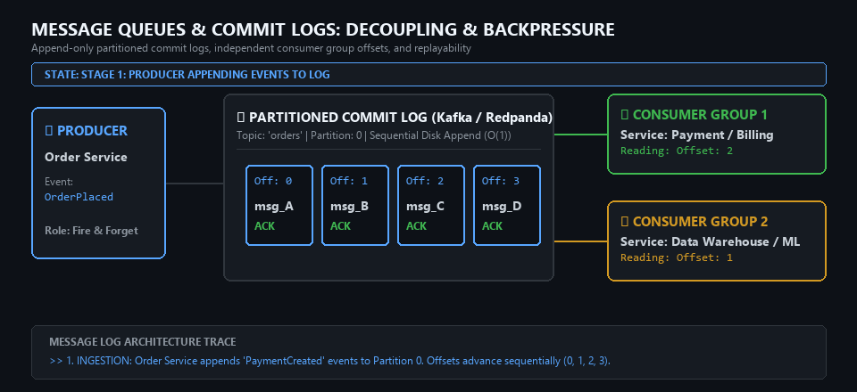

# 17 - Message Queues & Distributed Commit Logs

> **Executive Summary:** Synchronous HTTP/REST calls bind microservices in rigid temporal coupling—if a downstream billing or notification service is slow or down, the upstream checkout service blocks, exhausts thread pools, and crashes. Asynchronous messaging decouples producers from consumers in both time and space. While traditional **Message Queues** (RabbitMQ, SQS) delete messages upon consumer acknowledgment, **Distributed Commit Logs** (Apache Kafka, Redpanda) store ordered, immutable streams of events on disk, allowing multiple independent consumer groups to read and replay data at their own pace.

---

## ⏱️ Prerequisites: What You Need to Know First

To get the most out of this module, make sure you understand:
- [01 - Client-Server Networking](../01-client-server-networking/README.md): Synchronous blocking I/O vs. asynchronous event-driven I/O.
- [06 - Relational & Non-Relational Databases](../06-relational-and-non-relational-databases/README.md): Transaction commit logs (WAL) and disk I/O performance.
- [15 - Consensus & Leader Election](../15-consensus-and-leader-election/README.md): Partition leader failover in distributed clusters.

---

## 🧒 The 30-Second Version (ELI5)

Imagine a busy pizza chef:
- **Without a queue (Synchronous)**: Every time an order comes in, the chef must stop cooking, walk into the dining room, personally hand the pizza to the customer, and wait for them to finish paying before starting the next pizza. If a customer is slow, the entire kitchen grinds to a halt!
- **With a Message Queue (RabbitMQ / SQS)**: Waiters drop order tickets into a basket. The chef grabs tickets one by one, cooks pizzas, and throws the tickets away.
- **With a Distributed Commit Log (Kafka)**: All orders are recorded in a permanent, numbered ledger book ($1, 2, 3 \dots$). The chef reads the ledger to cook pizzas. The accounting team reads the exact same ledger to calculate taxes. The inventory manager reads it to restock flour. Nobody tears out or deletes pages from the book, and anyone can flip back to page 1 anytime to recount.

---

## 🍕 Everyday Analogy

| Concept | Everyday Kitchen & Ledger Analogy | Technical Reality in Kafka / RabbitMQ |
| :--- | :--- | :--- |
| **Producer** | Waiters taking orders from customers | Microservice publishing events (e.g., `OrderPlaced`) |
| **Traditional Queue** | Physical paper ticket basket (ticket is shredded once cooked) | AMQP / RabbitMQ / SQS: message deleted on ACK |
| **Commit Log** | Indelible bound ledger book with sequential line numbers | Append-only sequential disk log with numeric offsets |
| **Topic** | The "Dinner Orders" ledger book | Named category/stream for events |
| **Partition** | Splitting the ledger into 4 separate station notebooks | Unit of parallel processing and scale-out |
| **Consumer Group** | A team of workers (e.g. Chefs) sharing the notebook work | Set of consumers dividing partitions among themselves |
| **Offset** | A bookmark indicating the last line number read | Monotonically increasing 64-bit integer pointer |
| **Replay** | Flipping the bookmark back 50 pages to re-verify an order | Rewinding consumer offset to reprocess historical events |
| **Dead-Letter Queue** | A special tray for corrupted orders that cannot be cooked | Secondary queue for messages failing maximum retries |

---

## 🧩 The Problem It Solves

### The Cascading Outage of Synchronous Chains
In a naive synchronous microservice architecture:
```
[User] ──> [Checkout API] ──(HTTP)──> [Inventory Service]
                                  ──(HTTP)──> [Payment Gateway]
                                  ──(HTTP)──> [Fraud Detection]
                                  ──(HTTP)──> [Email Service]
```
- If the Email Service experiences a 5-second database freeze, Checkout API threads block waiting for HTTP responses.
- Checkout API connection pools and worker threads exhaust within seconds.
- Users see HTTP 504 Gateway Timeouts. An email delay has caused a total e-commerce revenue blackout!

### The Asynchronous Message-Driven Architecture
```
[User] ──> [Checkout API] ──(Publish: 2ms)──> [Order Topic (Kafka / SQS)]
                │
                └──> Return "202 Accepted" to User immediately!

[Order Topic] ──> [Inventory Worker] (Pulls at its own speed)
              ──> [Payment Worker]   (Pulls at its own speed)
              ──> [Fraud Worker]     (Batch ML evaluation)
              ──> [Email Worker]     (Down? Doesn't matter! Messages buffer safely)
```
- **Temporal Decoupling**: Services do not need to be online at the same time.
- **Backpressure Absorption**: If traffic surges by 50x during a flash sale, messages queue up safely on disk. Downstream workers continue processing at their maximum sustainable rate without crashing.

---

## 🖼️ Picture It: Architecture & Flow

### High-Resolution Message Log Animation
Below is an animated trace of a partitioned append-only commit log with independent consumer groups and offset rewinding:



---

### Queue (RabbitMQ) vs. Log (Kafka) Architecture Comparison

```mermaid
flowchart TD
    subgraph Traditional["1. Traditional Queue (RabbitMQ / SQS)"]
        P1["Producer"] --> Q["FIFO Queue<br/>• Destructive Read<br/>• Deleted after ACK"]
        Q --> W1["Worker 1 (Processes Task 1)"]
        Q --> W2["Worker 2 (Processes Task 2)"]
    end

    subgraph CommitLog["2. Partitioned Commit Log (Apache Kafka / Redpanda)"]
        P2["Producer"] --> L["Topic: 'orders' (Partition 0)<br/>[Offset 0 | Offset 1 | Offset 2 | Offset 3 | Offset 4]"]
        L -->|Offset: 4 (Live)| CG1["💳 Payment Service (Consumer Group A)"]
        L -->|Offset: 2 (Lagging)| CG2["📊 Analytics Pipeline (Consumer Group B)"]
        L -.->|Rewind to Offset 0| CG3["🔄 Bug Fix Replay (Consumer Group C)"]
    end

    style Traditional fill:#161b22,stroke:#58a6ff,stroke-width:2px;
    style CommitLog fill:#161b22,stroke:#3fb950,stroke-width:2px;
    style CG1 fill:#21262d,stroke:#3fb950,stroke-width:1px;
    style CG2 fill:#21262d,stroke:#d29922,stroke-width:1px;
    style CG3 fill:#21262d,stroke:#f85149,stroke-width:1px;
```

---

## 🔢 Walk-Through with Real Numbers

Let's look at the mechanical reasons why Kafka can process **millions of messages per second** on cheap spinning disks:

### 1. Sequential vs. Random Disk I/O Throughput
- **Random Disk Writes (B-Trees / Relational DBs)**: Requires moving mechanical disk heads or flash block erase cycles:
  $$\approx 100\text{–}300\text{ IOPS} \implies \approx 10\text{ MB/sec}$$
- **Sequential Disk Appends (Commit Log)**: Merely appends bytes to the end of a physical file descriptor:
  $$\approx 600\text{–}800\text{ MB/sec on NVMe} \quad (\approx 150\text{ MB/sec on mechanical HDD})$$
Sequential disk write speed is mathematically as fast as writing to RAM!

### 2. Zero-Copy Network Transfer (`sendfile` syscall)
In traditional servers, transferring data from disk to network requires 4 context switches and 3 memory buffer copies:
```
Disk ──> [OS Page Cache] ──> [JVM / App Memory] ──> [Socket Buffer] ──> Network NIC
```
In Kafka, the Linux kernel `sendfile()` system call executes **Zero-Copy**:
```
Disk ──> [OS Page Cache] ──────────────────────────────────────────────> Network NIC
```
- Data never enters user-space application memory!
- Zero CPU copy overhead and zero JVM garbage collection pauses, enabling a single broker to saturate a 10Gbps network link.

---

## ⚙️ How It Works Under the Hood

### 1. Queues vs. Logs: Architectural Taxonomy

| Feature | Message Queue (RabbitMQ / SQS) | Distributed Commit Log (Kafka / Redpanda) |
| :--- | :--- | :--- |
| **Data Retention** | Ephemeral: Deleted once consumed and acknowledged | Persistent: Retained for days/years according to retention policy |
| **Consumer Scaling**| Competing consumers pulling from one shared queue | Consumer groups mapped to discrete log partitions |
| **Ordering** | FIFO within queue, but concurrent consumers process out-of-order | **Strictly ordered per partition** |
| **Replayability** | ❌ Impossible (messages destroyed after delivery) | ✅ Trivial (rewind offset pointer back to zero) |
| **Routing Flexibility**| Complex topic exchange bindings and pattern matching | Static topics partitioned by hash key |

---

### 2. Partitioning & Strict Ordering Guarantees

A fundamental interview trap: *"Does Kafka guarantee global message ordering?"*
**No.** Kafka guarantees ordering **strictly within a single partition**, never globally across an entire topic!
- When a producer publishes a message, it provides a `partition_key` (e.g., `user_id` or `order_id`).
- The broker hashes the key:
  $$\text{partition\_id} = \text{hash}(\text{key}) \pmod{\text{num\_partitions}}$$
- All events for `user_101` (`OrderCreated`, `OrderPaid`, `OrderShipped`) are guaranteed to land in **Partition 2** in strict chronological sequence.
- Events for `user_102` land in **Partition 0**.
- Therefore, each consumer reads a single partition sequentially, ensuring state transitions for a given user never execute out of order!

---

### 3. Delivery Semantics & Idempotency

1. **At-Most-Once**:
   - Consumer reads message, immediately commits offset, and then processes the message.
   - *Risk*: If consumer crashes during processing, the message is permanently lost.
2. **At-Least-Once (Standard Production Practice)**:
   - Consumer reads message, completes processing (e.g. database write), and *then* commits offset.
   - *Risk*: If consumer crashes right after processing but before committing offset, the new consumer re-reads the message $\rightarrow$ **Duplicate processing!**
   - *Solution*: **Idempotency Keys** (deduplication table in the consumer database: `INSERT INTO processed_events (event_id) VALUES ('evt_123') ON CONFLICT DO NOTHING`).
3. **Exactly-Once Semantics (EOS)**:
   - Coordinated transactional producers and consumers using two-phase commit over an internal `__transaction_state` topic.

---

## ⚖️ Trade-Offs & Decision Matrix

| Dimension | Use Traditional Queue (RabbitMQ / SQS) | Use Commit Log (Kafka / Redpanda) |
| :--- | :--- | :--- |
| **Task Routing** | Complex task dispatch (e.g. priority queues, worker pools) | High-throughput streaming event pipelines |
| **Event Replay** | Not needed (one-and-done background tasks) | Essential (analytics, machine learning, audit trail) |
| **Throughput** | Up to 50k msgs/sec | >1,000,000 msgs/sec |
| **Message Ordering** | Loose | Strict per-partition ordering |
| **Client Memory** | Low (broker manages tracking state) | Requires tracking offsets in consumer group |

---

## 🚫 Common Mistakes & Production Pitfalls

1. **Missing Partition Keys Causing Ordering Bugs**:
   - *Pitfall*: Publishing `OrderCreated` and `OrderCancelled` without an explicit key.
   - *Result*: The broker round-robins the messages across different partitions. Partition 1 runs faster than Partition 0, so the consumer receives `OrderCancelled` *before* `OrderCreated`, throwing invalid state exceptions! Always supply an entity key (e.g., `order_id`).

2. **Consumer Lag Blindness (Poison Pill Hangs)**:
   - *Pitfall*: A consumer encounters an unexpected null pointer exception on a corrupted payload, crashes, restarts, re-reads the same poison payload, and crashes in an infinite loop.
   - *Result*: Consumer lag climbs to millions of messages, stalling processing for all valid subsequent messages in that partition.
   - *Fix*: Implement a **Dead-Letter Queue (DLQ)**: catch unrecoverable deserialization exceptions, route the bad message to a DLQ topic for engineering triage, and commit the offset to allow the partition to proceed.

3. **Setting Too Few Partitions**:
   - *Pitfall*: Creating a topic with only 1 partition.
   - *Result*: In Kafka, a partition can be consumed by at most **one active consumer thread in a group**. Even if you launch 50 worker containers, 49 of them will sit completely idle! Sizing partitions determines your maximum horizontal scaling limit.

---

## 💻 Try It Yourself: Python Simulation

The companion simulation script [`demo.py`](./demo.py) implements:
1. An append-only partitioned commit log with hash-based key routing.
2. Independent consumer groups reading at divergent speeds.
3. Live event replay: rewinding a consumer group offset to reprocess past messages.
4. Competing consumer work queue with automatic retry backoff and Dead-Letter Queue (DLQ) routing.

Run it locally in your terminal:
```bash
python demo.py
```

Expected output preview:
```
======================================================================
MESSAGE QUEUES & DISTRIBUTED COMMIT LOGS SIMULATION
======================================================================

--- Part 1: Partitioned Commit Log & Independent Consumer Groups ---
Produced: 'OrderPlaced(id=1, total=$99)' -> Partition 0, Offset 0
Produced: 'OrderPlaced(id=2, total=$249)' -> Partition 0, Offset 1
Produced: 'OrderPaid(id=1)' -> Partition 0, Offset 2
Produced: 'OrderPlaced(id=3, total=$15)' -> Partition 1, Offset 0

[PaymentService Group] Processed 4 events. Offsets: {0: 3, 1: 1}
[AnalyticsService Group] Starting from offsets: {0: 0, 1: 0} (Lagging behind)

--- Part 2: Event Replay (Offset Rewind) ---
Bug found in PaymentService accounting! Rewinding Partition 0 offset back to 0...
PaymentService replayed 3 historical events from Partition 0:
  Re-processed: Offset 0 | Payload: OrderPlaced(id=1, total=$99)
  Re-processed: Offset 1 | Payload: OrderPlaced(id=2, total=$249)
  Re-processed: Offset 2 | Payload: OrderPaid(id=1)
Notice: AnalyticsService state and offsets were completely untouched!

--- Part 3: Competing Consumer Queue with DLQ Failures ---
1. Task email_1 successfully processed and ACKed.
2. Task email_bad failed (attempt 1) -> Re-queued with backoff.
3. Task email_bad failed (attempt 2) -> Re-queued with backoff.
4. Task email_bad FAILED permanently -> Routed to DLQ!
DLQ contents: ['email_bad']
```

---

## 🌍 Where You'll See It in Production

- **LinkedIn**: Invented Apache Kafka in 2011 to handle activity tracking, metrics, and message queues. Currently processes $>7\text{ Trillion}$ messages per day across thousands of brokers.
- **Shopify**: Uses Kafka and Google Cloud Pub/Sub to decouple storefront checkouts from fulfillment, warehouse, inventory, and payment processing during flash sales.
- **Uber**: Uses Kafka as the real-time spine connecting rider apps, driver GPS telemetry, pricing algorithms, and dispatch microservices.
- **Stripe**: Uses AWS SQS for asynchronous payment webhook delivery, guaranteeing retries with exponential backoff over 72 hours.

---

## 🎯 Top Interview Questions & Deep Answers

### Q1: "What is the difference between RabbitMQ and Apache Kafka, and how do you decide which to use?"
**Interviewer Goal**: Testing architectural decision-making and pattern matching.

**Model Answer**:
"The fundamental difference lies in their data model and storage engine:
1. **RabbitMQ is a traditional message broker**:
   - Messages are transient: once a consumer reads and ACKs a message, it is deleted from the broker.
   - Supports complex AMQP routing (topic exchanges, direct exchanges, headers, dead-letter exchanges).
   - Ideal for **heterogeneous background task queues**, long-running worker jobs, or complex routing topologies where messages are independent.
2. **Apache Kafka is an append-only distributed commit log**:
   - Messages are immutable and persisted to disk according to a time retention policy (e.g. 7 days), regardless of whether they have been read.
   - Multiple consumer groups read from the same log at their own independent offsets.
   - Ideal for **high-throughput event streaming**, real-time analytics, event sourcing, and scenarios requiring event replay.
If you need high message routing flexibility and worker-task dispatching, choose RabbitMQ. If you need massive throughput ($>100\text{k msgs/sec}$), event replay, and unified multi-team log consumption, choose Kafka."

---

### Q2: "How does Kafka guarantee message ordering, and under what conditions can ordering be violated?"
**Interviewer Goal**: Checking understanding of partition semantics and producer retry configurations.

**Model Answer**:
"Kafka **never** guarantees global ordering across an entire topic. It guarantees ordering **strictly within a single partition**.
To ensure that all events for a specific business entity (such as `account_123`) are processed in order:
1. The producer must assign the entity ID as the message's `record_key`. All records with that key hash to the same partition.
2. A single partition is only ever assigned to a single consumer thread within a consumer group.

**How ordering can be accidentally violated**:
- **In-flight Retries**: If the producer has `max.in.flight.requests.per.connection > 1` and `enable.idempotence = false`. If batch 1 fails and retries while batch 2 succeeds immediately, batch 2 will be written before batch 1 on the broker!
- **Fix**: Set `enable.idempotence = true` (standard since Kafka 3.0), which assigns sequence numbers to producer batches, ensuring the broker rejects out-of-order writes even across retries."

---

### Q3: "What is Consumer Lag, why is it dangerous, and how do you monitor and remediate it?"
**Interviewer Goal**: Evaluating production operations and observability maturity.

**Model Answer**:
"**Consumer Lag** is the delta between the latest offset produced to a partition (`LogEndOffset`) and the latest offset processed and committed by a consumer group (`CurrentOffset`):
$$\text{Lag} = \text{LogEndOffset} - \text{CurrentOffset}$$

**Why it is dangerous**:
- Increasing lag means downstream systems are processing stale data in real time.
- If consumer lag grows faster than data can be processed, memory and disk retention thresholds may expire, causing the oldest unprocessed messages to be permanently purged before the consumer ever reads them.

**Remediation**:
1. **Horizontal Scaling**: Scale up consumer instances in the group up to the number of partitions (if you have 10 partitions, you can run up to 10 parallel consumers).
2. **Batch & Concurrency Tuning**: Increase `max.poll.records` or parallelize message processing inside the worker using worker thread pools (committing offsets carefully).
3. **Partition Rescaling**: If partitions are already at 1:1 parity with consumers, increase the topic's partition count to allow more consumer instances."

---

### Q4: "How do you achieve Exactly-Once Processing in an asynchronous message pipeline?"
**Interviewer Goal**: Dissecting distributed systems guarantees (end-to-end vs. transport).

**Model Answer**:
"True distributed exactly-once delivery across network boundaries is mathematically impossible due to the Two Generals' Problem—network timeouts force producers to retry, which can create duplicates.
Therefore, 'Exactly-Once' in practice is achieved via **At-Least-Once Delivery + Consumer Idempotency**:
1. **Idempotent Producers**: The producer assigns a unique transaction ID and sequence number to each message. The broker automatically de-duplicates retried messages.
2. **Idempotent Consumer State Storage**:
   - The consumer saves the message processing result and the message ID in the **same atomic database transaction**:
     ```sql
     BEGIN;
     INSERT INTO bank_transactions (id, amount, account_id) VALUES ('tx_88', 100, 'acc_1');
     INSERT INTO processed_events (event_id) VALUES ('evt_msg_9918');
     COMMIT;
     ```
   - If a duplicate message arrives, the unique constraint on `processed_events.event_id` detects the collision, and the consumer drops it safely with zero side effects."

---

### Q5: "What is a Dead-Letter Queue (DLQ), and how should it be designed in a production system?"
**Interviewer Goal**: Testing fault-tolerance patterns and error recovery architectures.

**Model Answer**:
"A **Dead-Letter Queue (DLQ)** is a secondary queue or topic where unprocessable messages are routed after exhausting their retry attempts, preventing them from stalling the main processing pipeline.

**Best Practices for DLQ Design**:
1. **Distinguish Transient vs. Poison Errors**:
   - *Transient errors* (network timeout, temporary DB 503): Retry with exponential backoff and jitter.
   - *Poison pill errors* (malformed JSON, invalid schema, business logic violation): Route immediately to the DLQ on the first failure—retrying will never fix a corrupt payload.
2. **Attach Error Metadata**: When routing to the DLQ, wrap the message with headers containing:
   - Original topic and partition.
   - Stack trace / error message.
   - Timestamp and failure attempt count.
3. **Automated Reprocessing Tooling**: Provide administrative CLI or UI tools to inspect the DLQ, allow engineers to fix downstream bugs, and redrive/replay the DLQ messages back into the primary processing topic."

---

## ✅ Check Yourself: Flash Quiz

<details>
<summary><b>1. If a Kafka topic has 4 partitions, and you launch 6 consumer containers in the same Consumer Group, how many containers will be actively consuming messages?</b></summary>
<br>
<b>4 containers.</b> In Kafka, a partition can be consumed by at most one consumer thread in a consumer group at any given time. The extra 2 containers will sit completely idle as hot standbys unless one of the active 4 containers crashes.
</details>

<details>
<summary><b>2. Why can Kafka achieve over 1,000,000 messages/sec on standard disks without bottlenecking on disk I/O?</b></summary>
<br>
Due to two architectural optimizations:
1. <b>Sequential Disk Appends</b>: Writing sequentially to disk avoids mechanical seek overhead and block erase latency, matching RAM throughput speeds.
2. <b>Zero-Copy <code>sendfile()</code></b>: The OS transfers bytes directly from the Page Cache to the network socket, bypassing user-space JVM memory and eliminating GC overhead.
</details>

<details>
<summary><b>3. What is the fundamental difference in data retention between RabbitMQ and Kafka?</b></summary>
<br>
RabbitMQ is <b>ephemeral</b>: messages are deleted from the broker as soon as a consumer acknowledges them. Kafka is a <b>persistent commit log</b>: messages remain stored on disk for a configured retention period (e.g. 7 days or indefinitely), allowing multiple consumer groups to read and replay the data independently.
</details>

---

## 📚 Go Deeper: Recommended Reading

- **Designing Data-Intensive Applications** by Martin Kleppmann — *Chapter 11: Stream Processing (Message Systems and Partitioned Logs)*.
- **Kafka: The Definitive Guide** by Neha Narkhede, Gwen Shapira, and Todd Palino (O'Reilly).
- **Understanding Distributed Systems** by Roberto Vitillo — *Chapter: Asynchronous Messaging*.
- **The Log: What every software engineer should know about real-time data's unifying abstraction** by Jay Kreps (LinkedIn Engineering).

---

## 🔗 Related Modules

- [01 - Client-Server Networking](../01-client-server-networking/README.md): RPC vs. asynchronous messaging models.
- [18 - Event Sourcing & CQRS](../18-event-sourcing-and-cqrs/README.md): Building state machines on top of immutable event logs.
- [19 - Distributed Transactions](../19-distributed-transactions/README.md): Sagas and transactional outbox patterns with message queues.
- [20 - Fault Tolerance & Resilience](../20-fault-tolerance-and-resilience/README.md): Dead-letter queues, backoff, and circuit breakers.
