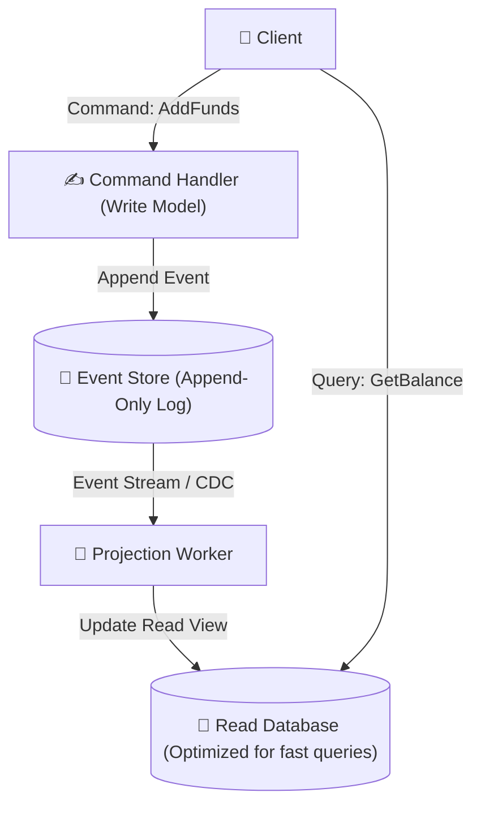

# 18 - Event Sourcing & CQRS

> **Real-World Analogy:**  
> Think of your bank statement. It's a list of every deposit, withdrawal and transfer since the account was opened, and nothing on it is ever erased (Event Sourcing). Your balance can always be worked out by adding up that list. The balance shown at the top of your banking app is a pre-computed summary kept for fast reading (a CQRS read model).

---

## 🎯 What & Why
Explains Event Sourcing (recording all changes as an append-only sequence of immutable events) and CQRS (Command Query Responsibility Segregation) separating write models from read-optimized views.

---

## 📊 Visual Architecture Diagram


---

## ⚙️ How It Works Under The Hood
### Understanding CQRS

Traditional architectures use the exact same data model for both reads and writes:
- **Problem**: Queries often require complex JOINs, aggregations, and denormalization, while writes require strict relational constraints and locks.

**Command Query Responsibility Segregation (CQRS)**:
- **Command Side**: Handles business logic, validates constraints, and executes state mutations. Optimized for transaction integrity.
- **Query Side**: Read-only denormalized projections optimized for specific UI screens and search queries (e.g., Elasticsearch or DynamoDB read tables).

---

### Core Concepts of Event Sourcing

1. **Immutable Event Stream**: Instead of `UPDATE accounts SET balance = 500 WHERE id = 1`, store events:
   - `AccountCreated(initial_balance = 0)`
   - `FundsDeposited(amount = 700)`
   - `FundsWithdrawn(amount = 200)`
2. **Auditability & Time Travel**: You can reconstruct the exact state of any entity at any point in the past by replaying events up to that timestamp.
3. **Snapshots**: To avoid replaying 100,000 events on startup, periodically take a state snapshot (e.g., every 1,000 events) and replay only subsequent events from that snapshot forward.

---

## 💻 Concrete Code Implementation
```python
# Minimal event sourcing: state is rebuilt from events (the CQRS read side is not shown)
class AccountAggregate:
    def __init__(self, account_id: str):
        self.account_id = account_id
        self.balance = 0
        self.changes = []

    def apply(self, event: dict):
        if event["type"] == "AccountCreated":
            self.balance = event["initial_balance"]
        elif event["type"] == "FundsDeposited":
            self.balance += event["amount"]
        elif event["type"] == "FundsWithdrawn":
            self.balance -= event["amount"]

    def deposit(self, amount: float):
        event = {"type": "FundsDeposited", "amount": amount}
        self.apply(event)
        self.changes.append(event)

    def withdraw(self, amount: float):
        if self.balance < amount:
            raise ValueError("Insufficient balance!")
        event = {"type": "FundsWithdrawn", "amount": amount}
        self.apply(event)
        self.changes.append(event)

if __name__ == "__main__":
    acc = AccountAggregate("acc_100")
    acc.apply({"type": "AccountCreated", "initial_balance": 100})
    acc.deposit(50)
    acc.withdraw(30)

    print(f"Current Reconstructed Balance: ${acc.balance}")
    print("Recorded Events Log:", acc.changes)

```

---

## ⚖️ Trade-offs

| Benefit | Cost |
| :--- | :--- |
| Full audit trail: you know *why* every value is what it is | Much more complex than plain CRUD; most apps don't need it |
| Rebuild state as of any past moment; fix bugs by replaying events | Events are permanent, so changing their shape later needs versioning and "upcasters" |
| New read models can be built from old events at any time | Read models lag behind writes (eventual consistency) |
| CQRS lets reads and writes scale and evolve separately | Two models to keep in sync; more moving parts |
| | Deleting personal data (e.g. GDPR) is hard in an append-only log |

**Use it when** the history itself is valuable (accounting, orders, auditing, collaborative editing). **Skip it** for simple CRUD screens.
