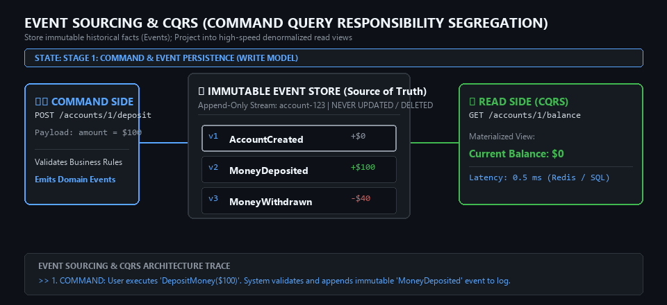

# 18 - Event Sourcing & CQRS (Command Query Responsibility Segregation)

> **Executive Summary:** Traditional CRUD systems mutate state in place (`UPDATE users SET email = '...'`), destroying historical intent, temporal context, and audit trails. **Event Sourcing** persists every state mutation as an immutable, append-only domain event (`EmailUpdated`, `MoneyDeposited`). **CQRS** (Command Query Responsibility Segregation) structurally splits the architecture into two independent models: a write-optimized **Command Side** enforcing business invariants, and a read-optimized **Query Side** maintaining denormalized materialized projections. Together, they provide complete auditability, time-travel debugging, and unconstrained read scalability.

---

> 🏢 **Real-world case studies**: how **Google** & **Netflix** approach this, in [REAL_WORLD_EXAMPLES.md](./REAL_WORLD_EXAMPLES.md).

## ⏱️ Prerequisites: What You Need to Know First

To get the most out of this module, make sure you understand:
- [06 - Relational & Non-Relational Databases](../06-relational-and-non-relational-databases/README.md): CRUD operations, write-ahead logs (WAL), and read-heavy vs write-heavy workloads.
- [14 - Consistency Models](../14-consistency-models/README.md): Eventual consistency across asynchronous projections.
- [17 - Message Queues & Distributed Logs](../17-message-queues/README.md): Append-only logs, consumer groups, and event streaming.
- **Domain-Driven Design (DDD)**: Aggregates, Domain Events, and Commands.

---

## 🧒 The 30-Second Version (ELI5)

Imagine your bank account:
- **Traditional CRUD**: The bank keeps a single sticky note with your balance written in pencil: `"$140"`. When you deposit \$50, the teller erases \$140 and writes `"$190"`. If someone asks: *"Why is the balance \$190? Did you deposit money or did an employer pay you?"*, the sticky note has zero answers.
- **Event Sourcing**: The bank gives you a printed transaction passbook. Every deposit, withdrawal, and fee is permanently stamped in ink line-by-line. Your balance isn't a static number; it is simply the sum of every line in your passbook!
- **CQRS**: The bank keeps the master ink passbook in a locked vault (Write Model), while displaying your current balance on a high-speed digital ATM screen (Read Model).

---

## 🍕 Everyday Analogy

| Concept | Accounting Passbook Analogy | Technical Reality in Event Sourcing & CQRS |
| :--- | :--- | :--- |
| **Command** | Handing a check to the teller: *"Deposit \$100"* | `DepositMoneyCommand(accountId, 100)` |
| **Domain Event** | The line stamped in indelible ink in your passbook | Immutable event: `MoneyDeposited(id, amount, timestamp)` |
| **Event Store** | The official bound leather accounting ledger | Append-only database (EventStoreDB, Kafka, PostgreSQL) |
| **Aggregate Root** | The teller enforcing rules: *"You cannot withdraw more than you have"* | Domain entity verifying business logic against current state |
| **Materialized View**| The ATM screen showing your latest balance in 1 second | Denormalized projection in Redis, Elastic, or PostgreSQL |
| **CQRS** | Segregating the teller vault (deposits) from the ATM (queries) | Splitting Write models (normalized) from Read models (flat) |
| **Snapshot** | The bank issuing a "Monthly Statement Balance" every 30 days | Pre-computed state checkpoint preventing replay of 100k events |
| **Replay** | Reading the passbook from day one to recount every dollar | Re-projecting historical events to rebuild a corrupted database |

---

## 🧩 The Problem It Solves

### The Flaws of Destructive CRUD Updates
In standard CRUD architectures (`UPDATE accounts SET balance = 50 WHERE id = 1`):
1. **Loss of Intent & History**: Who changed the balance? Was it a refund, a fraudulent withdrawal, or a correction? The previous value is permanently destroyed.
2. **Read/Write Impedance Mismatch**: The relational schema required to safely process high-concurrency writes (highly normalized with foreign keys and locks) is the exact opposite of what high-speed read queries need (denormalized, flat, aggregated tables).
3. **Locking Bottlenecks**: Complex dashboard queries execute heavy SQL JOINs across 10 tables, locking rows and starving transactional write operations.

### How Event Sourcing & CQRS Solves This
1. **100% Complete Audit Trail**: Because events are append-only and never deleted, you have an unalterable forensic record of every single business transaction that ever occurred.
2. **Infinite Read Scalability**: The Command side only does fast $O(1)$ appends to the event store. The Query side maintains multiple specialized read models—e.g., Elasticsearch for full-text search, Redis for real-time balances, and Neo4j for social graphs—all populated asynchronously from the same event stream.
3. **Time-Travel Debugging**: You can run an aggregate's state backwards or replay events up to any specific millisecond in the past to reproduce production bugs with exact precision.

---

## 🖼️ Picture It: Architecture & Flow

### High-Resolution Event Sourcing & CQRS Animation
Below is an animated trace of a command generating an immutable domain event, persisting to the Event Store, and asynchronously projecting into a high-speed Read Model:



---

### End-to-End CQRS Flowchart

```mermaid
flowchart LR
    subgraph CommandSide["1. Command Side (Write Model)"]
        ClientWrite["👤 Client"] -->|1. Submit Command| CmdHandler["Command Handler<br/>(Validates Invariants)"]
        CmdHandler -->|2. Append Event| Store[("📜 Event Store<br/>(Append-Only Log)")]
    end

    subgraph EventBus["2. Event Distribution"]
        Store -->|3. Publish Stream| Bus["⚡ Event Bus / Kafka"]
    end

    subgraph QuerySide["3. Query Side (Read Model)"]
        Bus -->|4. Consume| Projector["Background Projector"]
        Projector -->|5. Update View| ReadDB[("📖 Read DB (Redis/SQL)<br/>Denormalized Projections")]
        ClientRead["👤 Client"] -->|"6. Query Balance (0.5ms)"| ReadDB
    end

    style CommandSide fill:#161b22,stroke:#58a6ff,stroke-width:2px;
    style EventBus fill:#161b22,stroke:#d29922,stroke-width:2px;
    style QuerySide fill:#161b22,stroke:#3fb950,stroke-width:2px;
```



---

## 🔢 Walk-Through with Real Numbers

Let's look at the performance math of Event Sourcing write throughput vs. Snapshotting intervals:

### 1. Write Throughput: Sequential Append vs Relational UPDATE
- **Traditional Relational Update**:
  `UPDATE orders SET status = 'SHIPPED', updated_at = NOW() WHERE id = 99824;`
  - Requires B-tree index lookup, acquiring row-level locks, updating table blocks, updating secondary index pages, and writing to WAL.
  - **Cost**: $\approx 5\text{–}15\text{ ms}$ per write.
- **Event Sourcing Append**:
  `INSERT INTO event_store (stream_id, version, type, payload) VALUES ('order-99824', 4, 'OrderShipped', '...');`
  - Pure sequential append to disk. No locks on read tables.
  - **Cost**: $\approx 0.5\text{–}1.0\text{ ms}$ per write (**10x faster!**).

### 2. Snapshotting Frequency Math
Suppose a popular e-commerce inventory item undergoes $1,000,000$ stock adjustments per year:
- **Without Snapshots**: To load the item aggregate into memory, the server must fetch and fold all $1,000,000$ events from the event store. At $1\ \mu\text{s}$ per event, replay takes **$1.0\text{ second}$**, causing massive API latency.
- **With Snapshots every 1,000 events**:
  - The aggregate loads the latest pre-computed snapshot (e.g., at version $999,000$).
  - It only needs to replay the remaining $1,000$ events since the snapshot.
  - Replay time drops from $1,000\text{ ms}$ to **$1.0\text{ ms}$ (99.9% faster recovery!)**.

---

## ⚙️ How It Works Under the Hood

### 1. The Anatomy of an Event Store

An Event Store is typically built using specialized engines (like **EventStoreDB**) or modeled inside PostgreSQL/DynamoDB with strict table constraints:

``*(The event store schema is defined in [schema.sql](./schema.sql); run [demo.py](./demo.py) for the executable simulation with Optimistic Concurrency Control.)*``

#### Optimistic Concurrency Control (OCC)
When two users concurrently attempt to modify the same account:
1. Both read the current stream version ($V = 4$).
2. User A appends `MoneyWithdrawn` with `version = 5`. The write succeeds.
3. User B attempts to append `MoneyWithdrawn` with `version = 5`.
4. The database primary key constraint `(stream_id, version)` rejects User B's insert with a unique constraint violation!
5. User B's command handler catches the error, reloads the aggregate with fresh events, and re-evaluates whether sufficient balance remains.

---

### 2. Materialized Views & Multiple Projections

The real power of CQRS is that a single event stream can populate dozens of completely different, purpose-built read projections:

```
                                  ┌──> [Redis] ─────────────> Balance View (Key-Value)
                                  │
[Event Store] ──> [Projectors] ───┼──> [Elasticsearch] ─────> Full-text Audit Search
                                  │
                                  └──> [PostgreSQL / Redshift] -> Monthly Analytics & Tax Reports
```
- If the business wants to add a new recommendation feature, they don't migrate historical database tables.
- They simply write a new projector and replay the entire historical event stream from day 1! The new view is fully populated in hours.

---

## ⚖️ Trade-Offs & Decision Matrix

| Dimension | Traditional CRUD Architecture | Event Sourcing + CQRS |
| :--- | :--- | :--- |
| **Auditability & History** | None (overwritten in place) | **100% Complete & Immutable** |
| **Write Performance** | Slower (locking, normalized updates) | **Fastest ($O(1)$ sequential appends)** |
| **Read Complexity** | Complex SQL JOINs across tables | **Trivial $O(1)$ flat denormalized queries** |
| **Consistency** | Strong / Immediate consistency | **Eventual Consistency** (read projections lag by 10–50ms) |
| **System Complexity** | Low (familiar to all engineers) | High (requires DDD, event stores, idempotency, projections) |
| **Schema Evolution** | `ALTER TABLE` migrations | Event upcasting and versioned schemas |

---

## 🚫 Common Mistakes & Production Pitfalls

1. **Using Event Sourcing for Simple CRUD Applications**:
   - *Pitfall*: Building a simple blog or admin settings page using Event Sourcing and CQRS.
   - *Result*: Extreme over-engineering. Writing commands, aggregates, events, projectors, and read views for a system with 10 writes a day adds massive architectural drag with zero benefit. Use CRUD where historical intent doesn't matter.

2. **Treating Events as Ephemeral Messages Instead of State**:
   - *Pitfall*: Deleting events from the event store after 7 days like a standard message queue.
   - *Result*: Total disaster. In Event Sourcing, the Event Store **is the primary database of record**. If you delete past events, you destroy your source of truth!

3. **Breaking Event Schema Backward Compatibility**:
   - *Pitfall*: Renaming a field in a payload from `user_name` to `username` without migration logic.
   - *Result*: When historical events from 2 years ago are replayed, deserialization crashes on missing fields!
   - *Fix*: Use **Event Upcasting** (transforming old event JSON into current version schema in memory during deserialization) or enforce strict Protobuf/Avro backward-compatibility rules.

---

## 💻 Try It Yourself: Python Simulation

The companion simulation script [`demo.py`](./demo.py) implements:
1. A complete Bank Account Aggregate with command validation (`OpenAccount`, `Deposit`, `Withdraw`).
2. An append-only Event Store enforcing optimistic concurrency control.
3. A denormalized Read Model Projector maintaining instant balance summaries.
4. Live disaster recovery: Deleting the read database and rebuilding it from historical events with 100% accuracy.

Run it locally in your terminal:
```bash
python demo.py
```

---

## 🌍 Where You'll See It in Production

- **Financial & Banking Ledgers**: Wall Street trading platforms, Stripe, and modern fintechs (e.g. Nubank) use event sourcing exclusively for double-entry bookkeeping ledgers. Balances are derived; transactions are indelible.
- **Git Version Control**: Every Git repository is a pure event-sourced system. The commit history is an immutable append-only DAG of diffs; your working directory checkout is simply the materialized projection!
- **Uber**: Tracks ride lifecycles (`DriverDispatched`, `RiderPickedUp`, `RouteDiverged`, `RideCompleted`) as an event stream, driving real-time fare calculation, driver payouts, and dispute arbitration.
- **E-Commerce Order Fulfillment**: Amazon and Shopify model shopping carts and order fulfillment states through discrete domain events, decoupling warehouse shipping from customer email updates.

---

## 🎯 Top Interview Questions & Deep Answers

### Q1: "What is the core difference between Event Sourcing and Event-Driven Architecture (EDA)?"
**Interviewer Goal**: Disqualifying candidates who confuse architectural patterns.

**Model Answer**:
"While both patterns utilize events, they solve completely different architectural concerns:
1. **Event-Driven Architecture (EDA)** is an **inter-service communication pattern**. Services publish events (e.g., via Kafka or SNS) to notify other services that something occurred. The publishing service may still use traditional relational CRUD tables internally to store its own state.
2. **Event Sourcing** is an **internal data persistence pattern**. Instead of storing current state in a database row, the service persists every mutation as an append-only sequence of domain events. The event log **is the definitive source of truth**.
In summary: EDA is about how separate systems communicate; Event Sourcing is about how a single system persists its own state. They are often combined, but one does not imply the other."

---

### Q2: "How does CQRS handle eventual consistency when a user performs a write and immediately reads the result?"
**Interviewer Goal**: Testing practical user-experience engineering under eventual consistency.

**Model Answer**:
"In CQRS, writing to the Command side and projecting to the Read side is asynchronous, typically introducing 10–50 ms of replication lag. If a user deposits \$100 and the browser immediately redirects to the dashboard, the read database might not have applied the projection yet, showing the old balance.

To solve this in production:
1. **Command Returns Version Token**: The command handler returns the newly committed version or event ID (e.g., `version = 5`).
2. **Read-With-Version Polling**: The frontend requests the read model passing `expected_version=5`. If the projection is still at version 4, the read API either holds the connection briefly (long polling for up to 100 ms) or queries the primary aggregate.
3. **Optimistic Client UI**: The web/mobile frontend updates the local UI state optimistically upon receiving the command 200 OK, completely hiding the projection delay from the user."

---

### Q3: "What is an Aggregate Root in Event Sourcing, and why is it the only entity that can validate business invariants?"
**Interviewer Goal**: Assessing Domain-Driven Design (DDD) rigor and transactional boundary modeling.

**Model Answer**:
"An **Aggregate Root** is a cluster of associated domain objects treated as a single unit for data changes. It defines the consistency boundary for transactions:
- It maintains current state in memory by folding historical events.
- When a command arrives, the Aggregate Root inspects its internal state to determine if business invariants are satisfied (e.g., *'Does account balance exceed the withdrawal amount?'*).
- If valid, it emits a new Domain Event and appends it to the Event Store using optimistic locking on its version number.
- Other entities or services are strictly forbidden from modifying the aggregate directly. This guarantees that invalid states can never be written to the event log."

---

### Q4: "How do you handle schema evolution and changing requirements in an immutable Event Store over 5 years?"
**Interviewer Goal**: Evaluating long-term operational viability and backward-compatibility maintenance.

**Model Answer**:
"Because events in the Event Store are immutable, historical records written 5 years ago cannot be modified with an `ALTER TABLE` migration.
We handle schema evolution using three production patterns:
1. **Weak Schema / Additive Changes**: New fields are always made optional with safe defaults. Old fields are never deleted.
2. **Upcasting (In-Memory Transformation)**: When reading an old event from the database (e.g., `UserRegistered_v1`), an upcaster intercepts the raw JSON and transforms it into `UserRegistered_v2` in memory before handing it to the application. The on-disk storage remains untouched, but the application code only deals with the latest schema.
3. **Event Migration Streams**: For major structural overhauls, a migration script reads Stream A and writes a brand new Stream B, pointing future consumers to the new stream."

---

### Q5: "What are Snapshots in Event Sourcing, and how do they prevent performance degradation as logs grow?"
**Interviewer Goal**: Checking performance optimization and memory bounding skills.

**Model Answer**:
"In Event Sourcing, loading an entity requires replaying all historical events from version 1 to version $N$. For long-lived aggregates (like an active bank account with 50,000 transactions), replaying 50,000 events on every single command takes hundreds of milliseconds, crippling write throughput.

**Snapshots solve this**:
- Every $K$ events (e.g., every 500 events), a background worker takes a serialized snapshot of the aggregate's internal state and stores it alongside `snapshot_version = 500`.
- When the aggregate needs to load, it directly loads the snapshot at version 500 in $O(1)$ time, and then only replays the subsequent events (e.g. from version 501 to 523).
- This caps aggregate load time to at most $K$ events, keeping command latency constant and bounded regardless of the aggregate's age."

---

## ✅ Check Yourself: Flash Quiz

<details>
<summary><b>1. True or False: In Event Sourcing, can you issue an <code>UPDATE</code> or <code>DELETE</code> SQL statement to alter a past event in the Event Store?</b></summary>
<br>
<b>False.</b> Event Stores are strictly <b>append-only and immutable</b>. If a mistake was made (e.g. accidentally depositing $1,000 instead of $100), you never alter the original <code>MoneyDeposited</code> event. Instead, you append a new <b>Compensating Event</b> (e.g. <code>DepositReversed</code> or <code>CorrectionApplied</code>), exactly as accountants do in a ledger.
</details>

<details>
<summary><b>2. In CQRS, what is the primary role of a "Projector"?</b></summary>
<br>
A Projector is a consumer that listens to the stream of Domain Events emitted by the Write side, transforms them, and updates <b>denormalized Materialized Views (Read Models)</b> so queries can be served instantly without complex SQL joins.
</details>

<details>
<summary><b>3. How does Optimistic Concurrency Control (OCC) prevent two concurrent users from overwriting each other in an Event Store?</b></summary>
<br>
By checking the <code>expected_version</code>. The database enforces a unique composite primary key on <code>(stream_id, version)</code>. If both users read version 5 and try to append an event at version 6, the first writer succeeds, and the second writer's query fails with a unique constraint violation, prompting a retry.
</details>

---

## 📚 Go Deeper: Recommended Reading

- **Designing Data-Intensive Applications** by Martin Kleppmann — *Chapter 12: The Future of Data Systems (Event Sourcing & Stream Processing)*.
- **Domain-Driven Design: Tackling Complexity in the Heart of Software** by Eric Evans.
- **Greg Young's CQRS Documents**: *CQRS and Event Sourcing Principles (`https://cqrs.files.wordpress.com/2010/11/cqrs_documents.pdf`)*.
- **Martin Fowler's Architectural Guides**: *Event Sourcing & CQRS (`martinfowler.com`)*.

---

## 🔗 Related Modules

- [06 - Relational & Non-Relational Databases](../06-relational-and-non-relational-databases/README.md): Transaction logs and storage engines.
- [14 - Consistency Models](../14-consistency-models/README.md): Eventual consistency across CQRS projections.
- [17 - Message Queues & Distributed Logs](../17-message-queues/README.md): The underlying streaming infrastructure for event stores.
- [19 - Distributed Transactions](../19-distributed-transactions/README.md): Sagas and transactional outbox patterns.
