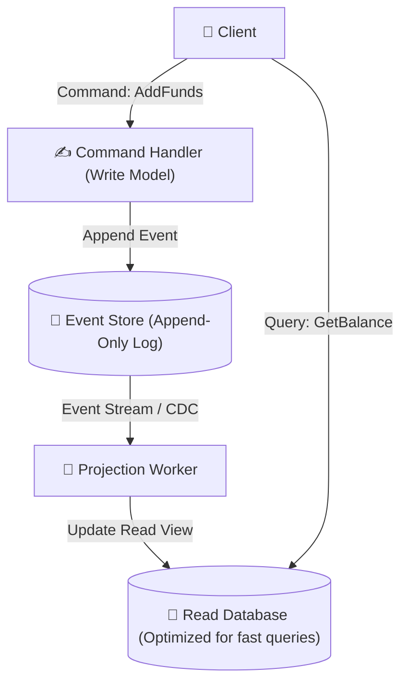

# 18 - Event Sourcing & CQRS

> **Real-World Analogy:**  
> Look at your personal bank account. Your bank does not simply store one single number for your balance. Instead, it records an immutable ledger of every single deposit, withdrawal, and transfer you made since opening the account (Event Sourcing). To show your current balance, the bank sums all those transactions up into a cached view (CQRS read model).

---

## 🎯 What & Why
Explains Event Sourcing (recording all changes as an append-only sequence of immutable events) and CQRS (Command Query Responsibility Segregation) separating write models from read-optimized views.

---

## 📊 Visual Architecture Diagram


---

## ⚙️ How It Works Under The Hood
### Understanding CQRS

Traditional architectures use the exact same data model for both reads and writes:
- **Problem**: Queries often require complex JOINs, aggregations, and denormalization, while writes require strict relational constraints and locks.

**Command Query Responsibility Segregation (CQRS)**:
- **Command Side**: Handles business logic, validates constraints, and executes state mutations. Optimized for transaction integrity.
- **Query Side**: Read-only denormalized projections optimized for specific UI screens and search queries (e.g., Elasticsearch or DynamoDB read tables).

---

### Core Concepts of Event Sourcing

1. **Immutable Event Stream**: Instead of `UPDATE accounts SET balance = 500 WHERE id = 1`, store events:
   - `AccountOpened(initial_balance = 0)`
   - `MoneyDeposited(amount = 700)`
   - `MoneyWithdrawn(amount = 200)`
2. **Auditability & Time Travel**: You can reconstruct the exact state of any entity at any point in the past by replaying events up to that timestamp.
3. **Snapshots**: To avoid replaying 100,000 events on startup, periodically take a state snapshot (e.g., every 1,000 events) and replay only subsequent events from that snapshot forward.

---

## 💻 Concrete Code Implementation
```python
# Python implementation: Minimal Event Sourcing & CQRS engine
class AccountAggregate:
    def __init__(self, account_id: str):
        self.account_id = account_id
        self.balance = 0
        self.changes = []

    def apply(self, event: dict):
        if event["type"] == "AccountCreated":
            self.balance = event["initial_balance"]
        elif event["type"] == "FundsDeposited":
            self.balance += event["amount"]
        elif event["type"] == "FundsWithdrawn":
            self.balance -= event["amount"]

    def deposit(self, amount: float):
        event = {"type": "FundsDeposited", "amount": amount}
        self.apply(event)
        self.changes.append(event)

    def withdraw(self, amount: float):
        if self.balance < amount:
            raise ValueError("Insufficient balance!")
        event = {"type": "FundsWithdrawn", "amount": amount}
        self.apply(event)
        self.changes.append(event)

if __name__ == "__main__":
    acc = AccountAggregate("acc_100")
    acc.apply({"type": "AccountCreated", "initial_balance": 100})
    acc.deposit(50)
    acc.withdraw(30)

    print(f"Current Reconstructed Balance: ${acc.balance}")
    print("Recorded Events Log:", acc.changes)

```

---

## ⚖️ Trade-Offs & Architectural Considerations
- **Resilience**: Design for failure at every tier; assume machines and networks will fail.
- **Backpressure**: Shed load gracefully before resources are completely exhausted.
- **Idempotency**: Guarantee safe retries for all network operations.
