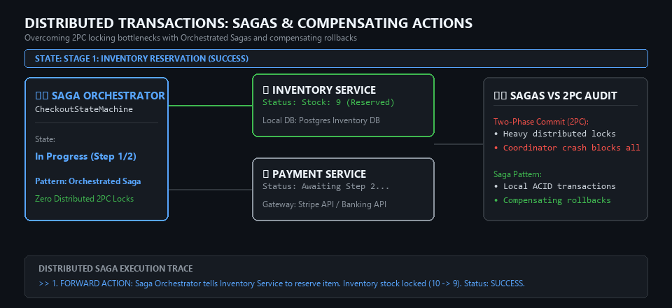

# 19 - Distributed Transactions: 2PC, Sagas & Outbox

> **Executive Summary:** In monolithic architectures, database transactions rely on local ACID guarantees—a single `BEGIN ... COMMIT` block guarantees all-or-nothing atomicity. In microservice architectures where each service owns its private database (**Database-per-Service**), local ACID transactions cannot span network boundaries. While **Two-Phase Commit (2PC)** enforces atomic commits across databases, its heavy synchronous locking causes severe latency and single-point-of-failure coordinator deadlocks. Modern distributed systems favor the **Saga Pattern** (a sequence of local transactions with semantic **Compensating Transactions**) combined with the **Transactional Outbox Pattern** to guarantee eventual consistency without distributed locks.

---

> 🏢 **Real-World Deep Dives**: Detailed case studies of how **Google** & **Netflix** implement this in production are documented in [REAL_WORLD_EXAMPLES.md](./REAL_WORLD_EXAMPLES.md).

## ⏱️ Prerequisites: What You Need to Know First

To get the most out of this module, make sure you understand:
- [06 - Relational & Non-Relational Databases](../06-relational-and-non-relational-databases/README.md): ACID transactions, isolation levels, and row-level locks.
- [14 - Consistency Models](../14-consistency-models/README.md): Eventual consistency across decoupled services.
- [17 - Message Queues & Distributed Logs](../17-message-queues/README.md): Asynchronous message delivery, at-least-once delivery, and consumer idempotency.
- [18 - Event Sourcing & CQRS](../18-event-sourcing-and-cqrs/README.md): Domain events and state reconstruction.

---

## 🧒 The 30-Second Version (ELI5)

Imagine booking a vacation: you need a **Flight**, a **Hotel**, and a **Rental Car**.
- **Two-Phase Commit (2PC)**: You call the airline, the hotel, and the car company simultaneously. You force all three managers to freeze their computer screens, hold the inventory, and stay on the phone without hanging up. If your cell connection drops, all three businesses stay frozen forever!
- **The Saga Pattern**: You book the flight first (it succeeds). Then you book the hotel (it succeeds). Then you try to book the rental car, but they are sold out!
  - You don't freeze the world. Instead, you call the hotel and cancel your room (**Compensating Transaction**), and call the airline to refund your ticket (**Compensating Transaction**).
  - You return to where you started without holding anyone hostage.

---

## 🍕 Everyday Analogy

| Concept | Vacation Booking Analogy | Technical Reality in Microservices |
| :--- | :--- | :--- |
| **Local Transaction** | Paying for your flight on the airline website | Single database ACID transaction (`OrderService` Postgres DB) |
| **Two-Phase Commit** | Forcing 3 hotel managers to hold phone receivers open | Synchronous XA distributed lock blocking rows on multiple DBs |
| **Coordinator Crash** | Travel agent passes out; hotels remain locked indefinitely | 2PC coordinator fails; participant database locks never release |
| **Saga** | Booking items one-by-one: Flight $\rightarrow$ Hotel $\rightarrow$ Car | Chain of local transactions linked by messages/events |
| **Compensating Action** | Calling the hotel to cancel your room with full refund | Reversing previous step (e.g. `RefundPayment`, `ReleaseStock`) |
| **Saga Orchestrator** | A dedicated travel concierge following a checklist | Central state machine service (e.g. AWS Step Functions) |
| **Saga Choreography** | Hotel finishes booking and automatically faxes the car company | Services listen to event bus and trigger next step reactively |
| **Transactional Outbox**| Tucking the receipt and the mail parcel into the same mailbox | Writing business data + event table in ONE local SQL transaction |

---

## 🧩 The Problem It Solves

### The Dual-Write Problem
In a microservice checkout handler:
1. **Step 1 (Local DB Write)**: Save the order record to the local SQL database.
2. **Step 2 (Network Event Publish)**: Publish an `OrderCreated` event to Apache Kafka.

*(See [`demo.py`](./demo.py) for an executable simulation of this dual-write failure mode and its outbox solution.)*
**This is fundamentally broken.**
- If Step 1 succeeds, but the network drops or the server crashes before Step 2, the order exists in the database, but downstream billing, shipping, and notification services never receive the event.
- If you flip the order (send event first, then save to DB), Kafka emits the event, but the database transaction rolls back due to a constraint violation $\rightarrow$ downstream services charge the customer for a non-existent order!
- You cannot wrap an HTTP/Kafka network call inside a database SQL transaction!

### The Flaws of Two-Phase Commit (2PC)
For decades, distributed transactions relied on 2PC (XA transactions):
1. **Prepare Phase**: Coordinator asks all participants: *"Can you commit?"* Participants acquire locks and vote `YES`.
2. **Commit Phase**: If all vote `YES`, Coordinator writes commit log and tells all to commit.
- **Why 2PC fails in the cloud**:
  - **Blocking Protocol**: If the coordinator crashes during Phase 2, participants hold database locks indefinitely, blocking all other transactions.
  - **Latency Multiplier**: 2PC requires at least 4 network hops ($2\times \text{Prepare} + 2\times \text{Commit}$). Cross-region WAN latency easily exceeds $300\text{–}500\text{ ms}$, dropping throughput to single digits.

---

## 🖼️ Picture It: Architecture & Flow

### High-Resolution Distributed Saga Animation
Below is an animated trace of an Orchestrated Saga handling forward steps, a payment failure, and triggering compensating rollbacks:



---

### Orchestrated Saga Sequence Diagram (Failure & Rollback)

```mermaid
sequenceDiagram
    autonumber
    actor User as 👤 Customer
    participant Orch as ⚙️ Saga Orchestrator
    participant Inv as 📦 Inventory Service
    participant Pay as 💳 Payment Service
    participant Order as 📝 Order Service

    User->>Orch: Checkout Order #102 ($450)
    Orch->>Order: Create Order (Status: PENDING)
    Order-->>Orch: Order Created
    
    Orch->>Inv: Reserve 2 Items
    Inv-->>Orch: Stock Reserved (10 -> 8)
    
    Orch->>Pay: Process Payment ($450)
    Pay-->>Orch: 💥 Payment Declined (Card Invalid)

    rect rgb(35, 15, 15)
    Note over Orch, Inv: Triggering Compensating Transactions
    Orch->>Inv: Compensate: ReleaseStock(2 Items)
    Inv-->>Orch: Stock Restored (8 -> 10)
    Orch->>Order: Update Status: CANCELLED
    Order-->>Orch: Order Cancelled
    end

    Orch-->>User: 400 Bad Request: Payment Declined
```



---

## 🔢 Walk-Through with Real Numbers

Let's calculate the latency and lock contention between 2PC and Sagas under high concurrent traffic:

### Latency Math: 3-Service Checkout (Order, Inventory, Payment)
- Inter-service network round-trip time: $20\text{ ms}$.
- Local database write latency: $2\text{ ms}$.

```
┌────────────────────────────────────────────────────────────────────────┐
│ Model 1: Two-Phase Commit (2PC / XA)                                   │
├────────────────────────────────────────────────────────────────────────┤
│ 1. Phase 1 Prepare: Send prepare to 3 DBs (20ms)                       │
│ 2. Participants acquire row locks & flush prepare log (2ms)            │
│ 3. Phase 1 Responses collected (20ms)                                  │
│ 4. Coordinator writes commit decision to disk (2ms)                    │
│ 5. Phase 2 Commit: Send commit to 3 DBs (20ms)                         │
│ 6. Participants release row locks & ACK (20ms)                         │
│ Total Latency: ~84 ms per transaction!                                 │
│ Lock Hold Time: ~64 ms per transaction.                                │
│ Max Throughput on hot inventory row: 1 / 0.064s = ~15 tx/second!      │
└────────────────────────────────────────────────────────────────────────┘

┌────────────────────────────────────────────────────────────────────────┐
│ Model 2: Asynchronous Saga with Local Transactions                    │
├────────────────────────────────────────────────────────────────────────┤
│ 1. Order Service commits locally (2ms) -> Emits event                  │
│ 2. Inventory Service commits locally (2ms) -> Emits event              │
│ 3. Payment Service commits locally (2ms)                               │
│ Total Lock Hold Time per database: Exactly 2 ms!                       │
│ Max Throughput on hot inventory row: 1 / 0.002s = ~500 tx/second!      │
│ (33x higher throughput with ZERO cross-service locks!)                 │
└────────────────────────────────────────────────────────────────────────┘
```

---

## ⚙️ How It Works Under the Hood

### 1. The Saga Pattern (Garcia-Molina & Salem, 1987)

A Saga is a sequence of local transactions:
$$T_1, T_2, \dots, T_n$$
Each local transaction $T_i$ updates state within a single service's database and publishes an event.
For every forward transaction $T_i$, there exists a corresponding **Compensating Transaction** $C_i$ that semantically undoes its effects:
- If transaction $T_3$ fails, the system executes:
  $$C_2, C_1$$
- The system achieves **Eventual Consistency** without holding global locks.

#### Saga Orchestration vs. Choreography

| Dimension | Saga Choreography (Event-Driven) | Saga Orchestration (Command-Driven) |
| :--- | :--- | :--- |
| **Architecture** | Services reactively listen to events and publish new events | A central Orchestrator coordinates steps sequentially |
| **Coupling** | Loosely coupled (no central orchestrator) | Central state machine holds workflow logic |
| **Complexity** | Becomes tangled ("spaghetti events") at $>4$ services | Clear, centralized visualization of states and timeouts |
| **Best For** | Simple 2–3 step workflows | Complex enterprise multi-step business transactions |

---

### 2. The Transactional Outbox Pattern

To completely eliminate the Dual-Write problem, services use the **Transactional Outbox Pattern**:

```
[Application Service]
       │
       ▼ (Single Local ACID Transaction: BEGIN ... COMMIT)
┌─────────────────────────────────────────────────────────────┐
│ PostgreSQL Database                                         │
│  ├── `orders` Table: INSERT INTO orders (id, total)...      │
│  └── `outbox` Table: INSERT INTO outbox (event_id, payload) │
└─────────────────────────────────────────────────────────────┘
       │
       ▼ (Tails WAL via Debezium or Polling Worker)
[Outbox Relay Worker] ──> Publish Event ──> [Apache Kafka / RabbitMQ]
```
1. The business record (`orders`) and the event record (`outbox`) are written in the **exact same local ACID database transaction**.
2. Either both commit, or both abort. It is physically impossible for the order to exist without the corresponding outbox record!
3. A background process (or **Change Data Capture (CDC)** tool like Debezium) tails the database Write-Ahead Log (WAL) and reliably delivers the outbox events to Kafka with at-least-once guarantees.

---

## ⚖️ Trade-Offs & Decision Matrix

| Strategy | Atomicity Guarantee | Latency | Complexity | Fault Tolerance |
| :--- | :--- | :--- | :--- | :--- |
| **Local DB ACID** | Strict (all-or-nothing) | Ultra-Low (<2 ms) | Lowest | Single database failure only |
| **Two-Phase Commit (2PC)**| Strict Atomic Commit | High (80–300 ms) | Medium | Fragile (coordinator crash locks all) |
| **Saga Orchestration** | **Eventual Consistency** | Low (async chain) | Medium | Resilient (automatic compensation) |
| **Saga Choreography** | **Eventual Consistency** | Low (async chain) | High (hard to debug) | Resilient |
| **Transactional Outbox**| Guaranteed Event Delivery | Low | Low–Medium | Guaranteed zero event loss |

---

## 🚫 Common Mistakes & Production Pitfalls

1. **Non-Idempotent Compensating Actions**:
   - *Pitfall*: When a network glitch causes the orchestrator to retry a compensating `Refund($50)` call.
   - *Result*: The customer is refunded \$50 twice! All forward and compensating actions in a Saga **must be strictly idempotent** (using unique transaction IDs).

2. **Semantic Anomalies (Lack of Isolation)**:
   - *Pitfall*: In a Saga, Step 1 reserves inventory, but Step 3 fails 2 seconds later. During those 2 seconds, other users read the database and see that the item is out of stock (**Dirty Read / Lack of Isolation**).
   - *Fix*: Use semantic locking or reservation states: mark item as `Status: RESERVED_PENDING_PAYMENT` with an automatic 5-minute expiration timer.

3. **Writing to Kafka Inside a DB Transaction Block**:
   - *Pitfall*:
     Placing network I/O calls (`kafka.send()`) inside a database transaction block (`with db.transaction():`). If the message broker takes 2 seconds to respond, database connection locks remain held open, exhausting connection pools. Always use the Transactional Outbox pattern instead.
   - *Result*: If Kafka takes 2 seconds to respond, the database connection and row locks are held open for 2 seconds, destroying database connection pool capacity. Never place network I/O inside SQL transactions; use Transactional Outbox instead.

---

## 💻 Try It Yourself: Python Simulation

The companion simulation script [`demo.py`](./demo.py) implements:
1. An Orchestrated Saga handling an e-commerce checkout flow across 3 isolated microservice databases.
2. A live payment decline triggering a **Compensating Transaction** that restores inventory stock.
3. The **Transactional Outbox Pattern** guaranteeing zero Dual-Write inconsistency.

Run it locally in your terminal:
```bash
python demo.py
```

---

## 🌍 Where You'll See It in Production

- **Uber (Trip Lifecycle Saga)**: Booking a ride coordinates Rider Dispatch, Driver Match, Dynamic Pricing, and Payment Authorization. If no driver accepts the ride within 3 minutes, a compensating transaction unfreezes the rider's credit card authorization.
- **Stripe Billing**: Manages recurring subscription charges, invoice generation, tax calculation, and bank ACH transfers using state machine Sagas.
- **Airbnb**: Booking an apartment reserves dates on the host's calendar, authorizes guest payment, and handles security deposits. If host declines, compensating refunds execute automatically.
- **AWS Step Functions**: Amazon's serverless orchestration service explicitly designed to run visual Saga state machines with built-in retry backoff and error catch/compensation blocks.

---

## 🎯 Top Interview Questions & Deep Answers

### Q1: "Why does Two-Phase Commit (2PC) fail to scale in modern microservice architectures?"
**Interviewer Goal**: Testing candidate's knowledge of distributed locking and failure modes.

**Model Answer**:
"Two-Phase Commit fails in modern microservices for three critical reasons:
1. **The Synchronous Blocking Problem**: 2PC is a blocking protocol. When participants vote `YES` in the Prepare phase, they acquire local row and table locks. If the coordinator crashes or network partition occurs before the Commit phase completes, participants hold locks indefinitely. All other transactions touching those rows are blocked, causing cascading thread exhaustion.
2. **Extreme Latency**: 2PC requires multiple synchronous network round-trips across all participating databases. In multi-region deployments, latency exceeds $200\text{–}400\text{ ms}$, dropping throughput to single digits.
3. **Loss of Service Autonomy**: 2PC violates microservice encapsulation by requiring external transaction managers to coordinate internal database locks across organizational boundaries."

---

### Q2: "What is the difference between Saga Orchestration and Saga Choreography, and when should you choose each?"
**Interviewer Goal**: Evaluating architectural maturity in workflow design.

**Model Answer**:
"Both implement the Saga pattern, but differ in where control logic resides:
1. **Saga Choreography (Decentralized / Event-Driven)**:
   - There is no central controller. Service A executes its local transaction and publishes `OrderCreated`. Service B listens to `OrderCreated`, reserves inventory, and publishes `InventoryReserved`.
   - *Pros*: Simple for small flows (2–3 services); loose coupling.
   - *Cons*: High cognitive load at scale; cyclic dependencies; difficult to track workflow status.
2. **Saga Orchestration (Centralized / Command-Driven)**:
   - A dedicated Orchestrator service (state machine) sends explicit commands to services: `ReserveInventory`, awaits the reply, and decides the next step or compensation.
   - *Pros*: Centralized workflow visibility, easy to implement timeouts, clear error handling.
   - *Cons*: Orchestrator can become a god service if business logic leaks into it.
*Rule of Thumb*: Use choreography for simple 2–3 service pipelines. Use orchestration for complex, high-value business flows like checkout, flight booking, or loan approvals."

---

### Q3: "What is the Dual-Write Problem, and how does the Transactional Outbox Pattern solve it?"
**Interviewer Goal**: Testing practical data consistency patterns across database and messaging boundaries.

**Model Answer**:
"The **Dual-Write Problem** occurs when an application must update a database and publish a message to an event bus (e.g. Kafka):
- Because the database and message broker are separate distributed systems, you cannot update both atomically without expensive 2PC.
- If the database write succeeds but the message send fails (or crashes), downstream systems are out of sync. If the message send succeeds but the database transaction rolls back, downstream systems process phantom data.

**The Transactional Outbox Pattern solves this**:
1. An `outbox` table is created in the application's relational database.
2. In a single local ACID transaction, the application inserts the business record (`orders`) and inserts the message event into the `outbox` table.
3. Because both happen in the same local transaction, atomicity is guaranteed: either both are saved, or neither is.
4. An asynchronous relay process (or Change Data Capture tool like Debezium tailing the WAL) reads unread events from `outbox` and reliably publishes them to the message broker."

---

### Q4: "How do you handle the 'Lack of Isolation' (the 'I' in ACID) in Saga transactions?"
**Interviewer Goal**: Probing deep knowledge of distributed transaction anomalies.

**Model Answer**:
"Sagas provide Atomicity, Consistency, and Durability, but fundamentally lack **Isolation** (ACID): because each local transaction commits immediately, intermediate states are visible to other concurrent transactions before the entire Saga finishes.

To mitigate this lack of isolation in production:
1. **Semantic Locking**: Mark records with a pending flag (e.g., `status = PENDING_PAYMENT`). Other transactions inspecting the row know it is in-flight and refuse to modify it.
2. **Commutative Updates**: Design operations so that execution order does not affect the final outcome (e.g., `account_balance += 50` rather than overwriting `balance = 150`).
3. **Pessimistic Reservation Timers**: Deduct inventory with an expiration lease (e.g. 10-minute hold). If the checkout saga does not confirm within 10 minutes, a background sweeper automatically releases the hold."

---

### Q5: "What is the TCC (Try-Confirm-Cancel) pattern, and how does it differ from a standard Saga?"
**Interviewer Goal**: Assessing advanced financial transaction architectures.

**Model Answer**:
"**TCC (Try-Confirm-Cancel)** is a 2-phase reservation-based transaction pattern tailored for high-contention financial systems:
1. **Try Phase**: Checks business prerequisites and **reserves/freezes** resources without finalizing them (e.g., placing a \$100 temporary authorization hold on a credit card, or placing 2 seats in a 'Reserved' bucket).
2. **Confirm Phase**: If all Try calls across services succeed, the coordinator issues Confirm calls to finalize the transaction (e.g., permanently capturing the \$100 hold). This phase is guaranteed not to fail unless network errors occur.
3. **Cancel Phase**: If any Try call fails, the coordinator issues Cancel calls to release the frozen reservations.

**Difference from Saga**:
- In a standard Saga, transactions execute directly and mutate actual state; rollbacks require semantic compensation.
- In TCC, state is only temporarily reserved in the Try phase; actual state mutation only commits in the Confirm phase, avoiding dirty reads and messy compensations."

---

## ✅ Check Yourself: Flash Quiz

<details>
<summary><b>1. Why can't you wrap a Kafka publish call inside a relational SQL transaction block?</b></summary>
<br>
Because Kafka and PostgreSQL are completely separate distributed systems. The SQL transaction manager only controls local database locks and WAL logs; it has no control over external network calls. If the SQL transaction rolls back after the Kafka message was sent, the message is already out in the wild! Use the <b>Transactional Outbox Pattern</b> instead.
</details>

<details>
<summary><b>2. If a Saga executes 3 steps (A -> B -> C), and Step C fails, in what order are compensating transactions executed?</b></summary>
<br>
In <b>reverse chronological order</b>: Compensate Step B first ($C_B$), then Compensate Step A ($C_A$). This unwinds the stack cleanly back to the original starting state.
</details>

<details>
<summary><b>3. Why is it mandatory that all Compensating Transactions in a Saga be idempotent?</b></summary>
<br>
Because in a distributed system, network timeouts will cause the Saga orchestrator to retry compensating calls. If a compensating <code>Refund($50)</code> call is executed twice, the user would be refunded $100 instead of $50 unless the service enforces idempotency via unique transaction IDs.
</details>

---

## 📚 Go Deeper: Recommended Reading

- **Designing Data-Intensive Applications** by Martin Kleppmann — *Chapter 9: Consistency and Consensus (Distributed Transactions and Two-Phase Commit)*.
- **Sagas (1987)** by Hector Garcia-Molina and Kenneth Salem (Princeton University).
- **Microservices Patterns** by Chris Richardson — *Chapter 4: Managing transactions with sagas & Chapter 3: Transactional outbox*.
- **AWS Architecture Blog**: *Building resilient distributed transactions with AWS Step Functions*.

---

## 🔗 Related Modules

- [06 - Relational & Non-Relational Databases](../06-relational-and-non-relational-databases/README.md): Relational ACID transaction semantics.
- [14 - Consistency Models](../14-consistency-models/README.md): Eventual consistency across asynchronous systems.
- [17 - Message Queues & Distributed Logs](../17-message-queues/README.md): Decoupling services with reliable messaging.
- [18 - Event Sourcing & CQRS](../18-event-sourcing-and-cqrs/README.md): Generating immutable event streams from domain aggregates.
