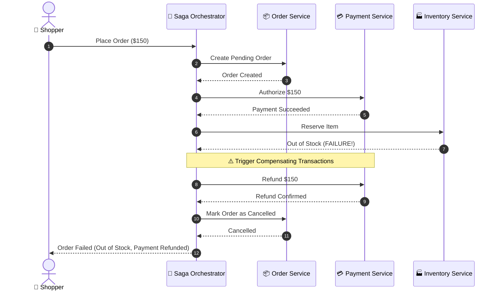

# 19 - Distributed Transactions & The Saga Pattern

> **Real-World Analogy:**  
> Imagine booking a vacation package: you must book a flight, reserve a hotel room, and rent a rental car. If the car rental fails at the last step, nobody can "roll back" the airline's and the hotel's computers for you. Instead, a coordinator runs explicit undo steps: it cancels the hotel reservation and requests a flight refund. This chain of steps with compensating cancellations is the Saga Pattern.

---

## 🎯 What & Why
Explains how to coordinate multi-service transactions across distributed databases, contrasting Two-Phase Commit (2PC) with Saga Orchestration and Choreography.

---

## 📊 Visual Architecture Diagram


---

## ⚙️ How It Works Under The Hood
### Two-Phase Commit (2PC) vs The Saga Pattern

- **Two-Phase Commit (2PC)**:
  - Phase 1 (Prepare): Coordinator asks all participating databases: *"Can you commit this change?"* All participants acquire locks.
  - Phase 2 (Commit): If all vote yes, coordinator says *"Commit"*. If any votes no, coordinator says *"Rollback"*.
  - **Major Flaw**: Blocking protocol. If the coordinator crashes after participants voted "yes", they must keep holding their locks until the coordinator recovers and tells them the outcome. Everything that touches those rows waits.

- **The Saga Pattern**:
  - Breaks a distributed transaction into a series of local database transactions across separate microservices.
  - Each local transaction commits immediately to its own database.
  - If any step fails, the Saga executes **Compensating Transactions** backwards to undo the effects of previous steps.
  - Sagas give up **isolation**: other requests can see the half-finished state (e.g. a "pending" order) before it's completed or undone.

---

### Saga Coordination Styles

1. **Choreography (Event-Driven)**:
   - Each service publishes events, and other services listen and react without a centralized coordinator.
   - Good for simple 2–3 step workflows. Hard to trace and debug when workflows grow to 10+ services.
2. **Orchestration (Central Coordinator)**:
   - A dedicated state machine orchestrator directs each service explicitly via commands and manages compensation logic.
   - Recommended for complex enterprise business flows (e.g., Temporal, AWS Step Functions).

---

## 💻 Concrete Code Implementation
```python
# Python implementation: A Saga Orchestrator with Compensating Actions

class BookingSagaOrchestrator:
    def __init__(self):
        self.compensations = []

    def execute_booking(self, user_id: str, amount: float, item_available: bool):
        try:
            # Step 1: Charge Payment
            print("[Step 1] Charging payment...")
            self.compensations.append(lambda: print("  -> [COMPENSATE] Refunding payment."))

            # Step 2: Reserve Inventory
            print("[Step 2] Reserving inventory...")
            if not item_available:
                raise RuntimeError("Item is out of stock!")
            self.compensations.append(lambda: print("  -> [COMPENSATE] Releasing inventory."))

            print("✅ Booking successfully confirmed!")
            return True
        except Exception as err:
            print(f"❌ Booking failed: {err}")
            self._rollback()
            return False

    def _rollback(self):
        print("Executing compensating transactions in reverse:")
        while self.compensations:
            comp_action = self.compensations.pop()
            comp_action()

if __name__ == "__main__":
    saga = BookingSagaOrchestrator()
    saga.execute_booking(user_id="user_123", amount=120.0, item_available=False)

```

---

## ⚖️ Trade-offs

| Approach | Good | Bad |
| :--- | :--- | :--- |
| **One database, one transaction** | Real ACID; by far the simplest | Only works if the data lives together; worth designing for |
| **Two-phase commit** | All-or-nothing across databases | Blocking, slow (extra round trips while holding locks), every participant must support it |
| **Saga: choreography** | Services stay decoupled; no central component | The overall flow is hidden across many services; hard to debug |
| **Saga: orchestration** | The flow is explicit in one place; easier to monitor | The orchestrator is one more service, and logic tends to concentrate there |

**Saga rules of thumb:** every step and every compensation must be **idempotent** (it may run twice), compensations must be able to **retry until they succeed**, and some actions can't be undone (an email that was sent). Put those last.
