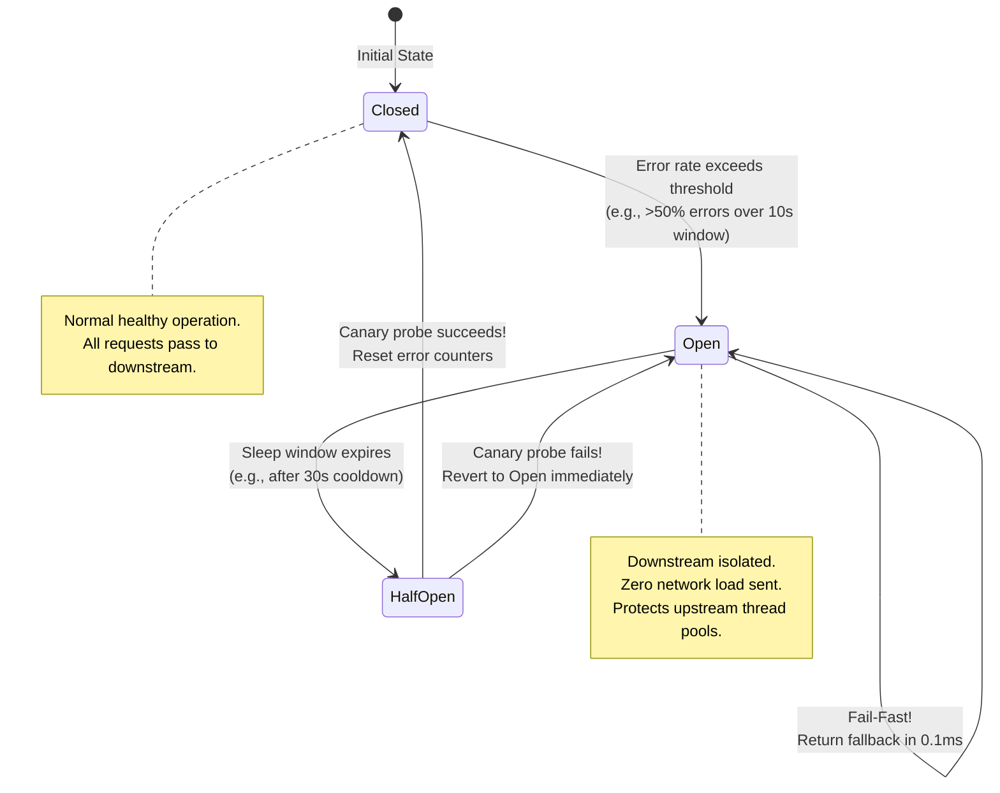

# 20 - Fault Tolerance & Resilience: Circuit Breakers, Bulkheads & Retries

> **Executive Summary:** In distributed architectures with hundreds of interconnected microservices, network partitions, slow dependencies, and service crashes are not edge cases—they are everyday mathematical certainties. Without defensive patterns, a single degraded downstream database or third-party API can trigger catastrophic **cascading failures** that crash an entire company's platform in seconds. Resilience engineering decouples failure domains using **Timeouts**, **Circuit Breakers** (fail-fast), **Exponential Backoff with Full Jitter** (anti-retry-storm), and **Bulkheads** (compartmentalized resource isolation).

---

> 🏢 **Real-world case studies**: how **Google** & **Netflix** approach this, in [REAL_WORLD_EXAMPLES.md](./REAL_WORLD_EXAMPLES.md).

## ⏱️ Prerequisites: What You Need to Know First

To get the most out of this module, make sure you understand:
- [01 - Client-Server Networking](../01-client-server-networking/README.md): TCP connection timeouts, socket read timeouts, and thread pool blocking.
- [03 - Load Balancing](../03-load-balancing/README.md): Active and passive health checks.
- [05 - Rate Limiting](../05-rate-limiting/README.md): Protecting services from traffic surges.
- [17 - Message Queues & Distributed Logs](../17-message-queues/README.md): Asynchronous decoupling and Dead-Letter Queues.

---

## 🧒 The 30-Second Version (ELI5)

Imagine an apartment building:
- **Circuit Breaker**: If you plug a faulty toaster into a wall outlet that sparks, the electrical fuse in your basement automatically trips and cuts power to the toaster in 1 millisecond. It stops the entire apartment building from catching fire!
- **Bulkhead**: A submarine is divided into watertight compartments separated by heavy steel doors. If a torpedo punches a hole in Compartment 1, water fills only that single room. The other 5 rooms stay dry, and the submarine continues to float.
- **Exponential Backoff with Jitter**: If you call a friend and their line is busy, you don't redial every 0.1 seconds. You wait 5 seconds, then 10 seconds, adding a random few seconds so you don't clash with someone else trying to call at the exact same moment.

---

## 🍕 Everyday Analogy

| Resilience Pattern | Real-World Engineering Analogy | Technical Reality in Microservices |
| :--- | :--- | :--- |
| **Circuit Breaker** | Household electrical circuit breaker tripping on short circuit | Halts calls to failing downstream dependency; returns fallback in 0.1ms |
| **Bulkhead** | Watertight compartments in a submarine hull | Separate thread pools / connection pools per downstream service |
| **Timeout** | Walking away from a restaurant queue after waiting 15 minutes | Aborting an HTTP request if socket doesn't return bytes within 1000ms |
| **Exponential Backoff**| Waiting longer between redial attempts when phone is busy | $T_{\text{wait}} = \text{Base} \times 2^{\text{attempt}}$ |
| **Jitter** | Arriving at a party at a slightly randomized time to avoid a traffic jam | Adding random noise $\text{Uniform}(0, T_{\text{wait}})$ to stagger retries |
| **Graceful Degradation**| A hotel power outage turning on emergency hallway lights | Serving stale cached recommendations when personalized ML engine fails |

---

## 🧩 The Problem It Solves

### The Anatomy of a Cascading Failure Storm
Consider an e-commerce platform with 50 microservices:
1. The **Product Recommendations Service** encounters a slow database query, causing its response time to spike from $10\text{ ms}$ to $5,000\text{ ms}$ ($5\text{ seconds}$).
2. The upstream **API Gateway** has a pool of 200 worker threads.
3. Because incoming customer requests take 5 seconds to complete, all 200 API Gateway threads are soon blocked, sitting completely idle while waiting for network socket responses.
4. When a new customer visits the website to check out their shopping cart (which has *nothing to do* with recommendations), the API Gateway cannot even accept the TCP connection because **all threads are exhausted!**
5. Within 30 seconds, a minor glitch in recommendations has completely taken down user logins, cart checkout, and payments. The entire site is dark.

### How Resilience Engineering Stops the Bleeding
- **Timeouts**: The gateway aborts calls after $500\text{ ms}$, freeing threads.
- **Circuit Breaker**: After 5 consecutive timeouts, the breaker trips to **OPEN**. Subsequent requests fail fast in **$0.05\text{ ms}$** and return a cached default list without even touching the network!
- **Bulkheads**: The gateway allocates at most 10 threads to Recommendations, preserving 190 threads exclusively for Checkout and Payments.

---

## 🖼️ Picture It: Architecture & Flow

### High-Resolution Circuit Breaker Animation
Below is an animated trace of a Circuit Breaker transitioning from CLOSED $\rightarrow$ OPEN (fail-fast fallback) $\rightarrow$ HALF-OPEN (canary probe) $\rightarrow$ CLOSED:


---

### Circuit Breaker 3-State Finite State Machine



---

## 🔢 Walk-Through with Real Numbers

Let's calculate thread pool exhaustion and retry storm blast radiuses:

### 1. Thread Pool Exhaustion Math
- **API Gateway Thread Pool**: $N = 100\text{ worker threads}$.
- **Normal Latency**: $L = 20\text{ ms} = 0.02\text{ s}$.
- **Throughput Capacity (Little's Law)**:
  $$\text{Throughput} = \frac{N}{L} = \frac{100}{0.02} = \mathbf{5,000\text{ requests/second}}$$
- **Downstream Slowdown**: Downstream service slows down to $L = 2,000\text{ ms} = 2.0\text{ s}$.
  $$\text{Degraded Capacity} = \frac{100}{2.0} = \mathbf{50\text{ requests/second!}}$$
If traffic is $200\text{ req/sec}$, the thread pool exhausts in **$0.66\text{ seconds}$**, causing site-wide HTTP 503 errors!

### 2. The Disaster of Immediate Retries (Retry Storms)
Suppose 10,000 users encounter a temporary database glitch:
- **Without Backoff**: 10,000 clients immediately retry 3 times within 100 ms $\implies$ **30,000 additional queries hammer the dying database**, ensuring it never recovers!
- **With Full Jitter Backoff**:
  $$t = \text{Uniform}(0, \min(M, B \times 2^{\text{attempt}}))$$
  Retries are scattered smoothly across a 10-second Gaussian timeline, reducing instantaneous load on the recovering database by **98%**.

---

## ⚙️ How It Works Under the Hood

### 1. The Anatomy of Timeouts

Never use a single generic "timeout." Robust microservices define two distinct timeout boundaries:
1. **Connect Timeout**: Time allowed to complete the TCP 3-way handshake and TLS negotiation. Should be aggressive: **$50\text{–}200\text{ ms}$** in internal data centers.
2. **Read / Socket Timeout**: Time allowed between receiving individual data packets from the server. Typically set to **$1,000\text{–}3,000\text{ ms}$**.

---

### 2. Circuit Breaker Mechanics

A Circuit Breaker (popularized by Netflix Hystrix and Resilience4j) operates as a proxy wrapping outbound remote calls:
1. **CLOSED**:
   - Outbound calls pass through directly.
   - Maintains a sliding time window (e.g. last 100 calls or last 10 seconds).
   - If failure rate exceeds threshold (e.g., $50\%$) or consecutive errors $\ge 5$, state flips to **OPEN**.
2. **OPEN**:
   - Outbound calls are **short-circuited immediately** without opening a network socket.
   - Returns a fallback response (or throws `CircuitBreakerOpenException`) in $<100\ \mu\text{s}$.
   - Protects upstream memory and gives the downstream service breathing room to recover.
3. **HALF-OPEN**:
   - After a cooldown duration (e.g., 30 seconds), the circuit transitions to HALF-OPEN.
   - Permits a small configurable number of trial requests (canary probes, e.g. 3 requests).
   - If all probes succeed, the circuit resets to **CLOSED**. If any probe fails, it flips back to **OPEN** for another cooldown period.

---

### 3. The Bulkhead Pattern

Named after the partition walls in marine vessels:
- **Thread Pool Bulkheads**: Each downstream service is assigned a dedicated thread pool with an execution queue:
  - `PaymentThreadPool`: 20 threads.
  - `InventoryThreadPool`: 20 threads.
  - `RecommendationsThreadPool`: 5 threads.
  If the Recommendations service hangs, only its 5 threads block. The 20 payment threads continue operating with zero disruption.
- **Semaphore Bulkheads**: Instead of separate thread pools (which incur CPU context-switching overhead), use atomic semaphores to cap concurrent in-flight requests per dependency.

---

## ⚖️ Trade-Offs & Decision Matrix

| Resilience Pattern | Blast Radius Reduction | Latency Overhead | Implementation Complexity | Primary Risk |
| :--- | :--- | :--- | :--- | :--- |
| **Strict Timeouts** | High | Zero | Lowest | Cutting off slow but valid queries if set too tight |
| **Circuit Breaker** | **Highest (Fail-Fast)** | Negligible (<50 $\mu$s) | Medium | Flapping between states if thresholds misconfigured |
| **Bulkheads** | **Highest (Resource Isolation)**| Small (thread context switch) | Medium | Wasting idle threads if static pools are over-provisioned |
| **Exponential Backoff**| High (Prevents Retry Storms)| Adds wait time to retries | Low | Increases total client request duration |
| **Fallback Caching** | High (Preserves User UX) | Ultra-Low (<1 ms) | Low | Serving outdated data |

---

## 🚫 Common Mistakes & Production Pitfalls

1. **Retrying Non-Idempotent Writes**:
   - *Pitfall*: Retrying `POST /orders/checkout` upon receiving a 504 Gateway Timeout.
   - *Reality*: A 504 timeout means the gateway didn't get an answer in time; it does *not* mean the downstream service didn't execute the transaction! Retrying without an **Idempotency Key** charges the customer's credit card twice. Only idempotent operations (GET, PUT, DELETE, or requests with unique idempotency keys) may be automatically retried.

2. **Synchronized Retries (The "Thundering Herd" Retry Storm)**:
   - *Pitfall*: Using exponential backoff *without jitter* ($t = 1\text{s}, 2\text{s}, 4\text{s}$).
   - *Reality*: When an outage occurs, 50,000 clients fail simultaneously. They all sleep for exactly 1.0 second, and all 50,000 clients retry at the exact same millisecond, instantly re-crashing the recovering service. Always add **random jitter**!

3. **Infinite Retry Loops Without Deadlines**:
   - *Pitfall*: Microservice A retries 3 times to Service B. Service B retries 3 times to Service C. Service C retries 3 times to Service D.
   - *Result*: $3 \times 3 \times 3 = \mathbf{27\text{ multiplicative requests}}$ for a single customer action!
   - *Fix*: Use **Distributed Context Deadlines** (e.g. gRPC deadlines): propagate a single `timeout_epoch` header across all downstream hops. If the deadline expires, all downstream retries abort immediately.

---

## 💻 Try It Yourself: Python Simulation

The companion simulation script [`demo.py`](./demo.py) implements:
1. A production-style Circuit Breaker state machine (Closed $\rightarrow$ Open $\rightarrow$ Half-Open $\rightarrow$ Closed).
2. Live fail-fast demonstration: latency dropping from timeouts down to $0.001\text{ ms}$ with fallback responses.
3. The AWS Exponential Backoff with Full Jitter algorithm.
4. A Bulkhead simulation showing how isolated thread limits protect healthy endpoints from hanging dependencies.

Run it locally in your terminal:
```bash
python demo.py
```

---

## 🌍 Where You'll See It in Production

- **Netflix (Resilience4j / Hystrix)**: Netflix pioneered the Circuit Breaker and Bulkhead patterns in cloud computing to prevent outages across their thousands of daily microservice deployments.
- **Envoy Proxy & Istio Service Mesh**: Operates circuit breakers, connection pool caps, and retry budgets at the infrastructure sidecar layer, decoupling resilience logic from application application code.
- **AWS SDKs**: All AWS client libraries (boto3, AWS Java SDK, AWS Go SDK) enforce **Exponential Backoff with Full Jitter** by default on all 5xx and throttling errors.
- **Cloudflare**: Deploys automated edge fail-fast circuit breakers to protect origin servers from crashing during sudden traffic spikes.

---

## 🎯 Top Interview Questions & Deep Answers

### Q1: "What is the difference between a Connect Timeout and a Read Timeout, and how do you configure them in microservices?"
**Interviewer Goal**: Testing whether the candidate understands network socket fundamentals.

**Model Answer**:
"In network programming, timeouts govern different phases of the socket lifecycle:
1. **Connect Timeout**:
   - The maximum time allowed to establish the TCP connection (the 3-way handshake: SYN $\rightarrow$ SYN-ACK $\rightarrow$ ACK) and negotiate TLS.
   - Because connection establishment in a cloud datacenter only involves OS kernel networking stacks, connect timeouts should be **very aggressive** (e.g. $50\text{–}100\text{ ms}$). If a server doesn't respond to a TCP SYN packet in 100 ms, its network card or host is likely dead.
2. **Read / Socket Timeout**:
   - The maximum time allowed between receiving successive data packets from the server after the connection is established.
   - This covers server-side database query execution, business processing, and payload serialization.
   - It should be set to match the p99 latency SLA of the downstream service (e.g. $1,000\text{–}2,000\text{ ms}$).
Confusing the two is dangerous: setting a 10-second connect timeout allows threads to sit frozen during network outages, whereas setting a 50ms read timeout aborts valid, heavy database queries."

---

### Q2: "Why is Exponential Backoff without Jitter an anti-pattern during outages?"
**Interviewer Goal**: Checking deep knowledge of synchronization anomalies and retry storms.

**Model Answer**:
"When an outage occurs in a high-traffic system (for example, a database restarts), thousands of clients fail simultaneously at time $t_0$.
If clients use deterministic exponential backoff without jitter ($t_{\text{wait}} = 2^{\text{attempt}}$):
- All 10,000 clients sleep for exactly 1.0 second.
- At $t_0 + 1.0\text{s}$, all 10,000 clients wake up at the exact same millisecond and retry in unison.
- This creates massive, synchronized harmonic waves of traffic (**Retry Storms**) that repeatedly hammer and re-crash the recovering database.

**The Fix is Full Jitter**:
$$t_{\text{wait}} = \text{Uniform}\big(0, \min(M, B \times 2^{\text{attempt}})\big)$$
Randomizing the sleep duration uniformly breaks the synchronization lock-step. Retries are dispersed smoothly across time, allowing the recovering database to process traffic gradually without spikes."

---

### Q3: "Explain the three states of a Circuit Breaker and the exact transition triggers between them."
**Interviewer Goal**: Evaluating state machine precision.

**Model Answer**:
"A Circuit Breaker operates in three distinct states:
1. **CLOSED**:
   - Normal operation. All calls pass through to downstream.
   - *Transition to OPEN*: Triggered when the failure rate over a rolling time window exceeds a configured threshold (e.g. $>50\%$ error rate over the last 100 requests) or when consecutive timeouts exceed a limit (e.g., 5 consecutive failures).
2. **OPEN**:
   - Outbound calls fail fast immediately ($<1\ \mu\text{s}$) without sending any network packets. Fallback data or errors are returned instantly.
   - *Transition to HALF-OPEN*: Triggered when an idle sleep window / cooldown timer expires (e.g., 30 seconds).
3. **HALF-OPEN**:
   - The breaker allows a limited number of trial requests (canary probes, e.g. 1 to 5 requests) to pass through to the downstream service.
   - *Transition to CLOSED*: If all canary probes succeed, the breaker assumes the downstream dependency has fully recovered, resets error counters, and returns to CLOSED.
   - *Transition back to OPEN*: If any canary probe fails, the breaker immediately reverts to OPEN for another cooldown period."

---

### Q4: "What is the Bulkhead pattern, and what is the difference between Thread Pool Bulkheads and Semaphore Bulkheads?"
**Interviewer Goal**: Testing resource management and concurrency design skills.

**Model Answer**:
"The **Bulkhead pattern** isolates resources into bounded pools so that failure in one dependency cannot exhaust all resources in the host process:
1. **Thread Pool Bulkheads**:
   - Each downstream dependency has a dedicated worker thread pool and task queue.
   - If Service A hangs, only Service A's thread pool fills up. The thread pools for Service B and Service C remain completely unaffected.
   - *Advantage*: Asynchronous, supports true execution isolation.
   - *Disadvantage*: Higher memory footprint and CPU overhead from thread context switching.
2. **Semaphore Bulkheads**:
   - Uses an atomic counter (semaphore) on the caller thread to limit the number of concurrent in-flight requests to a dependency.
   - If the counter reaches the limit (e.g., 10 concurrent requests), additional requests are rejected immediately without creating new threads.
   - *Advantage*: Ultra-lightweight with zero thread context switching overhead.
   - *Disadvantage*: Synchronous; caller threads can still block until their timeout expires."

---

### Q5: "What is a Retry Budget, and how does it prevent cascading retries?"
**Interviewer Goal**: Assessing advanced cloud architecture resilience (Google SRE standard).

**Model Answer**:
"A **Retry Budget** is a mechanism introduced by Google SRE to prevent retries from magnifying outages:
- Under standard retry logic, if 100% of requests fail, clients retry 3 times, tripling the load on a dying backend.
- A **Retry Budget** enforces a hard ceiling: a client is only allowed to retry if retries account for less than a fixed percentage (typically **$10\%$**) of total historical requests over a rolling window.
- If the backend is healthy and only 1% of requests fail, the client has plenty of retry budget and retries succeed.
- But if the backend experiences a major outage and failure rate spikes to 50%, the client exhausts its retry budget within seconds and **stops retrying completely**, returning errors immediately. This prevents clients from inadvertently launching a self-inflicted DDoS attack against recovering infrastructure."

---

## ✅ Check Yourself: Flash Quiz

<details>
<summary><b>1. Why should you never automatically retry a <code>POST /payments/charge</code> request that timed out with HTTP 504?</b></summary>
<br>
Because a 504 Gateway Timeout means the client did not receive a response in time; it does <b>not</b> mean the payment was not charged! Downstream may have successfully billed the card right before the timeout. Retrying non-idempotent writes risks double-charging the customer. Always use <b>Idempotency Keys</b>.
</details>

<details>
<summary><b>2. In a Circuit Breaker, what is the purpose of the HALF-OPEN state?</b></summary>
<br>
The HALF-OPEN state acts as a <b>safe canary probe</b> after the cooldown period. Instead of suddenly dumping 100% of traffic onto a recently recovering service, it sends a tiny number of trial requests (e.g. 1–3 requests) to test whether downstream is genuinely healthy before fully resetting to CLOSED.
</details>

<details>
<summary><b>3. How does the Bulkhead pattern protect a checkout service when an image-rendering microservice hangs?</b></summary>
<br>
By allocating <b>separate, isolated thread pools or semaphores</b>. The hanging image-rendering service will consume only its own small dedicated pool (e.g. 5 threads). The checkout service has its own independent pool (e.g. 50 threads), allowing customers to continue buying products without disruption.
</details>

---

## 📚 Go Deeper: Recommended Reading

- **Release It! Design and Deploy Production-Ready Software** by Michael T. Nygard — *Chapters on Circuit Breakers, Bulkheads, Timeouts, and Stability Patterns*.
- **Site Reliability Engineering (The Google SRE Book)** — *Chapter 22: Addressing Cascading Failures*.
- **AWS Architecture Blog**: *Exponential Backoff and Jitter (Marc Brooker)*.
- **Resilience4j Documentation**: *Fault tolerance library designed for functional programming (`resilience4j.readme.io`)*.

---

## 🔗 Related Modules

- [01 - Client-Server Networking](../01-client-server-networking/README.md): Connection timeouts and socket mechanics.
- [03 - Load Balancing](../03-load-balancing/README.md): Health checks and passive failover.
- [05 - Rate Limiting](../05-rate-limiting/README.md): Protecting backends from excessive throughput.
- [17 - Message Queues & Distributed Logs](../17-message-queues/README.md): Dead-Letter Queues and asynchronous backpressure absorption.
