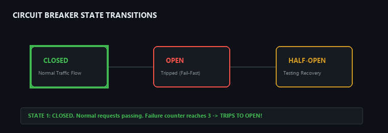
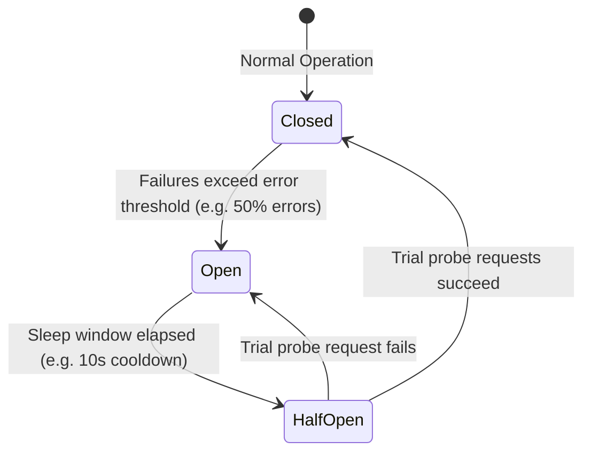

# 20 - Fault Tolerance, Resilience & Circuit Breakers

> **Real-World Analogy:**  
> Think of electrical circuit breakers in your home. If a short circuit occurs in your toaster, the circuit breaker instantly trips and cuts the power to that outlet. It prevents your entire house from catching fire. In software, a circuit breaker stops sending requests to a dying service before it drags down the entire system.

---

## 🎯 What & Why
Explores how to design resilient distributed systems that withstand inevitable hardware and network failures, using Circuit Breakers, Bulkheads, and Exponential Backoff with Jitter.

---

## 📊 Visual Architecture Diagram

<p align="center">
  
</p>


---

## ⚙️ How It Works Under The Hood
### The Three States of a Circuit Breaker

1. **Closed**:
   - Everything is healthy. Requests flow through to the backend service.
   - Measures failure rate over a rolling time window.
2. **Open**:
   - The failure rate exceeded the configured threshold (e.g., 50% failures or 5 consecutive timeouts).
   - **Immediately rejects incoming calls** with a fallback response or error without touching the struggling downstream service.
3. **Half-Open**:
   - After a cool-down sleep duration (e.g., 10 seconds), the circuit breaker lets a small probe percentage of requests through.
   - If probes succeed, the circuit resets to **Closed**. If any probe fails, it snaps back to **Open**.

---

### Resiliency Patterns

- **Bulkhead Pattern**: Partitions resources (thread pools, connection pools) so that a failure in one non-critical feature (e.g., video recommendations) cannot consume all threads and starve critical features (e.g., video playback).
- **Exponential Backoff with Full Jitter**:
  - Instead of retrying on a fixed schedule (which causes synchronized retry stampedes), exponentially increase wait times and add randomized noise:
  $$T_{	ext{wait}} = 	ext{random}(0, \min(T_{\max}, 	ext{base} 	imes 2^{	ext{attempt}}))$$

---

## 💻 Concrete Code Implementation
```python
# Python implementation: Circuit Breaker State Machine
import time

class CircuitBreaker:
    def __init__(self, failure_threshold: int = 3, recovery_time: float = 5.0):
        self.failure_threshold = failure_threshold
        self.recovery_time = recovery_time
        self.state = "CLOSED"
        self.failure_count = 0
        self.last_state_change = time.time()

    def call(self, func, *args, **kwargs):
        now = time.time()
        
        # Check if cool-down elapsed in OPEN state
        if self.state == "OPEN":
            if now - self.last_state_change > self.recovery_time:
                self.state = "HALF-OPEN"
                print("Circuit Breaker transitioned to HALF-OPEN")
            else:
                return "FAIL-FAST: Circuit is OPEN (Fallback)"

        try:
            result = func(*args, **kwargs)
            if self.state == "HALF-OPEN":
                self.state = "CLOSED"
                self.failure_count = 0
                print("Circuit Breaker recovered to CLOSED")
            return result
        except Exception:
            self.failure_count += 1
            if self.failure_count >= self.failure_threshold:
                self.state = "OPEN"
                self.last_state_change = now
                print("Circuit Breaker tripped to OPEN!")
            raise

if __name__ == "__main__":
    def unstable_service():
        raise RuntimeError("Service timeout!")

    cb = CircuitBreaker(failure_threshold=2, recovery_time=1.0)
    for i in range(4):
        try:
            cb.call(unstable_service)
        except Exception as e:
            print(f"Call {i+1} failed:", e)

    print("Subsequent immediate call:", cb.call(unstable_service))

```

---

## ⚖️ Trade-Offs & Architectural Considerations
- **Resilience**: Design for failure at every tier; assume machines and networks will fail.
- **Backpressure**: Shed load gracefully before resources are completely exhausted.
- **Idempotency**: Guarantee safe retries for all network operations.
