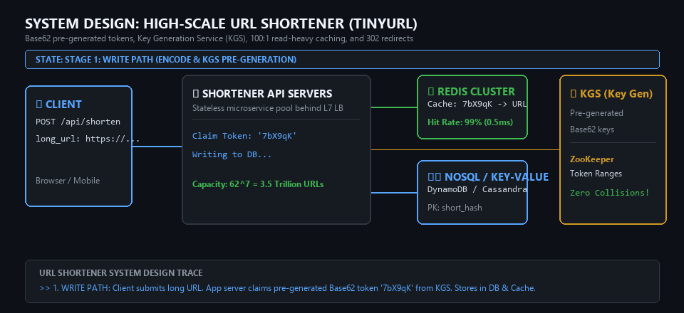

# 21 - System Design: Scalable URL Shortener (TinyURL / Bitly)

> **Executive Summary:** Designing a global URL shortener (like TinyURL or Bitly) is the quintessential system design interview question because it covers the end-to-end gamut: back-of-the-envelope capacity planning, mathematical encoding (Base62 vs. MD5), distributed unique key generation (KGS), 100:1 read-heavy caching, HTTP redirect status code trade-offs (301 vs. 302), and asynchronous analytics pipelines.

---

> 🏢 **Real-World Deep Dives**: Detailed case studies of how **Google** & **Netflix** implement this in production are documented in [REAL_WORLD_EXAMPLES.md](./REAL_WORLD_EXAMPLES.md).

## ⏱️ Prerequisites: What You Need to Know First

To get the most out of this module, make sure you understand:
- [01 - Client-Server Networking](../01-client-server-networking/README.md): HTTP status codes (`301 Moved Permanently` vs `302 Found`).
- [06 - Relational & Non-Relational Databases](../06-relational-and-non-relational-databases/README.md): Key-value stores vs relational schemas for $O(1)$ lookups.
- [10 - Caching Patterns](../10-caching-patterns/README.md): Cache-Aside pattern for read-heavy workloads.
- [16 - Consistent Hashing](../16-consistent-hashing/README.md): Sharding database partitions by short hash.

---

## 🧒 The 30-Second Version (ELI5)

Imagine you go to a theatre with a huge, heavy winter coat:
- The coat check attendant takes your bulky jacket and hands you a tiny plastic token with a number on it: `"#42"`.
- When the show ends, you hand the attendant plastic token `"#42"`. They instantly retrieve your heavy jacket from the rack and return it to you.
- You don't carry the bulky jacket around the crowded lobby; you only carry the tiny token!
- In computer terms: The bulky jacket is a massive 500-character URL (`https://example.com/products/deals/item?category=electronics&ref=affiliate_99824`), the plastic token is the short URL (`https://tiny.url/7bX9qK`), and the coat rack is a distributed Redis and NoSQL database.

---

## 🍕 Everyday Analogy

| System Component | Coat Check Analogy | Technical Reality in TinyURL |
| :--- | :--- | :--- |
| **Long URL** | Bulky, 10-pound winter coat | Full 2,048-character destination URL |
| **Short Code** | Tiny plastic numbered token (`#42`) | 7-character Base62 string (`7bX9qK`) |
| **Token Dispenser** | Roll of pre-printed ticket stubs | Key Generation Service (KGS) with ZooKeeper ranges |
| **Coat Storage Rack** | Huge basement storage shelves | Distributed NoSQL database (DynamoDB / Cassandra) |
| **Fast Pickup Desk** | Front counter holding the 50 most popular coats | In-memory Redis cache cluster (0.5 ms lookups) |
| **Visitor Counter** | Tally clicker counting every coat retrieved | Asynchronous Kafka event stream for click analytics |

---

## 🧩 The Problem It Solves

### Why URL Shortening is Hard at Scale
At small scale, creating a short URL is trivial: `SELECT id FROM urls` and return `tiny.url/id`.
However, at **production internet scale**:
1. **Capacity & Collision Free**: The service must support billions of URLs without running out of combinations and without two servers generating the same short code.
2. **Extreme Read Asymmetry**: 100:1 read-to-write ratio (11,600 reads/sec vs 116 writes/sec). Database disks cannot handle direct read traffic without collapsing.
3. **Sub-Millisecond Redirection**: Users clicking links expect instantaneous redirects (<10 ms total network turnaround).
4. **Security & Anti-Scraping**: Auto-incrementing integers (`tiny.url/1`, `tiny.url/2`) allow competitors to scrape the entire database simply by iterating $id+1$.

---

## 🖼️ Picture It: Architecture & Flow

### High-Resolution URL Shortener Animation
Below is an animated trace of the Write Path (KGS token claim) and Read Path (Redis Cache HIT with 302 Redirect):



---

### High-Level Architecture Diagram

```mermaid
flowchart TD
    subgraph Clients["Clients & Edge Tier"]
        User["👤 Mobile / Web User"]
        Edge["🌐 Cloudflare CDN Edge"]
        User -->|1. GET /7bX9qK| Edge
    end

    subgraph AppTier["Application Tier"]
        LB["⚖️ L7 Load Balancer"]
        Edge -->|Cache Miss| LB
        S1["App Server 1"]
        S2["App Server 2"]
        LB --> S1
        LB --> S2
    end

    subgraph DataTier["Data & Cache Tier"]
        Redis[("⚡ Redis Cluster (LRU)<br/>Stores top 20% hot URLs (0.5ms)")]
        DB[("🗄️ DynamoDB / Cassandra<br/>PK: short_hash<br/>Val: long_url, user_id, created_at")]
        S1 -->|Check Cache| Redis
        Redis -.->|Miss: Read DB| DB
    end

    subgraph KGSCluster["Key Generation Tier"]
        ZK["🐘 ZooKeeper / etcd<br/>(Allocates token ranges)"]
        KGS["🔑 KGS (Key Gen Service)<br/>Pre-generates Base62 tokens"]
        ZK --> KGS
        KGS -->|Pre-allocated Block| S1
        KGS -->|Pre-allocated Block| S2
    end

    subgraph AnalyticsTier["Asynchronous Analytics"]
        Kafka["📜 Kafka Topic: 'url-clicks'"]
        S1 -.->|Async Fire & Forget| Kafka
        AnalyticsWorker["📊 Analytics Consumer -> ClickHouse DB"]
        Kafka --> AnalyticsWorker
    end

    style Edge fill:#161b22,stroke:#58a6ff,stroke-width:2px;
    style Redis fill:#161b22,stroke:#3fb950,stroke-width:2px;
    style DB fill:#161b22,stroke:#d29922,stroke-width:2px;
    style KGS fill:#161b22,stroke:#a371f7,stroke-width:2px;
    style Kafka fill:#161b22,stroke:#f85149,stroke-width:2px;
```



---

## 🔢 Walk-Through with Real Numbers

Let's execute a formal back-of-the-envelope estimation for a global system:

### 1. Traffic Estimations
- **New Shortened URLs Created (Writes)**: $100\text{ Million / month}$
- **URL Redirections (Reads)**: $100:1\text{ ratio} \implies 10\text{ Billion / month}$
- **Writes per second (WPS)**:
  $$\text{WPS} = \frac{100,000,000}{30 \times 24 \times 3600} \approx \frac{100,000,000}{2,592,000} \approx \mathbf{38.5\text{ writes/sec}}$$
  $$\text{Peak WPS (2x)} \approx \mathbf{80\text{ writes/sec}}$$
- **Reads per second (RPS)**:
  $$\text{RPS} = \frac{10,000,000,000}{2,592,000} \approx \mathbf{3,858\text{ reads/sec}}$$
  $$\text{Peak RPS (2x)} \approx \mathbf{8,000\text{ reads/sec}}$$

### 2. Storage Estimations (10-Year Horizon)
- Assume average URL record size = $500\text{ bytes}$ (`short_code: 7B`, `long_url: 400B`, `created_at: 8B`, `user_id: 16B`, `metadata: 69B`).
- Total records in 10 years: $100\text{M/month} \times 12\text{ months} \times 10\text{ years} = 12\text{ Billion records}$.
$$\text{Total Storage} = 12,000,000,000 \times 500\text{ bytes} = 6,000,000,000,000\text{ bytes} \approx \mathbf{6\text{ Terabytes}}$$
6 TB of data over 10 years easily fits in a partitioned NoSQL database.

### 3. Memory & Caching Estimations (Pareto 80/20 Rule)
- 20% of the URLs generate 80% of daily traffic.
- Daily read requests: $10\text{ Billion} / 30 \approx 330\text{ Million requests/day}$.
- Total data requested daily: $330\text{M} \times 500\text{ bytes} \approx 165\text{ GB/day}$.
- To cache 20% of daily requests:
  $$\text{Cache RAM} = 165\text{ GB} \times 0.20 \approx \mathbf{33\text{ GB of RAM}}$$
A small 3-node Redis cluster with 32 GB RAM each easily holds the entire hot working set in memory!

### 4. Base62 Capacity Math
Using alphanumeric characters `[0-9a-zA-Z]` (62 unique characters):
- With a 6-character short URL: $62^6 \approx 56.8\text{ Billion unique URLs}$.
- With a 7-character short URL:
  $$62^7 = \mathbf{3,521,614,606,208\text{ unique URLs (3.52 Trillion!)}}$$
At 100M writes/month, **7 characters will last over 2,900 years!**

---

## ⚙️ How It Works Under the Hood

### 1. Token Generation: Base62 vs. MD5 Hash Collisions

#### Approach 1: MD5 / SHA-256 Hashing (Flawed)
- Hash long URL: $\text{MD5}(\text{url}) \implies 128\text{-bit hex string}$.
- Take first 7 characters: `d41d8cd`.
- *Fatal Flaw*: Hash collisions! Two completely different URLs can produce the same first 7 characters. You must query the database to detect collisions and append salt (`url + salt`), triggering expensive database round-trips on every single write.

#### Approach 2: Base62 Encoding of Distributed Sequence IDs (Production Gold Standard)
- Maintain a 64-bit unique integer ID generator.
- Convert the integer directly to Base62:
  - $\text{ID } 100,000,000 \implies \text{"006LAze"}$
  - $\text{ID } 100,000,001 \implies \text{"006LAzf"}$
- **Mathematical Guarantee**: Because integers are unique, **Base62 strings are 100% collision-free by definition!** Zero database collision checks required.

---

### 2. The Key Generation Service (KGS)

How do multiple application servers generate unique 64-bit integers without locking a central database sequence?
- We deploy a dedicated **Key Generation Service (KGS)** backed by **ZooKeeper or etcd**.
- ZooKeeper allocates discrete **Token Ranges** to each application server:
  - Server 1 is assigned IDs: `[1,000,000 to 1,999,999]`
  - Server 2 is assigned IDs: `[2,000,000 to 2,999,999]`
- Each server maintains its counter entirely in local memory with **zero network communication**!
- If Server 1 restarts, it simply requests a fresh range from ZooKeeper. The skipped IDs in the old range are harmless because 3.52 Trillion keys are available.

---

### 3. HTTP 301 vs. HTTP 302 Redirection

When a user requests `https://tiny.url/7bX9qK`, the server responds with an HTTP redirect:

| HTTP Status Code | Meaning | Browser Behavior | Impact on Analytics |
| :--- | :--- | :--- | :--- |
| **`301 Moved Permanently`** | URL is permanently at new destination | Browser caches redirect locally; **never contacts TinyURL server again!** | ❌ Destroys click analytics; cannot count future clicks |
| **`302 Found` (Recommended)**| Temporary redirect | Browser **always contacts TinyURL server** on every single click | ✅ Captures 100% of click analytics, referrer, and user-agent |

---

## ⚖️ Trade-Offs & Decision Matrix

| Dimension | Relational DB (PostgreSQL) | NoSQL Key-Value (DynamoDB / Cassandra) |
| :--- | :--- | :--- |
| **Lookup Performance** | Fast with B-tree index on `short_code` ($O(\log N)$) | Ultra-Fast primary key point lookup ($O(1)$) |
| **Horizontal Scalability** | Requires complex manual sharding schemes | Seamless native hash ring partitioning |
| **Operational Overhead** | High at 10 TB scale | Managed serverless (zero maintenance) |
| **Recommendation** | Good for MVP (<10M records) | **Industry Standard for Global Scale** |

---

## 🚫 Common Mistakes & Production Pitfalls

1. **Using 301 Redirects when Click Tracking is Required**:
   - *Pitfall*: Returning `301 Moved Permanently`.
   - *Result*: The user's browser permanently caches the redirect. Every subsequent click goes straight to the destination website without ever hitting TinyURL servers, cutting click analytics revenue to zero. Always use `302 Found` (or `307 Temporary Redirect`) if analytics are monetized.

2. **Predictable Sequential IDs (Scraping Vulnerability)**:
   - *Pitfall*: Incrementing token IDs strictly by $+1$ without shuffling: `0000001`, `0000002`.
   - *Result*: Competitors can easily write a bot that iterates from 1 to 1,000,000, scraping every secret internal document, unlisted Zoom link, and private Google Doc ever shortened by users.
   - *Fix*: Use a simple Feistel cipher or token shuffling bit-mask to pseudo-randomize integer output before Base62 encoding.

3. **Synchronous Analytics Logging**:
   - *Pitfall*: Writing an analytics record to Postgres (`INSERT INTO clicks (url_id, ip, timestamp)...`) inside the user redirection request thread.
   - *Result*: Increases redirect latency from 1 ms to 25 ms, creating database write lock contention.
   - *Fix*: Emit click events asynchronously to an Apache Kafka topic; background workers batch-insert analytics into ClickHouse or BigQuery.

---

## 💻 Try It Yourself: Python Simulation

The companion simulation script [`demo.py`](./demo.py) implements:
1. Base62 encoding/decoding of 64-bit sequence IDs into 7-character tokens.
2. A simulated Key Generation Service (KGS) managing token block allocations.
3. Cache-Aside Redis simulation demonstrating latency drop from **5.28 ms down to 0.001 ms**.
4. 1,000-request high-throughput benchmark demonstrating 100% cache hit rates and asynchronous click tracking.

Run it locally in your terminal:
```bash
python demo.py
```

---

## 🌍 Where You'll See It in Production

- **Bitly**: Manages over 10 billion clicks per month across hundreds of millions of branded short links. Uses distributed caching and Apache Cassandra storage.
- **Twitter / X (`t.co`)**: Automatically wraps every link posted on X inside a `t.co` short URL to perform malicious phishing scanning, malware detection, and engagement analytics.
- **LinkedIn (`lnkd.in`)**: Shortens links shared in feeds to monitor traffic sources and protect users from fraud.

---

## 🎯 Top Interview Questions & Deep Answers

### Q1: "Why is Base62 chosen for URL shorteners instead of Base64 or Base16 (Hex)?"
**Interviewer Goal**: Testing encoding knowledge and web URL standard compliance.

**Model Answer**:
"Base62 uses precisely the 62 alphanumeric characters: `[0-9]`, `[a-z]`, and `[A-Z]`:
1. **URL Safety**: Standard Base64 introduces `+` and `/` (and padding `=`), which are reserved characters in HTTP URLs. In standard URL queries, `+` is interpreted as a space, and `/` is interpreted as a path delimiter. While URL-safe Base64 exists (substituting `-` and `_`), Base62 consists strictly of pure alphanumeric characters that never require URL encoding or escaping in any browser, SMS, or QR code.
2. **Compact Density**: Compared to Base16 (Hexadecimal: `0–9, a–f`), Base62 packs vastly more entropy per character: $62^7 \approx 3.52\text{ Trillion}$ combinations vs. $16^7 \approx 268\text{ Million}$ combinations. Base62 keeps short URLs compact."

---

### Q2: "How do you handle custom alias URLs (e.g., `tiny.url/my-custom-vanity-name`)?"
**Interviewer Goal**: Checking database schema design and edge-case handling.

**Model Answer**:
"When users request a custom alias:
1. **Schema Check**: We query the database to verify if `custom_alias` already exists.
2. **Collision Prevention**: In a relational or NoSQL database, `short_code` is the primary key or unique index. We execute an atomic conditional write:
   - In DynamoDB: `attribute_not_exists(short_hash)`
   - In SQL: `INSERT INTO urls (short_code, long_url) VALUES ('my-custom-vanity-name', ...) ON CONFLICT DO NOTHING`
3. **If collision occurs**: Return HTTP `409 Conflict` with a user-friendly error message: *'Alias already taken, please choose another.'*
4. **Reserved Names**: Enforce an application-level blocklist preventing users from claiming reserved routes like `/api`, `/admin`, `/login`, or `/terms`."

---

### Q3: "What happens when the Redis cache becomes full in a URL shortener?"
**Interviewer Goal**: Testing cache eviction policies under read-heavy skew.

**Model Answer**:
"Because URL redirection follows the Pareto principle (the top 20% of URLs drive 80% of traffic), we configure the Redis cluster with an explicit memory limit and eviction policy:
- `maxmemory 32gb`
- `maxmemory-policy allkeys-lru` (Least Recently Used)
When memory is saturated, Redis automatically evicts URLs that haven't been accessed for the longest time. 
If an evicted short URL is clicked a month later:
1. Application suffers a Cache Miss.
2. Application queries the persistent NoSQL database in 5 ms.
3. Application writes the record back into Redis and serves the redirect.
The system gracefully degrades without dropping any requests or crashing."

---

### Q4: "How do you implement URL expiration (TTLs) at scale?"
**Interviewer Goal**: Evaluating background storage maintenance strategies.

**Model Answer**:
"If URLs have optional expiration dates (e.g. valid for 30 days):
1. **Passive Expiration (Lazy Check)**:
   - When a user clicks a short URL, the application checks `IF NOW() > expires_at`.
   - If expired, return HTTP `404 Not Found` immediately, and trigger an asynchronous message to delete the row.
2. **Active Sweeping (Background Cleanup)**:
   - Continuously scanning billions of records with `DELETE WHERE expires_at < NOW()` is too heavy for database performance.
   - Instead, we leverage **native database TTLs**: DynamoDB and Cassandra support automatic background TTL eviction natively without consuming application CPU or IOPS.
   - Alternatively, partition database tables by month (`urls_2026_01`, `urls_2026_02`), and drop old monthly tables entirely in a single $O(1)$ DDL drop operation."

---

### Q5: "How do you protect a public URL shortener from malicious links and spam abuse?"
**Interviewer Goal**: Assessing production security, compliance, and abuse prevention.

**Model Answer**:
"Public URL shorteners are prime targets for phishing, malware, and spam. Production platforms enforce multi-layered defenses:
1. **Rate Limiting**: Enforce token-bucket rate limits per IP address and authenticated user account (e.g., max 10 URL creations per minute).
2. **Malicious Domain Blacklisting**: During the write path, check the destination domain against Google Safe Browsing API, Spamhaus, and internal phishing blocklists before accepting the write.
3. **Async Malware Scanner**: Push newly submitted URLs to a Kafka scanning pipeline where headless browser workers fetch the target site and analyze page content for malware signatures. If malicious, flag the record in Redis/DB to display a warning splash screen rather than immediate redirection.
4. **Spam Honeytraps**: Deploy CAPTCHAs upon detecting abnormal automated creation spikes."

---

## ✅ Check Yourself: Flash Quiz

<details>
<summary><b>1. Why does Base62 with 7 characters provide 3.52 Trillion combinations while Base16 with 7 characters only provides 268 Million?</b></summary>
<br>
Because the radix (base) is exponentially multiplied by the length: $62^7 \approx 3.52 \times 10^{12}$, whereas $16^7 \approx 2.68 \times 10^8$. Base62 has 62 available alphanumeric options per slot (`[0-9a-zA-Z]`), giving it over <b>13,000 times more combinations</b> than hexadecimal.
</details>

<details>
<summary><b>2. Why should an analytics-focused URL shortener return HTTP 302 Found instead of HTTP 301 Moved Permanently?</b></summary>
<br>
Because browsers permanently cache HTTP 301 redirects on the client machine and will <b>never contact the shortener server again</b> for subsequent clicks. HTTP 302 forces browsers to contact the shortener on every visit, allowing 100% accurate tracking of clicks, referrers, devices, and countries.
</details>

<details>
<summary><b>3. How does the Key Generation Service (KGS) prevent duplicate short codes without acquiring database locks?</b></summary>
<br>
By allocating <b>pre-reserved token blocks</b> (e.g., Server 1 gets 100,000 to 199,999; Server 2 gets 200,000 to 299,999) using ZooKeeper or etcd. Each server increments its counter purely in local memory with zero cross-server locking or network collisions.
</details>

---

## 📚 Go Deeper: Recommended Reading

- **System Design Interview – An Insider's Guide (Volume 1)** by Alex Xu — *Chapter 8: Design a URL Shortener*.
- **Designing Data-Intensive Applications** by Martin Kleppmann — *Chapter 1: Reliability, Scalability, and Maintainability*.
- **Ilya Grigorik's High Performance Browser Networking** — *HTTP Redirects and Latency Impact*.
- **Bitly Engineering Blog**: *How Bitly Scales High-Volume Redirections*.

---

## 🔗 Related Modules

- [01 - Client-Server Networking](../01-client-server-networking/README.md): HTTP 301 vs 302 redirect protocol mechanics.
- [06 - Relational & Non-Relational Databases](../06-relational-and-non-relational-databases/README.md): Key-value storage models.
- [10 - Caching Patterns](../10-caching-patterns/README.md): Cache-Aside pattern for read-heavy scale.
- [16 - Consistent Hashing](../16-consistent-hashing/README.md): Distributing URL partitions across database clusters.
