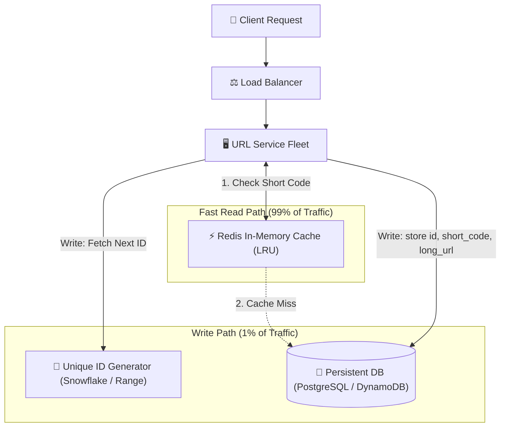

# 21 - Case Study: Scalable URL Shortener (TinyURL)

> **Real-World Analogy:**  
> Imagine a coat-check counter at a museum. You hand over a bulky winter coat (a 250-character long URL) and the attendant gives you a tiny plastic token labeled #4B (a 7-character short URL). When you leave, you hand back the token #4B and receive your exact coat back immediately.

---

## 🎯 What & Why
Step-by-step design of a production URL shortener handling 100M new URLs per month and billions of read redirects, covering Base62 encoding, unique ID generation, and high-throughput caching.

---

## 📊 Visual Architecture Diagram


---

## ⚙️ How It Works Under The Hood
### Capacity Estimation & Numbers

- **New URLs Created**: 100 million per month ≈ 100,000,000 ÷ 2.6 million seconds ≈ **40 writes/second**.
- **Read/Write Ratio**: 100 : 1 read-heavy.
- **Read Requests**: 4,000 requests / second (Peak: 8,000 RPS).
- **Storage for 10 Years**:
  - 100 million × 12 months × 10 years = **12 billion records**.
  - Assuming 500 bytes per URL record:
  - 12 billion × 500 bytes ≈ **6 TB**, which fits on a few modern SSDs.

---

### Base62 Encoding vs Hashing

- **Characters Available**: `[a-z, A-Z, 0-9]` = 62 alphanumeric characters.
- A 7-character Base62 string yields:
  - 62⁷ ≈ **3.5 trillion** unique codes.
- **Algorithm**:
  1. Increment a global 64-bit unique integer ID (e.g., using Twitter Snowflake or distributed range service).
  2. Convert that integer to its Base62 string representation.
  3. No hash collisions are possible because every unique ID maps to a unique Base62 string!

---

### HTTP 301 vs 302 Redirects

- **301 Moved Permanently**: The browser caches the redirect locally. Subsequent clicks bypass the URL shortener entirely. Reduces server load, but loses click analytics tracking.
- **302 Found (Temporary Redirect)**: Every click hits the URL shortener service first. Essential if you track click analytics, geolocation, and referral stats.

---

## 💻 Concrete Code Implementation
```python
# Python implementation: Base62 encoder and URL shortener service

class URLShortener:
    BASE62 = "0123456789abcdefghijklmnopqrstuvwxyzABCDEFGHIJKLMNOPQRSTUVWXYZ"

    def __init__(self):
        self.id_counter = 10000000  # Start with high base ID
        self.url_map = {}  # short_code -> long_url
        self.id_map = {}   # long_url -> short_code

    def _encode_base62(self, num: int) -> str:
        if num == 0:
            return self.BASE62[0]
        digits = []
        while num > 0:
            digits.append(self.BASE62[num % 62])
            num //= 62
        return "".join(reversed(digits))

    def shorten(self, long_url: str) -> str:
        if long_url in self.id_map:
            return self.id_map[long_url]

        short_code = self._encode_base62(self.id_counter)
        self.id_counter += 1
        self.url_map[short_code] = long_url
        self.id_map[long_url] = short_code
        return short_code

    def resolve(self, short_code: str) -> str:
        return self.url_map.get(short_code)

if __name__ == "__main__":
    shortener = URLShortener()
    long_link = "https://github.com/Aniketchavan7/system-design-illustrated"
    
    code = shortener.shorten(long_link)
    print(f"Generated Short Code: https://tiny.ly/{code}")
    print(f"Resolved Long URL: {shortener.resolve(code)}")

```

---

## ⚖️ Trade-offs

| Decision | Option A | Option B |
| :--- | :--- | :--- |
| **How to make the code** | Counter + Base62: no collisions, short codes; but codes are guessable (`abc1`, `abc2`…) and you need a reliable ID generator | Hash or random + collision check: unguessable; needs a uniqueness check on every write |
| **Redirect type** | `301`: browsers cache it, so less load, but you lose click stats and can't change the target later | `302`: every click hits you, so full analytics and editable links, but more traffic |
| **Same long URL twice** | Return the existing code: saves space, needs a lookup by long URL (an extra index) | Always create a new one: simpler, enables per-campaign stats |
| **Database** | SQL: easy and strongly consistent; fine at ~40 writes/s | NoSQL key-value: scales reads and writes horizontally with no schema |

**Don't forget:** spam and malware links (scan targets, allow reporting), expiry for unused links, and per-user rate limits on creating links ([module 05](../05-rate-limiting/)).
