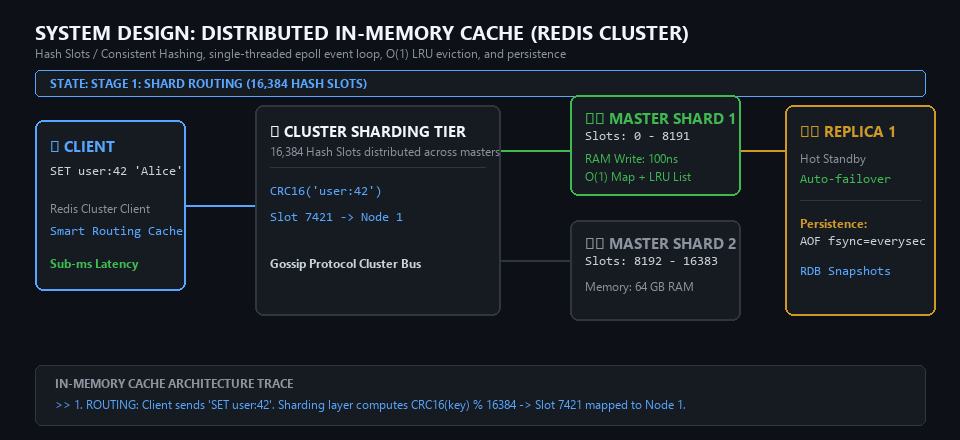

# 22 - System Design: Distributed In-Memory Cache (Redis Cluster)

> **Executive Summary:** Disk storage operates in milliseconds ($1\text{–}10\text{ ms}$), whereas main memory (RAM) operates in nanoseconds ($100\text{ ns}$) and local network transfers take sub-milliseconds ($0.5\text{ ms}$). A distributed in-memory cache bridges this $10,000\times$ speed gap. Designing a production-grade distributed cache like **Redis Cluster** or **Memcached** requires understanding single-threaded I/O multiplexing (`epoll`), $O(1)$ LRU memory eviction, 16,384-slot hash sharding, and durability persistence via point-in-time snapshots (RDB) and append-only logs (AOF).

---

> 🏢 **Real-World Deep Dives**: Detailed case studies of how **Google** & **Netflix** implement this in production are documented in [REAL_WORLD_EXAMPLES.md](./REAL_WORLD_EXAMPLES.md).

## ⏱️ Prerequisites: What You Need to Know First

To get the most out of this module, make sure you understand:
- [01 - Client-Server Networking](../01-client-server-networking/README.md): Network socket I/O multiplexing (`epoll` / `kqueue`).
- [10 - Caching Patterns](../10-caching-patterns/README.md): Cache-Aside, Write-Through, Write-Behind.
- [11 - Cache Eviction & Invalidation](../11-cache-eviction-and-invalidation/README.md): LRU, LFU, TTLs, and cache stampede mitigations.
- [16 - Consistent Hashing](../16-consistent-hashing/README.md): Sharding key-spaces across multi-node clusters.

---

## 🧒 The 30-Second Version (ELI5)

Imagine you are a detective working on a case:
- In the basement archives, there are 500 filing cabinets with millions of paper folders (**The Database**). Walking down the stairs, finding a folder, and walking back up takes 15 minutes.
- On your desk, you place a large corkboard with sticky notes (**The In-Memory Cache**). Looking at the corkboard takes 2 seconds!
- When the corkboard gets full, you pluck off the sticky note you haven't looked at all week and toss it into the recycling bin (**LRU Eviction**).
- If your office building is huge, you hire 10 junior detectives, assign each one a portion of the alphabet (A–C to Detective 1, D–F to Detective 2), so millions of questions can be answered simultaneously (**Distributed Sharding**).

---

## 🍕 Everyday Analogy

| Component | Detective Office Analogy | Technical Reality in Redis Cluster |
| :--- | :--- | :--- |
| **RAM Storage** | Sticky notes on the desk corkboard | Data held strictly in volatile RAM (sub-microsecond access) |
| **Disk Storage** | Basement heavy metal filing cabinets | Persistent relational database (PostgreSQL / MySQL) |
| **Single-Threaded Loop**| One hyper-focused detective handling 1 note at a time without interruptions | Single-threaded `epoll` event loop avoiding mutex lock contention |
| **LRU Eviction** | Throwing away the sticky note untouched for the longest time | Evicting tail node from doubly-linked list in $O(1)$ time |
| **TTL Expiration** | Sticky note marked: *"Discard at 5:00 PM today"* | Unix timestamp field evaluated lazily or swept periodically |
| **Hash Slots (16,384)** | Dividing case files into 16,384 standard color-coded folders | $\text{CRC16}(\text{key}) \pmod{16384}$ partitioning |
| **RDB Snapshots** | Taking a Polaroid photograph of the corkboard once an hour | Background `fork()` saving point-in-time binary dump |
| **AOF Log** | Writing every sticky note addition into a continuous diary | Append-Only File recording every mutating command |

---

## 🧩 The Problem It Solves

### The Physical Limits of Disk I/O
- A modern NVMe SSD can deliver $\approx 50,000\text{–}100,000\text{ IOPS}$.
- However, an internet platform with 100,000,000 active users generates millions of database queries per second.
- If every request hits the disk, disk queue depths explode, read latencies spike from 2 ms to 2,000 ms, and the database crashes under I/O starvation.

### How a Distributed Cache Solves This
- **Microsecond Response Time**: Serving data directly from RAM yields $0.1\text{–}0.5\text{ ms}$ read latency.
- **Massive Concurrency**: A single Redis shard comfortably handles $>100,000\text{ operations/second}$ on a single CPU core.
- **Horizontal Elasticity**: A cluster of 50 shards handles $>5,000,000\text{ operations/second}$ while offloading $95\%\dots 99\%$ of traffic from the primary database.

---

## 🖼️ Picture It: Architecture & Flow

### High-Resolution In-Memory Cache Animation
Below is an animated trace of key routing across 16,384 hash slots, single-threaded in-memory execution, and AOF/RDB persistence:



---

### Internal Node Architecture & Sharding Flow

```mermaid
flowchart TD
    subgraph ClientLayer["Client & Routing Layer"]
        App["App Server / Microservice"]
        Router["Smart Client (Hashes CRC16(key) % 16384)"]
        App --> Router
    end

    subgraph Cluster["Redis Cluster (3 Masters, 3 Replicas)"]
        direction LR
        subgraph Master1["Master Shard 1 (Slots 0 - 5460)"]
            Loop1["⚡ Single-Threaded Event Loop (epoll)"]
            RAM1[("In-Memory Store<br/>Dict + LRU Doubly Linked List")]
            AOF1["📜 AOF Buffer (fsync=everysec)"]
            Loop1 --> RAM1
            Loop1 --> AOF1
        end

        subgraph Master2["Master Shard 2 (Slots 5461 - 10922)"]
            Loop2["⚡ Single-Threaded Event Loop (epoll)"]
            RAM2[("In-Memory Store<br/>Dict + LRU Doubly Linked List")]
        end

        subgraph Master3["Master Shard 3 (Slots 10923 - 16383)"]
            Loop3["⚡ Single-Threaded Event Loop (epoll)"]
            RAM3[("In-Memory Store<br/>Dict + LRU Doubly Linked List")]
        end

        Router -->|Slot: 1042| Master1
        Router -->|Slot: 7891| Master2
        Router -->|Slot: 14200| Master3

        Replica1["🛡️ Replica 1<br/>(Async Replication)"]
        Master1 -.->|Replication Stream| Replica1
    end

    style Master1 fill:#161b22,stroke:#3fb950,stroke-width:2px;
    style Master2 fill:#161b22,stroke:#58a6ff,stroke-width:2px;
    style Master3 fill:#161b22,stroke:#d29922,stroke-width:2px;
    style Replica1 fill:#161b22,stroke:#8b949e,stroke-width:1px;
```



---

## 🔢 Walk-Through with Real Numbers

Let's calculate the hardware specifications and network capacity for a 10-node caching cluster:

### 1. Latency Physics Comparison
$$\text{L1 / L2 CPU Cache} \approx 0.5\text{–}2\text{ ns}$$
$$\text{Main Memory (RAM) Access} \approx 100\text{ ns} = 0.0001\text{ ms}$$
$$\text{NVMe SSD Read} \approx 100\ \mu\text{s} = 0.1\text{ ms}$$
$$\text{Spinning Mechanical HDD Read} \approx 10,000\ \mu\text{s} = 10\text{ ms}$$
RAM is **1,000x faster than NVMe SSDs** and **100,000x faster than traditional hard drives!**

### 2. Network NIC Bottleneck Calculation
Many engineers assume CPU is the bottleneck in Redis. **It is almost always the network card (NIC)!**
- Suppose a single Redis master serves 1 KB value payloads over a 10 Gbps network interface:
  $$\text{10 Gbps} \approx 1.25\text{ Gigabytes/sec} = 1,250,000\text{ KB/sec}$$
- Maximum theoretical throughput before saturating the 10 Gbps network pipe:
  $$\text{Max Throughput} = \frac{1,250,000\text{ KB/s}}{1\text{ KB/req}} \approx \mathbf{1,250,000\text{ requests/second}}$$
At 1.25 million requests/second, the network interface is 100% pegged, regardless of available CPU!

### 3. Memory Sizing for 200 Million Keys
- Keys: $200,000,000\text{ items}$.
- Average key size: $32\text{ bytes}$. Average value size: $250\text{ bytes}$.
- Redis internal overhead per entry (dictEntry + robj + SDS + jemalloc padding): $\approx 50\text{ bytes}$.
- Total per item: $32 + 250 + 50 = 332\text{ bytes}$.
$$\text{Total Memory} = 200,000,000 \times 332\text{ bytes} \approx \mathbf{66.4\text{ GB of RAM}}$$
A 3-node cluster with 32 GB RAM per node provides 96 GB total RAM, running comfortably below $70\%$ memory utilization.

---

## ⚙️ How It Works Under the Hood

### 1. Why is Redis Single-Threaded for Execution?

A common interview question: *"Why doesn't Redis use 64 worker threads to utilize modern multi-core CPUs?"*
- **Memory Access is Already Nanosecond Speed**: In-memory data access is so blindingly fast that execution is not CPU-bound.
- **Zero Lock Contention**: Multi-threaded memory structures require mutexes, read-write locks, or compare-and-swap (CAS) primitives. Under high concurrency, threads spend more time waiting on lock contention and suffering CPU cache line invalidations than executing actual queries!
- **I/O Multiplexing (`epoll` / `kqueue`)**: Redis uses an event-driven non-blocking socket model. A single thread monitors thousands of client socket file descriptors simultaneously, reading bytes and serving responses sequentially with zero context-switching overhead.
*(Note: Redis 6.0+ introduced multi-threaded I/O solely for parsing network protocol buffers, but core command execution remains strictly single-threaded).*

---

### 2. The 16,384 Hash Slot Sharding Mechanism

Unlike arbitrary consistent hashing rings where clients walk clockwise:
- Redis Cluster partitions the universe into exactly **16,384 Hash Slots** ($[0\dots 16383]$):
  $$\text{slot} = \text{CRC16}(\text{key}) \pmod{16384}$$
- Nodes in the cluster divide the slots among themselves:
  - Node A holds slots `0 – 5460`
  - Node B holds slots `5461 – 10922`
  - Node C holds slots `10923 – 16383`
- **Hash Tags (`{...}`)**: If a key contains curly braces (e.g. `{user:42}:profile` and `{user:42}:orders`), only the string inside `{user:42}` is hashed! This guarantees that related keys for the same user hash to the exact same slot and node, allowing multi-key atomic transactions (`MGET`, `EVAL`) without cross-node network hops!

---

### 3. Persistence: RDB vs. AOF

| Mechanism | How It Works | Durability Guarantee | Recovery Speed | Performance Impact |
| :--- | :--- | :--- | :--- | :--- |
| **RDB (Snapshot)** | Linux `fork()` creates child process; writes compact binary dump via Copy-on-Write (COW) | Weak (loses data written since last snapshot, e.g. last 5–15 mins) | **Fastest** (loads directly into memory) | Rare CPU/memory spikes during `fork()` of huge RAM instances |
| **AOF (`fsync=everysec`)**| Logs every mutating command (`SET`, `DEL`) to disk; background fsync every second | High (at most 1 second of data loss) | Slower (must replay every command from log) | Negligible continuous background sequential I/O |

---

## ⚖️ Trade-Offs & Decision Matrix

| Dimension | Redis | Memcached |
| :--- | :--- | :--- |
| **Data Structures** | Rich: Strings, Hashes, Lists, Sets, Sorted Sets, Bitmaps, HyperLogLog | Simple Key-Value Strings only |
| **Threading Model** | Single-threaded event loop (epoll) | Multi-threaded with fine-grained locking |
| **Persistence** | RDB Snapshots + Append-Only Files (AOF) | None (pure volatile memory) |
| **Replication** | Built-in Master-Replica with automatic failover (Sentinel / Cluster) | No built-in replication (handled by client) |
| **Best For** | Leaderboards, session stores, pub/sub, caching complex data | Pure, simple, high-throughput static caching |

---

## 🚫 Common Mistakes & Production Pitfalls

1. **Running O(N) Blocking Commands (`KEYS *`) in Production**:
   - *Pitfall*: An engineer executes `KEYS user:*` in production to debug a user issue.
   - *Result*: Because Redis is single-threaded, scanning 50,000,000 keys blocks the entire server for 5 seconds. All other 500,000 incoming requests queue up, time out, and crash upstream API services!
   - *Fix*: Disable the `KEYS` command in `redis.conf` (`rename-command KEYS ""`). Use non-blocking cursor iteration with `SCAN` instead.

2. **The Huge `fork()` Memory Spike (Copy-on-Write OOM)**:
   - *Pitfall*: Running Redis on a server with 30 GB of data on a 32 GB RAM instance. When RDB snapshotting triggers, the Linux kernel executes `fork()`.
   - *Result*: If high write volume occurs during the snapshot, Linux Copy-on-Write allocates duplicate memory pages. The memory footprint climbs past 32 GB, triggering Linux `OOM-Killer`, which abruptly sends `SIGKILL` to `redis-server`! Always keep memory utilization $\le 60\text{–}70\%$ of physical RAM on persisting nodes.

3. **Hot-Key CPU Saturation**:
   - *Pitfall*: An ultra-viral celebrity account or live breaking news article has all traffic routed to a single key (e.g. `news:breaking`).
   - *Result*: That key hashes to a single slot on a single Redis master. That single CPU core hits 100%, throttling all operations on that node.
   - *Fix*: Replicate hot keys with random suffix salting (`news:breaking:1`, `news:breaking:2...`) or deploy a local L1 in-process cache (e.g. Guava/Caffeine) on application servers.

---

## 💻 Try It Yourself: Python Simulation

The companion simulation script [`demo.py`](./demo.py) implements:
1. An $O(1)$ LRU Cache Node with Doubly-Linked List and Hash Map pointers.
2. TTL expiration mechanisms (lazy evaluation on read + automatic deletion).
3. Append-Only File (AOF) write-ahead logging and recovery replay on server reboot.
4. Consistent Hash Ring sharding keys across a multi-node cache cluster.

Run it locally in your terminal:
```bash
python demo.py
```

Expected output preview:
```
======================================================================
DISTRIBUTED IN-MEMORY CACHE (REDIS-LIKE) SIMULATION
======================================================================

--- Phase 1: Writing Keys to Distributed Shards ---
Key 'user:101' -> Routed to Cache-Shard-03 | Readback: Alice
Key 'user:102' -> Routed to Cache-Shard-03 | Readback: Bob
Key 'user:103' -> Routed to Cache-Shard-03 | Readback: Charlie
Key 'user:104' -> Routed to Cache-Shard-02 | Readback: Diana

--- Phase 2: Testing O(1) LRU Eviction ---
Targeting Cache-Shard-01 (Capacity = 3)
Initial keys on Cache-Shard-01: ['item:A', 'item:B', 'item:C']
Accessing 'item:A' to make it Most Recently Used (MRU)...
Adding 'item:D' (exceeds capacity)...
  [Cache-Shard-01] Memory limit (3) reached -> Evicting LRU key 'item:B'!
Keys on Cache-Shard-01 after LRU eviction: ['item:A', 'item:C', 'item:D']
Notice: 'item:B' was evicted because 'item:A' was recently refreshed!

--- Phase 3: Testing TTL Expiration (Lazy Check) ---
Immediate read: TokenXYZ (Valid)
Sleeping 0.25s for TTL to expire...
Read after TTL expiry: None (Expired & auto-purged!)

--- Phase 4: Persistence & Node Crash Recovery (AOF) ---
Simulating crash and reboot of Cache-Shard-01...
  [Cache-Shard-01] Replaying 5 commands from AOF log...
  [Cache-Shard-01] Recovery complete! Active keys in memory: ['item:C', 'item:D', 'temp:session']
```

---

## 🌍 Where You'll See It in Production

- **Twitter / X**: Uses Redis clusters with thousands of instances to store user home timeline tweet ID lists in memory.
- **GitHub**: Caches repository metadata, issue counts, and user sessions in Redis clusters with automated Sentinel failover.
- **Stack Overflow**: Serves their entire massive read traffic (tens of millions of monthly developers) from a small handful of high-RAM Redis servers.
- **AWS ElastiCache**: Managed Redis and Memcached service supporting cluster mode with automatic failover across Availability Zones.

---

## 🎯 Top Interview Questions & Deep Answers

### Q1: "How does Redis achieve high performance despite being single-threaded?"
**Interviewer Goal**: Testing candidate's understanding of operating system primitives and concurrency trade-offs.

**Model Answer**:
"Redis achieves $>100,000$ operations per second on a single thread due to four architectural reasons:
1. **Pure RAM Execution**: All primary operations manipulate data directly in main memory ($100\text{ ns}$ access time), eliminating disk seek and block erase latency.
2. **I/O Multiplexing (`epoll` / `kqueue`)**: Instead of allocating a thread per client (which wastes memory and incurs heavy context-switching overhead), a single thread uses OS-level event polling to monitor non-blocking sockets, processing requests as bytes arrive.
3. **No Lock Contention**: Multi-threaded memory access requires mutexes and synchronization primitives. Under high concurrency, lock acquisition overhead and thread context switching degrade CPU throughput. Redis's single-threaded model eliminates race conditions, deadlocks, and locking overhead completely.
4. **Optimized Low-Level Data Structures**: Redis uses custom, cache-friendly C data structures like Simple Dynamic Strings (SDS), Skiplists, and ZipLists."

---

### Q2: "What is the difference between Redis's RDB and AOF persistence, and which should you use?"
**Interviewer Goal**: Assessing understanding of durability, recovery speed, and operational overhead.

**Model Answer**:
"Both solve data durability, but with different trade-offs:
1. **RDB (Redis Database Snapshot)**:
   - Takes a point-in-time binary snapshot of all data in memory at configurable intervals (e.g. every 15 minutes).
   - Uses the Linux `fork()` system call to spawn a child process that writes to disk in the background while the parent continues serving traffic via Copy-on-Write (COW).
   - *Pros*: Extremely fast recovery on restart; compact single file.
   - *Cons*: High data loss risk (all writes since the last snapshot are lost if the server crashes).
2. **AOF (Append-Only File)**:
   - Logs every mutating write command (`SET`, `DEL`) to disk.
   - Typically configured with `fsync=everysec` (flushes OS page cache to disk once per second).
   - *Pros*: Maximum durability (at most 1 second of data loss).
   - *Cons*: Larger file size; slower recovery on startup.
*Best Practice*: Enable **both** simultaneously. Redis will use AOF on startup for maximum data completeness, while RDB provides fast disaster-recovery backups to S3."

---

### Q3: "How does Redis Cluster shard data across nodes, and how do client drivers know where to send keys?"
**Interviewer Goal**: Evaluating distributed hash sharding and routing mechanisms.

**Model Answer**:
"Redis Cluster does not use a central proxy. Instead, it uses **16,384 fixed Hash Slots**:
1. When a key is accessed, the slot is determined by:
   $$\text{slot} = \text{CRC16}(\text{key}) \pmod{16384}$$
2. The 16,384 slots are divided among master nodes (e.g. Master 1 gets 0–5460, Master 2 gets 5461–10922, etc.).
3. **Smart Client Routing**:
   - Modern Redis client libraries (like `jedis` or `redis-py-cluster`) fetch and cache the slot-to-node topology map upon startup.
   - The client computes the slot locally and routes the query directly to the correct master IP in $O(1)$ time.
   - If a slot was migrated to another node during rebalancing, the old node returns a `MOVED <new_slot> <new_ip>` redirect. The client updates its internal slot map and replays the request automatically."

---

### Q4: "How does Redis expire keys with TTLs, and why doesn't it crash the CPU when millions of keys expire simultaneously?"
**Interviewer Goal**: Testing memory reclamation algorithms and timer management.

**Model Answer**:
"Redis combines two complementary algorithms to expire keys efficiently:
1. **Passive / Lazy Expiration**:
   - When a client issues a `GET key`, Redis inspects the key's TTL timestamp.
   - If `NOW() > expires_at`, Redis does not return the value; it immediately deletes the key from memory and returns `nil`.
2. **Active / Periodic Sweeping**:
   - Relying solely on lazy expiration would leak memory for keys that are never read again.
   - Therefore, Redis runs a background periodic timer (10 times per second):
     1. It randomly samples 20 keys with active TTLs.
     2. It evicts all expired keys in that sample.
     3. If more than 25% of the sampled keys (i.e. $>5$ keys) were expired, it immediately repeats the process.
   - To prevent blocking the main event loop, this active sweep has a strict **time limit (typically 25 ms)**. If the limit is reached, it yields control back to serving client traffic, preventing CPU starvation."

---

### Q5: "What is the Cache Breakdown (Hot-Spot Key Expiration) problem, and how do you prevent it in Redis?"
**Interviewer Goal**: Checking production stability patterns and concurrency control.

**Model Answer**:
"**Cache Breakdown** occurs when an ultra-popular hot key (e.g., live election results or a viral sale item) that is being requested by 100,000 queries/second suddenly reaches its TTL expiration and evaporates from memory.
In the next 50 milliseconds, 5,000 parallel application requests miss the cache and all hammer the database with the exact same expensive query, crashing the database.

**Mitigation Strategies**:
1. **Distributed Mutex (Singleflight)**: When a cache miss occurs, the worker attempts to acquire a Redis lock (`SET lock:key token NX EX 5`). Only the single worker that acquires the lock queries the database; the other 4,999 workers sleep and re-read the cache.
2. **Logical Expiration (Probabilistic Early Refresh)**: Store an internal `logical_expire = NOW() + 300s` inside the JSON payload, while setting the actual Redis TTL to 600s. When an application sees that `NOW() > logical_expire`, it serves the cached data immediately while asynchronously spawning a background worker to refresh the value."

---

## ✅ Check Yourself: Flash Quiz

<details>
<summary><b>1. Why does executing <code>KEYS *</code> in a production Redis instance with 50M keys cause a severe site outage?</b></summary>
<br>
Because Redis is <b>single-threaded</b> for command execution. <code>KEYS *</code> traverses the entire dictionary in $O(N)$ time, blocking the event loop for several seconds. During that time, all other incoming client requests are blocked from executing, leading to client connection timeouts and cascading API failures. Always use <code>SCAN</code>.
</details>

<details>
<summary><b>2. How many hash slots does Redis Cluster have, and why is this number fixed?</b></summary>
<br>
Redis Cluster has exactly <b>16,384 hash slots</b>. The slot number is fixed to allow cluster nodes to exchange slot allocation maps via lightweight 2 KB heartbeat gossip bit-vectors ($16,384 / 8 = 2,048\text{ bytes}$), keeping inter-node network gossip overhead minimal.
</details>

<details>
<summary><b>3. What happens if you run Redis with <code>maxmemory</code> set, but without an eviction policy (<code>noeviction</code>)?</b></summary>
<br>
When memory limit is reached, Redis will refuse to accept any new mutating write commands (like <code>SET</code>, <code>HSET</code>, <code>LPUSH</code>), returning an error: <code>OOM command not allowed when used memory > 'maxmemory'</code>. Read commands (like <code>GET</code>) will continue to work.
</details>

---

## 📚 Go Deeper: Recommended Reading

- **Redis Design and Implementation** by Huang Zhisheng (`redisbook.com`).
- **Redis Documentation**: *Redis Cluster Specification & Memory Optimization Guides (`redis.io/docs`)*.
- **Antirez (Salvatore Sanfilippo's Blog)**: *Why Redis is Single-Threaded and How epoll Works*.
- **System Design Interview – An Insider's Guide (Volume 1)** by Alex Xu — *Chapter 6: Design a Key-Value Store*.

---

## 🔗 Related Modules

- [10 - Caching Patterns](../10-caching-patterns/README.md): Cache-Aside and read-through caching.
- [11 - Cache Eviction & Invalidation](../11-cache-eviction-and-invalidation/README.md): LRU, LFU, and stampede defenses.
- [16 - Consistent Hashing](../16-consistent-hashing/README.md): Partitioning hash keys across clusters.
- [21 - System Design: URL Shortener](../21-system-design-url-shortener/README.md): Leveraging Redis for sub-millisecond URL redirections.
