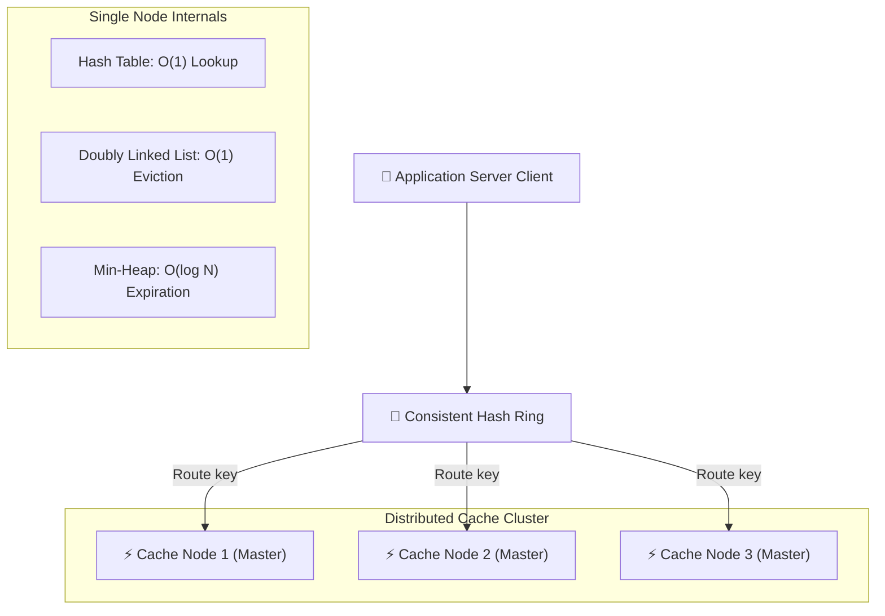

# 22 - Case Study: Distributed In-Memory Cache (Redis-like)

> **Real-World Analogy:**  
> Imagine a warehouse where hundreds of workers need reference sheets quickly. Instead of sending each worker down into the subterranean archives, you place a row of high-speed digital kiosks on the main floor. The kiosks use consistent hashing to decide which kiosk stores which item and automatically discard stale sheets when space runs low.

---

## 🎯 What & Why
End-to-end design of an in-memory distributed key-value store, detailing memory allocation, LRU eviction, TTL expiration policies, consistent hashing for cluster nodes, and replication.

---

## 📊 Visual Architecture Diagram


---

## ⚙️ How It Works Under The Hood
### Internal Architecture of a Cache Node

A high-performance cache node consists of three cooperating data structures:
1. **Hash Table**: Maps keys to data pointers with $O(1)$ average time complexity.
2. **Doubly Linked List**: Maintains item access recency for $O(1)$ LRU eviction when memory hits capacity.
3. **Expiration Queue (Min-Heap / Probabilistic Sampling)**:
   - Redis does not inspect every key every second.
   - It runs an active expiration cycle testing 20 random keys with TTLs 10 times per second; if more than 25% are expired, it repeats immediately.

---

### Scaling Out to Multiple Nodes

- Uses **Consistent Hashing** so adding a new cache server only moves $1/N$ of the dataset.
- Master-Replica pairs ensure high availability; if a master crashes, a replica takes over without cache drops.

---

## 💻 Concrete Code Implementation
```python
# Python implementation: In-Memory Key-Value Cache with TTL and LRU Eviction
import time

class CacheEntry:
    def __init__(self, key: str, value: any, expires_at: float):
        self.key = key
        self.value = value
        self.expires_at = expires_at

class InMemDistributedCacheNode:
    def __init__(self, max_keys: int = 100):
        self.max_keys = max_keys
        self.store = {}

    def set(self, key: str, value: any, ttl_seconds: float = None):
        expires_at = time.time() + ttl_seconds if ttl_seconds else float('inf')
        if len(self.store) >= self.max_keys and key not in self.store:
            # Evict oldest inserted key
            oldest_key = next(iter(self.store))
            del self.store[oldest_key]

        self.store[key] = CacheEntry(key, value, expires_at)

    def get(self, key: str):
        entry = self.store.get(key)
        if not entry:
            return None
        if time.time() > entry.expires_at:
            del self.store[key]  # Lazy expiration
            return None
        return entry.value

if __name__ == "__main__":
    cache = InMemDistributedCacheNode(max_keys=2)
    cache.set("k1", "v1", ttl_seconds=1.0)
    cache.set("k2", "v2")

    print("Immediate get k1:", cache.get("k1"))
    time.sleep(1.2)
    print("Expired get k1:", cache.get("k1"))

```

---

## ⚖️ Trade-Offs & Architectural Considerations
- **High Availability vs Strong Consistency**: Match the architectural requirements to the business domain.
- **Caching & Data Locality**: Keep reads fast at the edge while protecting the database.
- **Fail-Safe Design**: Ensure the system degrades gracefully under extreme load.
