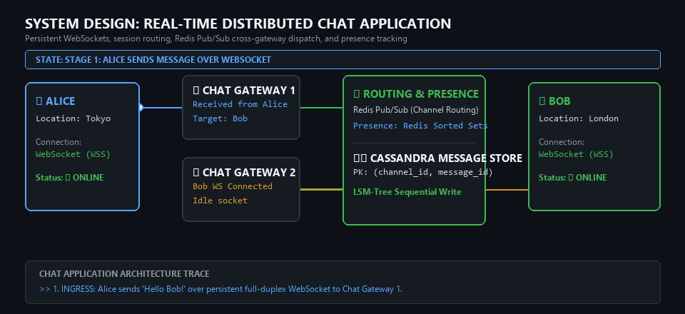

# 23 - System Design: Real-Time Distributed Chat App (WhatsApp / Discord)

> **Executive Summary:** Designing a global real-time chat application (like WhatsApp, Discord, or Slack) requires orchestrating millions of persistent, full-duplex **WebSocket** connections, maintaining a high-throughput **Presence Service** (Online/Offline status), routing messages across distributed gateway clusters via a low-latency pub/sub message broker, storing petabytes of chat history in wide-column LSM-tree storage (Apache Cassandra / ScyllaDB), and falling back to APNs/FCM mobile push notifications for offline users.

---

> 🏢 **Real-World Deep Dives**: Detailed case studies of how **Google** & **Netflix** implement this in production are documented in [REAL_WORLD_EXAMPLES.md](./REAL_WORLD_EXAMPLES.md).

## ⏱️ Prerequisites: What You Need to Know First

To get the most out of this module, make sure you understand:
- [01 - Client-Server Networking](../01-client-server-networking/README.md): WebSockets vs. HTTP long-polling vs. SSE.
- [06 - Relational & Non-Relational Databases](../06-relational-and-non-relational-databases/README.md): Wide-column NoSQL stores vs. relational tables.
- [17 - Message Queues & Distributed Logs](../17-message-queues/README.md): Pub/Sub routing and asynchronous messaging.
- [20 - Fault Tolerance & Resilience](../20-fault-tolerance-and-resilience/README.md): Connection pooling, heartbeats, and fail-fast patterns.

---

## 🧒 The 30-Second Version (ELI5)

Imagine you and your friend are talking over two-way walkie-talkies:
- When you speak, sound travels instantaneously over the open radio frequency (**WebSocket**). You don't hang up the phone and redial every time you say a single sentence!
- If your friend is in another country, your walkie-talkie signal beams to a local radio tower (**Chat Gateway**), which zips the message through an underground fiber optic cable (**Message Broker**) to your friend's local radio tower.
- If your friend's walkie-talkie is turned off (**Offline**), the central post office writes your message down in an envelope, slips it into their mailbox (**Message Store**), and taps on their window with a postcard (**Push Notification**).

---

## 🍕 Everyday Analogy

| Chat System Component | Walkie-Talkie & Dispatch Analogy | Technical Reality in Discord / WhatsApp |
| :--- | :--- | :--- |
| **WebSocket Connection** | Holding open a persistent walkie-talkie channel | Full-duplex bidirectional TCP connection (RFC 6455) |
| **Chat Gateway Server** | Local radio dispatch tower managing 50,000 radios | Stateful edge gateway holding open client socket descriptors |
| **Message Broker** | High-speed pneumatic tubes connecting dispatch towers | Redis Pub/Sub, Apache Kafka, or RabbitMQ cluster |
| **Presence Service** | The tower's status board showing which radios are transmitting | In-memory Redis Sorted Sets updated via 10-second heartbeats |
| **Message History Store** | Permanent bound filing cabinets with timestamped transcripts | Apache Cassandra / ScyllaDB wide-column store |
| **Push Notification** | Ringing the recipient's home doorbell when radio is turned off | Apple APNs / Google Firebase Cloud Messaging (FCM) |

---

## 🧩 The Problem It Solves

### Why Traditional HTTP Fails for Real-Time Chat
In classic HTTP request-response:
- The client must always initiate communication; the server cannot push data to the client.
- **Polling (`setInterval(fetch, 1000)`)**: Creates massive wasted traffic—$99\%$ of requests return empty responses, wasting bandwidth and exhausting server CPU.
- **HTTP Long-Polling**: Holds connection open until a message arrives. However, every new message requires tearing down the TCP connection, doing a new TLS handshake, and sending heavy HTTP headers ($500\text{–}1,000\text{ bytes}$ of header overhead for a $10\text{-byte}$ message!).

### How WebSockets Revolutionize Real-Time Scale
- **Persistent Bi-directional Socket**: Initiated via an HTTP Upgrade handshake, then converts to a lightweight framed binary protocol over TCP.
- **Minimal Framing Overhead**: Frame headers are only **$2\text{ to }10\text{ bytes}$** per message.
- **Instantaneous Server Push**: The server pushes messages directly into the client's open socket with zero polling delay ($<5\text{ ms}$).

---

## 🖼️ Picture It: Architecture & Flow

### High-Resolution Chat App Animation
Below is an animated trace of cross-gateway message routing between Alice and Bob via Redis Pub/Sub, with Cassandra history persistence:



---

### End-to-End Chat Architecture Flowchart

```mermaid
sequenceDiagram
    autonumber
    actor Alice as 👤 Alice (Tokyo)
    participant GW1 as ⚡ Chat Gateway 1
    participant Presence as 📡 Presence Service (Redis)
    participant Broker as 📜 Redis Pub/Sub / Kafka
    participant GW2 as ⚡ Chat Gateway 2
    actor Bob as 👤 Bob (London)
    participant DB as 🗄️ Cassandra Message Store

    Alice->>GW1: Send: "Hello Bob!" (over WebSocket)
    GW1->>DB: 1. Persist message (channel_id, timestamp)
    GW1->>Presence: 2. Query Bob's location
    Presence-->>GW1: Bob is on 'GW-London-02'
    
    rect rgb(22, 27, 34)
    Note over GW1, GW2: Cross-Gateway Real-Time Dispatch
    GW1->>Broker: 3. Publish to channel 'user:bob'
    Broker->>GW2: 4. Route frame to GW-London-02
    GW2->>Bob: 5. Push frame over active WebSocket (5ms)
    end

    Bob-->>GW2: Read ACK
    GW2->>Alice: Delivery Receipt: DELIVERED (✓✓)
```



---

## 🔢 Walk-Through with Real Numbers

Let's model capacity planning for a platform with **50 Million Daily Active Users (DAU)**:

### 1. Concurrency & Throughput Math
- **Peak Concurrent Connections**:
  Assume 20% of DAU are connected simultaneously at peak:
  $$\text{Concurrent WebSockets} = 50,000,000 \times 0.20 = \mathbf{10,000,000\text{ active connections}}$$
- **Message Volume**:
  Assume average active user sends 40 messages per day:
  $$\text{Total Daily Messages} = 50,000,000 \times 40 = \mathbf{2\text{ Billion messages/day}}$$
- **Average QPS**:
  $$\text{QPS} = \frac{2,000,000,000}{86,400} \approx \mathbf{23,150\text{ msgs/sec}}$$
  $$\text{Peak QPS (3x)} \approx \mathbf{70,000\text{ msgs/sec}}$$

### 2. Gateway Server Fleet Sizing
A high-performance Linux server running modern Erlang/Go/Node with tuned `epoll` and `file-max` can comfortably hold **$100,000$ open idle WebSocket connections**:
- Memory per open WebSocket connection (OS TCP buffer + app struct): $\approx 10\text{ KB}$.
- RAM for 100k connections: $100,000 \times 10\text{ KB} \approx 1\text{ GB of RAM}$.
- Servers needed to hold 10M concurrent connections:
  $$\text{Gateways Needed} = \frac{10,000,000}{100,000} = \mathbf{100\text{ Chat Gateway instances}}$$

### 3. Storage Estimations (5-Year Horizon)
- Average message size: $100\text{ bytes}$ text + $60\text{ bytes}$ metadata = $160\text{ bytes}$.
- Daily storage: $2\text{ Billion} \times 160\text{ bytes} \approx 320\text{ GB/day}$.
- 5-year storage:
  $$\text{Storage (5 Years)} = 320\text{ GB} \times 365 \times 5 \approx \mathbf{584\text{ Terabytes}}$$
584 TB fits cleanly in a multi-node Apache Cassandra or ScyllaDB cluster.

---

## ⚙️ How It Works Under the Hood

### 1. Transport Comparison

| Protocol | Connection Type | Header Overhead | Latency | Suitability for Chat |
| :--- | :--- | :--- | :--- | :--- |
| **HTTP Polling** | Short-lived request/response | Enormous (~800 bytes/req) | Terrible (tied to poll interval) | ❌ Unusable at scale |
| **Long-Polling** | Request held until data arrives | High (~800 bytes per msg) | Medium (~100–300 ms) | Legacy fallback only |
| **Server-Sent Events (SSE)**| Persistent half-duplex (server to client) | Minimal (~5 bytes) | Low (<10 ms) | Good for feeds, but cannot send client-to-server |
| **WebSockets (RFC 6455)**| **Persistent full-duplex bi-directional** | **Tiny (2 to 10 bytes)** | **Ultra-Low (<5 ms)** | **Gold Standard for Modern Chat** |

---

### 2. Presence Service Architecture (Heartbeats)

How do you track whether 50 million users are online or offline without melting the database?
- **Heartbeat Mechanism**: Every client sends a lightweight heartbeat frame (ping/pong) every 10–15 seconds over its existing WebSocket.
- **In-Memory Store (Redis)**:
  - When a heartbeat arrives: `SET user:online:<id> 1 EX 30` (sets key with 30-second TTL).
  - If the user disconnects or loses cellular signal, the 30-second TTL naturally expires in Redis. The user automatically transitions to **Offline** without needing an explicit logout event!
- **Presence Caching**: Clients only query presence for users visible on their current screen (e.g. current conversation or top 20 visible contacts), never for their entire contact book.

---

### 3. Group Chat Fanout: Small Groups vs. Massive Discord Channels

| Feature | Small Group Chat (e.g. WhatsApp / iMessage, $<100$ users) | Massive Public Channels (e.g. Discord / Twitch, $>100,000$ users) |
| :--- | :--- | :--- |
| **Fanout Strategy** | **Fanout-on-Write** (Push model) | **Fanout-on-Read** (Pull / Pub-Sub model) |
| **Mechanism** | Message is copied into each member's private inbox queue | Single copy stored in channel log; active members pull from channel |
| **Write Cost** | $O(N)$ where $N$ is group members | $O(1)$ constant time |
| **Delivery** | Instantaneous push to all members | Broadcast only to actively connected viewers in that channel |

---

### 4. Why Cassandra / ScyllaDB for Message Storage?

Relational databases (MySQL/Postgres) struggle with chat history because:
1. High concurrent random writes cause heavy B-tree index splits and lock contention.
2. Deleting old messages creates table fragmentation.

**Wide-Column NoSQL (Cassandra) is perfect for chat**:
- **LSM-Tree Storage Engine**: Writes are sequential appends to memory (Memtable) and flushed sequentially to disk (SSTables), providing massive write throughput.
- **Clustered Primary Key Design**:
  ``*(The ScyllaDB/Cassandra message table schema is separated into [schema.sql](./schema.sql); run [demo.py](./demo.py) for the complete chat gateway simulation.)*``
- **$O(1)$ Range Lookups**: Fetching the latest 50 messages for a channel translates to a single contiguous sequential disk scan!

---

## ⚖️ Trade-Offs & Decision Matrix

| Dimension | Fanout on Write (Push to Inbox) | Fanout on Read (Shared Channel) |
| :--- | :--- | :--- |
| **Best For** | 1-on-1 DMs and small group chats (<50 people) | Massive public channels, Discord servers, Twitch chat |
| **Write Amplification**| High ($N$ writes for $N$ recipients) | **Zero ($O(1)$ single write to channel log)** |
| **Read Complexity** | Ultra-Fast ($O(1)$ query to single inbox) | Must query channel log and filter permissions |
| **Storage Footprint** | Multiplied by number of participants | **Single master copy of message** |

---

## 🚫 Common Mistakes & Production Pitfalls

1. **Broadcasting Presence Changes to All Contacts**:
   - *Pitfall*: When User A logs in, the presence service broadcasts `Alice is Online` to all 2,000 of Alice's contacts.
   - *Result*: With 10,000,000 users logging in during peak morning hours, presence broadcasts generate $10\text{M} \times 2,000 = \mathbf{20\text{ Billion messages/second}}$, crashing the gateway cluster! Only push presence updates to users who are actively viewing a direct conversation with Alice.

2. **Using Auto-Incrementing IDs for Messages**:
   - *Pitfall*: Using database auto-increment integers (`1, 2, 3...`) across distributed shards.
   - *Result*: Impossible to coordinate monotonically increasing sequential IDs across multi-region databases without distributed lock bottlenecks. Use **UUIDv7** or **Twitter Snowflake IDs** (which encode a 41-bit millisecond timestamp + worker ID + sequence).

3. **Treating WebSockets as Stateless**:
   - *Pitfall*: Assuming an L4 load balancer can route WebSocket frames to any server.
   - *Reality*: WebSockets are **stateful TCP connections**. The TCP socket exists in memory on one specific physical machine. The architecture must maintain a Session Registry (in Redis) mapping `user_id -> gateway_server_id` so other servers know where to route incoming messages.

---

## 💻 Try It Yourself: Python Simulation

The companion simulation script [`demo.py`](./demo.py) implements:
1. Multi-server Chat Gateways holding active WebSocket client connections.
2. Real-time cross-gateway message routing via a simulated Redis Pub/Sub broker.
3. A distributed Presence Service tracking Online/Offline status with heartbeats.
4. Offline message inbox queuing and simulated mobile Push Notifications (APNs/FCM).
5. Wide-Column Cassandra message history fetching.

Run it locally in your terminal:
```bash
python demo.py
```

---

## 🌍 Where You'll See It in Production

- **WhatsApp**: Built on Erlang and the BEAM virtual machine. Uses lightweight Erlang actor processes to hold millions of concurrent connections per box, passing messages across an internal actor distribution mesh.
- **Discord**: Uses Elixir on edge gateways to terminate millions of WebSockets. Migrated their massive message history store from MongoDB to Apache Cassandra, and subsequently to **ScyllaDB** (C++ Cassandra rewrite) to eliminate Java JVM garbage collection latency spikes.
- **Slack**: Originally used HTTP long-polling with PHP backends; re-architected their real-time engine to Java/Go WebSocket edge servers backed by Kafka and Envoy proxies.

---

## 🎯 Top Interview Questions & Deep Answers

### Q1: "How do you guarantee that messages in a group chat are displayed in the exact same chronological order on all devices?"
**Interviewer Goal**: Testing candidate's mastery of distributed ordering and message ID generation.

**Model Answer**:
"Guaranteeing consistent ordering across distributed clients requires two core mechanisms:
1. **Timestamped Monotonic IDs (Snowflake / UUIDv7)**:
   - We cannot rely on client device clocks because client clocks suffer from severe skew, drift, and time-zone errors.
   - When the Chat Gateway receives a message, it assigns a 64-bit monotonically increasing ID (like Twitter Snowflake):
     $$\text{ID} = [\text{41-bit timestamp}] + [\text{10-bit machine ID}] + [\text{12-bit sequence}]$$
   - This ensures that within any given millisecond, messages are uniquely and strictly ordered.
2. **Channel Sequence Numbers**:
   - For high-concurrency group chats, the channel coordinator maintains an atomic sequence counter (`seq_num = 1, 2, 3...`) stored in Redis or assigned by a single partition leader in Kafka.
   - Clients render messages strictly sorted by `seq_num`. If a client receives sequence 4 while only having sequence 2, it buffers message 4 and issues a sync request for missing sequence 3."

---

### Q2: "How do you scale a Presence Service when you have 100 million users logging on and off?"
**Interviewer Goal**: Evaluating backpressure control and high-throughput cache design.

**Model Answer**:
"Naive presence architectures collapse because broadcasting online/offline status changes for 100M users generates billions of fanout events.
To scale presence efficiently:
1. **Heartbeats Instead of Persistent DB Writes**:
   - Clients send a TCP ping every 10–15 seconds.
   - The gateway writes to Redis using a key with a 30-second TTL: `SET presence:<user_id> online EX 30`.
2. **Batching & Debouncing**:
   - When a user's mobile connection fluctuates (e.g. driving through a tunnel), they may connect and disconnect 5 times in 1 minute.
   - We **debounce** status updates: don't broadcast 'Offline' immediately upon socket close; wait 30 seconds. If the user reconnects within 30 seconds, zero presence change events are emitted!
3. **Pull Model for Large Contact Lists**:
   - We never broadcast presence to a user's entire friend list.
   - When a user opens the app, the client fetches presence only for the **visible screen items** (e.g., the top 15 conversations in their inbox). For group chats with $>100$ people, presence is turned off completely."

---

### Q3: "What happens when a message is sent to an offline user, and how does mobile push notification delivery work?"
**Interviewer Goal**: Assessing edge-to-cloud mobile integration and offline sync protocols.

**Model Answer**:
"When Alice sends a message to Bob:
1. Gateway queries the Presence Service: Bob has no active WebSocket connection (Offline).
2. The message is written to the persistent **Cassandra Message Store** with status `UNREAD`.
3. The message is also placed in Bob's **Offline Inbox Queue**.
4. The Gateway invokes the **Push Notification Service**:
   - Assembles payload (e.g. `{"alert": "Alice: Hello!", "badge": 1}`).
   - Dispatches payload to Apple Push Notification service (APNs) for iOS or Firebase Cloud Messaging (FCM) for Android.
5. When Bob wakes up and opens the app:
   - Bob establishes a new WebSocket connection to a gateway.
   - Bob's client sends a sync request: `Sync(last_received_message_id = 'msg_9821')`.
   - The gateway fetches all messages for Bob with $\text{ID} > \text{'msg\_9821'}$, streams them down the socket, and marks them `DELIVERED`."

---

### Q4: "Why is Apache Cassandra or ScyllaDB preferred over MySQL/Postgres for storing chat history?"
**Interviewer Goal**: Testing database internal storage engine mechanics (LSM-trees vs B-Trees).

**Model Answer**:
"Chat messaging has an extreme write-heavy profile (billions of new inserts daily) coupled with a very specific read pattern: users almost exclusively query recent messages in a single channel ordered chronologically.

1. **LSM-Trees vs B-Trees**:
   - In MySQL/Postgres (B-Trees), inserting new rows requires random disk lookups to update index pages, causing heavy lock contention and disk head thrashing at high scale.
   - In Cassandra/ScyllaDB (LSM-Trees), all writes are sequential in-memory appends (Memtable) flushed sequentially to disk (SSTable), providing virtually unlimited horizontal write throughput.
2. **Partition & Clustering Key Alignment**:
   - By designing the schema with `PRIMARY KEY (channel_id, message_id)`, all messages for a conversation reside on the same physical cluster partition and are stored **pre-sorted on disk**.
   - Fetching the last 50 messages requires a single contiguous sequential disk read ($O(1)$ disk seek), rather than scanning scattered relational blocks."

---

### Q5: "How does End-to-End Encryption (E2EE) impact the system design of a chat application?"
**Interviewer Goal**: Testing security protocols (Signal Protocol) and server-side constraints.

**Model Answer**:
"When End-to-End Encryption (like the Signal Protocol used by WhatsApp) is introduced, the system design fundamentally shifts:
1. **Server is Zero-Knowledge**:
   - The application servers, message brokers, and database stores **cannot read message contents**. Messages are encrypted on the sender's device using the recipient's public key / session ratchet key, and can only be decrypted on the recipient's device.
2. **Key Management Infrastructure**:
   - The architecture must introduce a **Key Distribution Service** storing Identity Keys, Signed Prekeys, and One-Time Prekeys uploaded by clients upon registration.
3. **No Server-Side Full-Text Search**:
   - Because the server stores encrypted ciphertext blobs, servers cannot run Elasticsearch or SQL `LIKE '%keyword%'` queries. All message indexing and full-text search must be executed **locally on the client's mobile device (SQLite)**.
4. **Media Handling**:
   - Images and videos are encrypted on the sender's phone with a symmetric key. The encrypted ciphertext blob is uploaded to an S3/Blob store, and the symmetric key is transmitted inside the encrypted chat message payload."

---

## ✅ Check Yourself: Flash Quiz

<details>
<summary><b>1. Why are WebSockets vastly superior to HTTP Long-Polling for high-frequency chat?</b></summary>
<br>
Because WebSockets establish a <b>persistent, full-duplex TCP socket</b> with frame overhead of only <b>2 to 10 bytes</b>. In contrast, HTTP Long-Polling tears down the connection on every message, requiring fresh TCP/TLS handshakes and re-transmitting 500–1,000 bytes of redundant HTTP headers for every single message.
</details>

<details>
<summary><b>2. How does a Chat Gateway know which server an active recipient is connected to?</b></summary>
<br>
Via an in-memory <b>Session Registry / Presence Service</b> (typically built on Redis). When a client connects via WebSocket, the gateway writes <code>user_id -> gateway_server_id</code>. When another server needs to deliver a message, it queries Redis and routes the payload to that specific gateway via a pub/sub message broker.
</details>

<details>
<summary><b>3. Why is Cassandra's <code>PRIMARY KEY (channel_id, message_id)</code> optimal for message history queries?</b></summary>
<br>
Because <code>channel_id</code> acts as the <b>partition key</b> (grouping all messages for that channel onto the same storage node), and <code>message_id</code> acts as the <b>clustering column</b> (storing messages sequentially on disk pre-sorted by time). Fetching recent history is a contiguous sequential disk read rather than an expensive multi-table join.
</details>

---

## 📚 Go Deeper: Recommended Reading

- **System Design Interview – An Insider's Guide (Volume 1)** by Alex Xu — *Chapter 12: Design a Chat System*.
- **The Discord Engineering Blog**: *How Discord Stores Billions of Messages (Migrating from Cassandra to ScyllaDB)*.
- **WhatsApp Architecture**: *Scaling Erlang/OTP to Millions of Concurrent WebSockets (Rick Reed)*.
- **RFC 6455**: *The WebSocket Protocol Specification*.

---

## 🔗 Related Modules

- [01 - Client-Server Networking](../01-client-server-networking/README.md): TCP sockets, WebSockets, and TLS termination.
- [06 - Relational & Non-Relational Databases](../06-relational-and-non-relational-databases/README.md): Wide-column LSM storage engines.
- [17 - Message Queues & Distributed Logs](../17-message-queues/README.md): Pub/Sub message brokers for inter-gateway routing.
- [20 - Fault Tolerance & Resilience](../20-fault-tolerance-and-resilience/README.md): Connection heartbeats and dead-letter queues.
