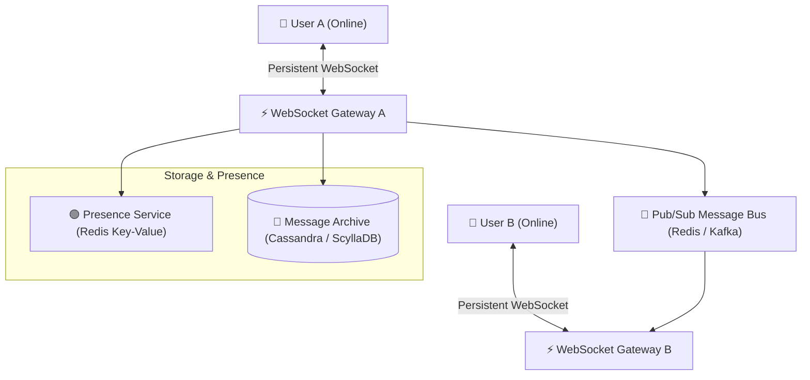

# 23 - Case Study: Real-Time Chat System (Discord / WhatsApp)

> **Real-World Analogy:**  
> Imagine a telephone switchboard. Every caller keeps an active line open to the switchboard (persistent WebSocket connection). When you speak, the operator looks up which line your friend is connected to and immediately connects your audio packets. If your friend's phone is disconnected, the operator writes your message onto an envelope and drops it into their physical mailbox (offline queue).

---

## 🎯 What & Why
Architecture design of a low-latency real-time chat application supporting one-on-one and group messaging, online presence tracking, and message history storage at scale.

---

## 📊 Visual Architecture Diagram


---

## ⚙️ How It Works Under The Hood
### Core Architectural Pillars

1. **Persistent WebSocket Connections**:
   - HTTP polling or long-polling incurs unacceptable latency and massive header overhead.
   - Long-lived bidirectional **WebSocket** connections keep TCP open with minimal frame overhead (2 bytes).

2. **Connection Gateway & Session Routing**:
   - A single gateway server can hold 50,000 to 100,000 concurrent open WebSocket connections using non-blocking epoll.
   - A distributed routing table (e.g., in Redis) tracks which gateway server currently hosts each user: `User_101 -> Server_A`.

3. **Message Storage Strategy**:
   - Chat apps are **write-heavy and read-recent**.
   - NoSQL Wide-Column stores (Apache Cassandra / ScyllaDB) excel here because messages are appended sequentially by timestamp within a `conversation_id` partition key:
     `PRIMARY KEY ((conversation_id), message_id)` with clustering order descending.

4. **Presence Tracking**:
   - Clients send a heartbeat ping every 10–30 seconds.
   - If no heartbeat is received within 60 seconds, mark the user offline.

---

## 💻 Concrete Code Implementation
```python
# Python simulation: Message routing engine for real-time chat
class ChatGateway:
    def __init__(self):
        # Maps user_id -> connected client callback
        self.active_sessions = {}
        # Stores offline messages
        self.offline_inbox = {}

    def connect_user(self, user_id: str, receive_callback):
        self.active_sessions[user_id] = receive_callback
        # Flush offline messages if any
        if user_id in self.offline_inbox:
            for msg in self.offline_inbox[user_id]:
                receive_callback(msg)
            del self.offline_inbox[user_id]

    def disconnect_user(self, user_id: str):
        if user_id in self.active_sessions:
            del self.active_sessions[user_id]

    def send_message(self, sender: str, recipient: str, text: str):
        message_packet = {"from": sender, "to": recipient, "text": text}
        if recipient in self.active_sessions:
            # Deliver directly via open connection
            self.active_sessions[recipient](message_packet)
        else:
            # Queue for offline delivery
            self.offline_inbox.setdefault(recipient, []).append(message_packet)

if __name__ == "__main__":
    gateway = ChatGateway()
    
    # Alice sends Bob a message while Bob is offline
    gateway.send_message("alice", "bob", "Hey Bob, are you free?")

    # Bob connects
    print("Bob connects to WebSocket Gateway:")
    gateway.connect_user("bob", lambda msg: print(f"  [Bob's Screen] New message: {msg['text']} from {msg['from']}"))

```

---

## ⚖️ Trade-Offs & Architectural Considerations
- **High Availability vs Strong Consistency**: Match the architectural requirements to the business domain.
- **Caching & Data Locality**: Keep reads fast at the edge while protecting the database.
- **Fail-Safe Design**: Ensure the system degrades gracefully under extreme load.
