# 24 - Case Study: Video Streaming Platform (YouTube / Netflix)

> **Real-World Analogy:**  
> Imagine shipping a giant 10-meter stone sculpture. You can't fit it into any standard delivery van. Instead, you carefully cut the sculpture into 500 small numbered jigsaw blocks. As soon as the first 5 blocks arrive at the destination, the recipient starts assembling the base without waiting for the other 495 blocks to ship. That is video chunking and streaming.

---

## 🎯 What & Why
Design of a large-scale video processing and distribution architecture, covering upload pipelines, parallel transcoding DAGs, Adaptive Bitrate Streaming (HLS/DASH), and CDN caching.

---

## 📊 Visual Architecture Diagram

```mermaid
flowchart TD
    Creator["📹 Video Creator"] --> Upload["🚀 Upload Service (Multipart S3)"]
    Upload --> Queue["📬 Transcode Job Queue"]

    subgraph TranscodePipeline["Transcoding Cluster (Distributed Workers)"]
        Chunker["✂️ Video Chunker (Split into 5s segments)"]
        Trans1080["Encoder: 1080p (H.264 / AV1)"]
        Trans720["Encoder: 720p (H.264 / AV1)"]
        Trans360["Encoder: 360p (H.264 / AV1)"]
        Manifest["📋 Generate Master Playlist (.m3u8)"]
    end

    Queue --> Chunker
    Chunker --> Trans1080
    Chunker --> Trans720
    Chunker --> Trans360
    Trans1080 --> Manifest
    Trans720 --> Manifest
    Trans360 --> Manifest

    Manifest --> CDN["⚡ Edge CDN PoPs"]
    CDN --> Viewer["📱 Video Viewers (Smooth Playback)"]
```


---

## ⚙️ How It Works Under The Hood
### Video Processing Architecture

1. **Chunking & Multipart Upload**:
   - Raw 4K video files can be 10GB–50GB.
   - Uploading in a single HTTP request will fail on mobile network drops.
   - The client splits files into 5MB chunks and uploads them in parallel with signed URLs directly to object storage (Amazon S3 / Google Cloud Storage).

2. **Transcoding DAG (Directed Acyclic Graph)**:
   - Raw uploaded videos must be encoded into multiple resolutions (360p, 480p, 720p, 1080p, 4K) and formats (H.264, VP9, AV1) to support devices from budget smartphones to 4K TVs.
   - Distributed workers encode chunks in parallel.

3. **Adaptive Bitrate Streaming (ABR)**:
   - Protocols: **HLS** (HTTP Live Streaming) and **DASH** (Dynamic Adaptive Streaming over HTTP).
   - Video is divided into short segments (typically 2 to 6 seconds each).
   - A **master playlist** lists all resolutions and bitrates: an `.m3u8` file for HLS, an `.mpd` manifest for DASH.
   - The video player continuously monitors network throughput:
     - On fast Wi-Fi: automatically downloads the next 1080p segment.
     - Moving into a subway tunnel: seamlessly steps down to 480p without buffering.

---

## 💻 Concrete Code Implementation
```python
# Python simulation: Adaptive Bitrate Playlist generation
class VideoStreamManifest:
    def __init__(self, video_id: str):
        self.video_id = video_id
        self.renditions = {
            "1080p": {"bandwidth": 5000000, "resolution": "1920x1080"},
            "720p":  {"bandwidth": 2500000, "resolution": "1280x720"},
            "360p":  {"bandwidth": 800000,  "resolution": "640x360"}
        }

    def generate_master_m3u8(self) -> str:
        lines = ["#EXTM3U", "#EXT-X-VERSION:6"]
        for label, spec in self.renditions.items():
            lines.append(f"#EXT-X-STREAM-INF:BANDWIDTH={spec['bandwidth']},RESOLUTION={spec['resolution']}")
            lines.append(f"https://cdn.example.com/videos/{self.video_id}/{label}/index.m3u8")
        return "\n".join(lines)

if __name__ == "__main__":
    manifest = VideoStreamManifest("vid_98765")
    print(manifest.generate_master_m3u8())

```

---

## ⚖️ Trade-offs

| Decision | Trade-off |
| :--- | :--- |
| **More renditions** (240p → 4K) | Smooth playback on any connection; transcoding cost and storage grow with each one |
| **H.264 vs VP9 / AV1** | H.264 plays everywhere; newer codecs save 30–50% bandwidth but are slower to encode and not supported on every device |
| **Shorter segments** (2 s) | Faster start and quicker quality switching; more files and requests, slightly worse compression |
| **Longer segments** (6–10 s) | Efficient; slower to adapt and higher latency for live streams |
| **Transcode everything upfront** | Instant playback in every quality; wasted on videos nobody watches |
| **Transcode popular videos only / on demand** | Cheaper; the first viewer of a rare quality waits |
| **CDN for everything** | Fast and offloads origin; for a long tail of rarely-watched videos, CDN cache hit rates drop |

**Most of the bill is bandwidth and storage, not servers.** Encoding choices and caching decide how much it all costs.
