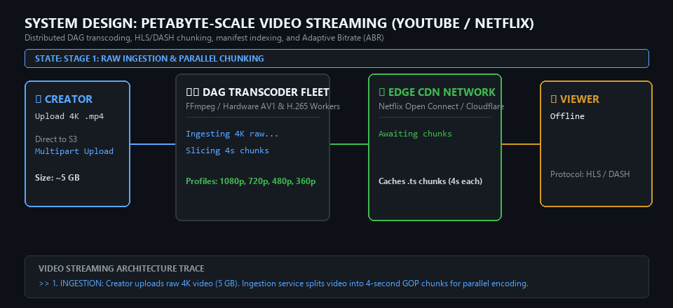

# 24 - System Design: Petabyte-Scale Video Streaming (YouTube / Netflix)

> **Executive Summary:** Serving video at global scale (YouTube handles 500 hours uploaded per minute; Netflix accounts for $\approx 15\%$ of global internet downstream traffic) is fundamentally different from serving standard web APIs. Monolithic video files cannot be streamed over fluctuating mobile networks. A production video architecture relies on **Distributed DAG Transcoding**, slicing videos into short 2–6 second chunks encoded across multiple bitrate profiles, indexed by **HLS / MPEG-DASH manifests** (`.m3u8`), dynamically navigated via **Adaptive Bitrate Streaming (ABR)**, and cached across global Edge CDN PoPs (e.g. Netflix Open Connect).

---

## ⏱️ Prerequisites: What You Need to Know First

To get the most out of this module, make sure you understand:
- [01 - Client-Server Networking](../01-client-server-networking/README.md): TCP flow control, bandwidth-delay product, and packet buffering.
- [12 - Content Delivery Networks](../12-content-delivery-networks/README.md): Edge Points of Presence (PoPs), Origin Shielding, and cache hit rates.
- [17 - Message Queues & Distributed Logs](../17-message-queues/README.md): Asynchronous task queues coordinating distributed workers.

---

## 🧒 The 30-Second Version (ELI5)

Imagine you are baking a massive 50-pound wedding cake to share with people all over the city:
- **Without Chunking**: You try to ship the entire 50-pound cake in one giant box to someone riding on a bicycle. If they hit a bump in the road, the whole delivery is ruined, and they starve until the entire cake arrives!
- **With Video Chunking & ABR (Netflix / YouTube)**:
  - You slice the cake into bite-sized cupcakes (**4-second video chunks**).
  - You bake the cupcakes in 4 different sizes: Giant Gourmet (1080p), Medium (720p), Small (480p), and Tiny Bite (360p).
  - If the bicycle rider is going fast down a smooth highway, they eat the Giant cupcakes. If they hit a rough dirt road (**weak 4G signal**), they automatically switch to eating the Tiny cupcakes without stopping to chew!

---

## 🍕 Everyday Analogy

| Video System Component | Bakery Analogy | Technical Reality in Netflix / YouTube |
| :--- | :--- | :--- |
| **Raw Master Video** | 50-pound raw unbaked wedding cake batter | Uncompressed 4K ProRes master file (50–100 GB) |
| **Transcoding Worker** | Fleet of industrial ovens baking different sizes | Distributed FFmpeg cluster encoding H.264, H.265, AV1 |
| **Video Chunk (.ts / .m4s)** | Individual 4-second bite-sized cupcake slices | 2–6 second HTTP chunk segment |
| **Manifest (.m3u8 / .mpd)**| The bakery menu listing all cupcake sizes and flavors | Master playlist index containing URLs for every resolution |
| **Adaptive Bitrate (ABR)** | Automatically eating smaller cupcakes when running out of breath | Client player dynamically switching bitrates based on bandwidth |
| **Edge CDN Appliance** | Local corner bakery stores holding fresh cupcakes | Edge PoP cache (Netflix OCA / Cloudflare) serving chunks in 3ms |

---

## 🧩 The Problem It Solves

### Why Monolithic Video Fails
If you serve a single 2-hour 4K MP4 file (`https://example.com/movie.mp4`, 8 GB):
1. **Bandwidth Waste**: If a user watches 30 seconds and navigates away, the browser has already pre-buffered 500 MB of data over cellular, wasting money for both the user and the platform.
2. **Buffering Hell**: If the user enters an elevator and network speed drops from 20 Mbps to 1 Mbps, playback immediately freezes with a spinning loading circle because the monolithic file bitrate exceeds current network capacity.
3. **Device Incompatibility**: A 4K TV needs high-bitrate HEVC/AV1, while an older Android smartphone only supports H.264 baseline profile.

### How Modern Video Streaming Solves This
1. Slices the video into discrete **4-second chunks**.
2. Encodes each chunk into multiple resolution/bitrate tiers ($360\text{p}, 480\text{p}, 720\text{p}, 1080\text{p}, 4\text{K}$).
3. The client video player monitors its own download buffer in real-time. If the buffer shrinks, it requests the next 4-second chunk in $720\text{p}$ rather than $1080\text{p}$. **Buffering drops to zero.**

---

## 🖼️ Picture It: Architecture & Flow

### High-Resolution Video Streaming Animation
Below is an animated trace of video chunking, distributed DAG transcoding, and real-time Adaptive Bitrate playback switching from 1080p $\rightarrow$ 720p with zero freezing:



---

### End-to-End Transcoding & Playback Pipeline

```mermaid
flowchart TD
    subgraph Ingestion["1. Ingestion Tier"]
        Creator["📹 Video Creator"] -->|Multipart Upload| S3Raw[("Raw Video Bucket<br/>(S3 / GCS Master)")]
        S3Raw --> Slicer["Video Slicer<br/>(Splits into 4s GOP chunks)"]
    end

    subgraph Transcode["2. Distributed DAG Transcoder Fleet"]
        Slicer --> Queue["📜 Kafka / SQS Task Queue"]
        Queue --> W1["Worker 1: 1080p (AV1)"]
        Queue --> W2["Worker 2: 720p (H.264)"]
        Queue --> W3["Worker 3: 360p (H.264)"]
        W1 --> Storage[("Transcoded Chunks Bucket<br/>.ts / .m4s segments + .m3u8")]
        W2 --> Storage
        W3 --> Storage
    end

    subgraph CDN["3. Global Delivery Tier"]
        Storage --> Shield["🛡️ Origin Shield (Regional Cache)"]
        Shield --> Edge["🌐 Edge CDN PoPs (Netflix Open Connect)"]
    end

    subgraph Playback["4. Client Playback Tier"]
        Edge -->|1. Fetch master.m3u8| Player["📱 Client Player (ABR Engine)"]
        Player -->|2. Stream 1080p chunks (Wi-Fi)| Edge
        Player -.->|3. Auto-downgrade to 480p on 4G| Edge
    end

    style Ingestion fill:#161b22,stroke:#58a6ff,stroke-width:2px;
    style Transcode fill:#161b22,stroke:#3fb950,stroke-width:2px;
    style CDN fill:#161b22,stroke:#d29922,stroke-width:2px;
    style Playback fill:#161b22,stroke:#a371f7,stroke-width:2px;
```

---

## 🔢 Walk-Through with Real Numbers

Let's estimate storage, compute, and bandwidth for a platform at **YouTube / Netflix scale**:

### 1. Ingestion & Storage Estimation
- **Upload Rate**: $500\text{ hours of video uploaded / minute}$.
- Raw video storage: Assume compressed master is $\approx 2\text{ GB / hour}$.
- Daily hours uploaded: $500 \times 60 \times 24 = \mathbf{720,000\text{ hours / day}}$.
- Daily raw master storage:
  $$\text{Raw Storage} = 720,000\text{ hrs} \times 2\text{ GB} = \mathbf{1,440\text{ Terabytes / day (1.44 PB/day)}}$$
- **Transcoded Storage Multiplier**:
  Each video is encoded into 4 resolution profiles (1080p, 720p, 480p, 360p), adding $\approx 150\%$ overhead:
  $$\text{Total Daily Storage} \approx 1.44\text{ PB} \times 2.5 = \mathbf{3.6\text{ Petabytes / day!}}$$

### 2. Egress Bandwidth & CDN Offload Math
- **Global Watch Time**: Assume $1\text{ Billion hours watched per day}$.
- Average streaming bitrate (weighted across mobile and TV): $\approx 3.0\text{ Mbps} = 375\text{ KB/second}$.
- Data transferred daily:
  $$\text{Total Daily Egress} = 1,000,000,000\text{ hrs} \times 3600\text{s} \times 375\text{ KB/s} \approx \mathbf{1.35\text{ Exabytes / day!}}$$
- Average Continuous Egress Bandwidth:
  $$\text{Bandwidth} = \frac{1\text{ Billion hrs} \times 3\text{ Mbps} \times 3600\text{s}}{86,400\text{s}} = \mathbf{125\text{ Terabits / second (125 Tbps)!}}$$

**Why Edge CDNs are Mandatory**:
- No central datacenter on Earth has 125 Tbps of transit capacity.
- With a **$98\%$ CDN edge cache hit rate**, origin traffic drops from 125 Tbps to only **2.5 Tbps**, distributed across thousands of local ISP peering exchanges.

---

## ⚙️ How It Works Under the Hood

### 1. Modern Video Codecs & Formats

A raw uncompressed $4\text{K}$ video frame ($3840 \times 2160 \times 3\text{ bytes}$) is $24.8\text{ MB per frame}$! At 60 fps, that is **$1.48\text{ GB per second}$**. Video codecs use temporal and spatial compression to reduce file sizes by $>99\%$:

| Codec | Efficiency | Hardware Support | Licensing | Best Used For |
| :--- | :--- | :--- | :--- | :--- |
| **H.264 (AVC)** | Baseline | 99.9% of all devices on Earth | Royalty fees | Fallback for legacy devices & mobile |
| **H.265 (HEVC)** | 50% better than H.264 | Modern 4K TVs, iPhones, Androids | Complex royalties | 4K & HDR premium streaming |
| **VP9** | 50% better than H.264 | Broad browser support (Chrome, Android) | Open source (Google) | YouTube default stream |
| **AV1** | **30% better than HEVC** | Modern GPUs & latest smartphones | Open source / Royalty-free | Next-generation YouTube & Netflix standard |

---

### 2. The HLS (HTTP Live Streaming) Protocol & Manifests

HLS (RFC 8216) works entirely over standard HTTP/HTTPS ports ($80/443$). There are no proprietary streaming server sockets!
1. The client player requests the **Master Manifest** (`master.m3u8`):
   ```m3u8
   #EXTM3U
   #EXT-X-STREAM-INF:BANDWIDTH=6000000,RESOLUTION=1920x1080
   1080p/index.m3u8
   #EXT-X-STREAM-INF:BANDWIDTH=2500000,RESOLUTION=1280x720
   720p/index.m3u8
   #EXT-X-STREAM-INF:BANDWIDTH=800000,RESOLUTION=640x360
   360p/index.m3u8
   ```
2. The player inspects its local network connection speed (e.g. 8 Mbps) and chooses `1080p/index.m3u8`:
   ```m3u8
   #EXTM3U
   #EXT-X-TARGETDURATION:4
   #EXTINF:4.000,
   chunk_000.ts
   #EXTINF:4.000,
   chunk_001.ts
   #EXTINF:4.000,
   chunk_002.ts
   ```
3. The player issues standard HTTP GET requests:
   `GET /video/1080p/chunk_000.ts`
   `GET /video/1080p/chunk_001.ts`

---

### 3. Distributed DAG Transcoding Architecture

A 2-hour movie cannot be transcoded sequentially on a single computer—it would take 4 hours to process!
- **GOP (Group of Pictures) Splitting**: Video frames depend on preceding I-frames (keyframes). The Ingestion worker splits the video strictly at GOP keyframe boundaries into thousands of standalone 4-second fragments.
- **DAG Workflow Engine (Temporal / Airflow)**:
  - Thousands of worker containers transcode chunks concurrently across multiple resolutions in parallel.
  - A stitcher worker compiles the individual transcoded segments and writes the master `.m3u8` manifest file.
  - An entire 2-hour movie is fully transcoded across 4 resolutions in **under 3 minutes**!

---

## ⚖️ Trade-Offs & Decision Matrix

| Dimension | HLS (HTTP Live Streaming) | WebRTC | RTMP (Legacy) |
| :--- | :--- | :--- | :--- |
| **Latency** | Medium (~2–6 seconds) | **Ultra-Low (<500 ms)** | Low (~1–3 seconds) |
| **CDN Scalability** | **Infinite (Standard HTTP Caching)**| Extremely Poor (No CDN caching) | Poor (Requires Flash media servers) |
| **Protocol** | Standard HTTP/HTTPS | UDP / SRTP / ICE | TCP port 1935 |
| **Best For** | On-Demand (Netflix, YouTube), Live TV | 2-way Video Calls (Zoom, Discord) | Ingestion stream from creator (OBS) |

---

## 🚫 Common Mistakes & Production Pitfalls

1. **Non-Keyframe Aligned Chunking**:
   - *Pitfall*: Slicing video chunks at arbitrary time marks (e.g. exactly every 4.000s) without aligning to I-frames (Keyframes).
   - *Result*: Video artifacts, green screen glitches, and player crashes during ABR resolution switching because P-frames and B-frames have missing references. Always split video strictly on **Keyframe (GOP) boundaries**.

2. **Serving Video Chunks Directly from S3/Origin**:
   - *Pitfall*: Letting user video players fetch `.ts` chunks directly from AWS S3.
   - *Result*: Catastrophic cloud egress bills (\$0.08 per GB). At 100 TB daily egress, S3 egress alone costs **\$8,000 per day**! Always put an Edge CDN (CloudFront/Cloudflare) in front with an aggressive 30-day cache header.

3. **Ignoring Client-Side Battery & CPU Drain**:
   - *Pitfall*: Forcing complex AV1 decoding on low-end mobile devices without dedicated AV1 hardware chips.
   - *Result*: Software decoding burns 100% of the mobile CPU, drains the phone's battery in 45 minutes, and causes frame drops. Always inspect client user-agent capabilities and fall back to hardware-accelerated H.264 when necessary.

---

## 💻 Try It Yourself: Python Simulation

The companion simulation script [`demo.py`](./demo.py) implements:
1. Video Slicing into 4-second HLS chunks across 4 resolution profiles (1080p, 720p, 480p, 360p).
2. Generating an HLS `master.m3u8` manifest index playlist.
3. An **Adaptive Bitrate (ABR) Video Player** dynamically shifting stream quality as simulated network speeds drop from 12 Mbps to 0.6 Mbps.
4. Proof of zero-rebuffering playback continuity.

Run it locally in your terminal:
```bash
python demo.py
```

Expected output preview:
```
======================================================================
PETABYTE-SCALE VIDEO STREAMING & ABR PLAYER SIMULATION
======================================================================

--- Phase 1: Transcoding 4K Master into HLS Streams ---
Generated 6 chunks (4s each) across 4 resolution profiles:
  Profile 1080p | Bitrate: 6000 kbps | Chunk Size: 2929.7 KB
  Profile 720p  | Bitrate: 2500 kbps | Chunk Size: 1220.7 KB
  Profile 480p  | Bitrate: 1000 kbps | Chunk Size: 488.3 KB
  Profile 360p  | Bitrate:  400 kbps | Chunk Size: 195.3 KB

HLS Master Manifest (.m3u8):
#EXTM3U
#EXT-X-STREAM-INF:BANDWIDTH=6000000,RESOLUTION=1080p
video_black_friday_keynote_1080p.m3u8
#EXT-X-STREAM-INF:BANDWIDTH=2500000,RESOLUTION=720p
video_black_friday_keynote_720p.m3u8

--- Phase 2: Simulating ABR Playback Under Fluctuating Bandwidth ---
Chunk 0 | Net: 12.0 Mbps -> Stream Quality: 1080p | Dl Time: 2.00s | Buffer Ahead: 2.00s
Chunk 1 | Net: 10.0 Mbps -> Stream Quality: 1080p | Dl Time: 2.40s | Buffer Ahead: 3.60s
Chunk 2 | Net:  3.2 Mbps -> Stream Quality: 480p  | Dl Time: 1.25s | Buffer Ahead: 6.35s
Chunk 3 | Net:  2.8 Mbps -> Stream Quality: 480p  | Dl Time: 1.43s | Buffer Ahead: 8.92s
Chunk 4 | Net:  0.8 Mbps -> Stream Quality: 360p  | Dl Time: 2.00s | Buffer Ahead: 10.92s
Chunk 5 | Net:  0.6 Mbps -> Stream Quality: 360p  | Dl Time: 2.67s | Buffer Ahead: 12.25s

✅ Playback Result: 100% smooth playback with ZERO rebuffering interruptions!
```

---

## 🌍 Where You'll See It in Production

- **Netflix Open Connect**: Netflix manufactures its own custom storage and streaming hardware appliances (Open Connect Appliances - OCAs) and provides them **free of charge directly inside local ISP data centers globally**. Over $95\%$ of Netflix traffic is served directly from inside the user's local internet provider without touching the public internet backbone!
- **YouTube**: Deploys the world's largest video transcoding infrastructure using custom Google-designed chips (Argos VCU - Video Coding Units), speeding up compute efficiency by $30\times$ compared to standard servers.
- **Twitch**: Ingests live video from streamers over RTMP/WebRTC, transcodes into HLS in real-time with sub-2-second latency (Low-Latency HLS - LL-HLS).

---

## 🎯 Top Interview Questions & Deep Answers

### Q1: "How does Adaptive Bitrate Streaming (ABR) work, and how does the client decide when to switch quality?"
**Interviewer Goal**: Testing client-server video protocol mechanics and control algorithms.

**Model Answer**:
"In Adaptive Bitrate Streaming (ABR):
1. The server pre-encodes the video into multiple discrete bitrate streams (e.g. 1080p @ 6 Mbps, 720p @ 2.5 Mbps, 360p @ 400 kbps) sliced into uniform 2–6 second chunks, described by a master `.m3u8` playlist.
2. The client video player runs an **ABR Decision Engine** governed by two metrics:
   - **Throughput-Based Estimation**: Measuring the download duration of the preceding chunk:
     $$\text{Estimated Bandwidth} = \frac{\text{Chunk Size (Bits)}}{\text{Download Duration (Seconds)}}$$
   - **Buffer-Based Estimation**: Monitoring the number of seconds of decoded video remaining in the player's forward buffer (e.g. 15 seconds ahead).
3. If network throughput drops or the forward buffer dips below a safety threshold (e.g. $<5$ seconds), the player proactively requests the next chunk in a lower resolution (e.g. 720p).
4. Because all resolution streams are strictly aligned on identical timestamp boundaries, the player seamlessly splices the lower-resolution chunk into playback without any audio popping, frame jitter, or buffering freezes."

---

### Q2: "Why do systems like YouTube split video files into small chunks during transcoding rather than encoding the full file?"
**Interviewer Goal**: Evaluating distributed processing, fault tolerance, and pipeline parallelism.

**Model Answer**:
"Transcoding an entire 2-hour 4K video file as a single monolithic job is an anti-pattern:
1. **Pipeline Parallelism**: Slicing the video into 4-second chunks allows hundreds of distributed worker containers to encode different chunks simultaneously. A 2-hour movie is processed in parallel across 500 containers in 2 minutes, rather than waiting 2 hours for a single machine.
2. **Failure Isolation**: Video transcoding is CPU/GPU intensive and prone to worker crashes or spot-instance terminations. If a worker crashes on chunk 42, only that single 4-second chunk needs to be re-tried, rather than restarting a 2-hour encoding job from the beginning.
3. **Pipelined Ingestion**: The transcoding pipeline can begin encoding the first 10 seconds of a video while the creator is still uploading the remaining 90% of the file."

---

### Q3: "How does Digital Rights Management (DRM) protect video content in streaming systems?"
**Interviewer Goal**: Testing media security, key licensing, and content encryption.

**Model Answer**:
"Video streaming platforms protect copyrighted content using Common Encryption (CENC - ISO/IEC 23001-7) combined with DRM systems (Google Widevine, Apple FairPlay, Microsoft PlayReady):
1. **Symmetric Chunk Encryption**: Video chunks are encrypted using AES-128 in CTR or CBC mode during transcoding. The encrypted `.ts` chunks can be publicly cached on edge CDNs without security risk.
2. **Encrypted Key Transmission**: The AES decryption key is not stored in the manifest.
3. **License Acquisition Handshake**:
   - When the user hits Play, the client authenticates with the platform and receives a signed DRM token.
   - The client browser's hardware-isolated **Content Decryption Module (CDM)** communicates directly with the platform's DRM License Server.
   - The license server issues the decryption key, which is injected directly into the device's secure video hardware pipeline (HDCP). Application JavaScript has zero access to the raw key or decrypted video frames, preventing screen recording."

---

### Q4: "How does live streaming (e.g. Twitch, live sports) differ from Video-on-Demand (VoD like Netflix)?"
**Interviewer Goal**: Assessing real-time latency trade-offs in media pipelines.

**Model Answer**:
"Live streaming introduces strict end-to-end latency constraints that fundamentally change the architecture:
1. **Latency Requirements**:
   - VoD (Netflix): Latency doesn't matter; pre-transcoding can take hours, and players buffer 30–60 seconds ahead.
   - Live Streaming: Expects sub-3-second latency so viewers can interact with live chat.
2. **Chunk Sizes**:
   - VoD uses 4–6 second chunks for maximum compression efficiency.
   - Low-Latency HLS (LL-HLS) and DASH-CMAF split chunks into **sub-second 'parts' (200–500 ms chunks)**, streaming them over HTTP/2 chunked transfer encoding as they are being encoded!
3. **Transcoding Compute**:
   - VoD uses multi-pass high-compression encoding (e.g. AV1/HEVC taking 10x real-time).
   - Live streaming requires real-time single-pass hardware encoding (GPU/ASIC) outputting frames in $<50\text{ ms}$."

---

### Q5: "What is Origin Shielding, and why is it crucial for high-traffic video platforms?"
**Interviewer Goal**: Testing multi-tier CDN caching economics and origin protection.

**Model Answer**:
"In a global CDN with 300+ Edge PoPs:
- When a viral video is published, all 300 PoPs will experience a cache miss for the new video chunks around the same time.
- If all 300 PoPs simultaneously fetch the video chunks from the origin storage bucket (AWS S3), it creates a massive Thundering Herd, spiking storage IOPS and egress bills.

**Origin Shielding (Tiered Caching)**:
- Places an intermediate caching proxy cluster geographically close to the S3 storage bucket.
- All 300 edge PoPs query the Origin Shield rather than S3.
- When Tokyo and London miss, Tokyo pulls from the Shield. The Shield pulls once from S3. When London queries 100 ms later, the Shield serves the chunk directly.
- This collapses 300 separate origin fetches into **exactly 1 origin fetch**, cutting S3 storage request costs by up to $99\%$."

---

## ✅ Check Yourself: Flash Quiz

<details>
<summary><b>1. Why can't you use WebRTC to stream a live football match to 50 million concurrent viewers?</b></summary>
<br>
Because WebSockets and WebRTC establish <b>direct stateful peer connections</b> that cannot be cached by standard HTTP Edge CDNs. Transmitting 50 million individual peer streams would require petabits of centralized server egress! HLS uses standard HTTP GET requests for static <code>.ts</code> chunks, allowing Edge CDNs to cache and fan out video to 50M viewers with 99% origin offload.
</details>

<details>
<summary><b>2. In HLS, what is the role of the <code>master.m3u8</code> file vs an individual resolution manifest file?</b></summary>
<br>
The <code>master.m3u8</code> manifest acts as the <b>top-level index</b> listing available resolution and bitrate streams (e.g. 1080p, 720p, 360p). The individual resolution manifest (e.g. <code>1080p/index.m3u8</code>) lists the actual URLs of the sequential 4-second video chunk files (<code>chunk_001.ts</code>, <code>chunk_002.ts</code>).
</details>

<details>
<summary><b>3. Why must video chunking strictly occur on I-frame (Keyframe) boundaries?</b></summary>
<br>
Because I-frames are the only frames that contain complete, self-contained image data. P-frames and B-frames only contain delta differences relative to preceding frames. Slicing at a non-keyframe boundary results in missing reference frames, causing visual artifacting and player crashes during adaptive bitrate switches.
</details>

---

## 📚 Go Deeper: Recommended Reading

- **System Design Interview – An Insider's Guide (Volume 1)** by Alex Xu — *Chapter 14: Design YouTube*.
- **The Netflix Tech Blog**: *A Brief History of Netflix Streaming Architecture & Encoding*.
- **High Performance Browser Networking** by Ilya Grigorik — *Chapter 18: Video Streaming Mechanics*.
- **Apple Developer Documentation**: *HTTP Live Streaming (HLS) Authoring Specification*.

---

## 🔗 Related Modules

- [01 - Client-Server Networking](../01-client-server-networking/README.md): TCP flow control and packet mechanics.
- [12 - Content Delivery Networks](../12-content-delivery-networks/README.md): Global edge caching and origin shielding.
- [17 - Message Queues & Distributed Logs](../17-message-queues/README.md): Coordinating distributed transcoding tasks.
- [21 - System Design: URL Shortener](../21-system-design-url-shortener/README.md): High-scale read-heavy caching patterns.
