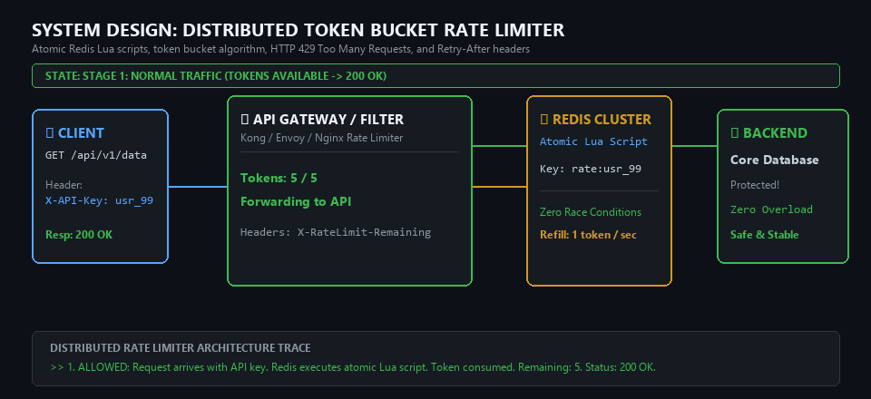

# 25 - System Design: Distributed Rate Limiter (Stripe / Cloudflare)

> **Executive Summary:** In distributed architectures handling hundreds of thousands of requests per second, rate limiting is the primary defense line against brute-force attacks, web scraping, and denial-of-service traffic spikes. Scaling a rate limiter across a multi-server API gateway fleet introduces two critical distributed challenges: **Race Conditions** (concurrent requests bypassing limits via read-then-write cycles) and **Synchronization Latency** (every API request requiring a cross-network database call). Production distributed rate limiters solve this by executing **Atomic Redis Lua Scripts** with lazy token-refill formulas and local in-memory token batching.

---

> 🏢 **Real-world case studies**: how **Google** & **Netflix** approach this, in [REAL_WORLD_EXAMPLES.md](./REAL_WORLD_EXAMPLES.md).

## ⏱️ Prerequisites: What You Need to Know First

To get the most out of this module, make sure you understand:
- [01 - Client-Server Networking](../01-client-server-networking/README.md): HTTP response codes (`429 Too Many Requests`) and custom headers.
- [04 - API Gateways & Proxies](../04-api-gateways-and-proxies/README.md): Edge reverse proxies, TLS termination, and middleware filters.
- [05 - Rate Limiting Algorithms](../05-rate-limiting/README.md): Mathematical principles of Token Bucket, Leaky Bucket, and Sliding Windows.
- [22 - System Design: Distributed In-Memory Cache](../22-system-design-in-memory-cache/README.md): Redis cluster sharding and atomic Lua scripting.

---

## 🧒 The 30-Second Version (ELI5)

Imagine an amusement park with a popular roller coaster:
- The roller coaster can only hold 5 people every minute (**Rate Limit: 5/min**).
- At the entrance gate, the attendant has a bucket holding 5 brass tokens.
- When you want to ride, you drop 1 brass token into the turnstile slot and walk through (**200 OK**).
- If 10 people rush the gate at once, the first 5 drop tokens and enter. The 6th person sees an empty bucket and a flashing red sign: *"Bucket empty! Please wait 30 seconds for the next token to drop!"* (**429 Too Many Requests**).
- Every 12 seconds, a mechanical chute drops a new brass token into the bucket (**Refill Rate**), letting the next person through.

---

## 🍕 Everyday Analogy

| Rate Limiter Component | Rollercoaster Turnstile Analogy | Technical Reality in Distributed Systems |
| :--- | :--- | :--- |
| **Token Bucket** | Brass bucket holding up to 5 ride tokens | Redis hash entry: `{tokens: 5, last_refill: timestamp}` |
| **Turnstile Attendant** | Security guard checking tokens at the gate | API Gateway middleware (Kong, Envoy, Nginx) |
| **Token Refill** | Automated coin dispenser dropping 1 token every 12s | Lazy $O(1)$ timestamp delta formula on request arrival |
| **Allowed Request** | Dropping a token and walking through the gate | `HTTP 200 OK` forwarded to backend service |
| **Throttled Request** | Bouncer stopping guest: *"Bucket empty, wait 12s!"* | `HTTP 429 Too Many Requests` + `Retry-After: 12` |
| **Race Condition** | Two guests grabbing the last brass token at the same millisecond | Two gateway threads reading `tokens=1` concurrently |
| **Atomic Lua Script** | A steel trapdoor dispensing exactly 1 token to 1 hand | Single-threaded atomic script inside Redis |

---

## 🧩 The Problem It Solves

### The Vulnerability of Unprotected APIs
Without a distributed rate limiter:
1. **Denial of Service (DoS)**: A runaway customer script or malicious attacker fires 100,000 requests/second against `/api/checkout`, exhausting database connection pools and taking down the platform for all paying customers.
2. **Credential Stuffing**: Hackers test millions of stolen password combinations against `/api/login` without throttling.
3. **Third-Party API Cost Explosion**: Uncontrolled traffic spikes trigger massive billing surges on downstream paid services (like Stripe or Twilio).

### The Challenge of Distributed Multi-Server Gateways
If your API gateway runs on 20 independent server instances:
- **Local In-Memory Counter (Flawed)**: If each gateway keeps its own local counter in RAM, a user sending 100 requests load-balanced across 20 servers can legally execute $20 \times \text{limit}$ requests, completely defeating the rate limit!
- **Central Database Counter (Race Condition Flaw)**:
  - **Step 1**: Gateway A and Gateway B both read `count = 9` simultaneously (Limit = 10).
- **Step 2**: Both gateways see `9 < 10`, increment the counter to `10`, and both admit their requests.
- **Result**: 11 requests are admitted instead of 10. Under 50 gateways, this race condition can double or triple the allowed traffic!
- **The Solution**: An atomic, centralized in-memory datastore (Redis) executing token refills and decrement operations in a **single atomic step**.

---

## 🖼️ Picture It: Architecture & Flow

### High-Resolution Distributed Rate Limiter Animation
Below is an animated trace of incoming client requests, atomic Redis Lua evaluation, token consumption, HTTP 429 throttling, and timer refills:



---

### Global API Gateway & Redis Sharding Flowchart

```mermaid
flowchart TD
    subgraph Clients["Clients Tier"]
        C1["👤 Client 1 (Mobile)"]
        C2["🤖 Client 2 (Web Bot)"]
    end

    subgraph GatewayTier["Distributed API Gateway Fleet"]
        LB["⚖️ L7 Load Balancer"]
        GW1["⚡ API Gateway 1"]
        GW2["⚡ API Gateway 2"]
        C1 --> LB
        C2 --> LB
        LB --> GW1
        LB --> GW2
    end

    subgraph RedisTier["Centralized Sharded Rate Limiting Tier"]
        Redis[("⚡ Redis Cluster (Master / Replica)<br/>Key: rate_limit:user_id<br/>Script: Atomic Token Bucket Lua")]
        GW1 -->|1. EVALSHA token_bucket.lua| Redis
        GW2 -->|1. EVALSHA token_bucket.lua| Redis
    end

    subgraph BackendTier["Protected Core Microservices"]
        Service["🏢 Core Application Database & APIs"]
        Redis -->|"Under Limit: Return (true, remaining)"| GW1
        GW1 -->|"2. HTTP 200 OK -> Forward"| Service
        Redis -.->|"Over Limit: Return (false, retry_after)"| GW2
        GW2 -.->|2. Return HTTP 429 Too Many Requests| C2
    end

    style Clients fill:#161b22,stroke:#58a6ff,stroke-width:2px;
    style GatewayTier fill:#161b22,stroke:#58a6ff,stroke-width:2px;
    style RedisTier fill:#161b22,stroke:#d29922,stroke-width:2px;
    style BackendTier fill:#161b22,stroke:#3fb950,stroke-width:2px;
```



---

## 🔢 Walk-Through with Real Numbers

Let's estimate traffic, memory footprint, and network latency for a global rate limiting tier:

### 1. Traffic & Memory Sizing
- **Peak Ingress Traffic**: $100,000\text{ requests / second}$.
- **Active User Base**: $10,000,000\text{ users / day}$.
- **Redis Key Structure**:
  - Key: `rate:<user_id>` $\approx 32\text{ bytes}$.
  - Value: `{tokens: float, last_refill: float}` $\approx 16\text{ bytes}$.
  - Redis internal hash overhead per key: $\approx 50\text{ bytes}$.
  - Total per key: $\approx 100\text{ bytes}$.
- **Total Memory Footprint**:
  $$\text{Memory} = 10,000,000 \times 100\text{ bytes} \approx \mathbf{1.0\text{ Gigabyte of RAM}}$$
A single small 4 GB Redis instance holds the rate limits for 10 million active users!

### 2. Network Latency & Synchronization Cost
If every request from the 20 API Gateways makes a synchronous network round-trip to Redis:
- Redis operations: $100,000\text{ ops / second}$.
- Network transit time inside datacenter: $0.5\text{ ms}$.
- While $0.5\text{ ms}$ is fast, $100\text{k req/s}$ places heavy load on Redis CPU cores.

**The Local Token Batching Optimization**:
- Each API Gateway locally reserves a batch of tokens (e.g. 10 tokens) from Redis.
- The Gateway serves the next 10 requests from its local RAM ($0.001\text{ ms}$) without contacting Redis!
- Only when local tokens are depleted does it contact Redis for another batch.
- **Result**: Reduces Redis network operations by **$90\%$ (from 100k down to 10k ops/sec)** with zero loss of protection.

---

## ⚙️ How It Works Under the Hood

### 1. The Token Bucket Lazy Refill Algorithm (Zero Background Timers!)

A naive implementation runs background timer threads incrementing counters every second. At 10 million users, 10 million timer ticks per second would melt the CPU.
**The Production Solution: Lazy Refill on Request Arrival**:
When a request arrives at timestamp $T_{\text{now}}$:
1. Fetch previous state: $(T_{\text{tokens}}, T_{\text{last}})$.
2. Calculate time elapsed: $\Delta t = T_{\text{now}} - T_{\text{last}}$.
3. Add refilled tokens:
   $$\text{New Tokens} = \min\big(\text{Capacity}, T_{\text{tokens}} + (\Delta t \times \text{Refill Rate})\big)$$
4. If $\text{New Tokens} \ge 1$: deduct 1, update $T_{\text{last}} = T_{\text{now}}$, and allow the request!
**Complexity**: Pure $O(1)$ arithmetic. Zero background timer threads!

---

### 2. Eliminating Race Conditions with Atomic Redis Lua Scripts

Because Redis executes Lua scripts as a single atomic transaction without interruption, the read-modify-write cycle is completely immune to race conditions:

*(The complete production Lua script is separated into [`rate_limiter.lua`](./rate_limiter.lua), and its atomic execution is simulated in [`demo.py`](./demo.py).)*

---

### 3. Standard HTTP Response Headers (RFC 6585)

When rate limiting is enforced, the API Gateway communicates status transparently via HTTP response headers:

| Header | Meaning | Example Value |
| :--- | :--- | :--- |
| `X-RateLimit-Limit` | Maximum number of allowed requests in current window | `100` |
| `X-RateLimit-Remaining`| Number of remaining tokens available in current window | `42` |
| `X-RateLimit-Reset` | Unix timestamp when the bucket will be completely refilled | `1795372800` |
| `Retry-After` | **Returned on 429**: Number of seconds to sleep before retrying | `3` |

---

## ⚖️ Trade-Offs & Decision Matrix

| Algorithm | Bursts Allowed? | Memory Usage | Implementation Complexity | Primary Drawback |
| :--- | :--- | :--- | :--- | :--- |
| **Token Bucket** | **Yes (up to capacity)** | $O(1)$ per client (2 numbers) | Low (with lazy refill) | Burst traffic can temporarily spike backends |
| **Leaky Bucket** | ❌ No (smooth constant rate) | $O(1)$ queue size | Medium | Drops requests if queue fills up |
| **Fixed Window** | Yes (2x burst at boundary) | Lowest (1 integer counter) | Lowest | Boundary spike allows 2x limit at window turn |
| **Sliding Window Log** | ❌ No | High ($O(M)$ timestamps) | High | High memory overhead storing all request timestamps |
| **Sliding Window Counter**| Smooth estimation | Low (2 window counters) | Medium | Approximated count (assume uniform traffic) |

---

## 🚫 Common Mistakes & Production Pitfalls

1. **The Fixed Window Boundary Burst Bug**:
   - *Pitfall*: Using a simple fixed window counter: `INCR rate:user:12:00`.
   - *Result*: A user sends 100 requests at 11:59:59 PM, and another 100 requests at 12:00:01 AM. Both windows show 100 requests (legal), but the system processed **200 requests in 2 seconds**! Always use Token Bucket or Sliding Window Counters to prevent boundary doubling.

2. **Failing Open vs. Failing Closed During Redis Outages**:
   - *Pitfall*: If the Redis rate limiter cluster crashes, every API call throws a 500 error (**Fail Closed**), causing a total platform outage.
   - *Production Standard*: **Fail Open**. If Redis is unreachable, log a critical alert, bypass rate limiting, and let traffic flow through to the backend while triggering emergency alerting. A degraded rate limiter is far better than a total platform blackout.

3. **Using IP Address Exclusively for Rate Limiting**:
   - *Pitfall*: Rate limiting solely by client IP address (`req.ip`).
   - *Result*: Large corporate offices, university campuses, or cellular carriers route thousands of distinct users through a single public NAT gateway IP. Limiting by IP blocks an entire university when one student exceeds the limit! Use **API Keys or Authenticated User IDs** whenever possible.

---

## 💻 Try It Yourself: Python Simulation

The companion simulation script [`demo.py`](./demo.py) implements:
1. An $O(1)$ Token Bucket algorithm with lazy mathematical refills.
2. A simulated Redis Atomic Lua Script execution eliminating race conditions across multiple gateway workers.
3. Rapid burst testing: verifying that exactly 5 burst requests pass and subsequent requests return `HTTP 429 Too Many Requests`.
4. Automated token recovery verification after a 1.0-second refill sleep.

Run it locally in your terminal:
```bash
python demo.py
```

---

## 🌍 Where You'll See It in Production

- **Stripe API**: Famous for their robust rate limiting architecture. Enforces multiple tiered limits: authentication limits (against brute-force attacks), read limits, and write limits using Redis clusters with atomic scripts.
- **Cloudflare Rate Limiting**: Operates at edge CDN servers globally, utilizing sliding-window counters to block malicious DDoS floods within milliseconds of reaching edge points of presence.
- **GitHub REST API**: Enforces 5,000 requests per hour for authenticated users and 60 requests per hour for unauthenticated users, communicating status via `x-ratelimit-remaining` and `x-ratelimit-reset` headers.

---

## 🎯 Top Interview Questions & Deep Answers

### Q1: "How do you prevent race conditions in a distributed rate limiter with 50 API Gateway servers?"
**Interviewer Goal**: Testing candidate's knowledge of atomic primitives and distributed concurrency.

**Model Answer**:
"In a distributed gateway fleet, multiple servers concurrently receive requests for the same user. If servers use a naive `GET count -> count++ -> SET count` pattern:
- Server 1 and Server 2 both read `count = 9` (where limit is 10).
- Both see that $9 < 10$.
- Both increment to 10 and write back.
- Result: 11 requests are admitted, violating the rate limit contract.

**The Solution is Redis Lua Scripting**:
1. We encapsulate the entire check, refill, and decrement logic inside a Lua script.
2. Redis executes Lua scripts with single-threaded atomicity: while the script executes, no other command or script can run on that shard.
3. The check and token decrement execute as an indivisible atomic operation in memory ($<100\ \mu\text{s}$). Zero race conditions are mathematically possible."

---

### Q2: "What is the difference between Token Bucket and Leaky Bucket, and when would you choose one over the other?"
**Interviewer Goal**: Evaluating algorithm trade-offs and traffic shaping understanding.

**Model Answer**:
"While both regulate throughput, they produce completely different traffic flow characteristics:
1. **Token Bucket**:
   - Tokens accumulate up to a maximum bucket capacity. Requests consume tokens.
   - **Allows bursts of traffic**: If the bucket is full (capacity 20), an application can legally fire 20 requests in 1 millisecond.
   - *Best for*: General-purpose web APIs (Stripe, GitHub), where user traffic naturally occurs in small bursts (e.g. loading a dashboard).
2. **Leaky Bucket**:
   - Requests enter a FIFO queue (the bucket) and leak out to the backend at a **strictly constant, smooth rate**.
   - If the queue overflows, incoming requests are dropped.
   - *Best for*: Traffic shaping in data ingestion pipelines, where downstream systems (like a database or third-party webhooks) require a smooth, constant flow without any sudden spikes."

---

### Q3: "How do you handle rate limiting across multiple geographic data centers (e.g. US-East and EU-West)?"
**Interviewer Goal**: Testing global distributed state synchronization trade-offs.

**Model Answer**:
"Synchronizing rate limits across global data centers presents a classic PACELC trade-off:
- If all global regions query a single centralized Redis cluster in US-East, a European user suffers an unacceptable **$80\text{ ms}$ trans-Atlantic latency penalty** on every API call.

**Production Solutions**:
1. **Geo-Partitioned / Local Rate Limiting**:
   - Allocate a portion of the user's quota to each region (e.g. 50% to US, 50% to EU). Local gateways enforce their local quota using local Redis clusters with sub-millisecond latency.
2. **Asynchronous Cross-Region Sync**:
   - Gateways enforce limits locally in RAM and periodically publish usage deltas asynchronously across a WAN message bus (Kafka/CRDTs). While small temporary overages ($<5\%$) can occur during high cross-region traffic bursts, latency remains under $1\text{ ms}$.
3. **Session Affinity / Geo-DNS Routing**:
   - Route all requests from a given API key or user to the same geographic region via DNS or BGP Anycast."

---

### Q4: "Where should the Rate Limiter be placed in the architecture: Client, API Gateway, or Middleware?"
**Interviewer Goal**: Assessing architectural layering and defense-in-depth principles.

**Model Answer**:
"The optimal placement is at the **API Gateway / Edge Reverse Proxy Layer**:
1. **Client-Side Rate Limiting**:
   - Unreliable for security. Malicious attackers and compromised devices bypass client logic trivially. (Useful only as a polite SDK throttling mechanism to avoid unnecessary network calls).
2. **Application Middleware (Inside Core Microservices)**:
   - Too late in the stack. By the time a request hits application containers, network bandwidth, TLS handshakes, and gateway connection pools have already been consumed.
3. **API Gateway (The Standard)**:
   - Sits in front of all microservices (Envoy, Kong, Nginx).
   - Rejects throttled traffic at the perimeter before it touches internal networks, protecting backend databases, thread pools, and business logic from resource exhaustion."

---

### Q5: "What is the Sliding Window Counter algorithm, and how does it balance accuracy with low memory?"
**Interviewer Goal**: Assessing understanding of hybrid rate limiting algorithms.

**Model Answer**:
"The **Sliding Window Counter** is a memory-efficient hybrid of Fixed Window and Sliding Window Log:
- Instead of storing every single request timestamp in memory (which uses megabytes of RAM under high traffic), it only stores two numbers: the request count of the **previous window** and the **current window**.
- When a request arrives at percentage $P$ into the current window, it calculates the approximated rolling count:
  $$\text{Count} = (\text{Previous Window Count} \times (1 - P)) + \text{Current Window Count}$$
- If $\text{Count} < \text{Limit}$, it increments the current window counter and allows the request.
- **Accuracy**: Assumes traffic in the previous window was distributed uniformly (typically $<1\%$ error rate in real-world traffic).
- **Memory**: Consumes only two integers per client ($\approx 16\text{ bytes}$), providing smooth sliding-window protection with near-zero memory footprint."

---

## ✅ Check Yourself: Flash Quiz

<details>
<summary><b>1. Why does the Token Bucket algorithm require zero background timer threads in production?</b></summary>
<br>
Because tokens are refilled <b>lazily on-demand</b> when a request arrives. The server simply computes the elapsed time delta since the last request ($\Delta t = \text{now} - \text{last\_refill}$) and multiplies by the refill rate in $O(1)$ constant time, eliminating the CPU overhead of background timers.
</details>

<details>
<summary><b>2. What HTTP status code should an API Gateway return when a client exceeds their rate limit, and what header tells them how long to wait?</b></summary>
<br>
Return <b>HTTP 429 Too Many Requests</b> along with the <b><code>Retry-After</code></b> header indicating the number of seconds the client must sleep before retrying.
</details>

<details>
<summary><b>3. Why is it dangerous to rely on client IP addresses as the sole rate limiting key?</b></summary>
<br>
Because thousands of distinct mobile users or corporate employees frequently share the <b>exact same public IP address</b> via NAT (Network Address Translation) or corporate proxies. Rate limiting by IP alone can inadvertently block an entire company or university when a single user misbehaves. Always rate limit by API Key, Session Token, or User ID when available.
</details>

---

## 📚 Go Deeper: Recommended Reading

- **System Design Interview – An Insider's Guide (Volume 1)** by Alex Xu — *Chapter 4: Design a Rate Limiter*.
- **The Stripe Engineering Blog**: *Scaling your API with Rate Limiters (Paul Tarjan)*.
- **Cloudflare Architecture**: *How Cloudflare handles Rate Limiting at the Edge*.
- **RFC 6585**: *Additional HTTP Status Codes (Section 4: 429 Too Many Requests)*.

---

## 🔗 Related Modules

- [01 - Client-Server Networking](../01-client-server-networking/README.md): HTTP status codes and headers.
- [04 - API Gateways & Proxies](../04-api-gateways-and-proxies/README.md): Edge filtering and reverse proxy architecture.
- [05 - Rate Limiting](../05-rate-limiting/README.md): Mathematical principles of rate limiting algorithms.
- [22 - System Design: Distributed In-Memory Cache](../22-system-design-in-memory-cache/README.md): High-performance Redis clusters.
