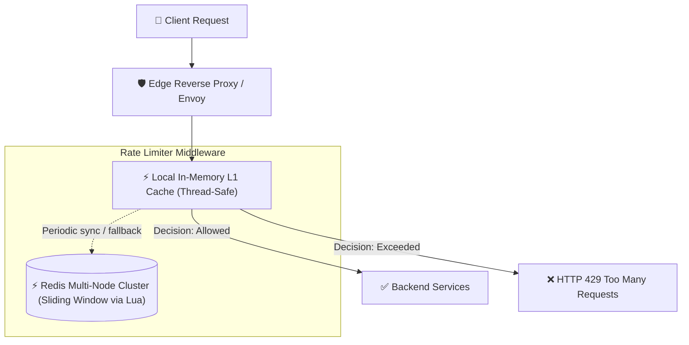

# 25 - Case Study: Distributed Multi-Region Rate Limiter

> **Real-World Analogy:**  
> Imagine an international amusement park with entrances in Paris, Tokyo, and Orlando. A VIP ticket allows 10 roller-coaster rides per day total across any park. To prevent a visitor from having friends use photocopied tickets simultaneously in Orlando and Paris, the park scanners sync counts via an ultra-fast global messaging channel.

---

## 🎯 What & Why
Design of a production-grade distributed rate limiting system capable of handling millions of requests per second with sub-millisecond overhead using Redis and Sliding Window Counter algorithms.

---

## 📊 Visual Architecture Diagram


---

## ⚙️ How It Works Under The Hood
### The Sliding Window Log in Redis

Using a sliding window log (see [module 05](../05-rate-limiting/)) prevents the window-boundary traffic spikes of fixed windows:
- Store timestamps of requests in a Redis Sorted Set (`ZSET`).
- When a request arrives from `user_ip`:
  1. Remove elements older than `(now - window_size)` using `ZREMRANGEBYSCORE`.
  2. Count elements in set using `ZCARD`.
  3. If count < limit: add `now` using `ZADD` and allow request. (Use a unique member such as `now + request_id`: sorted-set members must be unique, so two requests with the same timestamp would otherwise count as one.)
  4. Else: reject request.

---

### Atomic Execution via Redis Lua Scripts

Because this check involves multiple steps, concurrent requests could cause race conditions. Executing the logic inside an **atomic Redis Lua script** guarantees that no two requests can interleave between checking the count and incrementing it.

---

## 💻 Concrete Code Implementation
```python
# Sliding window LOG rate limiter (single process; the Redis version is described above)
import time
from collections import deque

class SlidingWindowRateLimiter:
    def __init__(self, limit: int, window_seconds: float):
        self.limit = limit
        self.window_seconds = window_seconds
        self.user_requests = {}

    def is_allowed(self, user_id: str) -> bool:
        now = time.time()
        if user_id not in self.user_requests:
            self.user_requests[user_id] = deque()

        timestamps = self.user_requests[user_id]

        # 1. Slide window: drop timestamps older than window threshold
        while timestamps and timestamps[0] <= now - self.window_seconds:
            timestamps.popleft()

        # 2. Check current capacity
        if len(timestamps) < self.limit:
            timestamps.append(now)
            return True
        return False

if __name__ == "__main__":
    limiter = SlidingWindowRateLimiter(limit=3, window_seconds=1.0)
    user = "client_ip_192.168.1.1"

    print("Simulating 5 rapid requests with limit 3 per second:")
    for i in range(1, 6):
        allowed = limiter.is_allowed(user)
        print(f"Request {i}: {'ALLOWED' if allowed else 'BLOCKED (429)'}")

    print("Sleeping 1.1 seconds...")
    time.sleep(1.1)
    print("New request:", "ALLOWED" if limiter.is_allowed(user) else "BLOCKED")

```

---

## ⚖️ Trade-offs

| Decision | Trade-off |
| :--- | :--- |
| **Central Redis counter** | Exact limits across all servers; adds ~1 ms per request, and Redis becomes critical infrastructure |
| **Local counters + periodic sync** | No extra hop; limits are approximate (a client can briefly exceed them by spreading requests across servers) |
| **Sliding log (sorted set)** | Exact; memory grows with the limit (one entry per request) |
| **Sliding window counter / token bucket** | A few numbers per client; slightly approximate or allows bursts |
| **Multi-region: one global counter** | Exact worldwide; every request pays cross-region latency |
| **Multi-region: per-region limits** | Fast; the effective global limit is the sum across regions unless you split the budget |
| **Fail open vs fail closed when Redis is down** | Open keeps the product working but unprotected; closed is safe but turns a Redis outage into a full outage |
